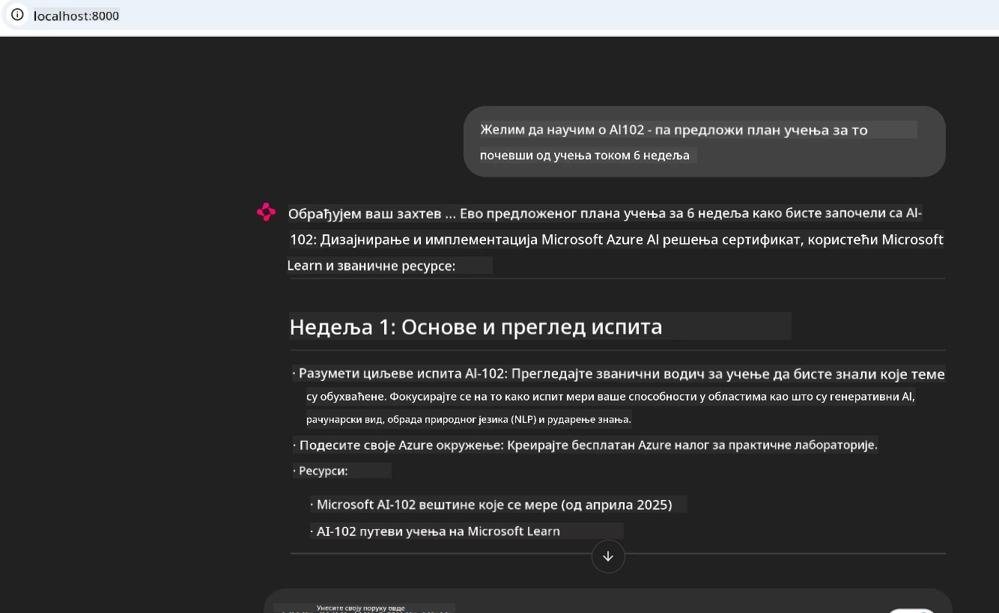
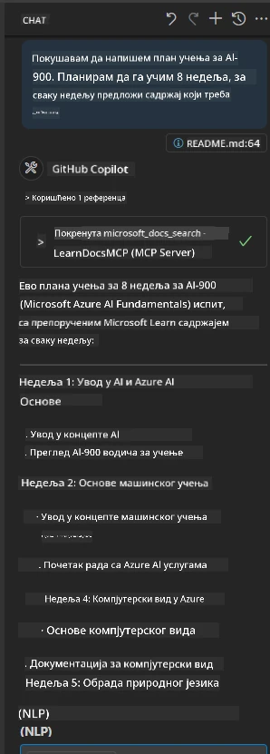

# Студија случаја: Повезивање на Microsoft Learn Docs MCP сервер са клијента

Да ли сте се икада нашли како пребацујете између сајтова са документацијом, Stack Overflow-а и бескрајних картица претраживача, док покушавате да решите проблем у свом коду? Можда имате други монитор само за документацију, или стално мењате прозоре између IDE-а и претраживача. Зар не би било боље да документацију доведете директно у свој радни ток — интегрисану у ваше апликације, IDE или чак у ваше сопствене алате? У овој студији случаја истражићемо како управо то учинити повезујући се директно на Microsoft Learn Docs MCP сервер из ваше клијентске апликације.

## Преглед

Модеран развој је више од писања кода — ради се о проналажењу правих информација у правом тренутку. Документација је свуда, али ретко тамо где вам највише треба: у вашим алатима и радним токовима. Интегрисаним преузимањем документације директно у ваше апликације можете уштедети време, смањити пребацивање контекста и повећати продуктивност. У овом делу показаћемо вам како да повежете клијента на Microsoft Learn Docs MCP сервер, тако да приступите документацији у реалном времену, осетљивој на контекст, а да никада не напуштате своју апликацију.

Проћи ћемо кроз процес успостављања везе, слања захтева и ефикасног руковања стриминг одговорима. Овај приступ не само да поједностављује ваш радни ток већ и отвара могућности за изградњу паметнијих, кориснијих алата за програмере.

## Циљеви учења

Зашто ово радимо? Јер најбоља корисничка искуства за програмере су она која уклањају препреке. Замислите свет у којем ваш едитор кода, ћаскаћ или веб апликација може одмах одговорити на ваша питања о документацији користећи најновији садржај са Microsoft Learn-а. На крају овог поглавља знаћете како да:

- Разумете основе комуникације сервера и клијента MCP за документацију
- Имплементирате конзолну или веб апликацију која се повезује на Microsoft Learn Docs MCP сервер
- Користите стриминг HTTP клијенте за преузимање документације у реалном времену
- Логујете и тумачите одговоре о документацији у својој апликацији

Видећете како вам ове вештине могу помоћи да направите алате који нису само реактивни, већ и заиста интерактивни и осетљиви на контекст.

## Сценарио 1 - Преузимање документације у реалном времену са MCP

У овом сценарију показаћемо вам како да повежете клијента на Microsoft Learn Docs MCP сервер, да бисте могли да приступите документацији у реалном времену и осетљивој на контекст без напуштања апликације.

Хајде да ово применимо. Ваш задатак је да напишете апликацију која се повезује на Microsoft Learn Docs MCP сервер, позива алат `microsoft_docs_search` и бележи стриминг одговор на конзоли.

### Зашто овај приступ?
Јер је то основа за изградњу напреднијих интеграција — без обзира да ли желите да покренете ћаскаћ, проширење за IDE или веб контролни панел.

Код и упутства за овај сценарио пронаћи ћете у фасцикли [`solution`](./solution/README.md) у оквиру ове студије случаја. Кораци ће вас водити кроз подешавање везе:
- Користите званични MCP SDK и стриминг HTTP клијент за везу
- Позовите алат `microsoft_docs_search` са упитним параметром за преузимање документације
- Имплементирајте исправно логовање и руковање грешкама
- Направите интерактивни конзолни интерфејс који ће омогућити корисницима да унесу више упита за претрагу

Овај сценарио показује како да:
- Повежете се са Docs MCP сервером
- Пошаљете упит
- Анализирате и испишете резултате

Ево како покретање решења може изгледати:

```
Prompt> What is Azure Key Vault?
Answer> Azure Key Vault is a cloud service for securely storing and accessing secrets. ...
```

Испод је минималан пример решења. Комплетан код и детаљи доступни су у фасцикли решења.

<details>
<summary>Python</summary>

```python
import asyncio
from mcp.client.streamable_http import streamablehttp_client
from mcp import ClientSession

async def main():
    async with streamablehttp_client("https://learn.microsoft.com/api/mcp") as (read_stream, write_stream, _):
        async with ClientSession(read_stream, write_stream) as session:
            await session.initialize()
            result = await session.call_tool("microsoft_docs_search", {"query": "Azure Functions best practices"})
            print(result.content)

if __name__ == "__main__":
    asyncio.run(main())
```

- За потпуну имплементацију и логовање, погледајте [`scenario1.py`](../../../../09-CaseStudy/docs-mcp/solution/python/scenario1.py).
- За упутства о инсталацији и коришћењу, погледајте фајл [`README.md`](./solution/python/README.md) у истој фасцикли.
</details>


## Сценарио 2 - Веб апликација за интерактивно креирање студијског плана са MCP

У овом сценарију научићете како да интегришете Docs MCP у веб пројекат. Циљ је омогућити корисницима да претражују Microsoft Learn документацију директно са веб интерфејса, чинећи документацију тренутно доступном у вашој апликацији или сајту.

Видећете како да:
- Подесите веб апликацију
- Повежете се са Docs MCP сервером
- Обрадите унос корисника и прикажете резултате

Ево како покретање решења може изгледати:

```
User> I want to learn about AI102 - so suggest the roadmap to get it started from learn for 6 weeks

Assistant> Here’s a detailed 6-week roadmap to start your preparation for the AI-102: Designing and Implementing a Microsoft Azure AI Solution certification, using official Microsoft resources and focusing on exam skills areas:

---
## Week 1: Introduction & Fundamentals
- **Understand the Exam**: Review the [AI-102 exam skills outline](https://learn.microsoft.com/en-us/credentials/certifications/exams/ai-102/).
- **Set up Azure**: Sign up for a free Azure account if you don't have one.
- **Learning Path**: [Introduction to Azure AI services](https://learn.microsoft.com/en-us/training/modules/intro-to-azure-ai/)
- **Focus**: Get familiar with Azure portal, AI capabilities, and necessary tools.

....more weeks of the roadmap...

Let me know if you want module-specific recommendations or need more customized weekly tasks!
```

Испод је минималан пример решења. Комплетан код и детаљи доступни су у фасцикли решења.



<details>
<summary>Python (Chainlit)</summary>

Chainlit је оквир за изградњу веб апликација за разговорну вештачку интелигенцију. Олакшава креирање интерактивних чатботова и асистената који могу позивати MCP алате и у реалном времену приказати резултате. Идеалан је за брзо прототиписање и корисничке интерфејсе.

```python
import chainlit as cl
import requests

MCP_URL = "https://learn.microsoft.com/api/mcp"

@cl.on_message
def handle_message(message):
    query = {"question": message}
    response = requests.post(MCP_URL, json=query)
    if response.ok:
        result = response.json()
        cl.Message(content=result.get("answer", "No answer found.")).send()
    else:
        cl.Message(content="Error: " + response.text).send()
```

- За потпуну имплементацију погледајте [`scenario2.py`](../../../../09-CaseStudy/docs-mcp/solution/python/scenario2.py).
- За упутства о подешавању и покретању, погледајте [`README.md`](./solution/python/README.md).
</details>


## Сценарио 3: Документација у едитору са MCP сервером у VS Code

Ако желите да Microsoft Learn Docs добијете директно унутар вашег VS Code-а (уместо да пребацујете картице претраживача), можете користити MCP сервер у вашем едитору. Ово вам омогућава да:
- Претражујете и читате документацију у VS Code-у без напуштања развојне средине.
- Реферишете документацију и убацујете линкове директно у README или курсне фајлове.
- Комбинујете GitHub Copilot и MCP за беспрекорни, AI-покретани радни ток документације.

**Видећете како да:**
- Додате валидни `.vscode/mcp.json` фајл у корен свог радног простора (погледајте пример испод).
- Отворите MCP панел или користите палету команди у VS Code-у за претрагу и уметање документације.
- Реферишете документацију директно у вашим markdown фајловима док радите.
- Комбинујете овај радни ток са GitHub Copilot-ом ради још веће продуктивности.

Ево примера како да подесите MCP сервер у VS Code-у:

```json
{
  "servers": {
    "LearnDocsMCP": {
      "url": "https://learn.microsoft.com/api/mcp"
    }
  }
}
```

</details>

> За детаљан преглед са снимцима екрана и упутствима корак по корак, погледајте [`README.md`](./solution/scenario3/README.md).



Овај приступ је идеалан за све који праве техничке курсеве, пишу документацију или развијају код са честим потребама за референцама.

## Кључни закључци

Интеграција документације директно у ваше алате није само погодност — то је променa игре за продуктивност. Повезивањем на Microsoft Learn Docs MCP сервер из свог клијента, можете:

- Уклонити пребацивање контекста између вашег кода и документације
- Преузети ажурну, осетљиву на контекст документацију у реалном времену
- Направити паметније, интерактивније алате за програмере

Ове вештине ће вам помоћи да креирате решења која нису само ефикасна, већ и пријатна за коришћење.

## Додатни ресурси

Да бисте продубили разумевање, истражите ове званичне ресурсе:

- [Microsoft Learn Docs MCP Server (GitHub)](https://github.com/MicrosoftDocs/mcp)
- [Почните са Azure MCP сервером (mcp-python)](https://learn.microsoft.com/en-us/azure/developer/azure-mcp-server/get-started#create-the-python-app)
- [Шта је Azure MCP сервер?](https://learn.microsoft.com/en-us/azure/developer/azure-mcp-server/)
- [Увод у Model Context Protocol (MCP)](https://modelcontextprotocol.io/introduction)
- [Додавање плагина са MCP сервера (Python)](https://learn.microsoft.com/en-us/semantic-kernel/concepts/plugins/adding-mcp-plugins)

## Шта следи

- Назад на: [Преглед студија случаја](../README.md)
- Наставите на: [Модул 10: Унапређење AI радних токова са Microsoft Foundry Toolkit](../../10-StreamliningAIWorkflowsBuildingAnMCPServerWithAIToolkit/README.md)

---

<!-- CO-OP TRANSLATOR DISCLAIMER START -->
**Изјава о одрицању одговорности**:
Овај документ је преведен коришћењем услуге за аутоматски превод [Co-op Translator](https://github.com/Azure/co-op-translator). Иако тежимо тачности, имајте у виду да аутоматски преводи могу садржати грешке или нетачности. Оригинални документ на његовом изворном језику треба сматрати ауторитативним извором. За критичне информације препоручује се професионални људски превод. Нисмо одговорни за било каква неспоразума или погрешна тумачења која произилазе из коришћења овог превода.
<!-- CO-OP TRANSLATOR DISCLAIMER END -->