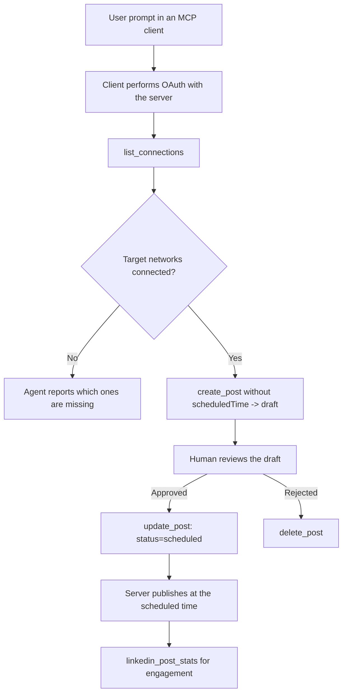

# Студија случаја: Објављивање на друштвеним мрежама из агента са удаљеним MCP сервером

> **Одрицање од одговорности:** Неколико услуга и пројеката отвореног кода може објављивати на друштвеним мрежама, а тим такође може директно интегрисати свако API сваке мреже. Сценарио испод је дат као један пример како се може дизајнирати и користити **удаљени MCP сервер способан за писање**. Publora је комерцијална услуга са бесплатним слојем; обрасци описани овде важе за било који MCP сервер који извршава неповратне радње у име корисника.

## Преглед

Агенти су добри у креирању садржаја али лоши у његовом достављању. Модел може написати најаву убрзо, а затим рад престаје: објављивање значи API по мрежи, OAuth апликацију по мрежи и скуп различитих медијских правила за сваку. Већина тимова решава овај проблем ручним копирањем текста у прегледач.

Ова студија случаја разматра како се тај последњи корак затвара са једним удаљеним MCP сервером, и — корисније за свакога ко гради један — о одлукама у дизајну које мора добити тај сервер способан за писање. Читање података је опроштено. Објављивање није: погрешан позив алата је видљив публици и не може се опозвати.

## Сценарио

Мали тим за развоја односа са корисницима креира постове унутар агента (Claude, VS Code, Cursor — клијент није битан). Желe да агент:

- види које су друштвене мреже прикључене на тим,
- креира нацрт поста и задржи га као нацрт за људско одобрење,
- придружи слику,
- заказује објављивање на неколико мрежа у одабрано време,
- и касније извештава о учинку.

Кључно, желе да агент не може случајно да објави док још увек експериментишу.

## Коришћени алати

- [Publora MCP Server](https://github.com/publora/mcp-server) — удаљени MCP сервер (`streamable-http`) који пружа алате за објављивање, заказивање, медије и аналитике LinkedIn-а. Регистрован у званичном MCP регистру као `com.publora/mcp-server`.

## Поступак корак по корак

1. **Повежите сервер.** Клијенти који користе OAuth завршавају ауторизациони ток са PKCE преко сопственог екрана сагласности сервера; клијенти који не користе OAuth, као што су headless CLI алати, користе Publora API кључ у заглављу. Обе варијанте су подржане и избор зависи од клијента, не од сервера.
2. **Листинг конекција.** Агент позива `list_connections` и добија све прикључене налоге са њиховим идентификаторима.
3. **Креира нацрт.** Агент позива `create_post` *без* заказаног времена. Пост се чува као нацрт — ништа није објављено.
4. **Придружи медије.** Јавне URL адресе слика се прослеђују у истом позиву; сервер их преузима и проверава.
5. **Закажи.** Након људског одобрења, `update_post` поставља статус на заказан са ISO 8601 временом.
6. **Измери.** За LinkedIn, `linkedin_post_stats` враћа учинак по објави поста.

## Пример упита

```text
Which social accounts do I have connected?
Draft a post announcing our new changelog page, attach the screenshot at
https://example.com/changelog.png, and keep it as a draft — do not publish it.
Once I approve, schedule it to LinkedIn and Bluesky for tomorrow at 09:00 UTC.
```

## Mermaid дијаграм тока



## Техничка имплементација

Поучне ствари испод су преносиви део ове студије случаја.

### Отворено откривање, аутентификовано извршење

`tools/list` се сервира без података за пријаву; сваки `tools/call` захтева токен
и у супротном враћа `401` са заглављем `WWW-Authenticate` које указује на
метаподатке заштићеног ресурса. Старије серверске тачке такође одговарају
неаутентификованим `initialize` за клијенте на протоколима пре
`2026-07-28`; актуелни клијенти не користе тај руковалац.

Ова специфична подела сервера омогућава регистрима, каталогима и клијентима да прегледају имена алата,
шеме и анотације без тајни, док истовремено спречавају анонимно
извршење. Отворено откривање је избор при постављању локације, а не MCP захтев; заштићени
систем може такође захтевати ауторизацију за `tools/list`.

### Регистрација: динамичка регистрација клијената и шта је замењује

Сервер рекламира `/.well-known/oauth-protected-resource` и `/.well-known/oauth-authorization-server`, и подржава ауторизациони ток са PKCE (`S256`), опоравак токена, и **динамичку регистрацију клијената**.

Динамичка регистрација је одстранила ручни корак за старије клијенте: без ње,
сваки клијент је морао да има претходно издат `client_id` од добављача.

Посматрајте ово као понашање за компатибилност, а не као дизајн који треба копирати. `2026-07-28` ревизија спецификације укида динамичку регистрацију клијената у корист Client ID Metadata Documents, где клијент хостује документ са метаподацима на стабилном HTTPS URL-у који *јесте* `client_id`. Динамичка регистрација клијената и даље ради, али сервер који се гради сада мора планирати за CIMD и задржати DCR само за старије клијенте.

### Анотације алата нису само декорација

Сваки алат носи `title` и применљиве наговештаје: `readOnlyHint`, `destructiveHint`, `idempotentHint`, `openWorldHint`.

Постоје два разлога за улагање у њих. Прво, клијенти користе наговештаје да одлуче шта да потврде са корисником — клијент може аутоматски извршити само читање и зауставити се на одобрењу пре брисања. Спецификација јасно каже да су анотације непоуздани наговештаји, а не механизам ауторизације: обликују шта клијент нуди да уради, али не спречавају ништа на серверу, и сервер мора и даље примењивати своја правила. Друго, велики директоријуми конектора сада *захтевају* анотације за преглед; сервер чији алати немају наслове и наговештаје биће враћен без обзира на то колико добро ради.

### Идентификаторе учинити непредвидивим

Идентификатори платформи су непрозирни низови које враћа `list_connections`, а опис шеме јасно каже да их треба копирати дословно и никада не погађати. Сервер одбија све друго.

Модели су мајстори креативног погађања. Сваки сервер способан за писање треба да претпостави да ће идентификатор једног дана бити халуцинован и да тај пут јасно и рано неуспехује, уместо да делује на основу вероватне вредности.

### Неуспех пре објављивања, са упутном поруком

Неки мрежни сервиси одбијају постове са само текстом и захтевају слику или видео. То се проверава када се пост заказује, а грешка указује на платформу и који захтев недостаје.

Агент може да се опорави од "Instagram захтева медије — придружите слику или видео" без додатног путовања. Не може се опоравити од опште грешке `400`.

### Обезбедите сигуран начин поновног покушаја

Два алата која креирају садржај, `create_post` и `update_post`, прихватају кључ идемпотентности: његова поновна употреба са истим захтевом репродукује оригинални одговор уместо креирања другог поста. Тиме се спречава да спор одговор резултира дупликатом. Остали алати за писање — брисања, медијски кораци, реакции и коментари за LinkedIn — не прихватају ово, па поновни покушај није аутоматски сигуран. Добро је знати које ваше мутације су заштићене, а које нису.

### Обезбедите могућност тестирања без објављивања

Сервер прихвата резервисану одредницу, `publora-playground`, која се валида и потврђује као стварна дестинација, а затим одбацује — ништа не стиже до стварног налога. Ово је описано у самој шеми алата, коју сваки клијент може читати без акредитива: `platforms` поље `create_post` описује је као "цилј за тест конекције који не захтева стварну конекцију — пост се потврђује и одбацује, ништа није објављено". Позива се тако што се проследи као једини унос: `platforms: ["publora-playground"]`.

Ово се показало као једна од најкориснијих детаља целе површине. Рецензенти директоријума конектора, сарадници и CI могу извршити целокупан пут писања од почетка до краја без ризика за стварну публику. Сваком MCP серверу са неповратним радњама користи документација о неактивној одредници.

## Резултати и утицај

- Корак објављивања премештен је из прегледача у исти разговор где се садржај пише, а навика "нацрт-пре-слања" држи човека у петљи. Будите прецизни шта је то: нацрт је конвенција, а не граница. Исти акредитив може заказати или објавити, па ко год жели стварну контролу мора то спроводити изван алата — посебни акредитиви или политичка слој испред сервера.
- Разлике по мрежама — захтеви за медијима, низови, контроле одговора — обрађују се једном на серверу, а не у сваком агенту који му приступа.
- Исти сервер подржава неколико MCP клијената без претходно издaних акредитива.
    Актуелни клијенти могу користити Client ID Metadata Documents; DCR остаје као резервна опција
    за старије клијенте.
- Дизајн ограничења су обликовали прегледи директоријума конектора у најмању руку колико и корисници: анотације, OAuth и сигуран тест циљ су били захтеви бар једног од њих.

## Референце

- [Publora MCP Server (извор)](https://github.com/publora/mcp-server)
- [Publora API и MCP документација](https://docs.publora.com)
- [MCP Registry унос: `com.publora/mcp-server`](https://registry.modelcontextprotocol.io/v0/servers?search=com.publora/mcp-server)
- [MCP спецификација — Ауторизација](https://modelcontextprotocol.io/specification/2026-07-28/basic/authorization)
- [MCP спецификација — Анотације алата](https://modelcontextprotocol.io/docs/concepts/tools)

## Шта даље

- Узмите MCP сервер који градите и проверите три најлакша унапређења овде: анотације на сваком алату, кључ идемпотентности на сваком писању и документацију за неактивни циљ.
- Испробајте поделу отвореног откривања: позовите `tools/list` према јавном удаљеном серверу без акредитива, а затим позовите алат и прегледајте `401` изазов.
- Размотрите шта "опозив" значи за вашу област. Објављивање има нацрте и брисање; ако ваше радње немају еквивалент, потврда припада дизајну алата, а не упиту.

---

<!-- CO-OP TRANSLATOR DISCLAIMER START -->
**Изјава о одрицању одговорности**:
Овај документ је преведен коришћењем услуге за аутоматски превод [Co-op Translator](https://github.com/Azure/co-op-translator). Иако тежимо тачности, имајте у виду да аутоматски преводи могу садржати грешке или нетачности. Оригинални документ на његовом изворном језику треба сматрати ауторитативним извором. За критичне информације препоручује се професионални људски превод. Нисмо одговорни за било каква неспоразума или погрешна тумачења која произилазе из коришћења овог превода.
<!-- CO-OP TRANSLATOR DISCLAIMER END -->