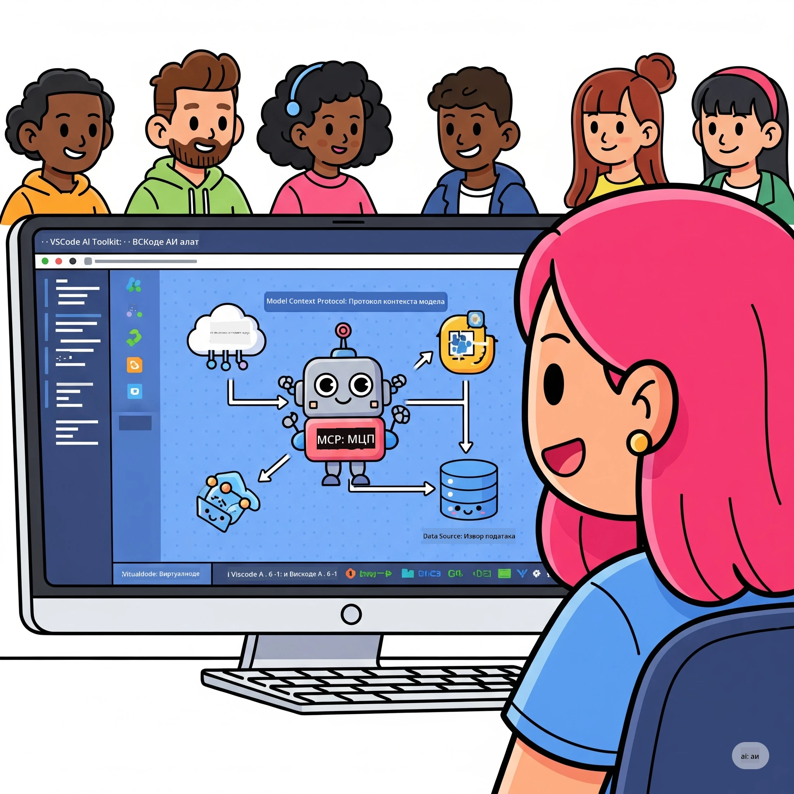
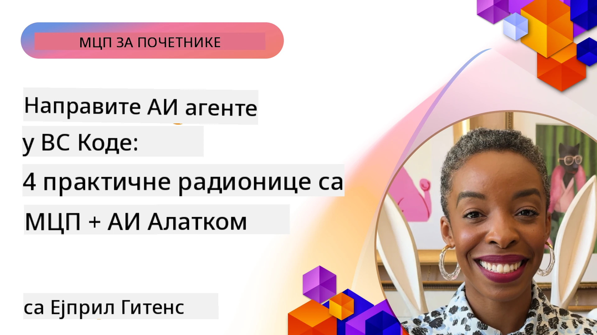

# Поједностављивање AI рада: Изградња MCP сервера уз Microsoft Foundry Toolkit

## 🎯 Преглед

_(Кликните на слику изнад за приказ видео снимка овог часа)_

Добро дошли у **Радионцу о Model Context Protocol (MCP)**! Овај свеобухватни практични радикон спаја две најсавременије технологије како би револуционисао развој AI апликација:

> **Напомена о компатибилности:** код радионице је изграђен и тестиран са MCP
> `2025-11-25`, као што показује значка изнад. Користите
> [тренутну спецификацију `2026-07-28`](https://modelcontextprotocol.io/specification/2026-07-28/)
> за нове имплементације протокола и прегледајте белешке о издањима SDK пре
> мигрирања лабораторија.

- **🔗 Model Context Protocol (MCP)**: Отворени стандард за беспрекорну интеграцију AI алата
- **🛠️ Microsoft Foundry Toolkit Extension за VS Code**: Моћно Microsoft-ово проширење за AI развој

### 🎓 Шта ћете научити

До краја ове радионице, савладаћете уметност изградње интелигентних апликација које повезују AI моделе са стварним алатима и сервисима. Од аутоматизованог тестирања до прилагођених API интеграција, стечете практичне вештине за решавање сложених пословних изазова.

## 🏗️ Технолошки скуп

### 🔌 Model Context Protocol (MCP)

MCP је **„USB-C за AI“** – универзални стандард који повезује AI моделе са екстерним алатима и изворима података.

**✨ Кључне карактеристике:**

- 🔄 **Стандардизована интеграција**: Универзални интерфејс за повезивање AI алата
- 🏛️ **Флексибилна архитектура**: Локални и даљински сервери преко stdio/SSE транспорта
- 🧰 **Богат екосистем**: Алати, упити и ресурси у једном протоколу
- 🔒 **Припремљен за предузећа**: Уграђена безбедност и поузданост

**🎯 Зашто је MCP важан:**
Баш као што је USB-C уклонио неред са кабловима, MCP уклања сложеност AI интеграција. Један протокол, бескрајне могућности.

### 🤖 Microsoft Foundry Toolkit Extension за VS Code

Microsoft-ово водеће проширење за AI развој које претвара VS Code у AI моћну платформу.

**🚀 Основне могућности:**

- 📦 **Каталог модела**: Приступ моделима из Azure AI, GitHub, Hugging Face, Ollama
- ⚡ **Локални извођење**: ONNX оптимизован CPU/GPU/NPU рад
- 🏗️ **Agent Builder**: Визуелни развој AI агената са MCP интеграцијом
- 🎭 **Мулти-модални**: Подршка за текст, визуелно и структуру

**💡 Предности развоја:**

- Нула конфигурација за постављање модела
- Визуелно дизајнирање подстицаја
- Игранка за тестирање у реалном времену
- Беспрекорна интеграција MCP сервера

## 📚 Пут учења

### [🚀 Модул 1: Основе Microsoft Foundry Toolkit](./lab1/README.md)

**Трајање**: 15 минута

- 🛠️ Инсталирање и подешавање Microsoft Foundry Toolkit за VS Code
- 🗂️ Истраживање Каталога модела (100+ модела са GitHub, ONNX, OpenAI, Anthropic, Google)
- 🎮 Савладајте интерактивну игранку за тестирање модела у реалном времену
- 🤖 Направите свог првог AI агента помоћу Agent Builder
- 📊 Процените перформансе модела уз уграђене метрике (F1, релевантност, сличност, кохеренција)
- ⚡ Научите о пакетном обрађивању и мулти-модалној подршци

**🎯 Резултат учења**: Креирајте функционалног AI агента уз свеобухватно разумевање могућности Microsoft Foundry Toolkit-а

### [🌐 Модул 2: MCP са основама Microsoft Foundry Toolkit](./lab2/README.md)

**Трајање**: 20 минута

- 🧠 Савладајте архитектуру и концепте Model Context Protocol (MCP)
- 🌐 Истражите Microsoft-ов MCP сервер екосистем
- 🤖 Направите агента за аутоматизацију претраживача користећи Playwright MCP сервер
- 🔧 Интегришите MCP сервере са Microsoft Foundry Toolkit Agent Builder-ом
- 📊 Поставите и тестирајте MCP алате у вашим агентима
- 🚀 Извезите и покрените агенте са MCP подршком у продукцији

**🎯 Резултат учења**: Покрените AI агента са напредном интеграцијом спољних алата преко MCP-а

### [🔧 Модул 3: Напредни развој MCP са Microsoft Foundry Toolkit](./lab3/README.md)

**Трајање**: 20 минута

- 💻 Креирајте прилагођене MCP сервере користећи Microsoft Foundry Toolkit
- 🐍 Конфигуришите и користите најновији MCP Python SDK (v1.9.3)
- 🔍 Поставите и користите MCP Inspector за отклањање грешака
- 🛠️ Изградите Weather MCP сервер са професионалним радним токовима за дебаговање
- 🧪 Дебагујте MCP сервере у окружењима Agent Builder и Inspector

**🎯 Резултат учења**: Развијање и отклањање грешака прилагођених MCP сервера са савременим алатима

### [🐙 Модул 4: Практични развој MCP - Прилагођени GitHub Clone сервер](./lab4/README.md)

**Трајање**: 30 минута

- 🏗️ Изградите прави GitHub Clone MCP сервер за развојне радне токове
- 🔄 Имплементирајте паметно клонирање репозиторијума са валидацијом и обрадом грешака
- 📁 Креирајте интуитивно управљање директоријумима и интеграцију са VS Code-ом
- 🤖 Користите GitHub Copilot Agent Mode са прилагођеним MCP алатима
- 🛡️ Примените поуздане и крос-платформске карактеристике за продукцијску употребу

**🎯 Резултат учења**: Покрените продукцијски MCP сервер који поједностављује стварне развојне радне токове

## 💡 Практичне примене и утицај

### 🏢 Коришћење у предузећима

#### 🔄 Аутоматизација DevOps процеса

Промените свој развојни процес интелигентном аутоматизацијом:

- **Паметно управљање репозиторијумима**: AI-вођени преглед кода и одлуке о комбиновању
- **Интелигентан CI/CD**: Аутоматска оптимизација цевовода заснована на променама кода
- **Тријажа проблема**: Аутоматска класификација и додела грешака

#### 🧪 Револуција у осигурању квалитета

Подигните тестирање са AI-подржаном аутоматизацијом:

- **Интелигентно генерисање тестова**: Креирајте свеобухватне тест пакете аутоматски
- **Визуелно регресионo тестирање**: AI засновано откривање промена у интерфејсу
- **Праћење перформанси**: Проактивно идентификовање и решавање проблема

#### 📊 Интелигенција на подацима у цевоводу

Изградите паметније радне токове обраде података:

- **Прилагодљиви ETL процеси**: Самооптимизујуће трансформације података
- **Откривање аномалија**: Мониторинг квалитета података у реалном времену
- **Интелигентно усмеравање**: Паметно управљање протоком података

#### 🎧 Побољшање корисничког искуства

Креирајте изванредне интеракције са корисницима:

- **Подршка са свешћу о контексту**: AI агенти са приступом историји корисника
- **Проактивно решавање проблема**: Прогностичка корисничка служба
- **Мулти-канална интеграција**: Уједињено AI искуство преко платформи

## 🛠️ Захтеви и подешавање

### 💻 Системски захтеви

| Компонента | Захтев | Напомене |
|-----------|-------------|-------|
| **Оперативни систем** | Windows 10+, macOS 10.15+, Linux | Било који модерни ОС |
| **Visual Studio Code** | Најновија стабилна верзија | Потребно за Microsoft Foundry Toolkit |
| **Node.js** | в18.0+ и npm | За развој MCP сервера |
| **Python** | 3.10+ | Опционо за Python MCP сервере |
| **Рам меморија** | минимум 8GB | Препоручено 16GB за локалне моделе |

### 🔧 Развојно окружење

#### Препоручена проширења за VS Code

- **Microsoft Foundry Toolkit** (ms-windows-ai-studio.windows-ai-studio)
- **Python** (ms-python.python)
- **Python Debugger** (ms-python.debugpy)
- **GitHub Copilot** (GitHub.copilot) - Опционо али корисно

#### Опционални алати

- **uv**: Модеран Python пакет менаџер
- **MCP Inspector**: Визуелни алат за дебаговање MCP сервера
- **Playwright**: За примере веб аутоматизације

## 🎖️ Резултати учења и сертификати

### 🏆 Контролна листа за савладавање вештина

Завршетком ове радионице овладаћете:

#### 🎯 Основне компетенције

- [ ] **МCP протокол мајсторство**: Дубоко разумевање архитектуре и образаца имплементације
- [ ] **Стручност за Microsoft Foundry Toolkit**: Експертска употреба Microsoft Foundry Toolkit за брзи развој
- [ ] **Развој прилагођених сервера**: Изградња, постављање и одржавање продукцијских MCP сервера
- [ ] **Одлична интеграција алата**: Беспрекорно повезивање AI са постојећим развојним радним токовима
- [ ] **Применa у решавању проблема**: Примена стечених вештина на стварне пословне изазове

#### 🔧 Техничке вештине

- [ ] Подешавање и конфигурација Microsoft Foundry Toolkit у VS Code
- [ ] Дизајн и имплементација прилагођених MCP сервера
- [ ] Интеграција Microsoft Foundry модела са MCP архитектуром
- [ ] Изградња аутоматизованих тест радних токова уз Playwright
- [ ] Постављање AI агената за продукцијску употребу
- [ ] Дебаговање и оптимизација перформанси MCP сервера

#### 🚀 Напредне могућности

- [ ] Архитектура AI интеграција на нивоу предузећа
- [ ] Применa најбољих безбедносних пракси за AI апликације
- [ ] Дизајн скалабилних MCP сервер архитектура
- [ ] Креирање прилагођених ланаца алата за специфичне домене
- [ ] Менторство у AI нативном развоју

## 📖 Додатни ресурси

- [MCP Specification (2026-07-28)](https://modelcontextprotocol.io/specification/2026-07-28/)
- [Microsoft Foundry Toolkit GitHub Repository](https://github.com/microsoft/vscode-ai-toolkit)
- [Sample MCP Servers Collection](https://github.com/modelcontextprotocol/servers)
- [Best Practices Guide](https://modelcontextprotocol.io/docs/best-practices)
- [OWASP MCP Top 10](https://microsoft.github.io/mcp-azure-security-guide/mcp/) - Најбоље безбедносне праксе

---

**🚀 Спремни преокренути свој AI развојни рад?**

Хајде да заједно изградимо будућност интелигентних апликација уз MCP и Microsoft Foundry Toolkit!

## Шта следи

Наставите ка: [Модул 11: MCP Server Практичне Лабораторије](../11-MCPServerHandsOnLabs/README.md)

---

<!-- CO-OP TRANSLATOR DISCLAIMER START -->
**Изјава о одрицању одговорности**:
Овај документ је преведен коришћењем услуге за аутоматски превод [Co-op Translator](https://github.com/Azure/co-op-translator). Иако тежимо тачности, имајте у виду да аутоматски преводи могу садржати грешке или нетачности. Оригинални документ на његовом изворном језику треба сматрати ауторитативним извором. За критичне информације препоручује се професионални људски превод. Нисмо одговорни за било каква неспоразума или погрешна тумачења која произилазе из коришћења овог превода.
<!-- CO-OP TRANSLATOR DISCLAIMER END -->