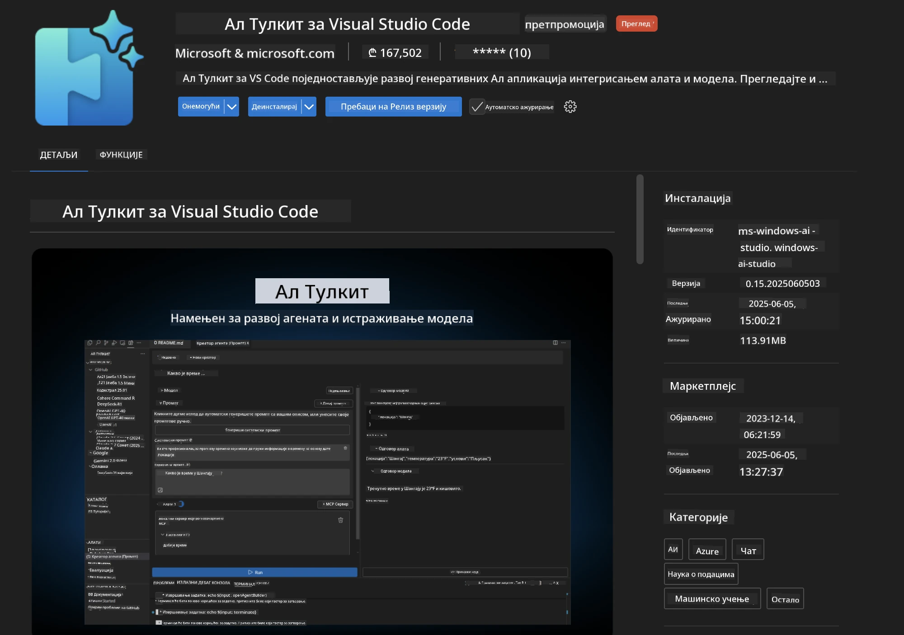
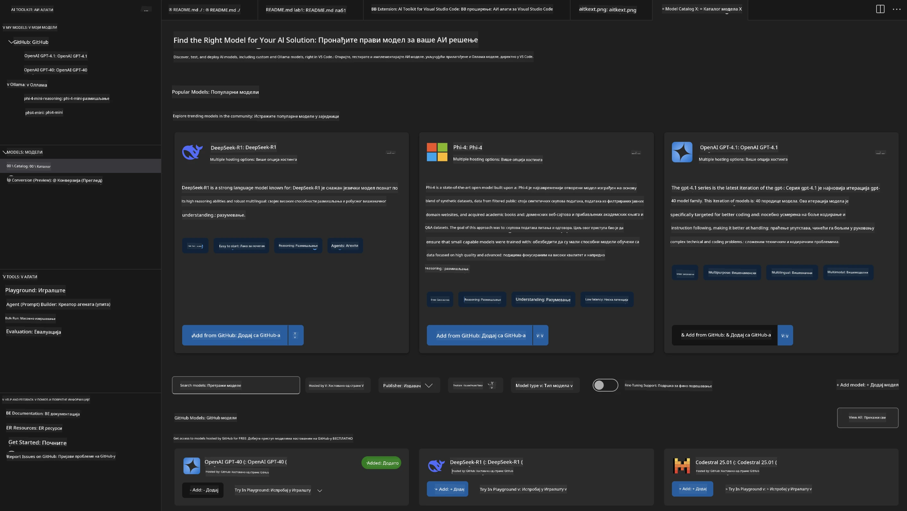
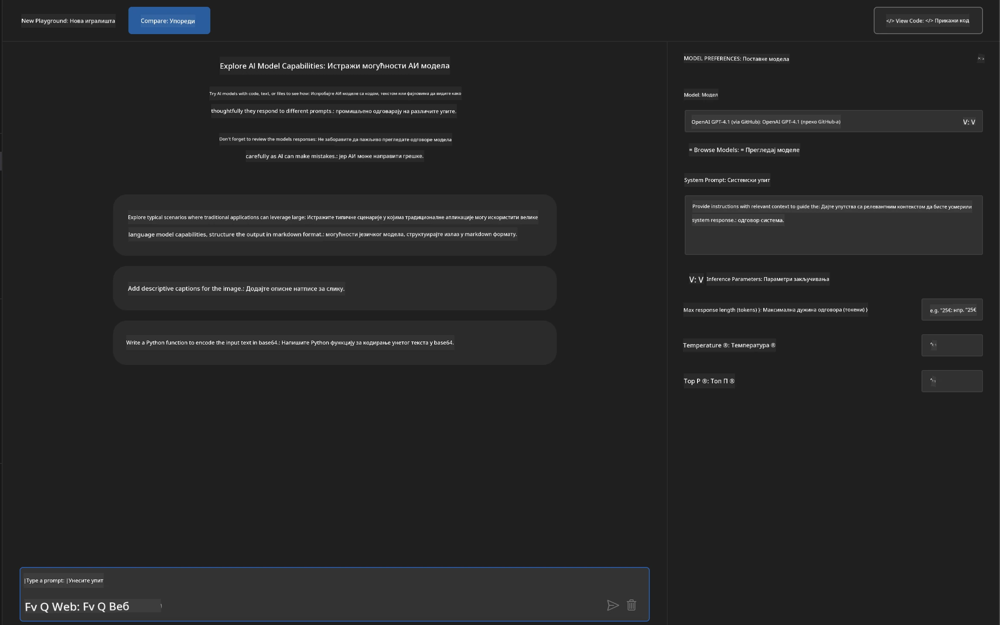
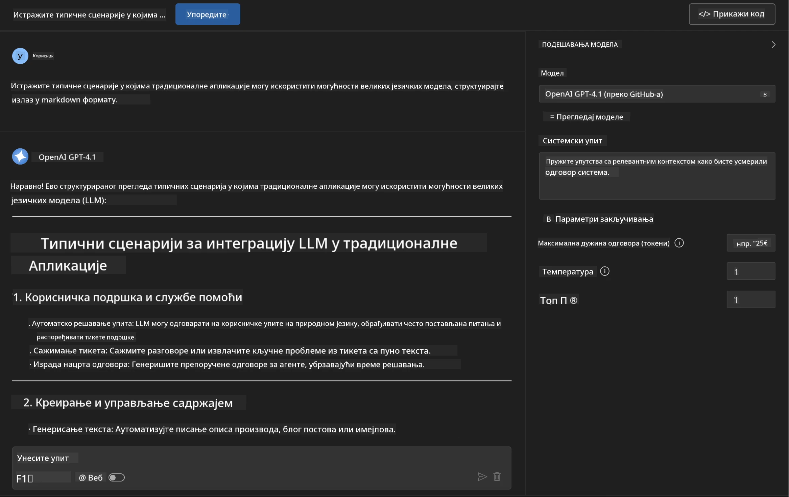
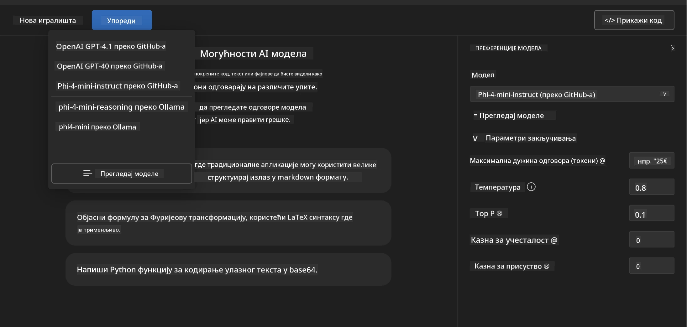
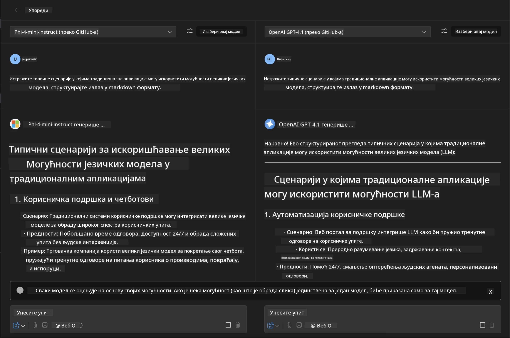
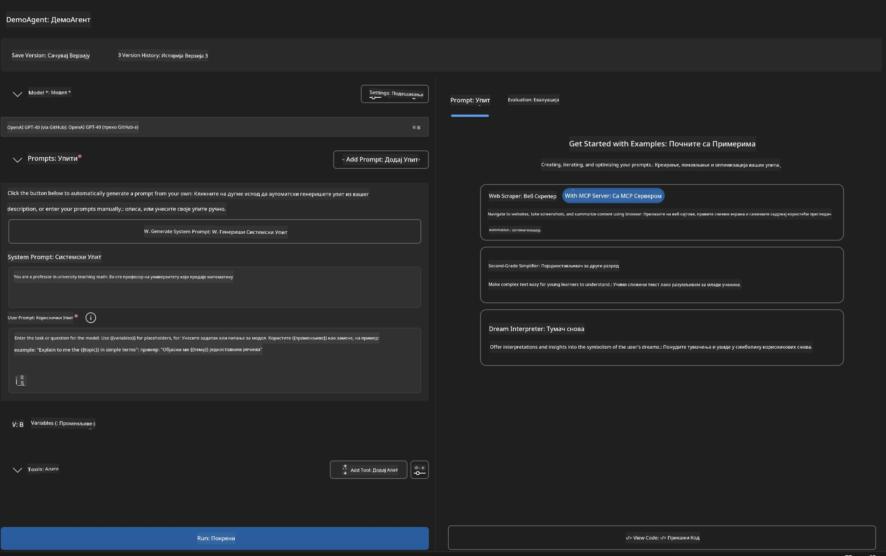
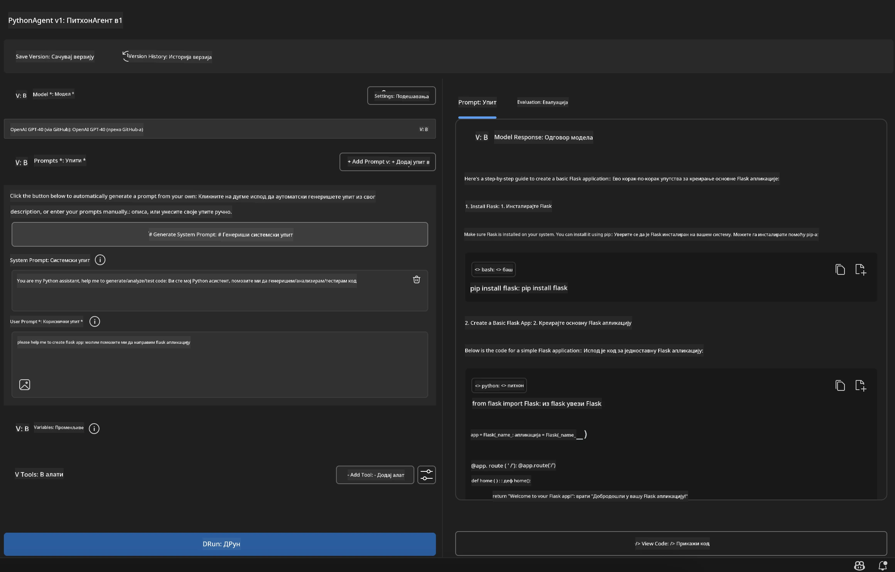

# 🚀 Модул 1: Основе Microsoft Foundry Toolkit-а

[]()
[]()
[]()

## 📋 Циљеви учења

На крају овог модула, моћи ћете да:
- ✅ Инсталирате и конфигуришете Microsoft Foundry Toolkit додатак за VS Code
- ✅ Навигирајте Каталог модела и разумете различите изворе модела
- ✅ Користите Playground за тестирање и експериментисање са моделима
- ✅ Креирате прилагођене AI агенте помоћу Agent Builder-а
- ✅ Упоредите перформансе модела код различитих провајдера
- ✅ Примените најбоље праксе за prompt инженеринг

## 🧠 Увод у Microsoft Foundry Toolkit

**Microsoft Foundry Toolkit Extension за VS Code** је водећи додатак компаније Microsoft који претвара VS Code у свеобухватно окружење за развој вештачке интелигенције. Он повезује истраживање на пољу AI и практични развој апликација, омогућавајући приступ генеративној AI програмерима свих нивоа искуства.

### 🌟 Кључне могућности

| Карактеристика | Опис | Пример употребе |
|---------|-------------|----------|
| **🗂️ Каталог модела** | Приступ преко 100 модела са GitHub-а, ONNX-а, OpenAI-а, Anthropic-а, Google-а | Проналажење и одабир модела |
| **🔌 Подршка за BYOM** | Интегрисање властитих модела (локално/далечински) | Прилагођено имплементирање модела |
| **🎮 Интерактивни Playground** | Тестирање модела у реалном времену са chat интерфејсом | Брзо прототиповање и тестирање |
| **📎 Мултимодална подршка** | Рад са текстом, сликама и прилозима | Комплексне AI апликације |
| **⚡ Пакетна обрада** | Извршавање више упита истовремено | Ефикасни радни токови тестирања |
| **📊 Процена модела** | Уграђене мере (F1, релевантност, сличност, кохеренција) | Процена перформанси |

### 🎯 Зашто је Microsoft Foundry Toolkit важан

- **🚀 Убрзан развој**: Од идеје до прототипа у минутима
- **🔄 Уједињен радни ток**: Један интерфејс за више AI провајдера
- **🧪 Лако експериментисање**: Упоредите моделе без компликованог подешавања
- **📈 Спремно за продукцију**: Беспрекорна транзиција од прототипа до примене

## 🛠️ Претходни услови и подешавање

### 📦 Инсталација Microsoft Foundry Toolkit додатка

**Корак 1: Приступ тржишту додатака**
1. Отворите Visual Studio Code
2. Идите у приказ додатака (`Ctrl+Shift+X` или `Cmd+Shift+X`)
3. Потражите "Microsoft Foundry Toolkit"

**Корак 2: Изаберите своју верзију**
- **🟢 Релизе**: Препоручена за продукциону употребу
- **🔶 Пре-релизе**: Рани приступ најновијим функцијама

**Корак 3: Инсталирајте и активирајте**



### ✅ Контролна листа потврде
- [ ] Икона Microsoft Foundry Toolkit се појављује у бочној траци VS Code-а
- [ ] Додатак је омогућен и активиран
- [ ] Нема грешака приликом инсталације у панелу излаза

## 🧪 Практична вежба 1: Истраживање Microsoft Foundry модела

**🎯 Циљ**: Савладати Каталог модела и тестирати први AI модел

### 📊 Корак 1: Навигација по Каталогу модела

Каталог модела је ваша капија у AI екосистем. Он окупља моделе са више провајдера, олакшавајући проналажење и упоређивање опција.

**🔍 Водич за навигацију:**

Кликните на **MODELS - Catalog** у бочној траци Microsoft Foundry Toolkit-а



**💡 Савет**: Тражите моделе са специфичним могућностима које одговарају вашем сценарију коришћења (нпр. генерисање кода, креативно писање, анализа).

> [!NOTE]
> GitHub Models је укинут 30. јула 2026. Користите имплементацију Microsoft Foundry модела
> и аутентификовајте се преко Microsoft Entra ID или Azure API кључа.

### 🚀 Корак 2: Додајте и конфигуришите свој први модел

**Стратегија избора модела:**
- **GPT-5.1**: Препоручени генерални модел за коришћење алата и резоновање
- **Phi-4-mini**: Лаган и брз за једноставне задатке

**🔧 Процес конфигурације:**
1. Изаберите **OpenAI GPT-5.1** из каталога
2. Кликните **Add to My Models** - ово региструје модел за употребу
3. Изаберите **Try in Playground** да покренете тест средину
4. Саачекајте инициализацију модела (прво подешавање може потрајати)



**⚙️ Разумевање параметара модела:**
- **Temperature (Температура)**: Контролише креативност (0 = детерминистички, 1 = креативан)
- **Max Tokens (Макс токени)**: Максимална дужина одговора
- **Top-p**: Nucleus узорковање за разноврсност одговора

### 🎯 Корак 3: Савладајте интерфејс Playground-а

Playground је ваша лабораторија за AI експерименте. Ево како да максимизирате његов потенцијал:

**🎨 Најбоље праксе у prompt engineering-у:**
1. **Будите прецизни**: Јасна, детаљна упутства дају боље резултате
2. **Обезбедите контекст**: Укључите релевантне позадинске информације
3. **Користите примере**: Покажите моделу шта желите уз примере
4. **Итерација**: Унапређујте упите на основу почетних резултата

**🧪 Сценарији тестирања:**
```markdown
# Example 1: Code Generation
"Write a Python function that calculates the factorial of a number using recursion. Include error handling and docstrings."

# Example 2: Creative Writing
"Write a professional email to a client explaining a project delay, maintaining a positive tone while being transparent about challenges."

# Example 3: Data Analysis
"Analyze this sales data and provide insights: [paste your data]. Focus on trends, anomalies, and actionable recommendations."
```



### 🏆 Изазовна вежба: Упоређивање перформанси модела

**🎯 Циљ**: Упоредите различите моделе користећи идентичне упите да бисте разумели њихове предности

**📋 Упутства:**
1. Додајте **Phi-4-mini** у свој радни простор
2. Користите исти упит за GPT-5.1 и Phi-4-mini



3. Упоредите квалитет одговора, брзину и прецизност
4. Документујте своја запажања у одељку са резултатима



**💡 Кључне увиде за откривање:**
- Када користити LLM у односу на SLM
- Компромиси трошкова и перформанси
- Специјализоване способности различитих модела

## 🤖 Практична вежба 2: Креирање прилагођених агената помоћу Agent Builder-а

**🎯 Циљ**: Креирати специјализоване AI агенте прилагођене одређеним задацима и радним токовима

### 🏗️ Корак 1: Разумевање Agent Builder-а

Agent Builder је место где Microsoft Foundry Toolkit заиста показује своје способности. Омогућава вам да креирате AI асистенте са конкретном наменом који комбинују снагу великих језичких модела са прилагођеним упутствима, специфичним параметрима и стручним знањем.

**🧠 Компоненте архитектуре агента:**
- **Основни модел**: Основни LLM (GPT-5.1, Phi, итд.)
- **Системски prompt**: Дефинише личност и понашање агента
- **Параметри**: Финесирана подешавања за оптималне перформансе
- **Интеграција алата**: Повезивање са спољним API-јима и MCP сервисима
- **Меморија**: Контекст разговора и трајност сесије



### ⚙️ Корак 2: Детаљна конфигурација агента

**🎨 Креирање ефикасних системских prompt-а:**
```markdown
# Template Structure:
## Role Definition
You are a [specific role] with expertise in [domain].

## Capabilities
- List specific abilities
- Define scope of knowledge
- Clarify limitations

## Behavior Guidelines
- Response style (formal, casual, technical)
- Output format preferences
- Error handling approach

## Examples
Provide 2-3 examples of ideal interactions
```

*Наравно, можете користити и Generate System Prompt да вам AI помогне да генеришете и оптимизујете prompt-ове*

**🔧 Оптимизација параметара:**
| Параметар | Препоручени распон | Пример употребе |
|-----------|------------------|----------|
| **Temperature** | 0.1-0.3 | Технички/фактички одговори |
| **Temperature** | 0.7-0.9 | Креативни/бренсторминг задаци |
| **Max Tokens** | 500-1000 | Кратки одговори |
| **Max Tokens** | 2000-4000 | Детаљна објашњења |

### 🐍 Корак 3: Практична вежба - Python програмски агент

**🎯 Мисија**: Креирати специјализованог асистента за Python програмирање

**📋 Кораци конфигурације:**

1. **Избор модела**: Изаберите **Claude 3.5 Sonnet** (одличан за код)

2. **Дизајн системског prompt-а**:
```markdown
# Python Programming Expert Agent

## Role
You are a senior Python developer with 10+ years of experience. You excel at writing clean, efficient, and well-documented Python code.

## Capabilities
- Write production-ready Python code
- Debug complex issues
- Explain code concepts clearly
- Suggest best practices and optimizations
- Provide complete working examples

## Response Format
- Always include docstrings
- Add inline comments for complex logic
- Suggest testing approaches
- Mention relevant libraries when applicable

## Code Quality Standards
- Follow PEP 8 style guidelines
- Use type hints where appropriate
- Handle exceptions gracefully
- Write readable, maintainable code
```

3. **Конфигурација параметара**:
   - Температура: 0.2 (за доследан, поуздан код)
   - Макс токени: 2000 (детаљна објашњења)
   - Top-p: 0.9 (балансирана креативност)



### 🧪 Корак 4: Тестирање вашег Python агента

**Сценарији тестирања:**
1. **Основна функција**: "Направи функцију за проналажење простих бројева"
2. **Комплексни алгоритам**: "Имплементирај бинарно дрво претраге са методама за убацивање, брисање и претрагу"
3. **Проблем из стварног света**: "Креирај веб скрепер који управља ограничењем учесталости и поновним покушајима"
4. **Отхоткивање**: "Поправи овај код [налепи buggy код]"

**🏆 Критеријуми успеха:**
- ✅ Код ради без грешака
- ✅ Укључује правилну документацију
- ✅ Следи најбоље праксе Pythona
- ✅ Даје јасна објашњења
- ✅ Предлаже побољшања

## 🎓 Завршетак Модула 1 и следећи кораци

### 📊 Провера знања

Тестирајте своје разумевање:
- [ ] Можете ли објаснити разлике између модела у каталогу?
- [ ] Да ли сте успешно креирали и тестирали прилагођеног агента?
- [ ] Да ли разумете како да оптимизујете параметре за различите сценарије употребе?
- [ ] Можете ли дизајнирати ефикасне системске prompt-ове?

### 📚 Додатни ресурси

- **Документација Microsoft Foundry Toolkit-а**: [Званична Microsoft документација](https://github.com/microsoft/vscode-ai-toolkit)
- **Водич за prompt engineering**: [Најбоље праксе](https://platform.openai.com/docs/guides/prompt-engineering)
- **Модели у Microsoft Foundry Toolkit-у**: [Модели у развоју](https://github.com/microsoft/vscode-ai-toolkit/blob/main/doc/models.md)

**🎉 Честитамо!** Савладали сте основе Microsoft Foundry Toolkit-а и спремни сте да градите напредније AI апликације!

### 🔜 Наставите са следећим модулом

Спремни за напредније могућности? Наставите са **[Модул 2: MCP са Microsoft Foundry Toolkit Fundamentals](../lab2/README.md)** где ћете научити како да:
- Повежете своје агенте са спољним алатима користећи Model Context Protocol (MCP)
- Креирате агенте за аутоматизацију прегледача са Playwright-ом
- Интегришете MCP сервере са вашим Microsoft Foundry Toolkit агентима
- Повећате снагу агената уз помоћ спољних података и могућности

---

<!-- CO-OP TRANSLATOR DISCLAIMER START -->
**Изјава о одрицању одговорности**:
Овај документ је преведен коришћењем услуге за аутоматски превод [Co-op Translator](https://github.com/Azure/co-op-translator). Иако тежимо тачности, имајте у виду да аутоматски преводи могу садржати грешке или нетачности. Оригинални документ на његовом изворном језику треба сматрати ауторитативним извором. За критичне информације препоручује се професионални људски превод. Нисмо одговорни за било каква неспоразума или погрешна тумачења која произилазе из коришћења овог превода.
<!-- CO-OP TRANSLATOR DISCLAIMER END -->