# 🌐 Модул 2: MCP са основама Microsoft Foundry Toolkit-а


## 📋 Циљеви учења

До краја овог модула, моћи ћете да:

- ✅ Разумете архитектуру и предности Model Context Protocol (MCP)
- ✅ Истражите Microsoft-ов MCP серверски екосистем
- ✅ Интегришете MCP сервере са Microsoft Foundry Toolkit Agent Builder-ом
- ✅ Креирате функционалног агента за аутоматизацију прегледача користећи Playwright MCP
- ✅ Конфигуришете и тестирате MCP алате у вашим агентима
- ✅ Извезете и распорестите агенте покретане MCP-ом за производну употребу

## 🎯 Надоградња на Модул 1

У Модулу 1 смо савладали основе Microsoft Foundry Toolkit-а и креирали наш
први Python агент. Сада ћемо ваше агенте **суперпонирати** повезивањем
са спољним алатима и услугама кроз револуционарни
**Model Context Protocol (MCP)**.

Замислите ово као надоградњу са основног калкулатора на пун рачунар. Ваши AI
агенти ће добити могућност да:

- 🌐 Прегледају и интерагују са вебсајтовима
- 📁 Приступају и манипулишу фајловима
- 🔧 Интегришу се са системима предузећа
- 📊 Обрађују податке у реалном времену преко API-ja

## 🧠 Разумевање Model Context Protocol (MCP)

### 🔍 Шта је MCP?

Model Context Protocol (MCP) је **"USB-C за AI апликације"**: отворени
стандард који повезује Велике Језичке Моделе (LLM) са спољним алатима, изворима
података и услугама. Баш као што USB-C пружа један универзални конектор,
MCP смањује сложеност интеграције AI-а кроз један стандардизовани протокол.

### 🎯 Проблем који MCP решава

**Пре MCP-а:**

- 🔧 Прилагођене интеграције за сваки алат
- 🔄 Закључавање код добављача са протоколима власничких решења  
- 🔒 Безбедносне рањивости услед ad-hoc веза
- ⏱️ Месеци развоја за основне интеграције

**Са MCP-ом:**

- ⚡ Интеграција алата спремна за употребу
- 🔄 Архитектура независна од добављача
- 🛡️ Уграђене безбедносне најбоље праксе
- 🚀 Минута потребних за додавање нових могућности

### 🏗️ Детаљан преглед архитектуре MCP

MCP следи **клијент-сервер архитектуру** која креира безбедан, масштабив екосистем:

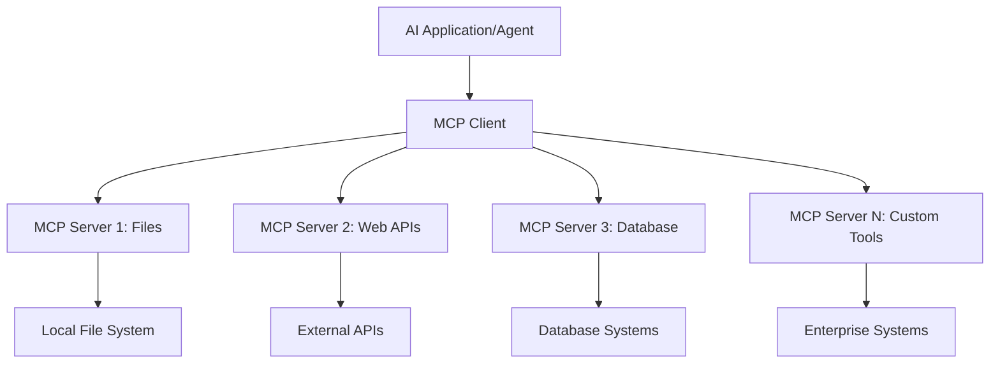

**🔧 Кључне компоненте:**

| Компонента | Улога | Примери |
| --------- | ---- | -------- |
| **MCP Домаћини** | Користе MCP услуге | VS Code, Foundry Toolkit |
| **MCP Клијенти** | Управљају протоколским везама | Уграђени у домаћине |
| **MCP Сервери** | Пружају функције | Playwright, Fajlovi, Azure, GitHub |
| **Транспортни слој** | Повезује клијенте и сервере | stdio, HTTP, WebSockets |

## 🏢 Microsoft-ов MCP серверски екосистем

Microsoft предводи MCP екосистем са обимним скупом
серверa за предузећа који одговарају стварним пословним потребама.

### 🌟 Истакнути Microsoft MCP сервери

#### 1. ☁️ Azure MCP сервер

**🔗 Репозиторијум**: [azure/azure-mcp](https://github.com/azure/azure-mcp)
**🎯 Намена**: Комплетно управљање Azure ресурсима уз AI интеграцију

**✨ Кључне особине:**

- Декларативно обезбеђење инфраструктуре
- Мониторинг ресурса у реалном времену
- Препоруке за оптимизацију трошкова
- Провера безбедносне усклађености

**🚀 Сценарији употребе:**

- Инфраструктура као код помоћу AI асистенције
- Аутоматско скалирање ресурса
- Оптимизација облачних трошкова
- Аутоматизација DevOps радних токова

#### 2. 📊 Microsoft Dataverse MCP

**📚 Документација**: [Microsoft Dataverse интеграција](https://go.microsoft.com/fwlink/?linkid=2320176)
**🎯 Намена**: Интеракција са пословним подацима природним језиком

**✨ Кључне особине:**

- Захтеви базе података природним језиком
- Разумевање пословног контекста
- Прилагођени шаблони упита
- Управљање пословним подацима

**🚀 Сценарији употребе:**

- Извештаји пословне интелигенције
- Анализа података о клијентима
- Увид у продајни левак
- Упити о подацима о усклађености

#### 3. 🌐 Playwright MCP сервер

**🔗 Репозиторијум**: [microsoft/playwright-mcp](https://github.com/microsoft/playwright-mcp)
**🎯 Намена**: Аутоматизација прегледача и интеракција са вебом

**✨ Кључне особине:**

- Крос-прегледачка аутоматизација (Chrome, Firefox, Safari)
- Интелигентно препознавање елемената
- Генерисање снимака екрана и PDF-ова
- Праћење мрежног саобраћаја

**🚀 Сценарији употребе:**

- Аутоматизација тестирања
- Веб скрејпинг и екстракција података
- Мониторинг UI/UX
- Аутоматизација конкурентске анализе

#### 4. 📁 Files MCP сервер

**🔗 Репозиторијум**: [microsoft/files-mcp-server](https://github.com/microsoft/files-mcp-server)
**🎯 Намена**: Интелигентне операције са фајловима

**✨ Кључне особине:**

- Декларативно управљање фајловима
- Синхронизација садржаја
- Интеграција контроле верзија
- Извлачење метаподатака

**🚀 Сценарији употребе:**

- Управљање документацијом
- Организација репозиторијума кода
- Радни токови објављивања садржаја
- Обрада фајлова у подацима и токовима

#### 5. 📝 MarkItDown MCP сервер

**🔗 Репозиторијум**: [microsoft/markitdown](https://github.com/microsoft/markitdown)
**🎯 Намена**: Напредна обрада и манипулација Markdown-а

**✨ Кључне особине:**

- Богато парсирање Markdown-а
- Конверзија формата (MD ↔ HTML ↔ PDF)
- Анализа структуре садржаја
- Обрада шаблона

**🚀 Сценарији употребе:**

- Радни токови техничке документације
- Системи за управљање садржајем
- Генерисање извештаја
- Аутоматизација базе знања

#### 6. 📈 Clarity MCP сервер

**📦 Пакет**: [@microsoft/clarity-mcp-server](https://www.npmjs.com/package/@microsoft/clarity-mcp-server)
**🎯 Намена**: Веб аналитика и увиди о понашању корисника

**✨ Кључне особине:**

- Анализа топлотних мапа
- Снимање корисничких сесија
- Метрике учинка
- Анализа фуњеле конверзије

**🚀 Сценарији употребе:**

- Оптимизација вебсајтова
- Истраживање корисничког искуства
- A/B тестирање
- Контролне табле пословне интелигенције

### 🌍 Екосистем заједнице

Поред Microsoft-ових сервера, MCP екосистем укључује:

- **🐙 GitHub MCP**: Управљање репозиторијумима и анализа кода
- **🗄️ Database MCPs**: Интеграције PostgreSQL, MySQL, MongoDB
- **☁️ Cloud Provider MCPs**: Алати за AWS, GCP, Digital Ocean
- **📧 Communication MCPs**: Интеграције Slack, Teams, Email

## 🛠️ Практична лабораторија: Креирање агента за аутоматизацију прегледача

**🎯 Циљ пројекта**: Направити интелигентног агента за аутоматизацију прегледача користећи
Playwright MCP сервер који може да прегледа вебсајтове, извлачи информације и
обавља сложене веб интеракције.

### 🚀 Фаза 1: Постављање основе агента

#### Корак 1: Иницијализујте свог агента

1. **Отворите Microsoft Foundry Toolkit Agent Builder**
2. **Креирајте новог агента** са следећом конфигурацијом:
   - **Име**: `BrowserAgent`
   - **Модел**: Изаберите GPT-5.1. Погледајте
      [распоред повлачења Microsoft Foundry модела](https://learn.microsoft.com/azure/foundry/openai/concepts/model-retirement-schedule)
      за актуелне информације о животном циклусу модела.

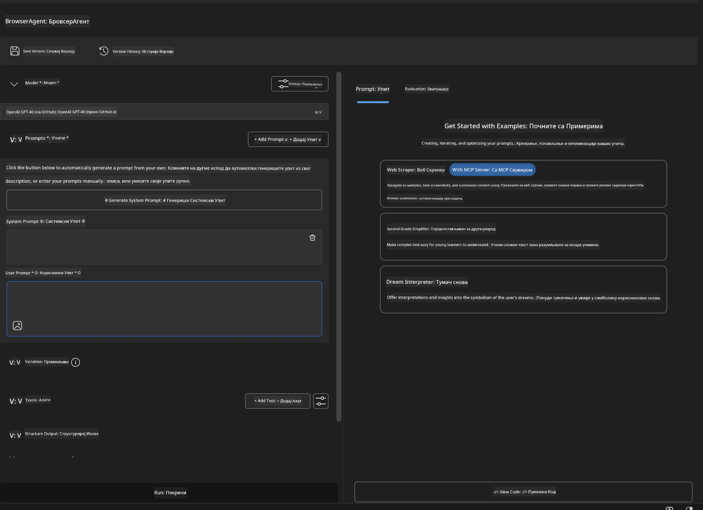

### 🔧 Фаза 2: Работни ток MCP интеграције

#### Корак 3: Додавање MCP сервер интеграције

1. **Идите у одељак Алати** у Agent Builder-у
2. **Кликните на "Додај алат"** да отворите мени за интеграцију
3. **Изаберите "MCP сервер"** из понуђених опција

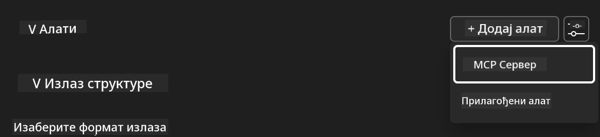

**🔍 Разумевање типова алата:**

- **Уграђени алати**: Предконфигурисане Microsoft Foundry Toolkit функције
- **MCP сервери**: Интеграције спољних услуга
- **Прилагођени API-ји**: Ваша сопствена сервисна крајња тачка
- **Позиви функција**: Директан приступ моделским функцијама

#### Корак 4: Избор MCP сервера

1. **Изаберите опцију "MCP сервер"** да наставите
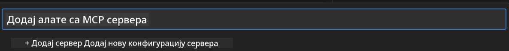

2. **Прегледајте Каталог MCP сервера** да истражите доступне интеграције
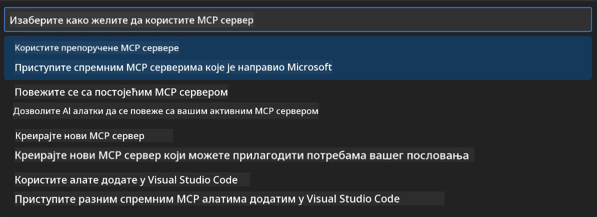

### 🎮 Фаза 3: Конфигурација Playwright MCP

#### Корак 5: Изаберите и конфигуришите Playwright

1. **Кликните на "Користи истакнуте MCP сервере"** да приступите верификованим Microsoft серверима
2. **Изаберите "Playwright"** са истакнуте листе
3. **Примите подразумевани MCP ID** или прилагодите за своје окружење

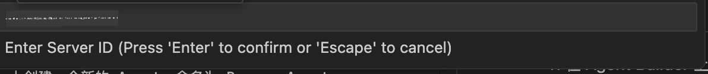

#### Корак 6: Омогућите Playwright могућности

**🔑 Критичан корак**: Изаберите **СВЕ** доступне Playwright методе за максималну функционалност

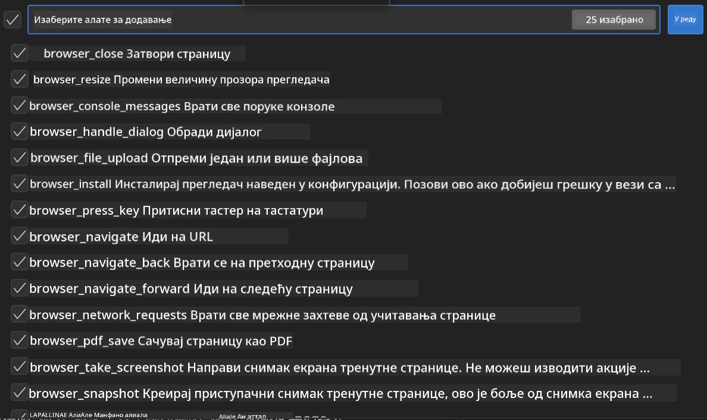

**🛠️ Есенцијални Playwright алати:**

- **Навигација**: `goto`, `goBack`, `goForward`, `reload`
- **Интеракција**: `click`, `fill`, `press`, `hover`, `drag`
- **Извлачење**: `textContent`, `innerHTML`, `getAttribute`
- **Валидација**: `isVisible`, `isEnabled`, `waitForSelector`
- **Захватање**: `screenshot`, `pdf`, `video`
- **Мрежа**: `setExtraHTTPHeaders`, `route`, `waitForResponse`

#### Корак 7: Потврдите успешност интеграције

**✅ Индикатори успешности:**

- Сви алати се приказују у интерфејсу Agent Builder-а
- Нема порука о грешкама на панелу интеграције
- Статус Playwright сервера показује "Повезано"

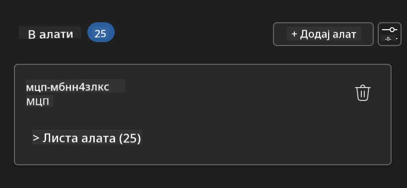

**🔧 Решавање уобичајених проблема:**

- **Неуспела веза**: Проверите интернет конекцију и подешавања заштитног зида
- **Недостају алати**: Уверите се да су све могућности изабране током постављања
- **Грешке у дозволама**: Проверите да VS Code има неопходна системска овлашћења

### 🎯 Фаза 4: Напредно креирање упита

#### Корак 8: Дизајнирајте интелигентне системске упите

Креирајте сложене упите који користе пуну функционалност Playwright-а:

```markdown
# Web Automation Expert System Prompt

## Core Identity
You are an advanced web automation specialist with deep expertise in browser
automation, web scraping, and user experience analysis. You have access to
Playwright tools for comprehensive browser control.

## Capabilities & Approach
### Navigation Strategy
- Always start with screenshots to understand page layout
- Use semantic selectors (text content, labels) when possible
- Implement wait strategies for dynamic content
- Handle single-page applications (SPAs) effectively

### Error Handling
- Retry failed operations with exponential backoff
- Provide clear error descriptions and solutions
- Suggest alternative approaches when primary methods fail
- Always capture diagnostic screenshots on errors

### Data Extraction
- Extract structured data in JSON format when possible
- Provide confidence scores for extracted information
- Validate data completeness and accuracy
- Handle pagination and infinite scroll scenarios

### Reporting
- Include step-by-step execution logs
- Provide before/after screenshots for verification
- Suggest optimizations and alternative approaches
- Document any limitations or edge cases encountered

## Ethical Guidelines
- Respect robots.txt and rate limiting
- Avoid overloading target servers
- Only extract publicly available information
- Follow website terms of service
```

#### Корак 9: Креирајте динамичке корисничке упите

Дизајнирајте упите који демонстрирају различите могућности:

**🌐 Пример веб анализе:**

```markdown
Navigate to github.com/kinfey and provide a comprehensive analysis including:
1. Repository structure and organization
2. Recent activity and contribution patterns  
3. Documentation quality assessment
4. Technology stack identification
5. Community engagement metrics
6. Notable projects and their purposes

Include screenshots at key steps and provide actionable insights.
```

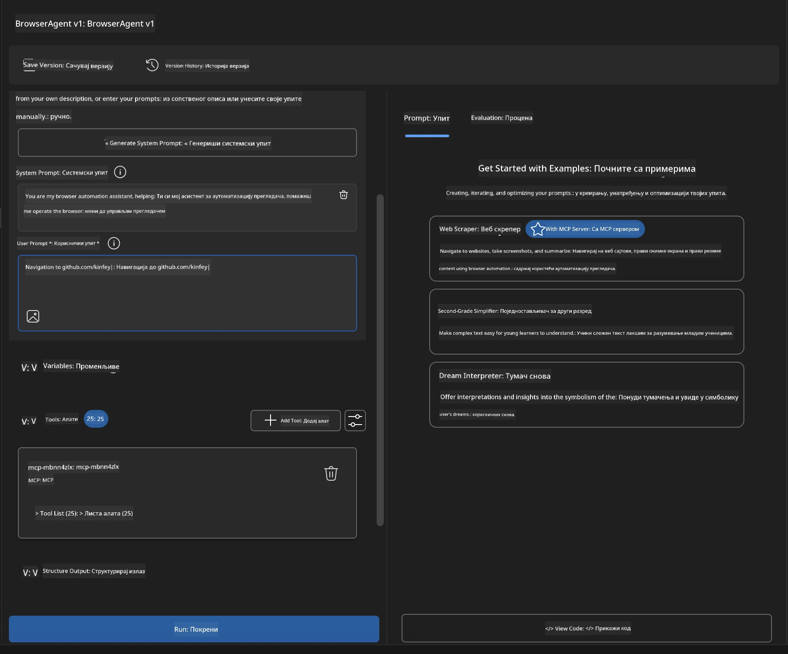

### 🚀 Фаза 5: Извршење и тестирање

#### Корак 10: Покрените прву аутоматизацију

1. **Кликните "Покрени"** да започнете низ аутоматизације
2. **Праћење извршења у реалном времену**:
   - Уноси се Chrome прегледач аутоматски
   - Агент прелази на циљани вебсајт
   - Снимци екрана бележе сваки главни корак
   - Резултати анализе стижу у реалном времену

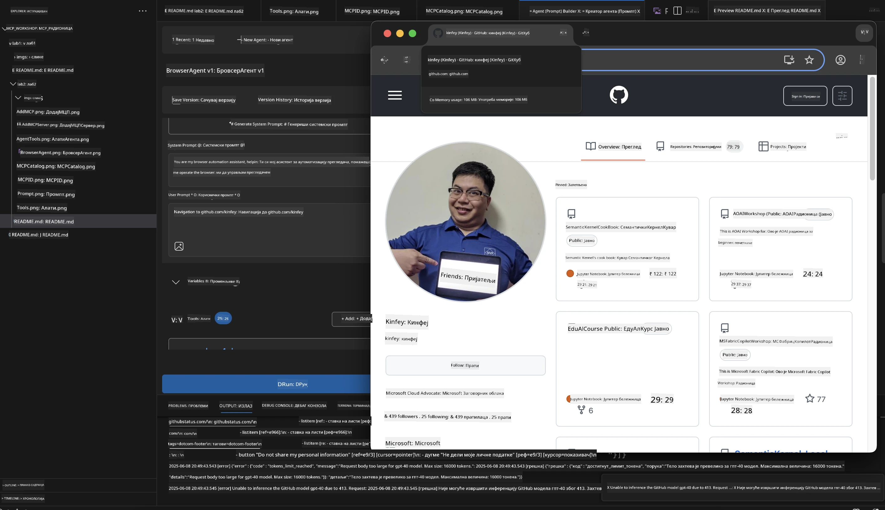

#### Корак 11: Анализирајте резултате и увиде

Прегледајте детаљне анализе у интерфејсу Agent Builder-а:

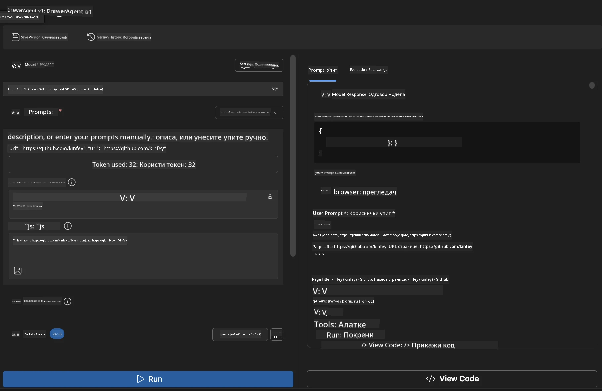

### 🌟 Фаза 6: Напредне могућности и распоређивање

#### Корак 12: Извоз и постављање у производњу

Agent Builder подржава више опција распореда:

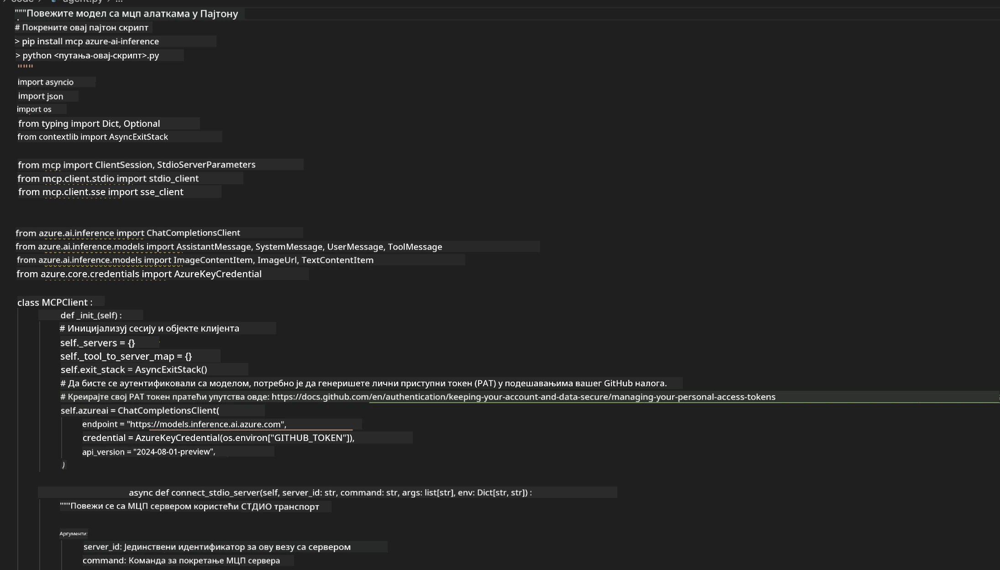

## 🎓 Резиме модула 2 и следећи кораци

### 🏆 Остварени успех: Мајстор MCP интеграције

**✅ Савладане вештине:**

- [ ] Разумевање архитектуре и предности MCP-а
- [ ] Навигација Microsoft-овим MCP серверским екосистемом
- [ ] Интеграција Playwright MCP-а са Microsoft Foundry Toolkit-ом
- [ ] Креирање софистицираних агената за аутоматизацију прегледача
- [ ] Напредно креирање упита за веб аутоматизацију

### 📚 Додатни ресурси

- **🔗 MCP спецификација**: [Званична документација протокола](https://modelcontextprotocol.io/)
- **🛠️ Playwright API**: [Комплетна референца метода](https://playwright.dev/docs/api/class-playwright)
- **🏢 Microsoft MCP сервери**:
   [Водич за интеграцију предузећа](https://github.com/microsoft/mcp-servers)
- **🌍 Примери заједнице**: [Галерија MCP сервера](https://github.com/modelcontextprotocol/servers)

**🎉 Честитамо!** Успешно сте савладали MCP интеграцију и сада можете
градити AI агенте спремне за производњу са спољним могућностима алата!

### 🔜 Наставите на следећи модул

Спремни да подигнете своје MCP вештине на виши ниво? Наставите на
**[Модул 3: Напредни развој MCP-а са Microsoft Foundry Toolkit-ом](../lab3/README.md)**
где ћете научити како да:

- Креирате своје сопствене прилагођене MCP сервере
- Конфигуришете и користите најновији MCP Python SDK
- Подесите MCP инспектор за дебаговање
- Савладате напредне радне токове развоја MCP сервера
- Изградите Weather MCP сервер од нуле

---

<!-- CO-OP TRANSLATOR DISCLAIMER START -->
**Изјава о одрицању одговорности**:
Овај документ је преведен коришћењем услуге за аутоматски превод [Co-op Translator](https://github.com/Azure/co-op-translator). Иако тежимо тачности, имајте у виду да аутоматски преводи могу садржати грешке или нетачности. Оригинални документ на његовом изворном језику треба сматрати ауторитативним извором. За критичне информације препоручује се професионални људски превод. Нисмо одговорни за било каква неспоразума или погрешна тумачења која произилазе из коришћења овог превода.
<!-- CO-OP TRANSLATOR DISCLAIMER END -->