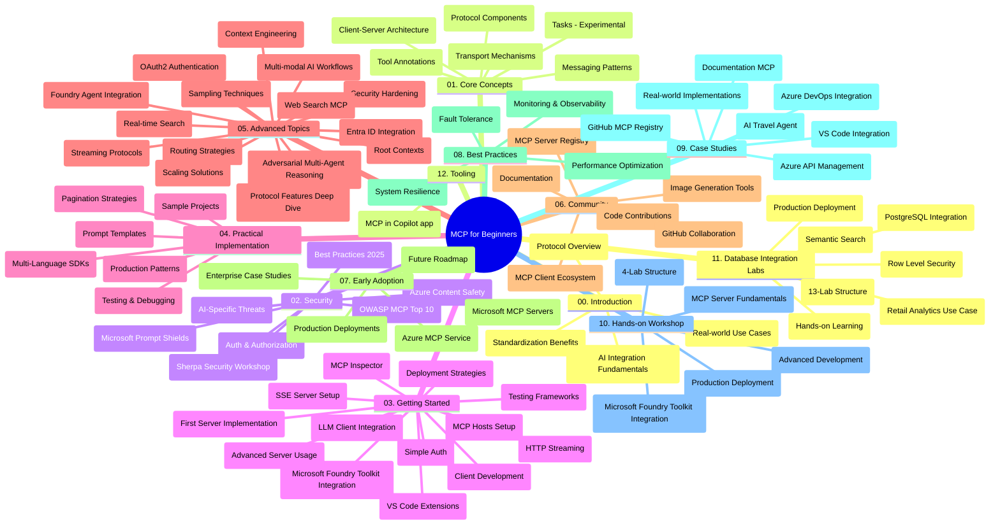

# Протокол контекста модела (MCP) за почетнике - водич за учење

Овај водич за учење пружа преглед структуре репозиторијума и садржаја за наставни материјал "Протокол контекста модела (MCP) за почетнике". Користите овај водич за ефикасно кретање кроз репозиторијум и максимално искористите доступне ресурсе.

## Преглед репозиторијума

Протокол контекста модела (MCP) је стандардизовани оквир за интеракцију између AI модела и клиент апликација. Првобитно креиран од стране Anтхропиц, MCP сада одржава ширa заједница MCP преко званичне GitHub организације. Овај репозиторијум пружа свеобухватан наставни програм са практичним примерима кода у C#, Java, JavaScript, Python и TypeScript, намењеним AI програмерима, системским архитектама и софтверским инжењерима.

## Визуелна мапа наставног програма

## Структура репозиторијума

Репозиторијум је организован у дванаест главних секција, од којих се свака фокусира на различите аспекте MCP:

1. **Увод (00-Introduction/)**
   - Преглед Протокола контекста модела
   - Зашто је стандардизација важна у AI пипелинима
   - Практичне примене и предности

2. **Основни концепти (01-CoreConcepts/)**
   - Клијент-сервер архитектура
   - Кључне компоненте протокола
   - Обрасци порука у MCP
   - Тренутна спецификација: [Шта се променило у MCP: Спецификација 2026-07-28](./01-CoreConcepts/mcp-2026-07-28.md) — језгро без стања, оквир за екстензије и декорације Roots/Sampling/Logging

3. **Безбедност (02-Security/)**
   - Безбедносне претње у системима базираним на MCP
   - Најбоље праксе за обезбеђивање имплементација
   - Стратегије аутентификације и ауторизације
   - Практични пример [CIMD и DCR ауторизације](./02-Security/samples/cimd-dcr-auth/README.md)
   - **Опсежна документација о безбедности**:
     - Најбоље праксе MCP безбедности
     - Водич за имплементацију Azure Content Safety
     - Контроле и технике MCP безбедности
     - Брзи преглед најбољих пракси MCP
   - **Кључне теме безбедности**:
     - Напади инјекције у упите и трујење алата
     - Отимање сесије и проблем збуњеног заменика
     - Ранљивости пропуштања токена
     - Прекомерна дозвола и контролa приступа
     - Безбедност ланаца снабдевања за AI компоненте
     - Интеграција Microsoft Prompt Shields

4. **Почетак рада (03-GettingStarted/)**
   - Подешавање и конфигурација окружења
   - Креирање основних MCP сервера и клијената
   - Интеграција са постојећим апликацијама
   - Укључује секције за:
     - Прву имплементацију сервера
     - Развој клијента
     - Интеграцију LLM клијента
     - Интеграцију у VS Code
     - Сервер са Server-Sent Events (SSE)
     - Напредну употребу сервера
     - HTTP стриминг
    - Интеграцију Microsoft Foundry Toolkit
     - Стратегије тестирања
     - Препоруке за деплојмент

5. **Практична имплементација (04-PracticalImplementation/)**
   - Коришћење SDK-ова у различитим програмским језицима
   - Методе за дебаговање, тестирање и валидацију
   - Креирање поновљивих шаблона упита и радних токова
   - Примери пројеката са имплементацијама

6. **Напредне теме (05-AdvancedTopics/)**
   - Технике инжењеринга контекста
   - Интеграција Foundry агента
   - Вишемодални AI радни токови
   - Демонстрације OAuth2 аутентификације
   - Могућности реално-временског претраживања
   - Стриминг у реалном времену
   - Имплементација Root контекста
   - Стратегије рутирања
   - Технике узорковања
   - Приступи скалирању
   - Сигурносни аспекти
   - Интеграција Entra ID безбедности
   - Интеграција веб претраге
   - Адверсаријални мулти-агент разлози (шаблони дебате)

7. **Заједнички доприноси (06-CommunityContributions/)**
   - Како допринети коду и документацији
   - Сарадња преко GitHub-а
   - Унапређења и повратне информације од заједнице
   - Коришћење разних MCP клијената (Claude Desktop, Cline, VSCode)
   - Рад са популарним MCP серверима укључујући генерацију слика

8. **Уроци из ране примене (07-LessonsfromEarlyAdoption/)**
   - Примери из стварног света и успешне приче
   - Креирање и имплементација решења заснованих на MCP
   - Трендови и будућа мапа пута
   - **Водич за Microsoft MCP сервере**: Опсежан водич за 10 Microsoft MCP сервера спремних за продукцију укључујући:
     - Microsoft Learn Docs MCP сервер
     - Azure MCP сервер (15+ специјализованих конектора)
     - GitHub MCP сервер
     - Azure DevOps MCP сервер
     - MarkItDown MCP сервер
     - SQL Server MCP сервер
     - Playwright MCP сервер
     - Dev Box MCP сервер
     - Microsoft Foundry MCP сервер
     - Microsoft 365 Agents Toolkit MCP сервер

9. **Најбоље праксе (08-BestPractices/)**
   - Подешавање перформанси и оптимизација
   - Дизајн фаулт-толерантних MCP система
   - Стратегије тестирања и отпорности

10. **Студије случаја (09-CaseStudy/)**
    - **Седам свеобухватних студија случаја** које показују флексибилност MCP-а у различитим сценаријима:
    - **Azure AI Travel Agents**: Мулти-агентска оркестрација са Azure OpenAI и AI Search
    - **Azure DevOps интеграција**: Аутоматизација радних токова са ажурирањима података са YouTube-a
    - **Превзимање документације у реалном времену**: Python конзолни клијент са HTTP стримингом
    - **Интерактивни генератор студијског плана**: Chainlit web апликација са конверзационим AI-јем
    - **Документација у едитору**: Интеграција у VS Code са GitHub Copilot радним токовима
    - **Azure API Management**: Интеграција ентерпрајз API-ја и креирање MCP сервера
    - **GitHub MCP Registry**: Развој екосистема и платформа за агенцијску интеграцију
    - Примери имплементација који обухватају ентерпрајз интеграцију, продуктивност програмера и развој екосистема

11. **Практична радионица (10-StreamliningAIWorkflowsBuildingAnMCPServerWithAIToolkit/)**
    - Свеобухватна практична радионица која комбинује MCP са Microsoft Foundry Toolkit-ом
    - Креирање интелигентних апликација које повезују AI моделе са алатима из стварног света
    - Практични модули који покривају основе, развој прилагођених сервера и стратегије продукционо г присшање
    - **Структура лабораторијских вежби**:
      - Лаб 1: Основе MCP сервера
      - Лаб 2: Напредни развој MCP сервера
      - Лаб 3: Интеграција Microsoft Foundry Toolkit-а
      - Лаб 4: Продукција и скалирање
    - Приступ учењу заснован на лабораторијама са корак по корак упутствима

12. **MCP сервер базе података лабораторије (11-MCPServerHandsOnLabs/)**
    - **Свеобухватан пут учења са 13 лабораторија** за грађење продукционo спремних MCP сервера са интеграцијом PostgreSQL
    - **Имплементација у области трговине у стварном свету** користећи случај употребе Zava Retail
    - **Ентерпрајз шаблони** укључујући Row Level Security (RLS), семантичко претраживање и приступ подацима са више закупаца
    - **Комплетна структура лабораторијских вежби**:
      - **Лабораторије 00-03: Основе** - Увод, Архитектура, Безбедност, Подешавање окружења
      - **Лабораторије 04-06: Грађење MCP сервера** - Дизајн базе података, имплементација MCP сервера, развој алата
      - **Лабораторије 07-09: Напредне функције** - Семантичко претраживање, Тестирање и дебаговање, Интеграција у VS Code
      - **Лабораторије 10-12: Продукција и најбоље праксе** - Деплојмент, Мониторинг, Оптимизација
    - **Обухваћене технологије**: FastMCP оквир, PostgreSQL, Azure OpenAI, Azure Container Apps, Application Insights
    - **Резултати учења**: Продукционo спремни MCP сервери, шаблони интеграције база података, AI-покретана аналитика, ентерпрајз безбедност

13. **Алати (12-tooling/)**
    - Научите како да користите MCP у Copilot апликацији и другим алатима

## Додатни ресурси

Репозиторијум садржи помоћне ресурсе:

- **Фолдер са сликама**: Садржи дијаграме и илустрације коришћене кроз наставни програм
- **Преводи**: Подршка за више језика са аутоматским преводима документације
- **Званични MCP ресурси**:
  - [MCP документација](https://modelcontextprotocol.io/)
  - [MCP спецификација](https://modelcontextprotocol.io/specification/2026-07-28/)
  - [MCP GitHub репозиторијум](https://github.com/modelcontextprotocol)

## Како користити овај репозиторијум

1. **Секвенцијално учење**: Пратите поглавља по редоследу (од 00 до 11) за структуирано учење.
2. **Фокус на одређени језик**: Ако сте заинтересовани за одређени програмски језик, прегледајте директоријуме са примерима за имплементације на жељеном језику.
3. **Практична имплементација**: Почните са секцијом "Почетак рада" да подесите окружење и направите свој први MCP сервер и клијента.
4. **Напредна истраживања**: Када савладате основе, уроните у напредне теме да проширите своје знање.
5. **Учествовање у заједници**: Придружите се MCP заједници преко GitHub дискусија и Discord канала да бисте се повезали са стручњацима и другим програмерима.

## MCP клијенти и алати

Наставни програм обухвата разне MCP клијенте и алате:

1. **Званични клијенти**:
   - Visual Studio Code
   - MCP у Visual Studio Code
   - Claude Desktop
   - Claude у VSCode
   - Claude API

2. **Заједнички клијенти**:
   - Cline (преко терминала)
   - Cursor (уређивач кода)
   - ChatMCP
   - Windsurf

3. **MCP алати за управљање**:
   - MCP CLI
   - MCP Manager
   - MCP Linker
   - MCP Router

## Популарни MCP сервери

Репозиторијум представља разне MCP сервере, укључујући:

1. **Званични Microsoft MCP сервери**:
   - Microsoft Learn Docs MCP сервер
   - Azure MCP сервер (15+ специјализованих конектора)
   - GitHub MCP сервер
   - Azure DevOps MCP сервер
   - MarkItDown MCP сервер
   - SQL Server MCP сервер
   - Playwright MCP сервер
   - Dev Box MCP сервер
   - Microsoft Foundry MCP сервер
   - Microsoft 365 Agents Toolkit MCP сервер

2. **Званични референтни сервери**:
   - Фајл систем
   - Fetch
   - Memory
   - Sequential Thinking

3. **Генерација слика**:
   - Azure OpenAI DALL-E 3
   - Stable Diffusion WebUI
   - Replicate

4. **Алатке за развој**:
   - Git MCP
   - Terminal Control
   - Code Assistant

5. **Специјализовани сервери**:
   - Salesforce
   - Microsoft Teams
   - Jira & Confluence

## Допринoс

Овај репозиторијум прихвата доприносе од заједнице. Погледајте одељак Заједнички доприноси за смернице о ефикасном доприносу MCP екосистему.

----

*Овај водич за учење последњи пут је ажуриран 9. септембра 2026. године. Одражава MCP
Спецификацију `2026-07-28`, тренутну ревизију протокола. Неки практични
примери су експлицитно верзионирани као `2025-11-25` док њихови SDK-ови и алати
усвајају API-је протокола без стања.*

---

<!-- CO-OP TRANSLATOR DISCLAIMER START -->
**Изјава о одрицању одговорности**:
Овај документ је преведен коришћењем услуге за аутоматски превод [Co-op Translator](https://github.com/Azure/co-op-translator). Иако тежимо тачности, имајте у виду да аутоматски преводи могу садржати грешке или нетачности. Оригинални документ на његовом изворном језику треба сматрати ауторитативним извором. За критичне информације препоручује се професионални људски превод. Нисмо одговорни за било каква неспоразума или погрешна тумачења која произилазе из коришћења овог превода.
<!-- CO-OP TRANSLATOR DISCLAIMER END -->