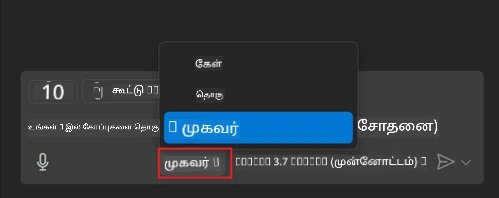
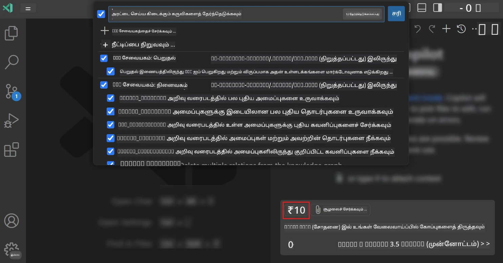
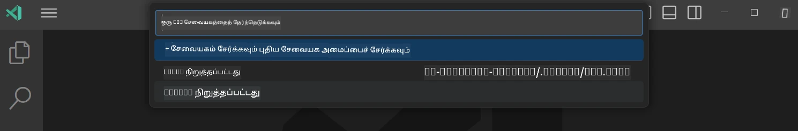
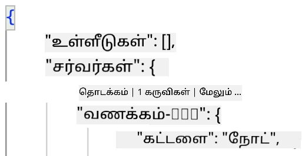
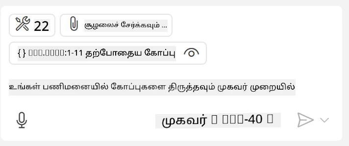
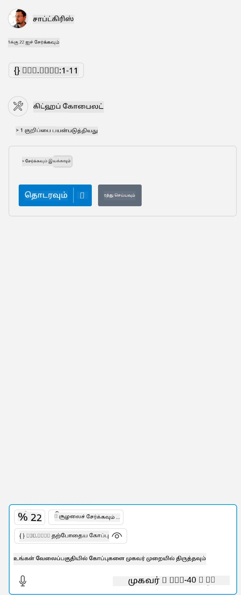

# GitHub Copilot Agent முறையில் ஒரு சர்வரை பயன்படுத்துதல்

Visual Studio Code மற்றும் GitHub Copilot ஒரு கிளையன்டாக செயல்பட்டு ஒரு MCP சர்வரை பயன்படுத்த முடியும். இது ஏன் வேண்டும் என்று நீங்கள் கேட்கலாம்? சரி, அதனால் MCP சர்வரின் எந்த பண்புகளும் இப்போது உங்கள் IDE இல் இருந்து பயன்படுத்தக்கூடியதாகும். உதாரணமாக GitHub இன் MCP சர்வரை நீங்கள் சேர்க்கப்படக் கூடியதை கற்பனையிடுங்கள், இது குறிப்பிட்ட கட்டளைகளை டெர்மினலில் টাইப்பிடுவதற்குப் பதிலாக வாய்ப்பு வழியாக GitHub ஐ கட்டுப்படுத்த அனுமதிக்கும். அல்லது உங்கள் டெவலப்பர் அனுபவத்தை எந்தவிதமாகவும் மேம்படுத்தக்கூடிய எதுவும் இயற்கை மொழி மூலம் கட்டுப்படுத்தப்படக்கூடியதாக இருக்கலாம் என்று கற்பனை செய்க. இப்போது நீங்கள் வெற்றி பார்க்க ஆரம்பிக்கிறீர்களா?

## கண்ணோட்டம்

இந்த பாடம் Visual Studio Code மற்றும் GitHub Copilot இன் Agent முறையை உங்கள் MCP சர்வருக்கான கிளையன்டாக எப்படிச் பயன்படுத்துவது என்பதைக் கற்றுக்கொள்கிறது.

## கற்றல் இலக்குகள்

இந்த பாடம் முடிவில், நீங்கள்:

- Visual Studio Code மூலம் MCP சர்வரை பயன்படுத்த முடியும்.
- GitHub Copilot மூலம் கருவிகள் போன்ற செயல்பாடுகளை இயக்க முடியும்.
- உங்கள் MCP சர்வரை கண்டுபிடித்து நிர்வகிக்க Visual Studio Code ஐ கட்டமைக்கலாம்.

## பயன்பாடு

நீங்கள் உங்கள் MCP சர்வரை இரண்டு விதமாக கட்டுப்படுத்தலாம்:

- பயனர் இடைமுகம், இதை இந்த அதிகாரத்தில் பின்னர் எப்படி செய்வதென்பது காண்பீர்கள்.
- டெர்மினல், `code` கணினிமுறை மூலம் டெர்மினலில் இருந்து கட்டுப்படுத்துதல் சாத்தியமாகும்:

  உங்கள் பயனர் சுயவிவரத்தில் MCP சர்வரை சேர்க்க --add-mcp கட்டளை வரிசை விருப்பத்தைப் பயன்படுத்தி, JSON சர்வர் கட்டமைப்பை {\"name\":\"server-name\",\"command\":...} வடிவில் வழங்கவும்.

  ```
  code --add-mcp "{\"name\":\"my-server\",\"command\": \"uvx\",\"args\": [\"mcp-server-fetch\"]}"
  ```

### திரைப் படங்கள்





அடுத்த பகுதிகளில் நாம் காட்சிபடுத்தும் இடைமுகத்தை எப்படி பயன்படுத்துவது என்பதைக் காண்போம்.

## அணுகுமுறை

இது சமீபத்திய அளவில் எவ்வாறு அணுகவேண்டும் என்பதை இங்கே பார்க்கலாம்:

- MCP சர்வரை கண்டுபிடிக்கக் கோப்பை கட்டமைக்கவும்.
- அந்த சர்வரை துவக்கி/இணைத்து அதன் வகுப்புகளை பட்டியலிடவும்.
- அது கண்டுபிடிக்கப்பட்ட வகுப்புகளை GitHub Copilot உரையாடல் இடைமுகம் மூலம் பயன்படுத்தவும்.

சிறந்தது, இப்போது நாம் ஓட்டப்பாதையைப் புரிந்துகொண்டுள்ளோம், Visual Studio Code மூலம் MCP சர்வரைப் பயன்படுத்துவதற்கு ஒரு பயிற்சியை முயலுவோம்.

## பயிற்சி: ஒரு சர்வரை பயன்படுத்துதல்

இந்த பயிற்சியில், நீங்கள் உங்கள் MCP சர்வரை GitHub Copilot உரையாடல் இடைமுகத்தில் இருந்து பயன்படுத்தக்கூடிய வகையில் Visual Studio Code ஐ கட்டமைப்பீர்கள்.

### -0- முன்கூட்டு படி, MCP சர்வர் கண்டுபிடிப்பை செயல்படுத்தவும்

நீங்கள் MCP சர்வர்கள் கண்டுபிடிப்பை செயல்படுத்த வேண்டியிருக்கலாம்.

1. Visual Studio Code இல் `File -> Preferences -> Settings` வில் செல்லவும்.

1. "MCP" என்று தேடி, settings.json கோப்பில் `chat.mcp.discovery.enabled` ஐ செயல்படுத்தவும்.

### -1- கட்டமைப்பு கோப்பை உருவாக்கவும்

உங்கள் திட்ட ஃரூட்டில் ஒரு கட்டமைப்பு கோப்பை உருவாக்க ஆரம்பியுங்கள், MCP.json என்ற கோப்பை உருவாக்கி அதை .vscode என்ற அடைவில் வைக்க வேண்டும். இது இதுபோல இருக்க வேண்டும்:

```text
.vscode
|-- mcp.json
```

அடுத்து, ஒரு சர்வர் உள்ளீட்டை நீங்கள் எப்படி சேர்க்கலாம் என்பதைக் காண்போம்.

### -2- சர்வரை கட்டமைக்கவும்

*mcp.json* இற்குள் கீழ்காணும் உள்ளடக்கத்தை சேர்க்கவும்:

```json
{
    "inputs": [],
    "servers": {
       "hello-mcp": {
           "command": "node",
           "args": [
               "build/index.js"
           ]
       }
    }
}
```

மேலே கொடுக்கப்பட்டுள்ள எளிய எடுத்துக்காட்டு, Node.js இல் எழுதப்பட்ட ஒரு சர்வரை துவக்குவது எப்படி என்பதைக் காண்பிக்கிறது, மற்ற இயங்கு சூழல்களுக்கு சர்வரை துவக்க சரியான கட்டளையை `command` மற்றும் `args` பயன்படுத்தி குறிப்பிடுங்கள்.

### -3- சர்வரை துவங்கவும்

ஒரு உள்ளீட்டை சேர்த்துவிட்டதால், சர்வரை துவங்குவோம்:

1. *mcp.json* இல் உங்கள் உள்ளீட்டை கண்டறிந்து "play" சின்னத்தை கண்டுபிடிக்கவும்:

    

1. "play" சின்னத்தை கிளிக் செய்தால், GitHub Copilot Chat இல் கருவிகள் சின்னத்தில் கிடைக்கும் கருவிகளின் எண்ணிக்கை அதிகரிக்கும். அந்த கருவிகள் சின்னத்தை கிளிக் செய்தால் பதிவு செய்யப்பட்ட கருவிகளின் பட்டியலை காணலாம். நீங்கள் GitHub Copilot அவற்றை தொடர்புடையச் சுருக்கமாகப் பயன்படுத்த விரும்பினால் ஒவ்வொரு கருவியையும் சரிபார்க்க/சரிபார்ப்பிலக்க கூடும்:

  

1. ஒரு கருவியை இயக்க, உங்கள் கருவிகளில் ஒன்றின் விளக்கத்துடன் பொருந்தும் ஒரு கேள்வியை டைப் செய்யவும், உதாரணமாக "add 22 to 1" போன்ற கேள்வி:

  

  பதிலாக 23 என்று வரும் பதிலை நீங்கள் காண்பீர்கள்.

## பணியிடு

உங்கள் *mcp.json* கோப்பில் ஒரு சர்வர் உள்ளீட்டை சேர்த்து சர்வரை துவக்க/நிறுத்த முடியுமா என்பதை முயற்சி செய்யுங்கள். உங்கள் சர்வர் கருவிகளுடன் GitHub Copilot உரையாடல் இடைமுகத்தின் மூலம் தொடர்பு கொள்ளவும்.

## தீர்வு

[தீர்வு](./solution/README.md)

## முக்கியக் குறிப்புகள்

இந்த அதிகாரத்திலிருந்து பெறவேண்டிய முக்கிய அம்சங்கள் இவை:

- Visual Studio Code பல MCP சர்வர்களையும் அவற்றின் கருவிகளையும் பயன்படுத்த உதவும் சிறந்த கிளையன்ட்.
- GitHub Copilot Chat இடைமுகம் சர்வர்களுடன் தொடர்பு கொள்ளும் வழி.
- API விசைகள் போன்ற உள்ளீடுகளை பயனரிடம் கேட்டு, *mcp.json* கோப்பில் சர்வர் உள்ளீட்டின் போது MCP சர்வருக்கு அனுப்ப முடியும்.

## மாதிரிகள்

- [ஜாவா கணக்கீட்டாளர்](../samples/java/calculator/README.md)
- [.NET கணக்கீட்டாளர்](../../../../03-GettingStarted/samples/csharp)
- [ஜாவாஸ்கிரிப்ட் கணக்கீட்டாளர்](../samples/javascript/README.md)
- [டைப்ஸ்கிரிப்ட் கணக்கீட்டாளர்](../samples/typescript/README.md)
- [பைதான் கணக்கீட்டாளர்](../../../../03-GettingStarted/samples/python)

## கூடுதல் வளங்கள்

- [Visual Studio ஆவணங்கள்](https://code.visualstudio.com/docs/copilot/chat/mcp-servers)

## அடுத்தது என்ன

- அடுத்தது: [stdio சர்வர் உருவாக்குதல்](../05-stdio-server/README.md)

---

<!-- CO-OP TRANSLATOR DISCLAIMER START -->
**மறுப்பு**:
இந்த ஆவணம் AI மொழிபெயர்ப்பு சேவை [Co-op Translator](https://github.com/Azure/co-op-translator) பயன்படுத்தி மொழிபெயர்க்கப்பட்டுள்ளது. நாங்கள் துல்லியத்திற்காக முயற்சி செய்துள்ளோம், ஆனால் தானாக செய்யப்படும் மொழிபெயர்ப்புகளில் பிழைகள் அல்லது தவறுகள் இருக்கலாம் என்பதை கவனத்தில் கொள்ளவும். அசல் ஆவணம் அதன் தாய்மொழியில் அதிகாரப்பூர்வ ஆதாரமாக கருதப்பட வேண்டும். முக்கியமான தகவல்களுக்கு, தொழில்நுட்பமான மனித மொழிபெயர்ப்பு பரிந்துரைக்கப்படுகிறது. இந்த மொழிபெயர்ப்பைப் பயன்படுத்துவதால் ஏற்படும் எந்த தவறான புரிதல்கள் அல்லது தவறான விளக்கத்திற்கும் நாங்கள் பொறுப்பில்வில்லை.
<!-- CO-OP TRANSLATOR DISCLAIMER END -->