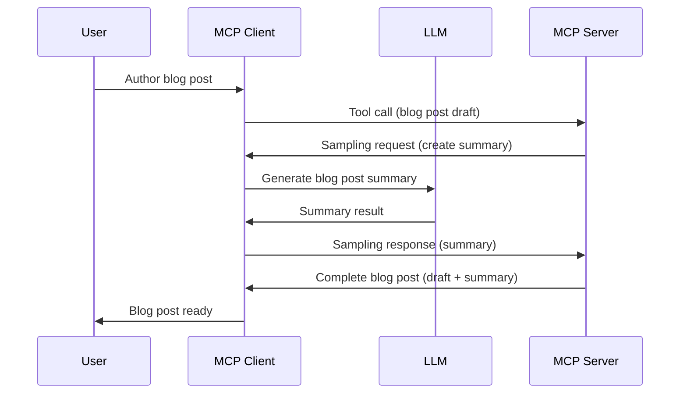

> [!WARNING]
> MCP `2026-07-28` இல் மாதிரிபார்க்குதல் இயலாமை செய்யப்பட்டது. இந்த பாடம்
> பழைய செயலாக்கங்களுக்காக வைத்திருக்கப்பட்டது. புதிய சேவையகங்கள் நேரடியாக LLM
> வழங்குநர் API உடன் ஒருங்கிணைக்க வேண்டும்.

# மாதிரிபார்க்குதல் - பணிகளை கிளையண்டுக்கு ஒப்படைக்கும்

> எடுத்துக்காட்டு `2026-07-28` விவரக்குறிப்பில் இணக்கமானதற்காகத் தொடர்கிறது மற்றும்
> 2027 ஜூலை 28-ஆம் தேதியன்று அல்லது அதற்கு பிறகு வெளியிடப்படும் முதல் திருத்தத்தில் அகற்றக்கூடியது.
> இக்கட்டத்தில் உள்ள உதாரணங்கள் `2025-11-25` ஐ செயல்படுத்தும் SDK APIs ஐப் பயன்படுத்தலாம்.
> பார்க்கவும் [MCP இல் என்ன மாற்றம் ஆகியுள்ளது: 2026-07-28 விவரக்குறிப்பு](../../01-CoreConcepts/mcp-2026-07-28.md).

பழைய செயலாக்கங்களில், சாம்பிளிங் என்பது MCP சேவையகம், கிளையண்ட் நிர்வகிக்கும் LLM இலிருந்து உதவி கேட்க அனுமதிக்கிறது.
புதிய செயலாக்கங்களுக்கு, தேர்ந்தெடுக்கப்பட்ட LLM வழங்குபவரை நேரடியாக அழைக்கவும்.


சாம்பிளிங் தொடர்புடைய சில பயன்பாடு நிலைகள் மற்றும் தீர்வுகளை கட்டமைப்பது எப்படி என்பதை ஆய்வு செய்வோம்.

## பார்வை

இந்த பாடத்தில், எப்போது மற்றும் எங்கே சாம்பிளிங் பயன்படுத்துவது மற்றும் அதை எங்கு அமைக்குவது என்பதைக் குறித்து கவனம் செலுத்துகின்றோம்.

## கற்றல் நோக்கங்கள்

இந்த அத்தியாயத்தில், நாம்:

- சாம்பிளிங் என்று என்னும் செயல் என்றால் என்ன மற்றும் அதை எப்போது பயன்படுத்த வேண்டும் என்பதைக் விளக்கவும்.
- MCP இல் சாம்பிளிங்கை எப்படி அமைக்குவது என்பதைக் காண்பிக்கவும்.
- செயல்பாட்டில் சாம்பிளிஙின் உதாரணங்களை வழங்கவும்.

## சாம்பிளிங் என்றால் என்ன மற்றும் இதன் பயன்பாடு ஏன்?

சாம்பிளிங் என்பது கீழ் கூறும் விதத்தில் செயல்படும் முன்னேற்றமடைந்த ஒரு வசதி:



### சாம்பிளிங் கோரிக்கை

சரி, நாங்கள் நம்பகமான சூழ்நிலையை ஒரு மைல் உயர ரீதியில் பார்வையிட்டோம், இப்பொழுது சர்வர் கிளையண்டிற்கு திருப்பி அனுப்பும் சாம்பிளிங் கோரிக்கையைப் பற்றி பேசுவோம். இந்த மாதிரியான கோரிக்கை JSON-RPC வடிவத்தில் இப்படிக் காணலாம்:

```json
{
  "jsonrpc": "2.0",
  "id": 1,
  "method": "sampling/createMessage",
  "params": {
    "messages": [
      {
        "role": "user",
        "content": {
          "type": "text",
          "text": "Create a blog post summary of the following blog post: <BLOG POST>"
        }
      }
    ],
    "modelPreferences": {
      "hints": [
        {
          "name": "gpt-5.1"
        }
      ],
      "intelligencePriority": 0.8,
      "speedPriority": 0.5
    },
    "systemPrompt": "You are a helpful assistant.",
    "maxTokens": 100
  }
}
```

இங்கே குறிப்பிடத்தக்க சில விஷயங்கள் உள்ளன:

- content -> text கீழ்ப்பாகத்தில் உள்ள Prompt என்பது LLM க்கு ஒரு கட்டளை, அது வலைப்பதிவு உள்ளடக்கத்தை சுருக்க பயன் படுத்தப்படுகிறது.

- **modelPreferences**. இந்த பகுதி வடிவமைப்புக்கான விருப்பங்கள் மற்றும் பரிந்துரைகளை உடையது. பயனர் இந்த பரிந்துரைகளை ஏற்கவோ மாற்றவோ முடியும். இங்கு பயன்படுத்த வேண்டிய மாடல், வேகம் மற்றும் அறிவு முன்னுரிமைக்கான பரிந்துரைகள் உள்ளன.
- **systemPrompt**, இது உங்கள் சாதாரண அமைப்பு குறிப்பு ஆகும், இது உங்கள் LLM க்கு ஒரு தனிப்பட்ட பண்பு கொடுத்துள்ளதுடன் வழிகாட்டும் அறிவுறுத்தல்களையும் கொண்டுள்ளது.
- **maxTokens**, இதுவொரு சொத்தை பயன்படுத்த வேண்டிய சீமைகளின் எண்ணிக்கையை குறிப்பிட பயன்படுத்தப்படுகிறது.

### பதிலளிப்பை மாதிரிப்பது

இந்த பதில் MCP கிளையனால் MCP சர்வருக்கு அனுப்பப்படும் முடிவு ஆகும் மற்றும் இது கிளையண்ட் LLM கேள்கிற போது கிடைக்கும் பதிலின் அடிப்படையில் கட்டப்படுகின்றது. JSON-RPCயில் இது இப்படியாக இருக்கும்:

```json
{
  "jsonrpc": "2.0",
  "id": 1,
  "result": {
    "role": "assistant",
    "content": {
      "type": "text",
      "text": "Here's your abstract <ABSTRACT>"
    },
    "model": "gpt-5.1",
    "stopReason": "endTurn"
  }
}
```

இந்த பதில் கோரப்பட்டபடி வலைப்பதிவு கட்டுரை சுருக்கம் ஆகும். கிளையண்ட்
சர்வரின் மாதிரி விருப்பத்திலிருந்து செயல்பாட்டில் உள்ள `gpt-5.1` பிரிவைத் தேர்ந்தெடுத்தது;
மாதிரி விருப்பங்கள் பரிந்துரைகளாகும், ஆகவே கிளையண்ட் தேவையான போது வேறு செயல்பாட்டில் உள்ள
பிரிவைத் தேர்ந்தெடுக்கலாம்.

சரி, இப்போது நம் தலைமைப் பாய்மாறும், "வலைப்பதிவு உருவாக்கம் + சுருக்கம்" என்ற பயனுள்ள பணி என புரிந்துகொண்டோம், இப்போது இயங்கச் செய்வதற்கு என்ன செய்வது என்று பார்ப்போம்.

### செய்தி வகைகள்

மாதிரிப்பதற்கான செய்திகள் வெறும் உரை மட்டுமல்லாமல் படங்கள் மற்றும் ஒலி அனுப்பவும் முடியும். JSON-RPC எப்படி வேறுபடுகிறது என்பதை இங்கே பார்க்கலாம்:

**உரை**

```json
{
  "type": "text",
  "text": "The message content"
}
```

**பட உள்ளடக்கம்**

```json
{
  "type": "image",
  "data": "base64-encoded-image-data",
  "mimeType": "image/jpeg"
}
```

**ஒலி உள்ளடக்கம்**

```json
{
  "type": "audio",
  "data": "base64-encoded-audio-data",
  "mimeType": "audio/wav"
}
```

> குறிப்பு: தற்போதைய நிலை மற்றும் மாற்ற வழிகாட்டலுக்கு, காண்க
> [நிராகரிக்கப்பட்ட மாதிரித்தல் ஆவணம்](https://modelcontextprotocol.io/specification/2026-07-28/client/sampling).

## கிளையண்டில் மாதிரித்தலை எப்படி அமைப்பது

> குறிப்பு: நீங்கள் ஒரு சர்வரை மட்டுமே கட்டியிருக்கின்றால், இங்கு அதிகம் செய்ய தேவையில்லை.

ஒரு கிளையண்டில், பின்வரும் அம்சத்தை இதுபோல குறிப்பிட வேண்டும்:

```json
{
  "capabilities": {
    "sampling": {}
  }
}
```

நீங்கள் தேர்ந்தெடுத்த கிளையண்ட் சர்வருடன் தொடங்கும்போது இது எடுத்துக்கொள்ளப்படும்.

## செயலில் மாதிரித்தல் உதாரணம் - ஒரு வலைப்பதிவு உருவாக்குக

வாருங்கள் ஒரு சாம்பிளிங் சர்வரை சேர்த்து நிரலாக்குவோம், நமக்கு பின்வருமாறு செய்ய வேண்டியுள்ளது:

1. சர்வரில் ஒரு கருவியை உருவாக்குக.
1. உட்கார்ந்த கருவி ஒரு சாம்பிளிங் கோரிக்கையை உருவாக்க வேண்டும்
1. கருவி கிளையன்ட் முழு சாம்பிளிங் கோரிக்கைக்கு பதில் வர வாய்ப்பு கொடுக்கும் வரை காத்திருக்க வேண்டும்.
1. பின்னர் அந்த கருவியின் முடிவுகளை உருவாக்க வேண்டும்.

வாருங்கள் கட்டற்றப்பட்ட முறையில் குறியீட்டை பார்க்கலாம்:

### -1- கருவியை உருவாக்குதல்

**python**

```python
@mcp.tool()
async def create_blog(title: str, content: str, ctx: Context[ServerSession, None]) -> str:
    """Create a blog post and generate a summary"""

```

### -2- சாம்பிளிங் கோரிக்கையை உருவாக்குதல்

கீழ்க்காணும் குறியீட்டுடன் உங்கள் கருவியை நீட்டிக்கவும்:

**python**

```python
post = BlogPost(
        id=len(posts) + 1,
        title=title,
        content=content,
        abstract=""
    )

prompt = f"Create an abstract of the following blog post: title: {title} and draft: {content} "

result = await ctx.session.create_message(
        messages=[
            SamplingMessage(
                role="user",
                content=TextContent(type="text", text=prompt),
            )
        ],
        max_tokens=100,
)

```

### -3- பதிலை காத்திருந்து பதிலை திருப்ப வழங்கல்

**python**

```python
post.abstract = result.content.text

posts.append(post)

# return the complete product
return json.dumps({
    "id": post.title,
    "abstract": post.abstract
})
```

### -4- முழு குறியீடு

**python**

```python
from starlette.applications import Starlette
from starlette.routing import Mount, Host

from mcp.server.fastmcp import Context, FastMCP

from mcp.server.session import ServerSession
from mcp.types import SamplingMessage, TextContent

import json


from uuid import uuid4
from typing import List
from pydantic import BaseModel


mcp = FastMCP("Blog post generator")

# app = FastAPI()

posts = []

class BlogPost(BaseModel):
    id: int
    title: str
    content: str
    abstract: str

posts: List[BlogPost] = []

@mcp.tool()
async def create_blog(title: str, content: str, ctx: Context[ServerSession, None]) -> str:
    """Create a blog post and generate a summary"""

    post = BlogPost(
        id=len(posts) + 1,
        title=title,
        content=content,
        abstract=""
    )

    prompt = f"Create an abstract of the following blog post: title: {title} and draft: {content} "

    result = await ctx.session.create_message(
        messages=[
            SamplingMessage(
                role="user",
                content=TextContent(type="text", text=prompt),
            )
        ],
        max_tokens=100,
    )

    post.abstract = result.content.text

    posts.append(post)

    # return the complete blog post
    return json.dumps({
        "id": post.title,
        "abstract": post.abstract
    })

if __name__ == "__main__":
    print("Starting server...")
    # mcp.run()
    mcp.run(transport="streamable-http")

# run app with: python server.py
```

### -5- Visual Studio Code இல் சோதனை

இதை Visual Studio Code இல் சோதிக்க, பின்வருமாறு செய்க:

1. டெர்மினலில் சர்வரை துவங்கு
1. இதை *mcp.json* இல் சேர்க்கவும் (துவங்கியிருக்க வேண்டும்) உதாரணமாக இதுபோல்:

   ```json
   "servers": {
      "blog-server": {
        "type": "http",
        "url": "http://localhost:8000/mcp"
      }
   }
   ```

1. ஒரு பிராம்ட் டைப் செய்யவும்:

   ```text
   create a blog post named "Where Python comes from", the content is "Python is actually named after Monty Python Flying Circus"
   ```

1. சாம்பிளிங் நடைபெற அனுமதிக்கவும். முதலில் நீங்கள் இதை சோதிக்கும் போது கூடுதல் உரையாடல் பெட்டி தோன்றும் அதை ஒப்புக்கொண்டு பின்னர் சாதாரண கருவி இயக்க கேட்கும் உரையாடல் பெட்டி தோன்றும்

1. முடிவுகளை ஆய்வு செய்யவும். முடிவுகள் GitHub Copilot Chat இல் அழகாக காண்பிக்கப்படும் மற்றும் நீங்கள் அரைநடுநிலை JSON பதிலையும் ஆய்வு செய்யலாம்.

**போனஸ்**. Visual Studio Code கருவிகள் சாம்பிளிங்கில் சிறந்த ஆதரவைக் கொண்டுள்ளன. உங்கள் நிறுவப்பட்ட சர்வரில் சாம்பிளிங் அணுகலை கீழ்காணும் முறைப்படி அமைக்கலாம்:

1. விரிவாக்க பகுதியை அணுகவும்.
1. "MCP சேவையகங்கள் - நிறுவப்பட்டவை" பிரிவில் உங்கள் நிறுவிய சேவையகத்திற்கான காக்கின் ஐக்கானை தேர்வு செய்க.
1 "மாதிரி அணுகலை அமைக்க" தேர்வு செய்க, இங்கு GitHub Copilot மாதிரிகள் மாதிரிப்படியில் பயன்படுத்த அனுமதிக்கப்படும் மாதிரிகளை நீங்கள் தேர்வு செய்யலாம். "மாதிரிப்படி கோரிக்கைகளை காண்பி" என்பதை தேர்வு செய்து சமீபத்தில் நடந்த எல்லா மாதிரிப்படி கோரிக்கைகளையும் பார்க்கலாம்.

## பணிகள்

இந்த பணியில், நீங்கள் ஒரு வித்தியாசமான மாதிரிப்படியை உருவாக்கப்போகின்றீர்கள், அதாவது ஒரு மாதிரிப்படி ஒருங்கிணைப்பை உருவாக்க வேண்டும், இது ஒரு தயாரிப்பு விளக்கத்தை உருவாக்குவதற்கு ஆதரவாக இருக்கும். உங்கள் சூழல் இதுவாகும்:

**சூழல்**: ஒரு மின்னணு வணிகத்தின் பின்புற தொழிலாளர் உதவி தேவை படுகிறான், தயாரிப்பு விளக்கங்களை உருவாக்க அதிகமாக நேரம் செல்கிறது. ஆகையால், நீங்கள் ஒரு கருவி "create_product" என்று அழைக்கும் தீர்வை உருவாக்க வேண்டும், இதில் "தலைப்பு" மற்றும் "முக்கியவசதிகள்" என்ற காரணிகளுடன் அழைத்தல், மற்றும் இது ஒரு முழு தயாரிப்பையும் உருவாக்க வேண்டும், அதில் "விளக்கம்" என்ற புலம் இருக்கும், இது வாடிக்கையாளர் LLM மூலம் நிரப்பப்பட வேண்டும்.

குறிப்புரை: முன்பு கற்றுக்கொண்டதைப் பயன்படுத்தி இந்த சேவையகத்தையும் அதன் கருவியையும் ஒரு மாதிரிப்படி கோரிக்கையை கொண்டு உருவாக்கவும்.

## தீர்வு

[தீர்வு](./solution/README.md)

## முக்கியமான எடுத்துக்காட்டுகள்

மாதிரிப்படி என்பது ஒரு சக்திவாய்ந்த அம்சம், இது சேவையகத்துக்கு LLM உதவிக்கு தேவையானபோது பணிகளை வாடிக்கையாளருக்கு ஒப்படைக்க அனுமதிக்கிறது.

## அடுத்து என்ன

- [அத்தியாயம் 4 - நடைமுறை செயல்படுத்தல்](../../04-PracticalImplementation/README.md)

---

<!-- CO-OP TRANSLATOR DISCLAIMER START -->
**மறுப்பு**:
இந்த ஆவணம் AI மொழிபெயர்ப்பு சேவை [Co-op Translator](https://github.com/Azure/co-op-translator) பயன்படுத்தி மொழிபெயர்க்கப்பட்டுள்ளது. நாங்கள் துல்லியத்திற்காக முயற்சி செய்துள்ளோம், ஆனால் தானாக செய்யப்படும் மொழிபெயர்ப்புகளில் பிழைகள் அல்லது தவறுகள் இருக்கலாம் என்பதை கவனத்தில் கொள்ளவும். அசல் ஆவணம் அதன் தாய்மொழியில் அதிகாரப்பூர்வ ஆதாரமாக கருதப்பட வேண்டும். முக்கியமான தகவல்களுக்கு, தொழில்நுட்பமான மனித மொழிபெயர்ப்பு பரிந்துரைக்கப்படுகிறது. இந்த மொழிபெயர்ப்பைப் பயன்படுத்துவதால் ஏற்படும் எந்த தவறான புரிதல்கள் அல்லது தவறான விளக்கத்திற்கும் நாங்கள் பொறுப்பில்வில்லை.
<!-- CO-OP TRANSLATOR DISCLAIMER END -->