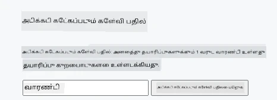
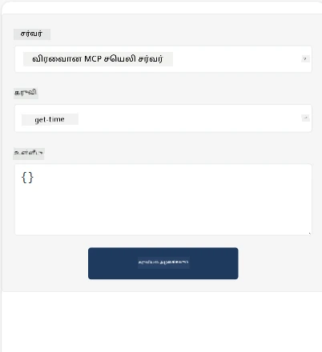
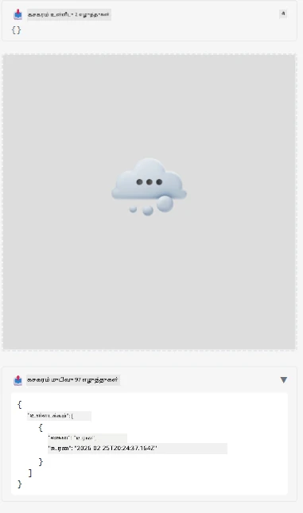

இது MCP App-ஐ விளக்கும் ஒரு உதாரணம்.

## நிறுவல் 

1. *mcp-app* கோப்பகத்திற்கு செல்லவும்
1. `npm install` இயக்கவும், இது முன்னணி மற்றும் பின்னணி சார்புகளை நிறுவும்

பின்னணி தொகுக்கப்படுகிறதா என்பதை சரிபார்க்க இயக்கவும்:

```sh
npx tsc --noEmit
```

எல்லாம் சரியாக இருந்தால் எந்தவொரு வெளியீடும் இல்லாமலிருக்க வேண்டும்.

## பின்னணியை இயக்கவும்

> நீங்கள் Windows இயந்திரத்தில் இருந்தால் இது சில கூடுதல் வேலைகளை தேவைப்படுத்தும், ஏனெனில் MCP Apps தீர்வு ஓட `concurrently` நூலகத்தை பயன்படுத்துகிறது, அதற்கு மாற்று கண்டுபிடிக்க வேண்டும். இதோ MCP App-இல் பிரச்சனைசெய்யும் வரி *package.json*:

```json
"start": "concurrently \"cross-env NODE_ENV=development INPUT=mcp-app.html vite build --watch\" \"tsx watch main.ts\""
```

இந்த செயலியில் இரண்டு பகுதிகள் உள்ளன: ஒரு பின்னணி பகுதி மற்றும் ஒரு ஹோஸ்ட் பகுதி.

பின்னணியை தொடங்க கீழ்க்காணும் கட்டளையை அழைக்கவும்:

```sh
npm start
```

இது `http://localhost:3001/mcp` இல் பின்னணியைத் தொடங்கும்.

> குறிப்பு: நீங்கள் Codespace-இல் இருந்தால், போர்ட் காட்சித்திறனை public ஆக அமைக்க வேண்டும். உலாவியில் https://<name வழியாக Codespace>.app.github.dev/mcp இலக்கை அணுக முடிகிறதா என்பதை சரிபார்க்கவும்

## தேர்வு -1 Visual Studio Code இல் செயலியை சோதிக்கவும்

Visual Studio Code-இல் தீர்வை சோதிக்க, பின்வருவன செய்யவும்:

- `mcp.json`-இல் கீழ் கூறியபடி ஒரு சர்வர் பதிவைச் சேர்க்கவும்:

    ```json
    {
        "servers": {
            "my-mcp-server-7178eca7": {
                "url": "http://localhost:3001/mcp",
                "type": "http"
            }
        },
        "inputs": []
    }
    ```

1. *mcp.json* இல் உள்ள "start" பொத்தானை கிளிக் செய்யவும்
1. ஒரு உரையாடல் சாளரம் திறந்திருப்பதாக உறுதிசெய்து `get-faq` என தட்டச்சு செய்யவும், கீழ்வருமாறு ஒரு முடிவை காண்பீர்கள்:

    

## Choice -2- Test the app with a host

The repo <https://github.com/modelcontextprotocol/ext-apps> contains several different hosts that you can use to test your MVP Apps. 

இங்கே இரண்டு வெவ்வேறு விருப்புகள் வழங்கப்பட உள்ளன:

### உள்ளக இயந்திரம்

- ரெப்போவை கிளோன் செய்த பின் *ext-apps* க்கு செல்லவும்.

- சார்புகளை நிறுவவும்

   ```sh
   npm install
   ```

- வேறு ஒரு டெர்மினல் சாளரத்தில், *ext-apps/examples/basic-host* க்கு செல்லவும்

    > Codespace-இல் இருந்தால், serve.ts மற்றும் வரி 27 க்கு செல்லி http://localhost:3001/mcp ஐ உங்கள் Codespace-ன் பின்னணிக்கான URL-ஆக மாற்ற வேண்டும்; உதாரணமாக https://psychic-xylophone-657rpjgvxpc5g64-3001.app.github.dev/mcp

- ஹோஸ்டை இயக்கவும்:

    ```sh
    npm start
    ```

    இது ஹோஸ்டை பின்னணியுடன் இணைத்து செயலி இவ்வாறு இயங்குவது போல காண்பிக்கும்:

    

### Codespace

Codespace சூழலை செயல்படுத்த சிறிது கூடுதல் வேலை தேவை. Codespace மூலம் ஹோஸ்டைப் பயன்படுத்த:

- *ext-apps* அடைவைக் காணவும் மற்றும் *examples/basic-host*க்கு செல்லவும்.
- சார்புகளை நிறுவ `npm install` ஐ இயக்கவும்
- ஹோஸ்டை தொடங்க `npm start` ஐ இயக்கவும்.

## செயலியை சோதிக்கவும்

செயலியை கீழ்காணும் முறையில் முயற்சிக்கவும்:

- "Call Tool" பொத்தானை தேர்ந்தெடுக்கவும், நீங்கள் கீழ் காட்டப்பட்டுள்ள போன்று முடிவுகளை பார்க்க வேண்டும்:

    

சிறந்தது, அனைத்தும் சரியாக வேலை செய்கின்றன.

---

<!-- CO-OP TRANSLATOR DISCLAIMER START -->
**மறுப்பு**:
இந்த ஆவணம் AI மொழிபெயர்ப்பு சேவை [Co-op Translator](https://github.com/Azure/co-op-translator) பயன்படுத்தி மொழிபெயர்க்கப்பட்டுள்ளது. நாங்கள் துல்லியத்திற்காக முயற்சி செய்துள்ளோம், ஆனால் தானாக செய்யப்படும் மொழிபெயர்ப்புகளில் பிழைகள் அல்லது தவறுகள் இருக்கலாம் என்பதை கவனத்தில் கொள்ளவும். அசல் ஆவணம் அதன் தாய்மொழியில் அதிகாரப்பூர்வ ஆதாரமாக கருதப்பட வேண்டும். முக்கியமான தகவல்களுக்கு, தொழில்நுட்பமான மனித மொழிபெயர்ப்பு பரிந்துரைக்கப்படுகிறது. இந்த மொழிபெயர்ப்பைப் பயன்படுத்துவதால் ஏற்படும் எந்த தவறான புரிதல்கள் அல்லது தவறான விளக்கத்திற்கும் நாங்கள் பொறுப்பில்வில்லை.
<!-- CO-OP TRANSLATOR DISCLAIMER END -->