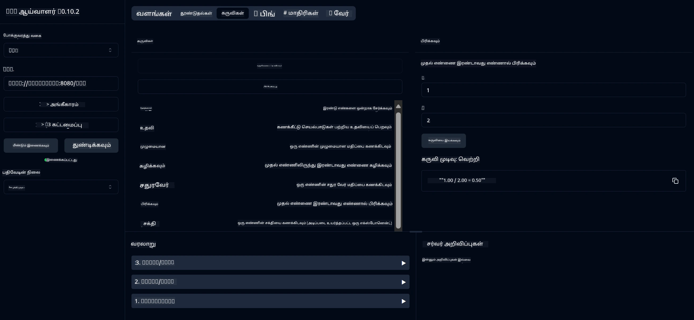

# அடிப்படை கால்குலேட்டர் MCP சேவை

> [!NOTE]
> இந்த மாதிரி பழைய HTTP+SSE போக்குவரத்தை பயன்படுத்துகிறது மற்றும் MCP உடன் பொருந்தக்கூடிய SDK-ஐ இலக்காகக் கொண்டுள்ளது
> MCP `2025-11-25`. புதிய ரிமோட் சர்வர்கள் `2026-07-28` Streamable
> HTTP ஆதரவு.

இந்த சேவை Spring Boot மற்றும் WebFlux போக்குவரத்தைப் பயன்படுத்தி Model Context Protocol (MCP) வழியாக அடிப்படை கணக்கைப் பண்புகளை வழங்குகிறது. இது MCP நடைமுறைகள் பற்றிக் கற்கும் தொடக்கநுட்ப பயனாளிகளுக்கான ஒரு எளிய உதாரணமாக வடிவமைக்கப்பட்டுள்ளது.

மேலும் தகவலுக்கு, [MCP Server Boot Starter](https://docs.spring.io/spring-ai/reference/api/mcp/mcp-server-boot-starter-docs.html) குறிப்பு ஆவணத்தைப் பார்க்கவும்.

## கண்ணோட்டம்

சேவை காட்டுகிறது:
- SSE (Server-Sent Events) ஆதரவு
- Spring AI இன் `@Tool` அனோட்டேஷனைப் பயன்படுத்தி கருவிகளை தானாக பதிவு செய்தல்
- அடிப்படை கணக்கியல் செயல்பாடுகள்:
  - கூட்டல், கழித்தல், பெருக்கல், வகுத்தல்
  - பவர் கணக்கீடு மற்றும் சதுரமூலம்
  - modulus (மீதம்) மற்றும் absolute value (முழு மதிப்பு)
  - செயல்பாடுகளுக்கான உதவி செயல்பாடு

## அம்சங்கள்

இந்த கணக்கீட்டு சேவை பின்வரும் திறன்களை வழங்குகிறது:

1. **அடிப்படை கணித செயல்பாடுகள்**:
   - இரண்டு எண்களின் கூட்டம்
   - ஒரு எண்ணை மற்றொன்றிலிருந்து கழித்தல்
   - இரண்டு எண்களின் பெருக்கல்
   - ஒரு எண்ணை மற்றொன்றால் வகுத்தல் (பூஜ்யத்தினால் வகுத்தல் சரிபார்ப்பு உடன்)

2. **மேம்பட்ட செயல்பாடுகள்**:
   - பவர் கணக்கீடு (ஒரு அடிப்படை எண்ணை ஒரு எக்ஸ்போனென்டிற்குச் உயர்த்துதல்)
   - சதுரமூலம் கணக்கீடு (எதிர்மறை எண் சரிபார்ப்பு உடன்)
   - modulus (மீதம்) கணக்கீடு
   - absolute value (முழு மதிப்பு) கணக்கீடு

3. **உதவி அமைப்பு**:
   - கிடைக்கும் அனைத்து செயல்பாடுகளையும் விளக்கும் உள்ளமைக்கப்பட்ட உதவி செயல்பாடு

## சேவையைப் பயன்படுத்துதல்

MCP நெறிமுறையின் மூலம் சேவை பின்வரும் API முனைகளைக் காண்பிக்கிறது:

- `add(a, b)`: இரண்டு எண்களை சேர்க்க
- `subtract(a, b)`: இரண்டாவது எண்ணை முதல் எண்ணிலிருந்து கழிக்கவும்
- `multiply(a, b)`: இரண்டு எண்களை பெருக்கவும்
- `divide(a, b)`: முதல் எண்ணை இரண்டாவது எண்ணால் வகுக்கவும் (பூஜ்யப் பரிசோதனை உடன்)
- `power(base, exponent)`: ஒரு எண்ணின் சக்தியை கணக்கிடவும்
- `squareRoot(number)`: சதுரமூலத்தை கணக்கிடவும் (எதிர்மறை எண் சரிபார்ப்பு உடன்)
- `modulus(a, b)`: வகுத்தபோது மீதியை கணக்கிடவும்
- `absolute(number)`: முழுமையான மதிப்பை கணக்கிடவும்
- `help()`: கிடைக்கக்கூடிய செயல்பாடுகள் பற்றிய தகவலைப் பெறவும்

## Test Client

ஒரு எளிய சோதனை கிளையன்ட் `com.microsoft.mcp.sample.client` package-இல் சேர்க்கப்பட்டுள்ளது. `SampleCalculatorClient` வகுப்பு கணக்கீட்டு சேவையின் கிடைக்கக்கூடிய செயல்பாடுகளை காம்பிரூ செய்யிறது.

## Using the LangChain4j Client

திட்டத்தில் ஒரு LangChain4j எடுத்துக்காட்டு கிளையன்்ட் உள்ளது
`com.microsoft.mcp.sample.client.LangChain4jClient`, இது எவ்வாறு
கணக்கீட்டு சேவையை Microsoft Foundry மாதிரியுடன் ஒருங்கிணைப்பது என்பதைக் காட்டுகிறது.

### Prerequisites

1. Microsoft Foundry வளத்தை உருவாக்கி செயலில் இருக்கும் மாதிரியை வழங்கவும், உதாரணமாக
   `gpt-5.1`.
2. மாதிரி endpoint, API விசை, மற்றும் deployment பெயரை அமைக்கவும்:

   ```bash
   export AZURE_OPENAI_ENDPOINT="https://<resource-name>.openai.azure.com"
   export AZURE_OPENAI_API_KEY="<api-key>"
   export AZURE_OPENAI_DEPLOYMENT="gpt-5.1"
   ```

3. சரிபார்க்கவும்
   [Microsoft Foundry மாதிரி ஓய்வு அட்டவணை](https://learn.microsoft.com/azure/foundry/openai/concepts/model-retirement-schedule)
   deployment தேர்வு செய்வதற்கு முன்.
4. கணக்கீட்டு சர்வர் `localhost:8080`-இல் இயங்கிக் கொண்டிருக்கிறதா என்பதைக் உறுதிசெய்யவும்.

### Running the LangChain4j Client

இந்த எடுத்துக்காட்டு காட்டுகிறது:
- SSE போக்குவரத்தின் மூலம் கணக்கீட்டுக் MCP சர்வருடன் இணைத்தல்
- LangChain4j-ஐப் பயன்படுத்தி கணக்கீட்டு செயல்பாடுகளை பயன்படுத்தும் ஒரு chat bot உருவாக்குதல்
- பணியில் இருக்கும் Microsoft Foundry மாதிரியுடன் ஒருங்கிணைத்தல்

கிளையன்ட் செயல்பாடுகளை காண்பிக்க பின்வரும் மாதிரி கேள்விகளை அனுப்புகிறது:
1. இரண்டு எண்களின் மொத்தத்தை கணக்கிடுதல்
2. ஒரு எண்ணின் சதுரமூலத்தை கணக்கிடுதல்
3. கிடைக்கக்கூடிய கணக்கீட்டு செயல்பாடுகள் பற்றி உதவி தகவலைப் பெறுதல்

உதாரணத்தை இயக்கி, AI மாதிரி கேள்விகளுக்கு பதிலளிக்க கணக்கீட்டு கருவிகளை எப்படி பயன்படுத்துகிறது என்பதை காண கான்சோல் வெளியீட்டை சரிபார்க்கவும்.

### Microsoft Foundry Model Configuration

LangChain4j கிளையன்ட் Microsoft Foundry வழங்கும் Azure OpenAI v1-பொருந்தக்கூடிய endpoint-ஐப் பயன்படுத்துகிறது:
Microsoft Foundry:

```java
String endpoint = System.getenv("AZURE_OPENAI_ENDPOINT");
ChatLanguageModel model = OpenAiOfficialChatModel.builder()
   .baseUrl(endpoint.replaceAll("/+$", "") + "/openai/v1/")
   .apiKey(System.getenv("AZURE_OPENAI_API_KEY"))
   .isAzure(true)
   .modelName(System.getenv().getOrDefault("AZURE_OPENAI_DEPLOYMENT", "gpt-5.1"))
    .timeout(Duration.ofSeconds(60))
    .build();
```

`AZURE_OPENAI_DEPLOYMENT` என்பது மாதிரி deploy செய்யப்பட்டபோது வழங்கப்பட்ட பெயருடன் பொருந்த வேண்டும்
deploy செய்யப்பட்டபோது அமைக்கப்பட்ட பெயர் அடிப்படை மாதிரி பெயரிலிருந்து வேறாக இருக்கலாம்.

## சார்புகள்

இந்த திட்டத்திற்கு பின்வரும் முக்கிய சார்பு தொகுப்புகள் தேவையாகின்றன:

```xml
<!-- For MCP Server -->
<dependency>
    <groupId>org.springframework.ai</groupId>
    <artifactId>spring-ai-starter-mcp-server-webflux</artifactId>
</dependency>

<!-- For LangChain4j integration -->
<dependency>
    <groupId>dev.langchain4j</groupId>
    <artifactId>langchain4j-mcp</artifactId>
    <version>${langchain4j.version}</version>
</dependency>

<!-- For Microsoft Foundry's OpenAI-compatible endpoint -->
<dependency>
    <groupId>dev.langchain4j</groupId>
   <artifactId>langchain4j-open-ai-official</artifactId>
    <version>${langchain4j.version}</version>
</dependency>
```

## திட்டத்தை கட்டமைத்து உருவாக்குதல்

Maven-ஐப் பயன்படுத்தி திட்டத்தை கட்டவும்:
```bash
./mvnw clean install -DskipTests
```

## சர்வரை இயக்குதல்

### Java-ஐ பயன்படுத்துதல்

```bash
java -jar target/calculator-server-0.0.1-SNAPSHOT.jar
```

### MCP Inspector-ஐ பயன்படுத்துதல்

MCP Inspector என்பது MCP சேவைகளுடன் தொடர்பு கொள்ள உதவும் ஒரு பயனுள்ள கருவி. இதனை இந்த கணக்கீட்டு சேவையுடன் பயன்படுத்த:

1. **MCP Inspector ஐ நிறுவி இயக்கவும்** புதிய டெர்மினல் விண்டோவில்:
   ```bash
   npx @modelcontextprotocol/inspector
   ```

2. **வலை UI-விற்கு அணுகவும்** செயலியில் காட்டப்படும் URL-ஐ கிளிக் செய்து (பொதுவாக http://localhost:6274)

3. **இணைப்பை கட்டமைக்கவும்**:
   - போக்குவரத்துத்தகத்தை "SSE" ஆக அமைக்கவும்
   - உங்கள் இயங்கும் சர்வரின் SSE endpoint ஐ URL ஆக அமைக்கவும்: `http://localhost:8080/sse`
   - "Connect" ஐ கிளிக் செய்யவும்

4. **கருவிகளைப் பயன்படுத்தவும்**:
   - "List Tools" ஐ கிளிக் செய்து கிடைக்கும் கணக்கீட்டு செயல்பாடுகளை காணவும்
   - ஒரு கருவியைத் தேர்ந்தெடுத்து "Run Tool" ஐ கிளிக் செய்து செயல்பாட்டை இயக்கவும்



### Docker-ஐ பயன்படுத்துதல்

திட்டத்தில் ஒரு கண்டெய்னரை உருவாக்குவதற்கான Dockerfile உள்ளது:

1. **Docker படத்தை உருவாக்கவும்**:
   ```bash
   docker build -t calculator-mcp-service .
   ```

2. **Docker கண்டெய்னரை இயக்கவும்**:
   ```bash
   docker run -p 8080:8080 calculator-mcp-service
   ```

இது பின்வருவன செய்யும்:
- Maven 3.9.9 மற்றும் Eclipse Temurin 24 JDK உடன் ஒரு பல-நிலை Docker படத்தை உருவாக்கும்
- ஒரு 최적화 செய்யப்பட்ட கண்டெய்னர் படம் உருவாக்கும்
- சேவையை போர்ட் 8080-ல் வெளிப்படுத்தும்
- கண்டெய்னருக்குள் MCP கணக்கீட்டு சேவையை துவக்கவும்

கண்டெய்னர் இயங்கத் தொடங்கியவுடன், நீங்கள் சேவையை `http://localhost:8080`-இல் அணுகலாம்.

## பிழை தீர்வு

### பொதுவான மாதிரி இணைப்பு பிரச்சனைகள்

1. **அங்கீகார பிழைகள்**: `AZURE_OPENAI_API_KEY` என்பது
   `AZURE_OPENAI_ENDPOINT` மூலம் அடையாளம் காணப்படும் resource-க்கு சேர்ந்து இருக்கிறதா என்பதை உறுதிசெய்யவும்.
2. **Deployment காணப்படவில்லை**: `AZURE_OPENAI_DEPLOYMENT` சரியாக பொருந்துகிறதா என்பதை உறுதிசெய்யவும்
   Microsoft Foundry-இல் உள்ள deployment பெயருடன்.
3. **Rate limiting**: deployment வரம்பைக் (quota) பரிசீலிக்கவும் மற்றும்
   சேவையால் திருப்பி அனுப்பப்படும் இடைவெளிக்கு பிறகு மீண்டும் முயற்சி செய்யவும்.

மேலும் உதவிக்கு, பார்க்கவும்
[LangChain4j ஆவணங்கள்](https://github.com/langchain4j/langchain4j) மற்றும்
[Microsoft Foundry ஆவணங்கள்](https://learn.microsoft.com/azure/ai-foundry/).

---

<!-- CO-OP TRANSLATOR DISCLAIMER START -->
**மறுப்பு**:
இந்த ஆவணம் AI மொழிபெயர்ப்பு சேவை [Co-op Translator](https://github.com/Azure/co-op-translator) பயன்படுத்தி மொழிபெயர்க்கப்பட்டுள்ளது. நாங்கள் துல்லியத்திற்காக முயற்சி செய்துள்ளோம், ஆனால் தானாக செய்யப்படும் மொழிபெயர்ப்புகளில் பிழைகள் அல்லது தவறுகள் இருக்கலாம் என்பதை கவனத்தில் கொள்ளவும். அசல் ஆவணம் அதன் தாய்மொழியில் அதிகாரப்பூர்வ ஆதாரமாக கருதப்பட வேண்டும். முக்கியமான தகவல்களுக்கு, தொழில்நுட்பமான மனித மொழிபெயர்ப்பு பரிந்துரைக்கப்படுகிறது. இந்த மொழிபெயர்ப்பைப் பயன்படுத்துவதால் ஏற்படும் எந்த தவறான புரிதல்கள் அல்லது தவறான விளக்கத்திற்கும் நாங்கள் பொறுப்பில்வில்லை.
<!-- CO-OP TRANSLATOR DISCLAIMER END -->