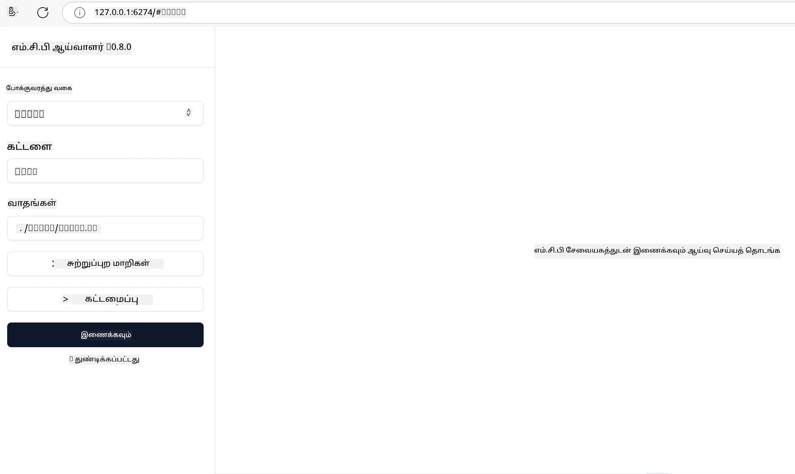

# நடைமுறை வடிவமைப்பு

[](https://youtu.be/vCN9-mKBDfQ)

_(இந்த பாடத்தின் வீடியோவைப் பார்ப்பதற்கு மேலே உள்ள படத்தைக் கிளிக் செய்யவும்)_

நடைமுறை வடிவமைப்பு என்பது மாடல் கன்டெக்ஸ்ட் புரோட்டோக்கோல் (MCP) யின் சக்தி புரிதலுக்கு ஆளுமை கிடைக்கும் இடம். MCP என்பதன் கோட்பாடு மற்றும் கட்டமைப்பை புரிந்துகொள்வது முக்கியமானாலும், இந்தக் கொள்கைகளை நடைமுறையில் பயன்படுத்தி, உண்மையான உலகப் பிரச்சினைகளை தீர்க்கும் தீர்வுகளை உருவாக்க, சோதிக்க மற்றும் வெளியிடும் போது உண்மையான மதிப்பு வெளிப்படுகிறது. இந்த அத்தியாயம் கருத்தியல் அறிவும் கைமுறை மேம்பாட்டும் இடையேயான இடைவெளியை இணைக்கிறது மற்றும் MCP அடிப்படையிலான செயலிகளுக்கு உயிர் கொடுக்குமாறு வழிகாட்டுகிறது.

அறிவாற்றல் உதவியாளர்களை உருவாக்குவதோ, AI யை வணிக பணிச் சுற்றுகளில் ஒருங்கிணைப்பதோ அல்லது தரவு செயலாக்கத்திற்கு தனிப்பயன் கருவிகள் உருவாக்குவதோ என எது இருந்தாலும், MCP ஒரு நெகிழ்வான அடித்தளத்தை வழங்குகிறது. இதன் மொழி-அக்னோஸ்டிக் வடிவமைப்பு மற்றும் பிரபலமான நிரலாக்க மொழிகளுக்கான அதிகாரப்பூர்வ SDKகள் பல்வேறு மேம்பாட்டாளர்களுக்கு அணுகல் வலுவாக இருக்க உதவுகிறது. இந்த SDKகளைப் பயன்படுத்தி நீங்கள் விரைவில் புரொட்டோடைப் செய்ய, திருத்தம் செய்ய மற்றும் பல்வேறு தளங்கள் மற்றும் சூழல்களில் உங்கள் தீர்வுகளை அளவுகோலிட்டு விரிவுபடுத்த முடியும்.

அடுத்ததாக உள்ள பகுதிகளில், நீங்கள் நடைமுறை எடுத்துக்காட்டுகள், மாதிரி குறியீடுகள் மற்றும் MCP ஐ C#, ஜாவா ஸ்பிரிங் உடன், டைப் ஸ்கிரிப்ட், ஜாவாஸ்கிரிப்ட் மற்றும் பைதானில் எப்படி நடைமுறைப்படுத்துவது என்பதற்கான வெளியீட்டு நுட்பங்கள் காணலாம். நீங்கள் MCP சேவையகங்களை எப்படி கைமுறையாக நிரப்பி சோதிப்பது, API-களை நிர்வகிப்பது மற்றும் Azure பயன்பாட்டை பயன்படுத்தி மேகத்திற்கு எப்படி வெளியிடுவது என்பதையும் கற்கலாம். இவை உங்கள் கற்றலை வேகமாக்கவும், உறுதியான வர்த்தகத் தயாரிப்பான MCP செயலிகளை நம்பிக்கையுடன் உருவாக்குவதற்கும் உதவும்.

## பார்வை

இந்த பாடம் பல நிரலாக்க மொழிகளுக்கிடையேயான MCP நடைமுறை அம்சங்களை கவனமாக ஆராய்கிறது. C#, ஜாவா ஸ்பிரிங் உடன், டைப் ஸ்கிரிப்ட், ஜாவாஸ்கிரிப்ட் மற்றும் பைதானில் MCP SDKகளை பயன்படுத்தி உறுதியான செயலிகளை உருவாக்குவது, MCP சேவையகங்களை துல்லியமாக நிரப்பி சோதிப்பது மற்றும் மீண்டும் பயன்படுத்தக்கூடிய வளங்கள், வினாடிகள் மற்றும் கருவிகளை உருவாக்குவது குறித்து ஆராய்கின்றோம்.

## கற்றல் குறிக்கோள்கள்

இந்த பாடம் முடிந்தவுடன், நீங்கள் செய்ய முடியும்:

- பல நிரலாக்க மொழிகளில் அதிகாரப்பூர்வ SDKகளைப் பயன்படுத்தி MCP தீர்வுகளை நடைமுறைப்படுத்துதல்
- MCP சேவையகங்களை திட்டமிடி நிரப்பி சோதித்தல்
- சேவையக அம்சங்களை (வளங்கள், வினாடிகள் மற்றும் கருவிகள்) உருவாக்கி பயன்படுத்துதல்
- சிக்கலான பணிகளுக்கான MCP பணிச் சுற்றமைப்புகளை வடிவமைத்தல்
- செயல்திறனும் நம்பகத்தன்மையும் காக்க MCP நடைமுறைகளை மேம்படுத்துதல்

## அதிகாரப்பூர்வ SDK வளங்கள்

மாதிரி சூழல் நெறிமுறை வெவ்வேறு மொழிகளுக்கான அதிகாரப்பூர்வ SDKகளை வழங்குகிறது. SDK
MCP `2026-07-28` க்கான ஆதரவு தனித்தனியாக வெளியிடப்படுகிறது, எனவே ஒவ்வொரு SDKயையும் சரிபார்க்கவும்
வெளியீட்டு குறிப்புகள் மற்றும் எடுத்துக்காட்டு பேக்கேஜ் பதிப்பு முன் புரொடோக்கால் 
பொருந்துதலை எண்ணும் முன். பார்க்கவும் [அதிகாரப்பூர்வ SDK பட்டியல்](https://modelcontextprotocol.io/docs/sdk):

- [C# SDK](https://github.com/modelcontextprotocol/csharp-sdk)
- [Java with Spring SDK](https://github.com/modelcontextprotocol/java-sdk) **குறிப்பு:** இது [Project Reactor](https://projectreactor.io) மீது சார்படைந்துள்ளது. (பார்க்கவும் [discuss issue 246](https://github.com/orgs/modelcontextprotocol/discussions/246).)
- [TypeScript SDK](https://github.com/modelcontextprotocol/typescript-sdk)
- [Python SDK](https://github.com/modelcontextprotocol/python-sdk)
- [Kotlin SDK](https://github.com/modelcontextprotocol/kotlin-sdk)
- [Go SDK](https://github.com/modelcontextprotocol/go-sdk)

## MCP SDK களுடன் வேலை செய்வது

இந்தப் பகுதி பல நிரல் மொழிகளில் MCP ஐ நடைமுறைப்படுத்துவதற்கான உதாரணங்களை வழங்குகிறது. மொழியின்படி ஒழுங்குபடுத்தப்பட்ட `samples` அடைவில் நீங்கள் மாதிரி கோடுகளை காணலாம்.

### கிடைக்கும் மாதிரிகள்

இந்த ரெப்போசிடரி கீழ்க்கண்ட மொழிகளில் [மாதிரி நடைமுறைகள்](../../../04-PracticalImplementation/samples) கொண்டிருக்கிறது:

- [C#](./samples/csharp/README.md)
- [Java with Spring](./samples/java/containerapp/README.md)
- [TypeScript](./samples/typescript/README.md)
- [JavaScript](./samples/javascript/README.md)
- [Python](./samples/python/README.md)

ஒவ்வொரு மாதிரி கூட MCP முக்கியக் கருத்துகள் மற்றும் அதே மொழி மற்றும் சூழல் (ecosystem)க்கு வினைவிளக்க மனைகளைக் காட்டுகிறது.

### நடைமுறை வழிகாட்டிகள்

நடைமுறை MCP நடைமுறைக்கு கூடுதல் வழிகாட்டிகள்:

- [Pagination மற்றும் பெரிய முடிவு தொகுதிகள்](./pagination/README.md) - கருவிகள், வளங்கள் மற்றும் பெரிய தரவுத்தொகுதிகளுக்கான கர்சர் அடிப்படையிலான பக்கமாற்றத்தை கையாளுதல்

## கோர் சர்வர் வசதிகள்

MCP சர்வர்கள் இவற்றின் எந்த ஒரு கலவையையும் அமல்படுத்த முடியும்:

### வளங்கள்

வளங்கள் பயனர் அல்லது AI மாதிரிக்கான சூழல் மற்றும் தரவை வழங்குகின்றன:

- ஆவணக் களஞ்சியங்கள்
- அறிவுத்தளங்கள்
- கட்டமைக்கப்பட்ட தரவுத் தோற்றிகள்
- கோப்பு அமைப்புகள்

### முன்மொழிவுகள்

முன்மொழிவுகள் பயனர்களுக்கான வார்ப்புரு செய்திகளும் வேலைநெறிகளும் ஆகும்:

- முன்கூட்டியே விவாத வார்ப்புருக்கள்
- வழிகாட்டியுள்ள பரிமாற்ற வடிவங்கள்
- சிறப்பு உரையாடல் அமைப்புகள்

### கருவிகள்

கருவிகள் AI மாதிரிக்கான செயல்பாடுகள் ஆகும்:

- தரவுகளை செயலாக்கும் பயன்பாடுகள்
- வெளிப்புற API இணைப்புக்கள்
- கணினி திறன்கள்
- தேடல் செயல்பாடு

## மாதிரித் செயலாக்கங்கள்: C# செயலாக்கம்

அதிகாரப்பூர்வ C# SDK அங்காடியில் MCP-ஐ பற்றிய பல்வேறு அம்சங்களை விளக்கும் பல மாதிரித் செயலாக்கங்கள் உள்ளன:

- **அடிப்படையான MCP கிளையண்ட்**: MCP கிளையண்ட் உருவாக்கி கருவிகளை அழைக்கும் எளிய உதாரணம்
- **அடிப்படையான MCP சர்வர்**: அடிப்படை கருவி பதிவு கொண்ட குறைந்தபட்ச சர்வர் செயலாக்கம்
- **மேம்படுத்தப்பட்ட MCP சர்வர்**: கருவி பதிவு, அங்கீகாரம் மற்றும் பிழை கையாளுதலை கொண்ட முழுமையான சர்வர்
- **ASP.NET ஒருங்கிணைவு**: ASP.NET கோர் உடன் ஒருங்கிணைப்பை விளக்கும் உதாரணங்கள்
- **கருவி செயலாக்க முன்மாதிரிகள்**: பல்வேறு சிக்கலான நிலைகளில் கருவிகளை செயலாக்குவதற்கான பல முன்மாதிரிகள்

MCP C# SDK முன்னோட்ட நிலையில் உள்ளது மற்றும் APIகள் மாறக்கூடும். SDK வளர்ந்துவரும்போது இந்த வலைப்பதிவை தொடர்ச்சியாக புதுப்பிப்போம்.

### முக்கிய அம்சங்கள்

- [C# MCP Nuget ModelContextProtocol](https://www.nuget.org/packages/ModelContextProtocol)
- உங்கள் [முதல் MCP சர்வரை](https://devblogs.microsoft.com/dotnet/build-a-model-context-protocol-mcp-server-in-csharp/) உருவாக்குதல்.

முழுமையான C# அமலாக்க மாதிரிகள் için, பார்வையிடவும் [அதிகாரபூர்வ C# SDK மாதிரிகள் சேகரிப்பு](https://github.com/modelcontextprotocol/csharp-sdk)

## மாதிரி அமலாக்கம்: ஜாவா உடன் ஸ்பிரிங் Implementation

ஜாவா உடன் ஸ்பிரிங் SDK வலுவான MCP அமலாக்க விருப்பங்களையும் நிறுவன நிலை அம்சங்களையும் வழங்குகிறது.

### முக்கிய அம்சங்கள்

- ஸ்பிரிங் ஃப்ரேம்வொர்க் ஒருங்கிணைப்பு
- வலுவான வகை பாதுகாப்பு
- ரியాక்டிவ் நிரலாக்க ஆதரவு
- விரிவான பிழை கையாளல்

முழுமையான ஜாவா மற்றும் ஸ்பிரிங் நாட்டு செயல்படுத்தல் மாதிரிக்கு, மாதிரிகள் அடைவு பகுதியில் உள்ள [Java with Spring sample](samples/java/containerapp/README.md) ஐப் பாருங்ஙள்.

## மாதிரி செயல்படுத்தல்: ஜாவாஸ்கிரிப்ட் செயல்படுத்தல்

ஜாவாஸ்கிரிப்ட் SDK ஒரு எளிமையான மற்றும் நெகிழ்வான MCP செயல்படுத்தல் அணுகுமுறையை வழங்குகிறது.

### முக்கிய அம்சங்கள்

- Node.js மற்றும் உலாவி ஆதரவு
- வாக்குறுதி-அடிப்படையிலான API
- Express மற்றும் பிற கட்டமைப்புகளுடன் எளிதான ஒருங்கிணைப்பு
- ஸ்ட்ரீமிங்குக்கான WebSocket ஆதரவு

முழுமையான JavaScript செயலாக்க மாதிரிக்கு, மாதிரிகள் அடைவு முன்னிலையில் உள்ள [JavaScript மாதிரி](samples/javascript/README.md) ஐ பார்க்கவும்.

## மாதிரி செயலாக்கம்: Python செயலாக்கம்

Python SDK சிறந்த ML கட்டமைப்புகளுடன் இணைந்த MCP செயலாக்கத்திற்கு பைத்தானிக் அணுகுமுறையை வழங்குகிறது.

### முக்கிய அம்சங்கள்

- asyncio உடன் Async/await ஆதரவு
- FastAPI ஒருங்கிணைப்பு``
- எளிய கருவி பதிவு
- பிரபலமான ML நூலகங்களுடன் இயல்புநிலை ஒருங்கிணைப்பு

முழுமையான Python செயலாக்க மாதிரிக்காக, மாதிரிகள் அடைவு முன்னிலையில் உள்ள [Python மாதிரி](samples/python/README.md) ஐ பார்க்கவும்.

## API மேலாண்மை

Azure API மேலாண்மை என்பது MCP சேவையகங்களை எவ்வாறு பாதுகாப்பது என்ற கேள்விக்கு ஒரு சிறந்த விடை. கருத்து உங்கள் MCP சேவையகத்தின் முன்னிலையில் ஒரு Azure API மேலாண்மை நிகழ்வை வைத்து, நீங்கள் விரும்பக்கூடிய பணிகள் போன்றவற்றை கையாள விடுவதே:

- வீத வரம்பு
- டோக்கன் மேலாண்மை
- கண்காணித்தல்
- ஏற்ற கடத்தல் சமநிலை
- பாதுகாப்பு

### Azure எடுத்துக்காட்டு

இதோ, அதேபோல செயல்படும் Azure எடுத்துக்காட்டு, அதாவது [MCP சேவையகத்தை உருவாக்கி Azure API மேலாண்மையால் அதை பாதுகாத்தல்](https://github.com/Azure-Samples/remote-mcp-apim-functions-python).

கீழ்காணும் படத்தில் அங்கீகார ஓட்டம் எப்படி நடக்கிறது என்பதை பாருங்கள்:


மேலே உள்ள படத்தில், கீழ்கண்ட நிகழ்வுகள் நடைபெறுகின்றன:

- Microsoft Entra மூலம் சர்வதேசப்படுத்தல்/அங்கீகாரம் நடைபெறுகிறது.
- Azure API மேலாண்மை ஒரு வாயிலாக செயல்பட்டு போக்குவரத்தியை வழிமாற்ற மற்றும் நிர்வகிக்க கொள்கைகளை பயன்படுத்துகிறது.
- Azure கண்காணிப்பு மேலதிக பகுப்பாய்விற்கு அனைத்து கோரிக்கைகளையும் பதிவு செய்கிறது.

#### அங்கீகார ஓட்டம்

அங்கீகார ஓட்டத்தை இன்னும் விரிவாக பார்ப்போம்:


#### MCP அங்கீகார விவரம்

பற்றி மேலும் கற்றுக்கொள்ளுங்கள்
[MCP அங்கீகார விவரம்](https://modelcontextprotocol.io/specification/2026-07-28/basic/authorization/).

## Azureக்கு தொலைநிலை MCP சேவையகத்தை பரப்பல்

நாம் மேலே குறிப்பிட்ட எடுத்துக்காட்டை பரப்ப முடியுமா பார்ப்போம்:

1. ரೆப்போவை கிளோன் செய்யவும்

    ```bash
    git clone https://github.com/Azure-Samples/remote-mcp-apim-functions-python.git
    cd remote-mcp-apim-functions-python
    ```

1. `Microsoft.App` வள வழங்குநரை பதிவு செய்யவும்.

   - நீங்கள் Azure CLI பயன்படுத்தினால், `az provider register --namespace Microsoft.App --wait` இயக்கவும்.
   - நீங்கள் Azure PowerShell பயன்படுத்தினால், `Register-AzResourceProvider -ProviderNamespace Microsoft.App` இயக்கவும். பிறகு பதிவு நிறைவடைந்ததா என்று பார்க்க `(Get-AzResourceProvider -ProviderNamespace Microsoft.App).RegistrationState` சில நேரம் கழித்து இயக்கவும்.

1. இந்த [azd](https://aka.ms/azd) கட்டளையை இயக்கி api மேலாண்மை சேவை, function app(குறியீட்டுடன்) மற்றும் அனைத்து தேவையான Azure வளங்களையும் செருப்பீடு செய்யவும்

    ```shell
    azd up
    ```

    இந்த கட்டளைகள் Azure மேக வளங்களை அனைத்தும் அமைக்கும் வேண்டும்

### MCP இன்ஸ்பெக்டரைப் பயன்படுத்தி உங்கள் சேவையகத்தை சோதனை செய்யவும்

1. **புதிய டெர்மினல் சாளரத்தில்**, MCP இன்ஸ்பெக்டரை நிறுவி இயக்கவும்

    ```shell
    npx @modelcontextprotocol/inspector
    ```

    உங்களுக்கு பின்வருமாறு இடைமுகம் காட்சி அளிக்கும்:

    

1. எந்த URL-ல் இந்த பயன்பாடு இயக்கப்படுகிறது என்று அங்கு காட்டப்படும் முகவரியில் CTRL கிளிக் செய்து MCP இன்ஸ்பெக்டர் வலை பயன்பாட்டை ஏற்றவும் (எ.கா. [http://127.0.0.1:6274/#resources](http://127.0.0.1:6274/#resources))
1. பரிமாற்ற வகையை `SSE` ஆக அமைக்கவும்
1. URL-ஐ உங்கள் இயங்கும் API மேலாண்மை SSE முடிவை உடனடியாக `azd up` இல் காண்பிக்கப்பட்டதற்குப் பொறுத்து அமைக்கவும் மற்றும் **Connect** செய்யவும்:

    ```shell
    https://<apim-servicename-from-azd-output>.azure-api.net/mcp/sse
    ```

1. **கருவிகள் பட்டியல்**. கருவியை கிளிக் செய்து **கருவியை இயக்கு** செய்யவும்.  

அனைத்து படிகளும் வெற்றிகரமாக நடைபெற்றிருந்தால், நீங்கள் இப்போது MCP சேவையகத்துடன் இணைக்கப்பட்டு கருவியை அழைக்க முடிந்திருக்க வேண்டும்.

## Azureக்கான MCP சேவையகங்கள்

[Remote-mcp-functions](https://github.com/Azure-Samples/remote-mcp-functions-dotnet): இவை Azure Functions உடன் Python, C# .NET அல்லது Node/TypeScript பயன்படுத்தி தனிப்பயன் தொலைநிலை MCP (மாதிரி உள்ளடக்க அமர்வு) சேவையகங்களை உருவாக்கவும் பரப்பவும் விரைவான தொடக்க வார்ப்புருக்கள்.

எடுத்துக்காட்டுகள் முழுமையான தீர்வை வழங்குகிறது, அது டெவலப்பர்களுக்கு:

- உள்ளூர் இயக்கு மற்றும் உருவாக்கு: உள்ளூர் இயந்திரத்தில் MCP சேவையகத்தை உருவாக்கி பொறுப்பாக டீபக் செய்யவும்
- Azureக்கு பரப்புக: ஒரு எளிய azd up கட்டளையால் மேகத்தில் எளிதில் பரப்புக
- வாடிக்கையாளர்களால் இணைக்க: பல்வேறு வாடிக்கையாளர் வழியாக MCP சேவையகத்துடன் இணைக்க VS Codeனின் கோப்பைலைட் முகவர் மற்றும் MCP இன்ஸ்பெக்டர் கருவி உட்பட

### முக்கிய அம்சங்கள்

- வடிவமைப்பிலேயே பாதுகாப்பு: MCP சேவையகம் சாவிகள் மற்றும் HTTPS மூலம் பாதுகாப்பு செய்யப்பட்டு இருக்கும்
- அங்கீகார விருப்பங்கள்: உள்ளமைக்கப்பட்ட அங்கீகாரத்துடன் மற்றும்/அல்லது API மேலாண்மையுடன் OAuth ஆதரவு உள்ளது
- நெட்வொர்க் தனித்துவம்: Azure காட்சி வலைப்பின்னல்கள் (VNET) பயன்படுத்தி நெட்வொர்க் தனித்துவம் வழங்குகிறது
- சர்வர்லெஸ் கட்டமைப்பு: Azure Functions பயன்படுத்தி அளவு கூடிய மற்றும் நிகழ்வு இயக்கப்படக்கூடிய அம்சங்களைக் கொண்டு உள்ளது
- உள்ளூர் அபிவிருத்தி: முழுமையான உள்ளூர் அபிவிருத்தி மற்றும் டீபக் ஆதரவு
- எளிய பரப்பல்: Azureக்கு சீரான பரப்பும் செயல்முறை

இந்த ரெப்போவில் அனைத்து தேவையான கட்டமைப்பு கோப்புகள், மூலக் குறியீடு மற்றும் அடிக்கடி உருவாக்கமுடியக்கூடிய MCP சேவையகம் செயலாக்கத்திற்கான அடித்தள வரையறைகள் அடங்கும்.

- [Azure Remote MCP Functions Python](https://github.com/Azure-Samples/remote-mcp-functions-python) - Python கொண்டு Azure Functions பயன்படுத்தி MCP உதாரண செயலாக்கம்

- [Azure Remote MCP Functions .NET](https://github.com/Azure-Samples/remote-mcp-functions-dotnet) - C# .NET கொண்டு Azure Functions பயன்படுத்தி MCP உதாரண செயலாக்கம்

- [Azure Remote MCP Functions Node/Typescript](https://github.com/Azure-Samples/remote-mcp-functions-typescript) - Node/TypeScript கொண்டு Azure Functions பயன்படுத்தி MCP உதாரண செயலாக்கம்.

## முக்கியத்தைக் கற்றுக்கொள்ளவேண்டியவை

- MCP SDKகள் பல்வேறு மொழிகளுக்கான வலுவான MCP தீர்வுகளுக்கான கருவிகளை வழங்குகின்றன
- டீபக்கிங் மற்றும் சோதனை செயல்முறை நம்பகமான MCP பயன்பாடுகளுக்கு மிக முக்கியம்
- மீண்டும் பயன்பாட்டு துணை வார்ப்புருக்கள் ஒரே மாதிரியான AI தொடர்புகளைச் செயல்படுத்த உதவுகின்றன
- நன்றாக வடிவமைக்கபட்ட பணிக்கட்டமைப்புகள் பல கருவிகள் மூலம் சிக்கலான பணிகளை ஒருங்கிணைக்க முடியும்
- MCP தீர்வுகளை செயல்படுத்த பாதுகாப்பு, செயல்திறன் மற்றும் பிழை கையாளுதல் ஆகியவை கவனத்தில் கொள்ளப்பட வேண்டும்

## பயிற்சி

உங்கள் துறையில் உள்ள ஒரு நிஜ பிரச்சினைக்கு பதிலளிக்கும் நடைமுறை MCP பணிக்கட்டமைப்பை வடிவமைக்கவும்:

1. இந்த பிரச்சினையை தீர்க்க பயன்படும் 3-4 கருவிகளைக் கண்டறியவும்
2. இந்த கருவிகள் எவ்வாறு ஒருங்கிணைக்கப்படுகின்றன என்பதைக் காட்டும் பணிக்கட்டமைப்பின் வரைப்படத்தை உருவாக்கவும்
3. உங்கள் விருப்ப மொழியில் ஒரு கருவியின் அடிப்படையான பதிப்பை உருவாக்கவும்
4. மாதிரியை உங்கள் கருவியை பயனாக பயன்படுத்த உதவும் ஒரு துணை வார்ப்புருவை உருவாக்கவும்

## கூடுதல் வளங்கள்

---

## அடுத்தது என்ன

அடுத்தது: [மேம்பட்ட தலைப்புகள்](../05-AdvancedTopics/README.md)

---

<!-- CO-OP TRANSLATOR DISCLAIMER START -->
**மறுப்பு**:
இந்த ஆவணம் AI மொழிபெயர்ப்பு சேவை [Co-op Translator](https://github.com/Azure/co-op-translator) பயன்படுத்தி மொழிபெயர்க்கப்பட்டுள்ளது. நாங்கள் துல்லியத்திற்காக முயற்சி செய்துள்ளோம், ஆனால் தானாக செய்யப்படும் மொழிபெயர்ப்புகளில் பிழைகள் அல்லது தவறுகள் இருக்கலாம் என்பதை கவனத்தில் கொள்ளவும். அசல் ஆவணம் அதன் தாய்மொழியில் அதிகாரப்பூர்வ ஆதாரமாக கருதப்பட வேண்டும். முக்கியமான தகவல்களுக்கு, தொழில்நுட்பமான மனித மொழிபெயர்ப்பு பரிந்துரைக்கப்படுகிறது. இந்த மொழிபெயர்ப்பைப் பயன்படுத்துவதால் ஏற்படும் எந்த தவறான புரிதல்கள் அல்லது தவறான விளக்கத்திற்கும் நாங்கள் பொறுப்பில்வில்லை.
<!-- CO-OP TRANSLATOR DISCLAIMER END -->