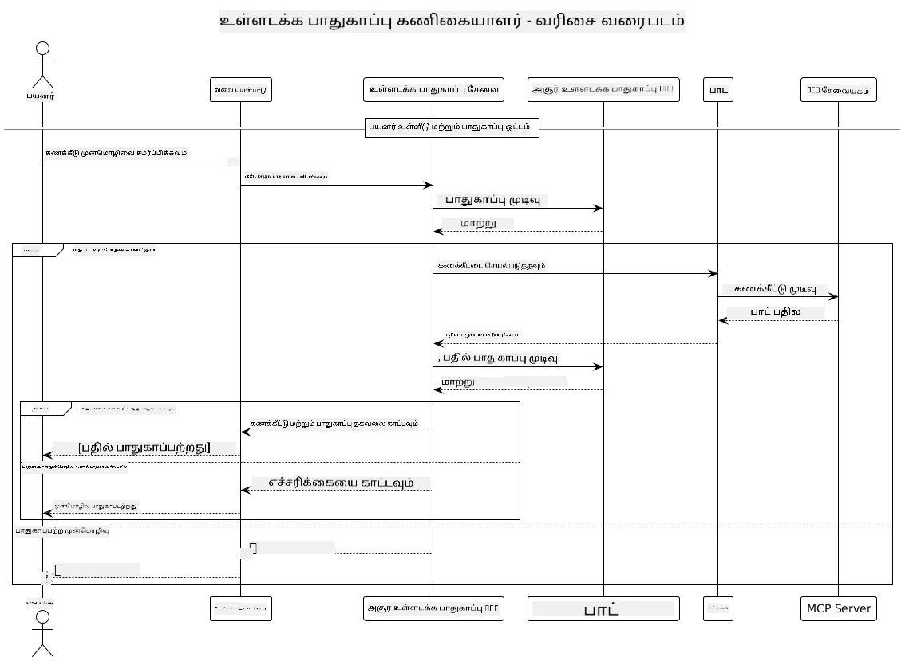

## சிஸ்டம் கட்டமைப்பு

இந்த திட்டம் Model Context Protocol (MCP) வழியாக பயனர் கோருதல்களை கால்குலேட்டர் சேவைக்கு அனுப்புவதற்கு முன் உள்ளடக்க பாதுகாப்பு பரிசோதனையை பயன்படுத்தும் ஒரு வலை பயன்பாட்டை விளக்குகிறது.



### இது எப்படி செயல்படுகிறது

1. **User Input**: பயனர் வலை இடைமுகத்தில் ஒரு கணக்கீட்டு கோருதலை உள்ளிடுகிறார்
2. **உள்ளடக்க பாதுகாப்பு சோதனை (உள்ளீடு)**: அந்த கோருதல் Azure Content Safety API மூலம் பகுப்பாய்வு செய்யப்படுகிறது
3. **பாதுகாப்பு தீர்மானம் (உள்ளீடு)**:
   - உள்ளடக்கம் பாதுகாப்பாக இருந்தால் (எல்லா வகைகளிலும் severity < 2), அது கால்குலேட்டருக்குச் செல்கிறது
   - உள்ளடக்கம் சாத்தியமான தீங்கு விளைவிக்கக்கூடியதாக குறிக்கப்பட்டால், செயல்முறை நிறுத்தப்பட்டு ஒரு எச்சரிக்கை வழங்கப்படும்
4. **Calculator Integration**: பாதுகாப்பான உள்ளடக்கம் LangChain4j மூலம் செயலாக்கப்படுகிறது, இது MCP கால்குலேட்டர் சர்வருடன் தொடர்பு கொள்கிறது
5. **Content Safety Screening (Output)**: போட்டின் பதில் Azure Content Safety API மூலம் பகுப்பாய்வு செய்யப்படுகிறது
6. **பாதுகாப்பு தீர்மானம் (வெளியீடு)**:
   - போட்டு பதில் பாதுகாப்பானதாக இருந்தால், அது பயனருக்கு காண்பிக்கப்படுகிறது
   - போட்டு பதில் சாத்தியமான தீங்கு விளைவிக்கக்கூடியதாக குறிக்கப்பட்டால், அது ஒரு எச்சரிக்கையால் மாற்றிக்கொள்ளப்படும்
7. **பதில்**: முடிவுகள் (பாதுகாப்பானதாக இருந்தால்) இரண்டு பாதுகாப்பு பகுப்பாய்வுகளுடன் பயனருக்கு காட்டப்படும்

## Model Context Protocol (MCP) ஐ கால்குலேட்டர் சேவைகளுடன் பயன்படுத்துதல்

இந்தத் திட்டம் LangChain4j இல் இருந்து Model Context Protocol (MCP) பயன்படுத்தி கால்குலேட்டர் MCP சேவைகளை எப்படி அழைக்க வேண்டும் என்பதை வெளிப்படுத்துகிறது. நடைமுறை செயலாக்கம் கால்குலேட்டர் செயல்களை வழங்க ஒரு உள்ளூர் MCP சர்வரை போர்ட் 8080-இல் இயக்குகிறது.

### Azure Content Safety சேவையை அமைத்தல்

உள்ளடக்க பாதுகாப்பு அம்சங்களை பயன்படுத்தும் முன், நீங்கள் ஒரு Azure Content Safety சேவை வளத்தை உருவாக்க வேண்டும்:

1. உள்நுழைக [Azure Portal](https://portal.azure.com)
2. "Create a resource" ஐ கிளிக் செய்து "Content Safety" என தேடுங்கள்
3. "Content Safety" ஐ தேர்ந்தெடுத்து "Create" ஐ கிளிக் செய்யுங்கள்
4. உங்கள் வளத்திற்கு ஒரு தனித்துவமான பெயரை உள்ளிடுங்கள்
5. உங்கள் சந்தா மற்றும் வளக் குழுவை தேர்ந்தெடுக்கவும் (அல்லது புதிய ஒன்றை உருவாக்கவும்)
6. ஆதரிக்கப்படும் பிராந்தியத்தை தேர்ந்தெடுக்கவும் (விபரங்களுக்கு [பிராந்திய கிடைப்புகள்](https://azure.microsoft.com/en-us/global-infrastructure/services/?products=cognitive-services) சரிபார்க்கவும்)
7. பொருத்தமான விலைத் தரத்தை தேர்ந்தெடுக்கவும்
8. "Create" ஐ கிளிக் செய்து வளத்தை நிறுவவும்
9. பயன்படுத்தல் முடிந்தவுடன், "Go to resource" ஐ கிளிக் செய்யவும்
10. இடது பக்கத்தில், "Resource Management" கீழ், "Keys and Endpoint" ஐ தேர்ந்தெடுக்கவும்
11. அடுத்த படியில் பயன்படுத்துவதற்காக எந்தவொரு சாவியையும் மற்றும் endpoint URL-ஐ நகலெடுக்கவும்

### சூழல் மாறிலிகள் அமைத்தல்

Microsoft Foundry மாடல் endpoint, API விசை, மற்றும் deployment பெயரை அமைக்கவும்:
```sh
export AZURE_OPENAI_ENDPOINT="https://<resource-name>.openai.azure.com"
export AZURE_OPENAI_API_KEY="<api-key>"
export AZURE_OPENAI_DEPLOYMENT="gpt-5.1"
```

உள்ளடக்க பாதுகாப்பு அம்சங்களுக்கு, அமைக்கவும்:
```sh
export CONTENT_SAFETY_ENDPOINT=<your_content_safety_endpoint>
export CONTENT_SAFETY_KEY=<your_content_safety_key>
```

இந்த சூழல் மாறிகள் பயன்பாடு Azure Content Safety சேவையுடன் அங்கீகரிக்க பயன்படுத்தப்படுகின்றன. இந்த மாறிகள் அமைக்கப்படாவிட்டால், பயன்பாடு விளக்கத்திற்காக பிளேஸ்ஹோல்டர் மதிப்புகளை பயன்படுத்தும், ஆனால் உள்ளடக்க பாதுகாப்பு அம்சங்கள் சரியாக வேலை செய்யாது.

### Calculator MCP சேவையகத்தை துவங்குதல்

கிளையண்ட்டை இயக்குவதற்கு முன், localhost:8080 இல் SSE முறையில் calculator MCP சர்வரை தொடங்க வேண்டும்.

## திட்ட விளக்கம்

இந்த திட்டம் Model Context Protocol (MCP)-ஐ LangChain4j உடன் ஒருங்கிணைத்து calculator சேவைகளை அழைப்பதை காட்சி செய்கிறது. முக்கிய அம்சங்கள்:

- அடிப்படை கணித செயல்களுக்கான calculator சேவையுடன் இணைக்க MCP ஐ பயன்படுத்துதல்
- பயனர் பிரேரிப்புகளிலும் bot பதில்களிலும் இரு அடுக்கு உள்ளடக்க பாதுகாப்பு சோதனை
- LangChain4j மூலம் பராமரிக்கப்பட்ட Microsoft Foundry மாதிரியுடன் பயன்பாட்டிலே விநியோகிக்கப்பட்ட மாதிரியை ஒருங்கிணைவு
- MCP போக்குவரத்திற்காக Server-Sent Events (SSE) பயன்படுத்துதல்

## உள்ளடக்கப் பாதுகாப்பு ஒருங்கிணைப்பு

இந்த திட்டத்தில் பயனர் உள்ளீடுகளும் அமைப்பு பதில்களும் தீங்கு விளைவிக்கும் உள்ளடக்கங்களிலிருந்து விலகியிருக்க வேண்டும் என்பதை உறுதிசெய்ய விரிவான உள்ளடக்கப் பாதுகாப்பு அம்சங்கள் உள்ளன:

1. **உள்ளீடு சரிபார்ப்பு**: அனைத்து பயனர் கோரிக்கைகளும் செயலாக்கத்திற்கு முன் வெறுப்புப்பேச்சு, வன்முறை, தன்னை சேதப்படுத்துதல் மற்றும் பாலியல் உள்ளடக்கம் போன்ற தீங்கு விளைவிக்கும் வகைகளுக்காக பகுப்பாய்வு செய்யப்படுகின்றன.

2. **வெளியீடு சரிபார்ப்பு**: வடிகட்டப்படாத மாதிரிகள் பயன்படுத்தப்படும் நிலைக்கிலும், அமைப்பு அனைத்து உருவாக்கப்பட்ட பதில்களையும் பயனருக்கு காட்டுவதற்கு முன் அதே உள்ளடக்கப் பாதுகாப்பு வடிகட்டுதல்கள் மூலம் சரிபார்க்கிறது.

இந்த இரு அடுக்கு அணுகுமுறை எந்த AI மாதிரியே பயன்படுத்தப்படுகிறதோ என்ற பொருட்டல்லாது அமைப்பு பாதுகாப்பானதாக தா்க காலை உறுதிசெய்கிறது, பயனர்களை தீங்கு விளைவிக்கும் உள்ளீடுகளிலிருந்து மற்றும் சாத்தியமான பிரச்னை எழுப்பக்கூடிய AI உருவாக்கப்பட்ட வெளியீடுகளிலிருந்து பாதுகாக்கின்றது.

## வலை கிளையன்ட்

இந்த பயன்பாட்டில் உள்ளடக்கப் பாதுகாப்பு கணக்கீட்டு அமைப்புடன் பயனர்கள் தொடர்பு கொள்ளக்கூடிய பயனர் நட்பு வலை இடைமுகம் உள்ளது:

### வலை இடைமுக அம்சங்கள்

- கணக்கீட்டு கோரிக்கைகளை உள்ளிட ஒரு எளிமையான, நேரடியாக புரிந்துகொள்ளக்கூடிய படிவம்
- இரு அடுக்கு உள்ளடக்கப் பாதுகாப்பு சரிபார்ப்பு (உள்ளீடு மற்றும் வெளியீடு)
- கோரிக்கை மற்றும் பதில் பாதுகாப்பு குறித்த நேரடி பின்னூட்டம்
- எளிதில் புரிந்துகொள்ள வண்ணங்களால் குறிக்கப்பட்ட பாதுகாப்பு குறியீடுகள்
- பல சாதனங்களில் செயல்படும் சுத்தமான, பதிலளிக்கும் வடிவமைப்பு
- பயனர்களுக்கு வழிகாட்ட உதவும் பாதுகாப்பான உதாரணக் கோரிக்கைகள்

### வலை கிளையன்டைப் பயன்படுத்துவது

1. Start the application:
   ```sh
   mvn spring-boot:run
   ```

2. Open your browser and navigate to `http://localhost:8087`

3. Enter a calculation prompt in the provided text area (உதாரணமாக, "24.5 மற்றும் 17.3 இன் கூட்டை கணக்கிடவும்")

4. Click "Submit" to process your request

5. View the results, which will include:
   - உங்கள் கோரிக்கையின் உள்ளடக்கப் பாதுகாப்பு பகுப்பாய்வு
   - கணக்கிடப்பட்ட முடிவு (கோரிக்கை பாதுகாப்பானிருந்தால்)
   - போட் அளித்த பதிலின் உள்ளடக்க பாதுகாப்பு பகுப்பாய்வு
   - உள்ளீடு அல்லது வெளியீடு எதுவும் குறிக்கப்பட்டால் ஏற்பட்ட எந்தவொரு பாதுகாப்பு எச்சரிக்கைகளும்

வலை கிளையன் உள்ளடக்க பாதுகாப்பு சரிபார்ப்பு இரு செயல்முறைகளையும் தானாக கையாளுகிறது, எது போன்ற AI மாடல் பயன்படுத்தப்படுகின்றதோ அவற்றை பொருட்படுத்தாமலேயே அனைத்து பரஸ்பரச் செயல்பாடுகளும் பாதுகாப்பானதும் பொருத்தமானதும் இருப்பதை உறுதி செய்கிறது.

---

<!-- CO-OP TRANSLATOR DISCLAIMER START -->
**மறுப்பு**:
இந்த ஆவணம் AI மொழிபெயர்ப்பு சேவை [Co-op Translator](https://github.com/Azure/co-op-translator) பயன்படுத்தி மொழிபெயர்க்கப்பட்டுள்ளது. நாங்கள் துல்லியத்திற்காக முயற்சி செய்துள்ளோம், ஆனால் தானாக செய்யப்படும் மொழிபெயர்ப்புகளில் பிழைகள் அல்லது தவறுகள் இருக்கலாம் என்பதை கவனத்தில் கொள்ளவும். அசல் ஆவணம் அதன் தாய்மொழியில் அதிகாரப்பூர்வ ஆதாரமாக கருதப்பட வேண்டும். முக்கியமான தகவல்களுக்கு, தொழில்நுட்பமான மனித மொழிபெயர்ப்பு பரிந்துரைக்கப்படுகிறது. இந்த மொழிபெயர்ப்பைப் பயன்படுத்துவதால் ஏற்படும் எந்த தவறான புரிதல்கள் அல்லது தவறான விளக்கத்திற்கும் நாங்கள் பொறுப்பில்வில்லை.
<!-- CO-OP TRANSLATOR DISCLAIMER END -->