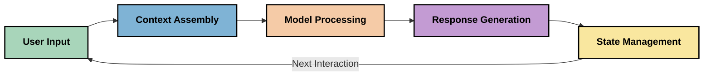
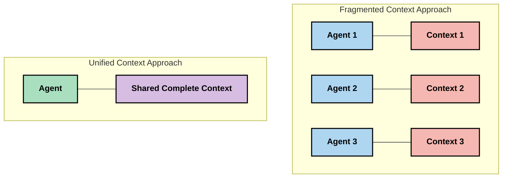
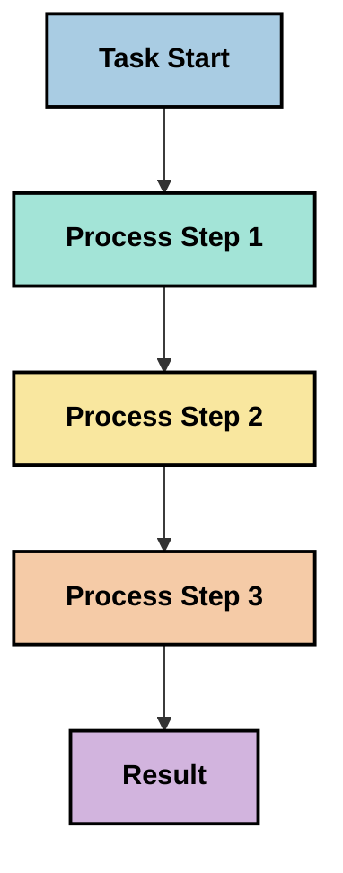
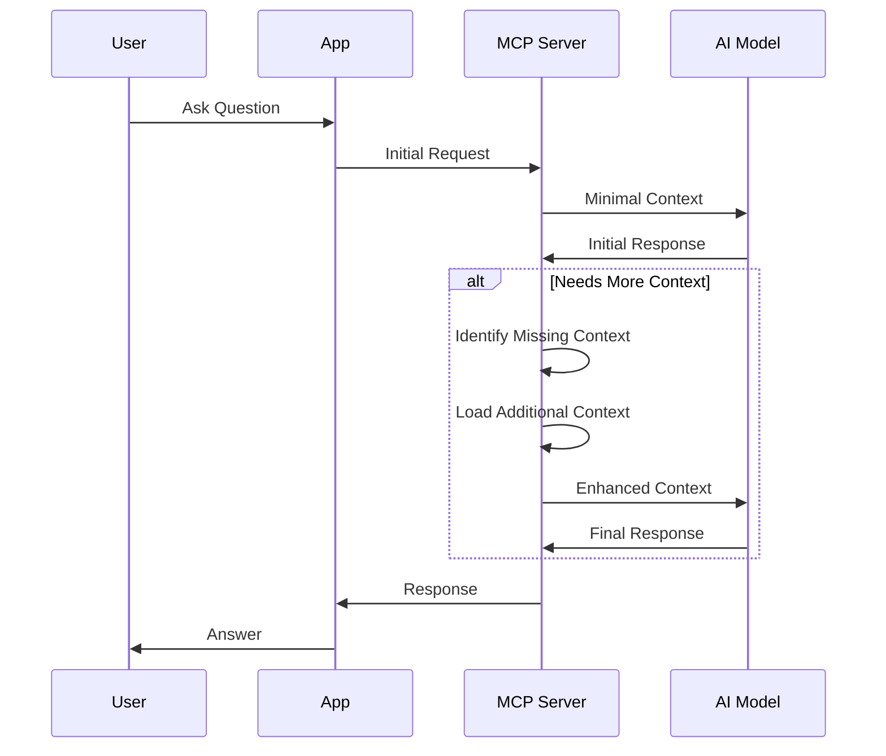
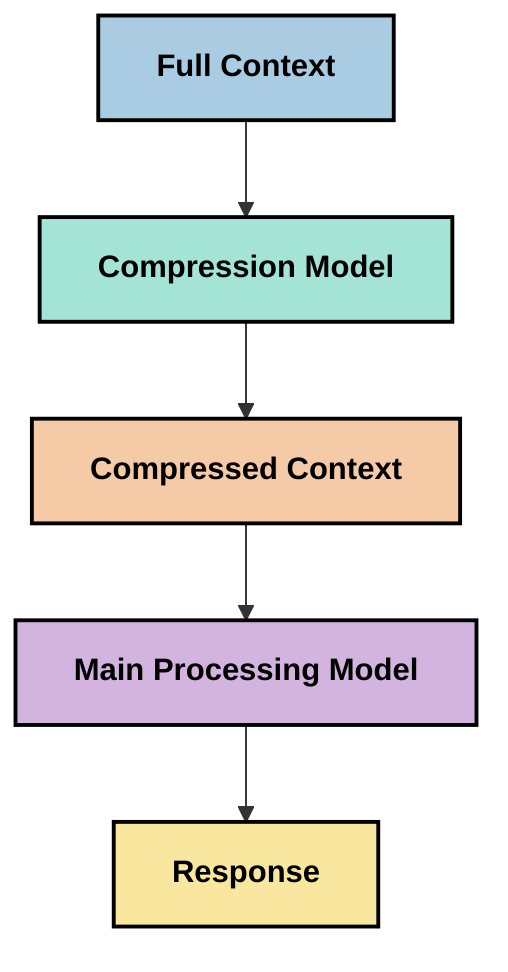
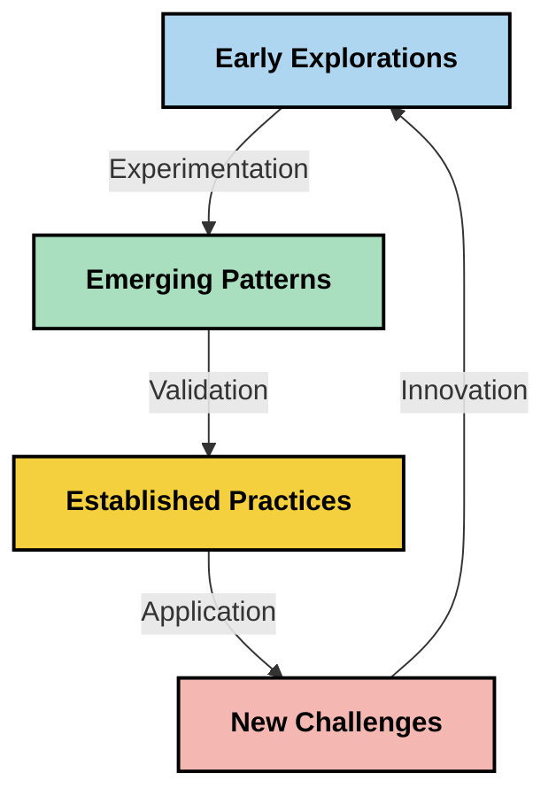

# சூழல் பொறியியல்: MCP சூழல்தழுவியலில் ஒரு தோன்றும் கருத்து

## கண்ணோட்டம்

சூழல் பொறியியல் என்பது ஏஐ களத்தில் தோன்றும் ஒரு கருத்து ஆகும், இது வாடிக்கையாளர்களும் ஏஐ சேவைகளும் இடையேயான தொடர்புகளின் முழுமையான விவரங்களை எவ்வாறு அமைக்கப்படுகிறது, வழங்கப்படுகிறது மற்றும் பராமரிக்கப்படுகிறது என்பதைக் கள ஆய்வுச் செய்கிறது. மாடல் சூழல் நடைமுறை (MCP) சூழல் முன்னேறுவது போல, சூழலை திறமையாக நிர்வகிப்பது மிகவும் முக்கியமாகிறது. இந்த தொகுப்பு சூழல் பொறியியல் என்ற கருத்தை அறிமுகப்படுத்தி, MCP செயலாக்கங்களில் அதன் சாத்தியமான பயன்பாடுகளை ஆராய்கிறது.

## கற்றல் குறிக்கோள்கள்

இந்த தொகுப்பின் முடிவுக்கு நீங்கள் முடியும்:

- தோன்றும் சூழல் பொறியியல் கருத்தை மற்றும் அதன் MCP பயன்பாடுகளில் சாத்தியமான பங்களிப்பை புரிந்து கொள்வது
- MCP நடைமுறை வடிவமைப்பு எதிர்கொள்ளும் முக்கிய சூழல் நிர்வகிப்பு சிக்கல்களை அடையாளம் காண்பது
- சிறந்த சூழல் கையாளும் முறைகளில் மூலம் மாடல் செயல்திறனை மேம்படுத்தும் தொழில்நுட்பங்களை ஆராய்வது
- சூழல் விளைவுகளைக் கணக்கிடவும் மதிப்பிடவும் உருவாக்கிய முறைகளை பரிசீலிப்பது
- MCP கட்டமைப்பின் மூலம் ஏஐ அனுபவங்களைப் பயன்படுத்தி இந்த தோன்றும் கருத்துக்களை பயன்படுத்துவது

## சூழல் பொறியியலுக்கு அறிமுகம்

சூழல் பொறியியல் என்பது பயனர்கள், பயன்பாடுகள் மற்றும் ஏஐ மாடல்கள் இடையேயான தகவல் ஓட்டத்தை ஜனனமாக வடிவமைத்து நிர்வகிப்பதில் கவனம் செலுத்தும் தோன்றும் கருத்து ஆகும். முன் அனுபவ பொறியியல் போன்ற நிறுவப்பட்ட துறைகளுக்கு மாறாக, சூழல் பொறியியல் என்பது இன்னும் நடைமுறையாளர் மூலம் வரையறுக்கப்படுகின்றது, ஏஐ மாடல்களுக்கு சரியான நேரத்தில் சரியான தகவலை வழங்கும் தனிப்பட்ட சிக்கல்களைத் தீர்க்க முயற்சிக்கின்றது.

பெரிய மொழி மாடல்கள் (LLM) வளர்ந்துகொண்டிருக்கும் போது, சூழலின் முக்கியத்துவம் அதிகரித்துள்ளது. நாங்கள் வழங்கும் சூழலின் தரம், பொருத்தம் மற்றும் அமைப்பு நேரடியாக மாடல் வெளியீடுகளை பாதிக்கிறது. சூழல் பொறியியல் இந்த உறவைக் ஆராய்கிறது மற்றும் திறமையான சூழல் நிர்வகிப்பதற்கான கருதுகோள்களை உருவாக்க முயல்கிறது.

> "2025 இல், உள்ள மாடல்கள் மிகவும் நுண்ணறிவுள்ளவை. ஆனால் மிக அறிவாளியுமான மனிதரும், அவர்களிடம் கேட்கப்படும் செயலின் சூழலைப் புரிந்து கொள்ளாமல் அவர்களது வேலையை திறமையாக செய்ய முடியாது... 'சூழல் பொறியியல்' என்பது அடுத்த நிலை முன் அனுப்பல் பொறியியல் ஆகும். இது இயந்திரமாக இயங்கும் இயக்க முறைபாட்டில் இதைச் செய்வதற்கு எதனாகும்." — வால்டன் யான், காக்ணிஷன் ஏஐ

சூழல் பொறியியல் கீழ்காணும் பகுதிகளை உள்ளடக்கலாம்:

1. **சூழல் தேர்வு**: ஒரு குறிப்பிட்ட பணிக்கான தொடர்புடைய தகவலை தீர்மானித்தல்
2. **சூழல் அமைப்பு**: மாடல் புரிதலை அதிகரிக்கும் வகையில் தகவலை ஒழுங்குபடுத்தல்
3. **சூழல் வழங்கல்**: தகவலை எப்போது மற்றும் எவ்வாறு மாடலுக்கு அனுப்ப வேண்டும் என்பதை மேம்படுத்தல்
4. **சூழல் பராமரிப்பு**: சூழலின் நிலையும் வளர்ச்சியும் காலத்தால் நிர்வகித்தல்
5. **சூழல் மதிப்பீடு**: சூழல் விளைவுகளை அளவிடவும் மேம்படுத்தவும் செய்வது

இந்த கவனிப்பு பகுதிகள் MCP சூழலுக்கு மிகவும் பொருத்தமாக உள்ளன, இது பயன்பாடுகளுக்கு LLM களுக்கு சூழலை வழங்க ஒரு தரமளிக்கப்பட்ட வழியை வழங்குகிறது.


## சூழல் பயண பார்வை

சூழல் பொறியியலை கண்காணிப்பதற்கு ஒரு வழி என்பது MCP முறையில் தகவல் பயணம் எவ்வாறு நடக்கிறது என்பதை கண்காணிப்பது:



### சூழல் பயணத்தின் முக்கிய கட்டங்கள்:

1. **பயனர் உள்ளீடு**: பயனரிடம் இருந்து அசல் தகவல்கள் (உரை, படங்கள், ஆவணங்கள்)
2. **சூழல் திரட்டல்**: பயனர் உள்ளீட்டை முறைமை சூழல், உரையாடல் வரலாறு மற்றும் பிற மீட்டெடுத்த தகவலுடன் இணைத்தல்
3. **மாடல் செயலாக்கம்**: ஏஐ மாடல் திரட்டப்பட்ட சூழலை செயலாக்குகிறது
4. **பதிலளிப்பு உருவாக்கம்**: வழங்கப்பட்ட சூழலின் அடிப்படையில் மாடல் வெளியீடுகளை உருவாக்குகிறது
5. **நிலை நிர்வகிப்பு**: முறைமை அதன் உள்நாட்டு நிலையை தொடர்பின் அடிப்படையில் புதுப்பிக்கிறது

இந்த பார்வை ஏஐ முறைகளில் சூழலின் இயங்கும் தன்மையை வெளிப்படுத்துகிறது மற்றும் ஒவ்வொரு கட்டத்திலும் தகவலை சிறந்த முறையில் நிர்வகிக்க வேண்டும் என்ற முக்கிய கேள்விகளை எழுப்புகிறது.

## சூழல் பொறியியலில் தோன்றும் கொள்கைகள்

சூழல் பொறியியல் துறை உருவெடுக்கும்போது, சில ஆரம்ப கொள்கைகள் நடைமுறையாளர் மூலம் தோன்ற ஆரம்பித்துள்ளன. இக்கொள்கைகள் MCP செயலாக்கத் தேர்வுகளை அறிவுறுத்த உதவும்:

### கொள்கை 1: சூழலை முழுமையாக பகிரவும்

சூழல் முறையின் அனைத்து கூறுகளுக்கும் முழுமையாக பகிரப்பட வேண்டும், பல முகவைகளாக அல்லது செயலாக்கங்களாக பிரிக்கப்பட கூடாது. சூழல் பகிரப்பட்டால், ஒரே முறையின் பகுதியிலான முடிவுகள் மற்றொரு பகுதியில் எடுக்கப்படும் முடிவுகளுடன் முரண்படலாம்.



MCP பயன்பாடுகளில், இது சூழல் முழுவதும் தடையின்றி வழிதடமாக வழங்கப்படும் முறைகள் வடிவமைக்கும் என்பதை குறிக்கிறது, பிரிவாள விடாமல்.

### கொள்கை 2: செயல்கள் மறைமுக முடிவுகளை எடுத்துக்கொள்ளும் என்பதை உணர்வது

ஒரு மாடல் எடுக்கின்ற ஒவ்வொரு செயலும் அந்த சூழலைக் எப்படி புரிகிறது என்பதற்கான மறைமுக முடிவுகளை உடையது. பல கூறுகள் வெவ்வேறு சூழல்களுக்கு செயல்படும்போது, இம்மறைமுக முடிவுகள் முரண்பாடு ஏற்படுத்தி இணக்கமின்றி முடிவுகளை ஏற்படுத்தலாம்.

இந்த கொள்கைக்கான MCP பயன்பாடுகளுக்கான முக்கிய அம்சங்கள்:
- குழப்பமான பணிகளை ஒரே தொடரில் பதிவு செய்து, பிரிக்கப்பட்ட சூழலுடன் இணைக சுழற்சி செய்து செயல்படுத்த விடாமல்
- அனைத்து முடிவு நிலைகளும் ஒரே சூழல் தகவலுக்கு அணுகல் பெற வேண்டும்
- பின்வரும் படிகள் முன் முடிவுகளின் முழு சூழலையும் பார்க்கக் கூடிய வகையில் அமைப்புகள் வடிவமைக்க வேண்டும்

### கொள்கை 3: சூழலின் ஆழம் மற்றும் விண்டோக்குள் உள்ளவரம்பை சமநிலை செய்யவும்

உரையாடல்கள் மற்றும் செயல்முறைகள் நீளமடைவதால், சூழல் விண்டோக்கள் நிறைவடையக்கூடும். திறமையான சூழல் பொறியியல் இந்த நீக்கம் மற்றும் தொழில்நுட்ப வரம்புகளுக்கு இடையே சமன்பாடான வழிகளை ஆராய்கிறது.

ஆய்வில் உள்ள சாத்தியமான முறைகள்:
- முக்கியத் தகவலை கொண்டிருக்கும் போது குரோதத்தை குறைக்கும் சூழல் நெருக்கமுறை
- தற்போதைய தேவைகளுக் கிடைக்கும் பொருத்தத்தை அடிப்படையாகக் கொண்டு வரிசையாக சூழலை ஏற்றுதல்
- முக்கிய முடிவுகள் மற்றும் உண்மைகளை பேண்வதுடன் முன் தொடர்புகளை சுருக்கம் செய்தல்

## சூழல் சிக்கல்கள் மற்றும் MCP நடைமுறை வடிவமைப்பு

மாடல் சூழல் நடைமுறை (MCP) சூழல் நிர்வகிப்பு சிக்கல்களை உணர்ந்து வடிவமைக்கப்பட்டது. இந்த சிக்கல்களை அறிந்துகொள்வது MCP நடைமுறை வடிவமைப்பின் முக்கிய அம்சங்களை விளக்குகிறது:


### சிக்கல் 1: சூழல் விண்டோ வரம்புகள்
பெரும்பாலான ஏஐ மாடல்களுக்கு கண்காணிப்புச் சூழல் விண்டோ அளவுகள் நிர்ணயிக்கப்பட்டுள்ளன, இது ஒரு நேரத்தில் எவ்வளவு தகவல் செயலாக்கப்படுகின்றது என்பதில் வரம்பை ஏற்படுத்துகிறது.

**MCP வடிவமைப்பு பதில்:** 
- நடைமுறை அமைப்பு குறியிடக்கூடிய, வள அடிப்படையிலான அமைந்த சூழலுக்கு ஆதரவளிக்கிறது
- வளங்களைக் பகுப்பாய்வு செய்து மற்றும் வரிசையாக ஏற்ற முடியும்

### சிக்கல் 2: பொருத்தத்தைக் கண்டறிவது
சூழலில் எந்த தகவல் மிக முக்கியமானது என்பதைக் கண்டுபிடிப்பது சிக்கல்.

**MCP வடிவமைப்பு பதில்:**
- தேவை அடிப்படையிலான தகவல் மீட்பை ஊக்குவிக்கும் நெகிழ்வான கருவிகள்
- ஒழுங்குசெய்யப்பட்ட முன் அனுப்பல்கள் முறையான சூழல் அமைப்புக்கான வழிகளை வழங்கும்

### சிக்கல் 3: சூழல் தொடர்ந்து நிலைத்திருத்தல்
இணக்கமான தொடர்புகளுக்கு நிலையை கையாள முக்கியமாக சூழலை கவனமாகத் தடவவேண்டும்.

**MCP வடிவமைப்பு பதில்:**
- தரமளிக்கப்பட்ட அமர்வு மேலாண்மை
- சூழல் வளர்ச்சிக்கு தெளிவான தொடர்பு வடிவுகள்

### சிக்கல் 4: பன்முக சூழல்
வெவ்வேறு தரவு வகைகள் (உரை, படங்கள், அமைந்துள்ள தரவு) வெவ்வேறு கையாளுதலை தேவைப் படுத்துகின்றன.

**MCP வடிவமைப்பு பதில்:**
- நடைமுறை வடிவமைப்பு வகையான தகவல்களை தாங்குகிறது
- பன்முகமான தகவல்களின் தரமான பிரதிநிதித்துவம்

### சிக்கல் 5: பாதுகாப்பு மற்றும் தனியுரிமை
சூழல் அதிகமாக உணர்ச்சிகரமான தகவலை கொண்டிருக்கும், அதை பாதுகாப்பது முக்கியம்.

**MCP வடிவமைப்பு பதில்:**
- வாடிக்கையாளர் மற்றும் சேவையக பொறுப்பிடங்களுக்கிடையேயான தெளிவான எல்லைகள்
- தரவு வெளிப்பாட்டை குறைக்கும் உள்ளூர் செயலாக்க விருப்பங்கள்

இந்த சிக்கல்களை புரிந்துகொண்டு MCP அவற்றை எப்படி அணுகுகிறது என்பதை அறிந்து, மேம்பட்ட சூழல் பொறியியல் தொழில்நுட்பங்களை ஆராய அடித்தளமாக அமைகிறது.

## தோன்றும் சூழல் பொறியியல் அணுகுதல்கள்

சூழல் பொறியியல் துறை வளர்வதற்கிடையில், சில வாடிக்கையாளர்க்கான கற்பனைகள் தோன்றுகின்றன. இவை நிறுவப்பட்ட சிறந்த வழிமுறைகள் அல்ல, நடுநிலை கருத்துக்களை பிரதிபலிக்கின்றன மற்றும் MCP செயலாக்கங்களோடு அதிக அனுபவத்தை பெற்றுக் கொண்டால் மேம்படும்.

### 1. தனித்தோக்கு ஒரே தொடரில் செயலாக்கம்

பல முகவைகள் மூலம் சூழலைப் பகிர்வதை விட, சில பயிற்றுவோருக்கு தனித்தோக்கு ஒரே தொடரில் செயலாக்கம் அதிக ஒற்றுமையான முடிவுகளை தருகிறது. இது ஒற்றை சூழலை பேணுவதற்கான கொள்கையை ஒத்துக்கொள்கிறது.



இவ்வாறு செயல்படுவது 병렬 செயலாக்கத்தைவிட குறைவான திறமையானதாக இருக்கும் போதிலும், ஒவ்வொரு படியும் முன் முடிவுகளின் முழுமையான புரிதலுக்கு அடிப்படையாக இருப்பதால் அது அதிக இணையுறையும் மற்றும் நம்பகமான முடிவுகளை வழங்குகிறது.

### 2. சூழல் துண்டாக்கம் மற்றும் முக்கியத்துவம் அளித்தல்

பெரிய சூழல்களை கையாளக்கூடிய துண்டுகளாக பிரித்து, மிக முக்கியமானவற்றை முன்னுரிமை தருவது.

```python
# Conceptual Example: Context Chunking and Prioritization
def process_with_chunked_context(documents, query):
    # 1. Break documents into smaller chunks
    chunks = chunk_documents(documents)
    
    # 2. Calculate relevance scores for each chunk
    scored_chunks = [(chunk, calculate_relevance(chunk, query)) for chunk in chunks]
    
    # 3. Sort chunks by relevance score
    sorted_chunks = sorted(scored_chunks, key=lambda x: x[1], reverse=True)
    
    # 4. Use the most relevant chunks as context
    context = create_context_from_chunks([chunk for chunk, score in sorted_chunks[:5]])
    
    # 5. Process with the prioritized context
    return generate_response(context, query)
```

மேலே உள்ள கருத்து, பெரிய ஆவணங்களை கையாளக்கூடிய துண்டுகளாகப் பிரித்து, வெறும் தொடர்புடைய பகுதிகளைத் தேர்ந்தெடுக்க כיצד முன் அனுப்பல்களில் என்ன செய்ய முடியும் என்பதைக் கூறுகிறது. இது சூழல் விண்டோ வரம்புகளிடையே பணியாற்ற உதவுகிறது மற்றும் பெரிய அறிவுத் தரவுத்தளங்களை பயன்படுத்துகிறது.

### 3. படிப்படியாக சூழல் ஏற்றுதல்

தேவையானபோது மட்டும் சூழலை படிப்படியாக ஏற்றல்.



படிப்படியாக சூழல் ஏற்றுதல் குறைவான சூழலில் தொடங்கி, தேவையான போது மட்டுமே விரிவாக்கப்படுகின்றது. இது எளிய கேள்விகளுக்கான குறைந்த டோக்கன் பயன்பாட்டை மிகுந்து செய்யும் மற்றும் சிக்கலான கேள்விகளைக் கையாளும் திறனை பேணும்.

### 4. சூழல் சுருக்கம் மற்றும் சுருக்கம்

தேவையான தகவலைப் பாதுகாக்கும் போதே சூழல் அளவைக் குறைத்தல்.



சூழல் சுருக்கம் கவனிக்கும்:
- மீள் தகவல்களை நீக்குதல்
- நீண்ட உள்ளடக்கங்களை சுருக்கல்
- முக்கிய உண்மைகள் மற்றும் விவரங்களை வெளியீடு செய்யும்
- முக்கிய சூழல் கூறுகளை பாதுகாக்குதல்
- டோக்கன் பயன்திறமைக்கு மேம்படுத்தல்

இந்த அணுகல் பெரும்பாலும் நீண்ட உரையாடல்களை சூழல் விண்டோக்குள் பராமரிக்கவும் அல்லது பெரிய ஆவணங்களை திறமையாக செயலாக்கவும் பயனுள்ளது. சில நடைமுறையாளர் உரையாடல் வரலாற்றின் சூழல் சுருக்கம் மற்றும் சுருக்கத்திற்காக சிறப்புப் பொருளாக்கப்பட்ட மாடல்களைப் பயன்படுத்துகின்றனர்.


## ஆராய்ச்சி சூழல் பொறியியல் பரிசீலனைகள்

தோன்றும் சூழல் பொறியியல் துறையை ஆராயும் போது, MCP செயலாக்கங்களுடன் பணியாற்றும் போது வளர்க்க வேண்டிய சில பரிசீலனைகள் உள்ளன. இவை கட்டாயமான சிறந்த வழிமுறைகள் அல்ல, உங்கள் குறிப்பிட்ட பயன்பாட்டில் மேம்பாடுகளை தரக்கூடிய ஆராய்ச்சி பகுதிகள் ஆகும்.

### உங்கள் சூழல் இலக்குகளை பரிசீலிக்கவும்

சிக்கலான சூழல் நிர்வாக தீர்வுகளை செயல்படுத்துவதற்கு முன், நீங்கள் எதை அடைய விரும்புகிறீர்கள் என்பதை தெளிவாக எழுதுங்கள்:
- எந்த குறிப்பிட்ட தகவல் மாடல் வெற்றிக்கு தேவையானது?
- எந்த தகவல் மிக முக்கியமாகும் மற்றும் எந்தது கூடுதல்?
- உங்கள் செயல்திறன் வரம்புகள் என்ன? (ஏபிஐ வேகம், டோக்கன் வரம்புகள், செலவுகள்)

### அடுக்குறைக் சூழல் அணுகுதல்களை ஆராயவும்

சில நடைமுறையாளர் கருத்தம்கொள்கிறார்கள் சூழலை கருத்துப் அடுக்குகளில் ஒழுங்குபடுத்துவது மகிழ்ச்சி தருகிறது:
- **மூலக அடுக்கு**: மாடலுக்கு எப்போதும் தேவையான முக்கியத் தகவல்
- **நிலைமை அடுக்கு**: தற்போதைய தொடர்புக்கான சிறந்த சூழல்
- **ஆதரவான அடுக்கு**: உதவும் கூடுதல் தகவல்
- **பின்னடைவு அடுக்கு**: தேவையான நேரத்தில் மட்டுமே அணுகப்படும் தகவல்

### மீட்பு முறைகள் ஆய்வு செய்யவும்

உங்கள் சூழல் விளைவுகள் முக்கியமாக நீங்கள் தகவலை எவ்வாறு மீட்டெடுப்பீர்கள் என்பதற்கே சார்ந்தவை:
- கருத்து சார்ந்த தேடல் மற்றும் ஒட்டுமொத்த வடிவத்தைத் தேடுதல்
- விசை சொற்கள் அடிப்படையிலான தேடல் என்பது குறிப்பிட்ட உண்மைகளை கண்டுபிடிக்கும்
- பல மீட்பு முறைகளை கூட்டும் இணைந்த அணுகுதல்கள்
- வகைகள், திகதிகள் அல்லது மூலங்கள் அடிப்படையிலான வரம்பைக் குறைக்கும் மெட்டாடேட்டா வடிகட்டல்

### சூழல் இணக்கத்தை முயற்சி செய்யவும்

உங்கள் சூழலின் அமைப்பு மற்றும் ஓட்டம் மாடல் புரிதலைத் தாக்கலாம்:
- தொடர்புடைய தகவல்களை ஒன்றாகக் கூட்டு
- ஒத்த வடிவமைப்பு மற்றும் அமைப்பைக் கையாளல்
- தேவையான போது தர்க்கத்திற்கு அல்லது காலஅமைப்புக்கு ஏற்ப வரிசைப்படுத்தல்
- முரண்பட்ட தகவலைத் தவிர்க்கும்

### பன்முக முகவரி அமைப்புகளின் நன்மைகள் மற்றும் குறைகள்

பல ஏஐ கட்டமைப்புகளில் பன்முக முகவரி அமைப்புகள் பிரபலமாக உள்ளன, ஆனால் அவை சூழல் நிர்வகிப்பில் பெரிய சிக்கல்களை கொண்டுள்ளன:
- சூழல் பிளவல் முகவைகள் இடையே முரண்பட்டு முடிவுகளை ஏற்படுத்தும்
- 병렬 செயலாக்கம் இடையே முரண்பாடுகளை உருவாக்கலாம், இதை சமன்படுத்துவது கடினம்
- முகவைகள் இடையேயான தொடர்பு அதிகரிப்பு செயல்திறனில் இழப்பை ஏற்படுத்தும்
- ஒற்றுமையை பராமரிக்க கடுமையான நிலை நிர்வாகம் தேவைப்படும்

பல சந்தர்ப்பங்களில், முழுமையான சூழல் நிர்வகிப்புடன் ஒரே முகவையாளர் அணுகுமுறை, பன்முக முகவர்கள் கொண்டு பிரிக்கப்பட்ட சூழலை விட நம்பகமான முடிவுகளை வழங்கக் கூடியதாக இருக்கலாம்.

### மதிப்பீடு முறைகளை உருவாக்கவும்

காலப்போக்கில் சூழல் பொறியியலை மேம்படுத்த, நீங்கள் வெற்றியை எப்படி அளவிடுவீர்கள் என்பதைக் கவனியுங்கள்:
- வெவ்வேறு சூழல் அமைப்புகளை A/B சோதனை செய்யும்
- டோக்கன் பயன்பாடு மற்றும் பதிலளிப்பு நேரம் கண்காணித்தல்
- பயனர் திருப்தி மற்றும் பணித் நிறைவு விகிதங்களை பின்தொடர்தல்
- சூழல் யுக்திகள் தோல்வியடையும் நேரம் மற்றும் காரணங்கள் பகுப்பாய்வு செய்தல்

இவை சூழல் பொறியியல் துறையின் செயலில் உள்ள ஆராய்ச்சி பகுதிகளை பிரதிபலிக்கின்றன. துறையை வளரும் போது, மேலும் தெளிவான வடிவங்கள் மற்றும் நடைமுறைகள் தோன்றும்.

## சூழல் விளைவுகளை அளவிடுதல்: வளர்ந்து வரும் கட்டமைப்பு

சூழல் பொறியியல் ஒரு கருத்தாக தோன்றும் போது, நடைமுறையாளர் அதன் விளைவுகளை எவ்வாறு அளவிடுவது என்பதனை ஆராய தொடங்கியுள்ளனர். இன்னும் நிறுவப்பட்ட கட்டமைப்பு இல்லை, ஆனால் பல அளவுகோல்கள் எதிர்கால பணிக்கு வழிகாட்ட இயலும்.

### சாத்தியமான அளவீட்டு பரிமாணங்கள்


#### 1. உள்ளீடு திறன் பரிசீலனைகள்

- **சூழல்-பதில்விகிதம்**: பதில் அளவுடன் தொடர்புடைய அளவு எவ்வளவு இருக்க வேண்டும்?
- **டோக்கன் பயன்பாடு**: வழங்கப்பட்ட சூழல் டோக்கன்களில் எத்தனை சதவீதம் பதிலை பாதிக்கிறது?
- **சூழல் சுருக்கம்**: அசல் தகவல்களை எவ்வாறு திறமையாக சுருக்க முடியும்?

#### 2. செயல்திறன் பரிசீலனைகள்

- **தாமதம் தாக்கம்**: சூழல் நிர்வாகம் பதிலளிப்பு நேரத்தை எவ்வாறு பாதிக்கிறது?
- **டோக்கன் பொருளாதாரம்**: டோக்கன் பயன்பாட்டில் நாங்கள் திறம்பட இருக்கிறோமா?
- **மீட்பு துல்லியம்**: மீட்டெடுத்த தகவல் எவ்வளவு பொருத்தமானது?
- **வழங்கப்படும் வளம்**: இதற்காக எந்த கணினி வளங்கள் தேவை?

#### 3. தரம் பரிசீலனைகள்

- **பதிலளிப்பு பொருத்தம்**: பதில் கேள்வி தொடர்பாக எவ்வளவு சரியாக உள்ளது?
- **உண்மை துல்லியம்**: சூழல் நிர்வாகம் உண்மையான சரியானதை மேம்படுத்துகிறதா?
- **ஒற்றுமை**: ஒரே மாதிரியான கேள்விகளில் பதில்கள் சீராக உள்ளனவா?
- **கற்பனை வீதம்**: சிறந்த சூழல் மாடல் பிழைகளை குறைக்கிறதா?

#### 4. பயனர் அனுபவ பரிசீலனைகள்

- **தொடர்பு வேண்டுதல் வீதம்**: பயனர்கள் எத்தனை முறை விளக்கத்தை கேட்கிறார்கள்?
- **பணி நிறைவு**: பயனர்கள் தங்களது இலக்குகளை வெற்றிகரமாக அடைகிறார்களில்?
- **திருப்தி குறியீடுகள்**: பயனர்கள் அனுபவத்தை எப்படி மதிப்பேற்றுகிறார்கள்?

### அளவிடுவதற்கான ஆராய்ச்சி அணுகுதல்கள்

MCP செயலாக்கங்களில் சூழல் பொறியியலை ஆராயும்போது, இவைகளை பரிசீலிக்கவும்:

1. **அடிப்படைக் கூட்டு முறை**: சிக்கலான முறைகள் முன் எளிய சூழல் அணுகுதல்களுடன் அடிப்படையை அமைக்கவும்

2. **நிலைநாட்டப்பட்ட மாற்றங்கள்**: ஒரே நேரத்தில் ஒரு சூழல் நிர்வாக கூறை மாற்றி அதனால் ஏற்படும் விளைவுகளை தனிக்கொள்ளவும்

3. **பயனர் மையமிடும் மதிப்பீடு**: அளவீடு தரவுக்களுடன் பயனர் கருத்துக்களை இணைத்து மதிப்பீடு செய்க

4. **தோல்வி பகுப்பாய்வு**: சூழல் யுக்திகள் தோல்வியடையும் நிலைகளை ஆய்வு செய்து மேம்பாட்டுக்கான வழிகளை ஆராய்க

5. **பல பரிமாண மதிப்பாய்வு**: திறன், தரம் மற்றும் பயனர் அனுபவ இடையேயான சமநிலைகளை கருத்தில் கொள்

இந்த முயற்சி மிகைப் பரிமாணமான அளவீட்டுக் கொள்கை, தோன்றும் சூழல் பொறியியலின் இயல்பு மற்றும் வளர்ச்சியுடன் ஒத்துப்போகிறது.

## முடிவுரை

சூழல் பொறியியல் என்பது MCP பயன்பாடுகளில் திறமையான செயலாய்வின் மையமாகவும் இருக்கக்கூடிய உறுதியான ஆராய்ச்சி பகுதியாகும். உங்கள் முறைமை மூலமாக தகவல் எவ்வாறு ஓடுகிறது என்பதை அறிவார்ந்த முறையில் பரிசீலிப்பதன் மூலம், நீங்கள் பயனர்களுக்கு அதிக திறமை, துல்லியம் மற்றும் மதிப்புள்ள ஏஐ அனுபவங்களை உருவாக்க முடியும்.

இந்த தொகுப்பில் விளக்கப்பட்ட தொழில்நுட்பங்கள் மற்றும் கற்பனைகள் இப்பகுதியில் ஆரம்ப கருத்துகளாகும்; நிர்ணயிக்கப்பட்ட நடைமுறைகள் அல்ல. ஏஐ திறன்கள் முன்னேறுவதோடு, சூழல் பொறியியல் மேலோங்கிய ஒரு துறையாகலாம். தற்போது, பரிசோதனையும் தீவிரமான அளவீட்டும் மிக நன்றியமான அணுகுமுறை ஆகும்.

## எதிர்கால சாத்திய பாதைகள்

சூழல் பொறியியல் துறை இன்னும் வளர்ந்து கொண்டிருக்கிறது, ஆனால் சில எதிர்க்குறிப்பு பாதைகள் தோன்றியுள்ளன:

- சூழல் பொறியியல் கொள்கைகள் மாடல் செயல்திறன், திறன், பயனர் அனுபவம் மற்றும் நம்பகத்தன்மையில் பரபரப்பான தாக்கத்தை ஏற்படுத்தக்கூடும்
- ஒரே தொடரில் முழுமையான சூழல் நிர்வகிப்புடன் செயல்படும் முறைகள் பல பயன்பாடுகளுக்கு பன்முக முகவரி அமைப்புகளைவிட சிறந்தவையாக இருக்கலாம்
- சிறப்பு சூழல் சுருக்க மாடல்கள் ஏஐ அலைநிலைகளில் நிலையான கூறுகளாக மாறக்கூடும்
- சூழல் முழுமையும் டோக்கன் வரம்புகளுக்கிடையேயான எதீதம் சூழல் கையாள்வில் புதுமையை தூண்டக்கூடும்
- மாடல்கள் மனிதர்களைப் போன்ற திறமையான தொடர்புக்கு வளர்ந்தால், உண்மையான பன்முக முகவரி ஒத்துழைப்பு மேம்படும்
- MCP செயலாக்கங்கள் தற்போதைய பரிசோதனைகளிலிருந்து தோன்றும் சூழல் நிர்வகிப்பு வடிவமைப்புகளை தரமளிப்பதில் முன்னேற்றம் பெறும்



## வளங்கள்

### அதிகாரப்பூர்வ MCP வளங்கள்
- [Model Context Protocol Website](https://modelcontextprotocol.io/)
- [Model Context Protocol Specification](https://github.com/modelcontextprotocol/modelcontextprotocol)
- [MCP ஆவணங்கள்](https://modelcontextprotocol.io/docs)
- [MCP C# SDK](https://github.com/modelcontextprotocol/csharp-sdk)
- [MCP பைதான் SDK](https://github.com/modelcontextprotocol/python-sdk)
- [MCP டைப்ஸ்கிரிப்ட் SDK](https://github.com/modelcontextprotocol/typescript-sdk)
- [MCP இன்ஸ்பெக்டார்](https://github.com/modelcontextprotocol/inspector) - MCP சர்வர்களுக்கான காண்பிழை పరీక్ష கருவி

### சூழல் பொறியியல் கட்டுரைகள்
- [பல முகவரிகளை கட்டாதீர்கள்: சூழல் பொறியியல் கோட்பாடுகள்](https://cognition.ai/blog/dont-build-multi-agents) - வால்டன் யானின் சூழல் பொறியியல் கோட்பாடுகளின் கருத்துக்கள்
- [முகவரிகளை உருவாக்கும் நடைமுறை வழிகாட்டி](https://cdn.openai.com/business-guides-and-resources/a-practical-guide-to-building-agents.pdf) - OpenAI இன் பயனுள்ள முகவரி வடிவமைப்பு வழிகாட்டி
- [பயனுள்ள முகவரிகளை உருவாக்குதல்](https://www.anthropic.com/engineering/building-effective-agents) - Anthropic இன் முகவர் மேம்பாட்டில் அணுகுமுறை

### தொடர்புடைய ஆய்வுகள்
- [பெரிய மொழி மாதிரிகளுக்கான இயக்கமாற்று வெளியீடு விரிவாக்கம்](https://arxiv.org/abs/2310.01487) - இயக்கமாற்று வெளியீட்டு அணுகுமுறைகளின் ஆய்வு
- [மத்தியில் இழந்துவிட்டோம்: மொழி மாதிரிகள் நீண்ட சூழல்களை எப்படி பயன்படுத்துகின்றன](https://arxiv.org/abs/2307.03172) - சூழல் செயலாக்க மாதிரிகளின் முக்கிய ஆய்வு
- [CLIP லேட்டென்ட்களுடன் அடுக்கமைந்த உரை-அடிப்படையிலான பட உருவாக்கம்](https://arxiv.org/abs/2204.06125) - DALL-E 2 ஆய்வுக் கட்டுரை சூழல் அமைப்பில் உள்ள洞ர்வு
- [பெரிய மொழி மாதிரி கட்டமைப்புகளில் சூழலின் பங்கு ஆராய்ச்சி](https://aclanthology.org/2023.findings-emnlp.124/) - சமீபத்திய சூழல் கையாளுதல் ஆய்வுகள்
- [பல முகவர் ஒத்துழைப்பு: ஒரு ஆய்வு](https://arxiv.org/abs/2304.03442) - பல முகவர் முறைமைகள் மற்றும் அவற்றின் சவால்கள் குறித்த ஆய்வு

### கூடுதல் வளங்கள்
- [சூழல் சாளர ஆப்டிமைசேஷன் தொழில்நுட்பங்கள்](https://learn.microsoft.com/en-us/azure/ai-services/openai/concepts/context-window)
- [மேம்பட்ட RAG தொழில்நுட்பங்கள்](https://www.microsoft.com/en-us/research/blog/retrieval-augmented-generation-rag-and-frontier-models/)
- [சமாந்திர கர்னல் ஆவணங்கள்](https://github.com/microsoft/semantic-kernel)
- [மைக்ரோசாஃப்ட் ஃபவுண்ட்ரி டூல் கிட்டை Visual Studio Code க்காக](https://github.com/microsoft/vscode-ai-toolkit)

## அடுத்தது என்ன

- [5.15 MCP தனிப்பயன் பாரிமாறி](../mcp-transport/README.md)

---

<!-- CO-OP TRANSLATOR DISCLAIMER START -->
**மறுப்பு**:
இந்த ஆவணம் AI மொழிபெயர்ப்பு சேவை [Co-op Translator](https://github.com/Azure/co-op-translator) பயன்படுத்தி மொழிபெயர்க்கப்பட்டுள்ளது. நாங்கள் துல்லியத்திற்காக முயற்சி செய்துள்ளோம், ஆனால் தானாக செய்யப்படும் மொழிபெயர்ப்புகளில் பிழைகள் அல்லது தவறுகள் இருக்கலாம் என்பதை கவனத்தில் கொள்ளவும். அசல் ஆவணம் அதன் தாய்மொழியில் அதிகாரப்பூர்வ ஆதாரமாக கருதப்பட வேண்டும். முக்கியமான தகவல்களுக்கு, தொழில்நுட்பமான மனித மொழிபெயர்ப்பு பரிந்துரைக்கப்படுகிறது. இந்த மொழிபெயர்ப்பைப் பயன்படுத்துவதால் ஏற்படும் எந்த தவறான புரிதல்கள் அல்லது தவறான விளக்கத்திற்கும் நாங்கள் பொறுப்பில்வில்லை.
<!-- CO-OP TRANSLATOR DISCLAIMER END -->