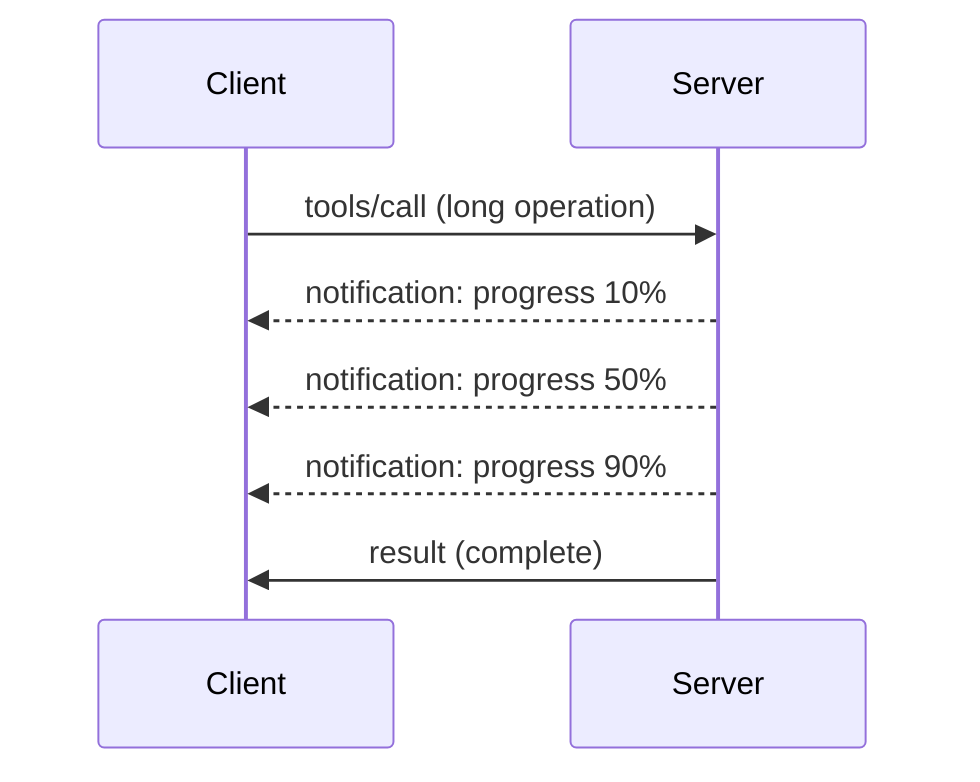

# MCP நெறிமுறை அம்சங்கள் ஆழ்ந்த ஆய்வு

இந்த கையேடு அடிப்படையான கருவி மற்றும் வள கையாளுதலை மீறி செல்லும் முன்னேற்றமான MCP நெறிமுறை அம்சங்களை ஆராய்கிறது. இந்த அம்சங்களைப் புரிந்து கொள்ளுவதன் மூலம் நீங்கள் வல்லுநரான, பயனருக்கு உகந்த மற்றும் உற்பத்திக்கு தயாரான MCP சேவையகங்களை உருவாக்க முடியும்.

> **MCP `2026-07-28` பரப்பு:** சேவையகம் செயல்முறை துவக்கம் மற்றும் நிறுத்தல் பயன்பாட்டு கவலைகளாக மாறி
> உள்ளது, ஆனால் MCP `initialize` கைஒப்பந்தம் மற்றும் நடைமுறை-தரம்
> அமர்வுகள் அகற்றப்பட்டுள்ளன. கீழுள்ள பதிவு பிரிவு பழைய செயல்பாடுகளுக்காக வைத்திருக்கப்பட்டுள்ளது;
> புதிய சேவைகள் `stderr` அல்லது OpenTelemetry ஐ பயன்படுத்த வேண்டும். Tasks என்பது
> இப்போது தனியாக பதிப்பு செய்யப்படும் நீட்டிப்பு. பார்க்கவும்
> [MCP இல் என்ன மாற்றங்கள்? 2026-07-28 விவரம்](../../01-CoreConcepts/mcp-2026-07-28.md).

## உள்ளடக்கிய அம்சங்கள்

1. **முன்னேற்ற அறிவிப்புகள்** - நீண்ட நிலைமையிலான செயல்களுக்கு முன்னேற்றத்தை அறிக்கை செய்யும்
2. **கோரிக்கை ரத்து செய்வது** - வாடிக்கையாளர்கள் நடப்பிலுள்ள கோரிக்கைகளை ரத்துசெய்ய அனுமதிக்கும்
3. **வள வார்ப்புருக்கள்** - பரிமாறிகள் உடன் டைனமிக் வள URI கள்
4. ** செயலி வாழ்நாள் சுழற்சி** - சேவை செயலியின் துவக்கம் மற்றும் நிறுத்தல்
5. **லாக் கட்டுப்பாடு (பழைய)** - பழைய MCP லாக் கட்டமைப்பு
6. **பிழை கையாளும் மாதிரிகள்** - ஒரே மாதிரியில் பிழை பதில்கள்

---

## 1. முன்னேற்ற அறிவிப்புகள்

நேரம் எடுத்துக் கொள்கின்ற செயலிகளுக்கு (தரவு செயலாக்கம், கோப்பு பதிவிறக்கம், API அழைப்புகள்), முன்னேற்ற அறிவிப்புகள் பயனர்களைத் தகவல்படுத்தும்.

### இது எப்படி செயல்படுகிறது



### Python செயலாக்கம்

```python
from mcp.server import Server, NotificationOptions
from mcp.types import ProgressNotification
import asyncio

app = Server("progress-server")

@app.tool()
async def process_large_file(file_path: str, ctx) -> str:
    """Process a large file with progress updates."""
    
    # Get file size for progress calculation
    file_size = os.path.getsize(file_path)
    processed = 0
    
    with open(file_path, 'rb') as f:
        while chunk := f.read(8192):
            # Process chunk
            await process_chunk(chunk)
            processed += len(chunk)
            
            # Send progress notification
            progress = (processed / file_size) * 100
            await ctx.send_notification(
                ProgressNotification(
                    progressToken=ctx.request_id,
                    progress=progress,
                    total=100,
                    message=f"Processing: {progress:.1f}%"
                )
            )
    
    return f"Processed {file_size} bytes"

@app.tool()
async def batch_operation(items: list[str], ctx) -> str:
    """Process multiple items with progress."""
    
    results = []
    total = len(items)
    
    for i, item in enumerate(items):
        result = await process_item(item)
        results.append(result)
        
        # Report progress after each item
        await ctx.send_notification(
            ProgressNotification(
                progressToken=ctx.request_id,
                progress=i + 1,
                total=total,
                message=f"Processed {i + 1}/{total}: {item}"
            )
        )
    
    return f"Completed {total} items"
```

### TypeScript செயலாக்கம்

```typescript
import { Server } from "@modelcontextprotocol/sdk/server/index.js";

server.setRequestHandler(CallToolSchema, async (request, extra) => {
  const { name, arguments: args } = request.params;
  
  if (name === "process_data") {
    const items = args.items as string[];
    const results = [];
    
    for (let i = 0; i < items.length; i++) {
      const result = await processItem(items[i]);
      results.push(result);
      
      // Send progress notification
      await extra.sendNotification({
        method: "notifications/progress",
        params: {
          progressToken: request.id,
          progress: i + 1,
          total: items.length,
          message: `Processing item ${i + 1}/${items.length}`
        }
      });
    }
    
    return { content: [{ type: "text", text: JSON.stringify(results) }] };
  }
});
```

### வாடிக்கையாளர் கையாளல் (Python)

```python
async def handle_progress(notification):
    """Handle progress notifications from server."""
    params = notification.params
    print(f"Progress: {params.progress}/{params.total} - {params.message}")

# Register handler
session.on_notification("notifications/progress", handle_progress)

# Call tool (progress updates will arrive via handler)
result = await session.call_tool("process_large_file", {"file_path": "/data/large.csv"})
```

---

## 2. கோரிக்கை ரத்து செய்தல்

தேவையில்லாத அல்லது மிகவும் நேரம் எடுத்துக் கொண்ட கோரிக்கைகளை வாடிக்கையாளர் ரத்துசெய்யக் கூடியதாகச் செய்யும்.

### Python செயலாக்கம்

```python
from mcp.server import Server
from mcp.types import CancelledError
import asyncio

app = Server("cancellable-server")

@app.tool()
async def long_running_search(query: str, ctx) -> str:
    """Search that can be cancelled."""
    
    results = []
    
    try:
        for page in range(100):  # Search through many pages
            # Check if cancellation was requested
            if ctx.is_cancelled:
                raise CancelledError("Search cancelled by user")
            
            # Simulate page search
            page_results = await search_page(query, page)
            results.extend(page_results)
            
            # Small delay allows cancellation checks
            await asyncio.sleep(0.1)
            
    except CancelledError:
        # Return partial results
        return f"Cancelled. Found {len(results)} results before cancellation."
    
    return f"Found {len(results)} total results"

@app.tool()
async def download_file(url: str, ctx) -> str:
    """Download with cancellation support."""
    
    async with aiohttp.ClientSession() as session:
        async with session.get(url) as response:
            total_size = int(response.headers.get('content-length', 0))
            downloaded = 0
            chunks = []
            
            async for chunk in response.content.iter_chunked(8192):
                if ctx.is_cancelled:
                    return f"Download cancelled at {downloaded}/{total_size} bytes"
                
                chunks.append(chunk)
                downloaded += len(chunk)
            
            return f"Downloaded {downloaded} bytes"
```

### ரத்து விவரத்தை செயல்படுத்தல்

```python
class CancellableContext:
    """Context object that tracks cancellation state."""
    
    def __init__(self, request_id: str):
        self.request_id = request_id
        self._cancelled = asyncio.Event()
        self._cancel_reason = None
    
    @property
    def is_cancelled(self) -> bool:
        return self._cancelled.is_set()
    
    def cancel(self, reason: str = "Cancelled"):
        self._cancel_reason = reason
        self._cancelled.set()
    
    async def check_cancelled(self):
        """Raise if cancelled, otherwise continue."""
        if self.is_cancelled:
            raise CancelledError(self._cancel_reason)
    
    async def sleep_or_cancel(self, seconds: float):
        """Sleep that can be interrupted by cancellation."""
        try:
            await asyncio.wait_for(
                self._cancelled.wait(),
                timeout=seconds
            )
            raise CancelledError(self._cancel_reason)
        except asyncio.TimeoutError:
            pass  # Normal timeout, continue
```

### வாடிக்கையாளர் பக்க ரத்து செய்தல்

```python
import asyncio

async def search_with_timeout(session, query, timeout=30):
    """Search with automatic cancellation on timeout."""
    
    task = asyncio.create_task(
        session.call_tool("long_running_search", {"query": query})
    )
    
    try:
        result = await asyncio.wait_for(task, timeout=timeout)
        return result
    except asyncio.TimeoutError:
        # Request cancellation
        await session.send_notification({
            "method": "notifications/cancelled",
            "params": {"requestId": task.request_id, "reason": "Timeout"}
        })
        return "Search timed out"
```

---

## 3. வள வார்ப்புருக்கள்

வள வார்ப்புருக்கள் பரிமாறிகளுடன் டைனமிக் URI கட்டமைப்பை வழங்குகிறது, APIகள் மற்றும் தரவுத்தளங்களுக்கு பயன்படும்.

### வார்ப்புருக்களை வரையறுக்கல்

```python
from mcp.server import Server
from mcp.types import ResourceTemplate

app = Server("template-server")

@app.list_resource_templates()
async def list_templates() -> list[ResourceTemplate]:
    """Return available resource templates."""
    return [
        ResourceTemplate(
            uriTemplate="db://users/{user_id}",
            name="User Profile",
            description="Fetch user profile by ID",
            mimeType="application/json"
        ),
        ResourceTemplate(
            uriTemplate="api://weather/{city}/{date}",
            name="Weather Data",
            description="Historical weather for city and date",
            mimeType="application/json"
        ),
        ResourceTemplate(
            uriTemplate="file://{path}",
            name="File Content",
            description="Read file at given path",
            mimeType="text/plain"
        )
    ]

@app.read_resource()
async def read_resource(uri: str) -> str:
    """Read resource, expanding template parameters."""
    
    # Parse the URI to extract parameters
    if uri.startswith("db://users/"):
        user_id = uri.split("/")[-1]
        return await fetch_user(user_id)
    
    elif uri.startswith("api://weather/"):
        parts = uri.replace("api://weather/", "").split("/")
        city, date = parts[0], parts[1]
        return await fetch_weather(city, date)
    
    elif uri.startswith("file://"):
        path = uri.replace("file://", "")
        return await read_file(path)
    
    raise ValueError(f"Unknown resource URI: {uri}")
```

### TypeScript செயலாக்கம்

```typescript
server.setRequestHandler(ListResourceTemplatesSchema, async () => {
  return {
    resourceTemplates: [
      {
        uriTemplate: "github://repos/{owner}/{repo}/issues/{issue_number}",
        name: "GitHub Issue",
        description: "Fetch a specific GitHub issue",
        mimeType: "application/json"
      },
      {
        uriTemplate: "db://tables/{table}/rows/{id}",
        name: "Database Row",
        description: "Fetch a row from a database table",
        mimeType: "application/json"
      }
    ]
  };
});

server.setRequestHandler(ReadResourceSchema, async (request) => {
  const uri = request.params.uri;
  
  // Parse GitHub issue URI
  const githubMatch = uri.match(/^github:\/\/repos\/([^/]+)\/([^/]+)\/issues\/(\d+)$/);
  if (githubMatch) {
    const [_, owner, repo, issueNumber] = githubMatch;
    const issue = await fetchGitHubIssue(owner, repo, parseInt(issueNumber));
    return {
      contents: [{
        uri,
        mimeType: "application/json",
        text: JSON.stringify(issue, null, 2)
      }]
    };
  }
  
  throw new Error(`Unknown resource URI: ${uri}`);
});
```

---

## 4. செயலி வாழ்நாள் சுழற்சி

இந்த பிரிவு பயன்பாட்டு செயல்முறை துவக்கம் மற்றும் நிறுத்தத்தை பக்குவமாக கையாள்வதைக் குறித்து உள்ளது, அகற்றப்பட்ட
MCP `initialize` ஹேண்ட்ஷேக்கை அல்ல. சரியான ஜීவ நிலை கையாள்தல் தூய மூலதனம்
நிர்வாகத்தை உறுதி செய்கிறது.

### பைத்தான் ஜீவ நிலை நிர்வாகம்

```python
from mcp.server import Server
from contextlib import asynccontextmanager

app = Server("lifecycle-server")

# Shared state
db_connection = None
cache = None

@asynccontextmanager
async def lifespan(server: Server):
    """Manage server lifecycle."""
    global db_connection, cache
    
    # Startup
    print("🚀 Server starting...")
    db_connection = await create_database_connection()
    cache = await create_cache_client()
    print("✅ Resources initialized")
    
    yield  # Server runs here
    
    # Shutdown
    print("🛑 Server shutting down...")
    await db_connection.close()
    await cache.close()
    print("✅ Resources cleaned up")

app = Server("lifecycle-server", lifespan=lifespan)

@app.tool()
async def query_database(sql: str) -> str:
    """Use the shared database connection."""
    result = await db_connection.execute(sql)
    return str(result)
```

### டைப்ஸ்கிரிப்ட் ஜீவ நிலை

```typescript
import { Server } from "@modelcontextprotocol/sdk/server/index.js";

class ManagedServer {
  private server: Server;
  private dbConnection: DatabaseConnection | null = null;
  
  constructor() {
    this.server = new Server({
      name: "lifecycle-server",
      version: "1.0.0"
    });
    
    this.setupHandlers();
  }
  
  async start() {
    // Initialize resources
    console.log("🚀 Server starting...");
    this.dbConnection = await createDatabaseConnection();
    console.log("✅ Database connected");
    
    // Start server
    await this.server.connect(transport);
  }
  
  async stop() {
    // Cleanup resources
    console.log("🛑 Server shutting down...");
    if (this.dbConnection) {
      await this.dbConnection.close();
    }
    await this.server.close();
    console.log("✅ Cleanup complete");
  }
  
  private setupHandlers() {
    this.server.setRequestHandler(CallToolSchema, async (request) => {
      // Use this.dbConnection safely
      // ...
    });
  }
}

// Usage with graceful shutdown
const server = new ManagedServer();

process.on('SIGINT', async () => {
  await server.stop();
  process.exit(0);
});

await server.start();
```

---

## 5. பதிவு கட்டுப்பாடு (பழைய)

> [!WARNING]
> MCP பதிவு `2026-07-28` இல் பழையதாகியுள்ளதும், ஜூலை 28, 2027 அன்று அல்லது அதற்கு பின் வெளியிடப்படும்
> முதல் குறிப்புரை திருத்தத்தில் அகற்றப்பட உட்கார்ந்துள்ளது. எடுத்துக்காட்டுக்கள்
> கீழே பழைய நடைமுறைகளுடன் பொருந்துவதற்காக உள்ளன. புதிய சேவையகங்களில் அமைந்துள்ள பார்வையிடுதலைக்கான மாவட்ட மற்றும் OpenTelemetry உடன் `stderr` பயன்படுத்தவும்.
> stdio மற்றும் OpenTelemetry ஐப் பயன்படுத்தி புதிய சேவையகங்களில் கட்டமைக்கப்பட்ட பார்வையிடலுக்குப் பயன்படுத்துக.

பழைய MCP பதிப்புகள் கிளையண்டுகள் கட்டுப்படுத்தக்கூடிய சேவையக பக்கம் பதிவேற்ற நிலைகளை ஆதரிக்கின்றன.

### பதிவேற்ற நிலைகளை வடிவமைத்தல்

```python
from mcp.server import Server
from mcp.types import LoggingLevel
import logging

app = Server("logging-server")

# Map MCP levels to Python logging levels
LEVEL_MAP = {
    LoggingLevel.DEBUG: logging.DEBUG,
    LoggingLevel.INFO: logging.INFO,
    LoggingLevel.WARNING: logging.WARNING,
    LoggingLevel.ERROR: logging.ERROR,
}

logger = logging.getLogger("mcp-server")

@app.set_logging_level()
async def set_logging_level(level: LoggingLevel) -> None:
    """Handle client request to change logging level."""
    python_level = LEVEL_MAP.get(level, logging.INFO)
    logger.setLevel(python_level)
    logger.info(f"Logging level set to {level}")

@app.tool()
async def debug_operation(data: str) -> str:
    """Tool with various logging levels."""
    logger.debug(f"Processing data: {data}")
    
    try:
        result = process(data)
        logger.info(f"Successfully processed: {result}")
        return result
    except Exception as e:
        logger.error(f"Processing failed: {e}")
        raise
```

### பதிவு செய்திகளை கிளையண்டிற்கு அனுப்புதல்

```python
@app.tool()
async def complex_operation(input: str, ctx) -> str:
    """Operation that logs to client."""
    
    # Send log notification to client
    await ctx.send_log(
        level="info",
        message=f"Starting complex operation with input: {input}"
    )
    
    # Do work...
    result = await do_work(input)
    
    await ctx.send_log(
        level="debug",
        message=f"Operation complete, result size: {len(result)}"
    )
    
    return result
```

---

## 6. பிழை கையாளும் முறைகள்

ஒரே மாதிரியாக பிழைகளை கையாளுதல் பிழைத்திருத்தத் திறனையும் பயனர் அனுபவத்தையும் மேம்படுத்துகின்றது.

### MCP பிழை குறியீடுகள்

```python
from mcp.types import McpError, ErrorCode

class ToolError(McpError):
    """Base class for tool errors."""
    pass

class ValidationError(ToolError):
    """Invalid input parameters."""
    def __init__(self, message: str):
        super().__init__(ErrorCode.INVALID_PARAMS, message)

class NotFoundError(ToolError):
    """Requested resource not found."""
    def __init__(self, resource: str):
        super().__init__(ErrorCode.INVALID_REQUEST, f"Not found: {resource}")

class PermissionError(ToolError):
    """Access denied."""
    def __init__(self, action: str):
        super().__init__(ErrorCode.INVALID_REQUEST, f"Permission denied: {action}")

class InternalError(ToolError):
    """Internal server error."""
    def __init__(self, message: str):
        super().__init__(ErrorCode.INTERNAL_ERROR, message)
```

### கட்டமைக்கப்பட்ட பிழை பதில்கள்

```python
@app.tool()
async def safe_operation(input: str) -> str:
    """Tool with comprehensive error handling."""
    
    # Validate input
    if not input:
        raise ValidationError("Input cannot be empty")
    
    if len(input) > 10000:
        raise ValidationError(f"Input too large: {len(input)} chars (max 10000)")
    
    try:
        # Check permissions
        if not await check_permission(input):
            raise PermissionError(f"read {input}")
        
        # Perform operation
        result = await perform_operation(input)
        
        if result is None:
            raise NotFoundError(input)
        
        return result
        
    except ConnectionError as e:
        raise InternalError(f"Database connection failed: {e}")
    except TimeoutError as e:
        raise InternalError(f"Operation timed out: {e}")
    except Exception as e:
        # Log unexpected errors
        logger.exception(f"Unexpected error in safe_operation")
        raise InternalError(f"Unexpected error: {type(e).__name__}")
```

### TypeScript இல் பிழை கையாளுதல்

```typescript
import { McpError, ErrorCode } from "@modelcontextprotocol/sdk/types.js";

function validateInput(data: unknown): asserts data is ValidInput {
  if (typeof data !== "object" || data === null) {
    throw new McpError(
      ErrorCode.InvalidParams,
      "Input must be an object"
    );
  }
  // More validation...
}

server.setRequestHandler(CallToolSchema, async (request) => {
  try {
    validateInput(request.params.arguments);
    
    const result = await performOperation(request.params.arguments);
    
    return {
      content: [{ type: "text", text: JSON.stringify(result) }]
    };
    
  } catch (error) {
    if (error instanceof McpError) {
      throw error;  // Already an MCP error
    }
    
    // Convert other errors
    if (error instanceof NotFoundError) {
      throw new McpError(ErrorCode.InvalidRequest, error.message);
    }
    
    // Unknown error
    console.error("Unexpected error:", error);
    throw new McpError(
      ErrorCode.InternalError,
      "An unexpected error occurred"
    );
  }
});
```

---

## பதிப்பு-இணங்கிச் செயல்பாடுகள்

### பணிகள் நீட்டிப்பு

பணிகள் என்பது MCP `2026-07-28` இல் அதிகாரபூர்வமாக பிரிக்கப்பட்ட பதிப்பாகும் விரிவாக்கமாகும். ஒரு
சர்வர் ஒரு கருவி அழைப்பில் இருந்து பணிக்கு ஒரு கைபிடியை வழங்கலாம், மற்றும் கிளையண்ட் அந்த பணியை
`tasks/get`, `tasks/update`, மற்றும் `tasks/cancel` உடன் இயக்குகிறது. பரிசோதனை
`2025-11-25` பணிகள் API பழைய பதிப்புகளுடன் பொருந்தக்கூடாது, மற்றும் `tasks/list` இனி
இல்லை.

### கருவி குறிப்புகள்

கருவி குறிப்புகள் வாசிக்க மட்டும், அழிக்கும், அதே மாதிரியாக செயல் படும்,
அல்லது திறந்த உலக செயல் போன்ற நடத்தையை விவரிக்கின்றன. அவை அறியூட்டல்கள் ஆகும் மற்றும் நம்பகமான
அதிகாரப்பூர்வம் அல்லது பாதுகாப்பு உறுதிப்பத்திரங்கள் என்று கருதப்படக்கூடாது மற்றும் அவை நம்பகமான சர்வர் வழங்கியதாக இருக்க வேண்டும்.

---

## அடுத்தது என்ன

- [தொகுதி 8 - சிறந்த நடைமுறைகள்](../../08-BestPractices/README.md)
- [5.14 - சூழல் பொறியியல்](../mcp-contextengineering/README.md)
- [MCP விவரக்குறிப்பு மாற்றங்கள் பட்டியல்](https://modelcontextprotocol.io/specification/2026-07-28/changelog)

---

## கூடுதல் ஆதாரங்கள்

- [MCP விவரக்குறிப்பு 2026-07-28](https://modelcontextprotocol.io/specification/2026-07-28/)
- [JSON-RPC 2.0 பிழை குறியீடுகள்](https://www.jsonrpc.org/specification#error_object)
- [Python SDK எடுத்துக்காட்டுகள்](https://github.com/modelcontextprotocol/python-sdk/tree/main/examples)
- [TypeScript SDK எடுத்துக்காட்டுகள்](https://github.com/modelcontextprotocol/typescript-sdk/tree/main/examples)

---

<!-- CO-OP TRANSLATOR DISCLAIMER START -->
**மறுப்பு**:
இந்த ஆவணம் AI மொழிபெயர்ப்பு சேவை [Co-op Translator](https://github.com/Azure/co-op-translator) பயன்படுத்தி மொழிபெயர்க்கப்பட்டுள்ளது. நாங்கள் துல்லியத்திற்காக முயற்சி செய்துள்ளோம், ஆனால் தானாக செய்யப்படும் மொழிபெயர்ப்புகளில் பிழைகள் அல்லது தவறுகள் இருக்கலாம் என்பதை கவனத்தில் கொள்ளவும். அசல் ஆவணம் அதன் தாய்மொழியில் அதிகாரப்பூர்வ ஆதாரமாக கருதப்பட வேண்டும். முக்கியமான தகவல்களுக்கு, தொழில்நுட்பமான மனித மொழிபெயர்ப்பு பரிந்துரைக்கப்படுகிறது. இந்த மொழிபெயர்ப்பைப் பயன்படுத்துவதால் ஏற்படும் எந்த தவறான புரிதல்கள் அல்லது தவறான விளக்கத்திற்கும் நாங்கள் பொறுப்பில்வில்லை.
<!-- CO-OP TRANSLATOR DISCLAIMER END -->