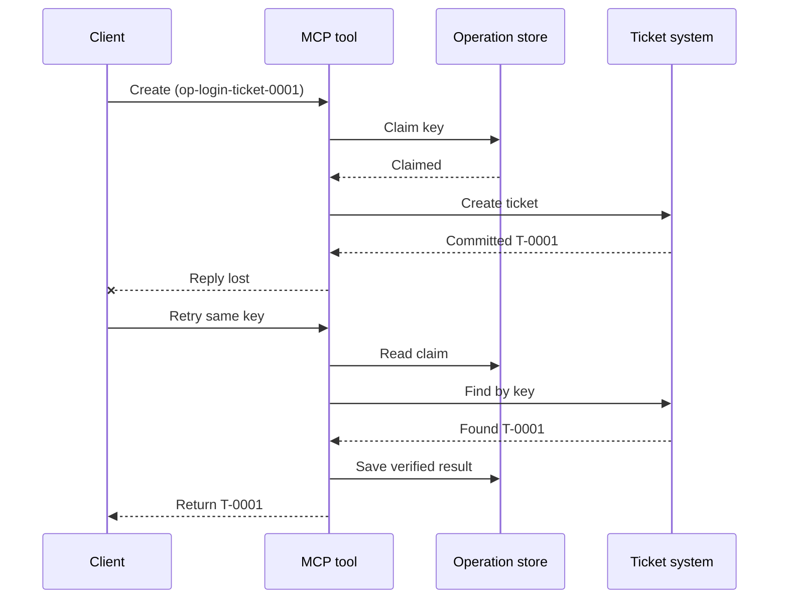
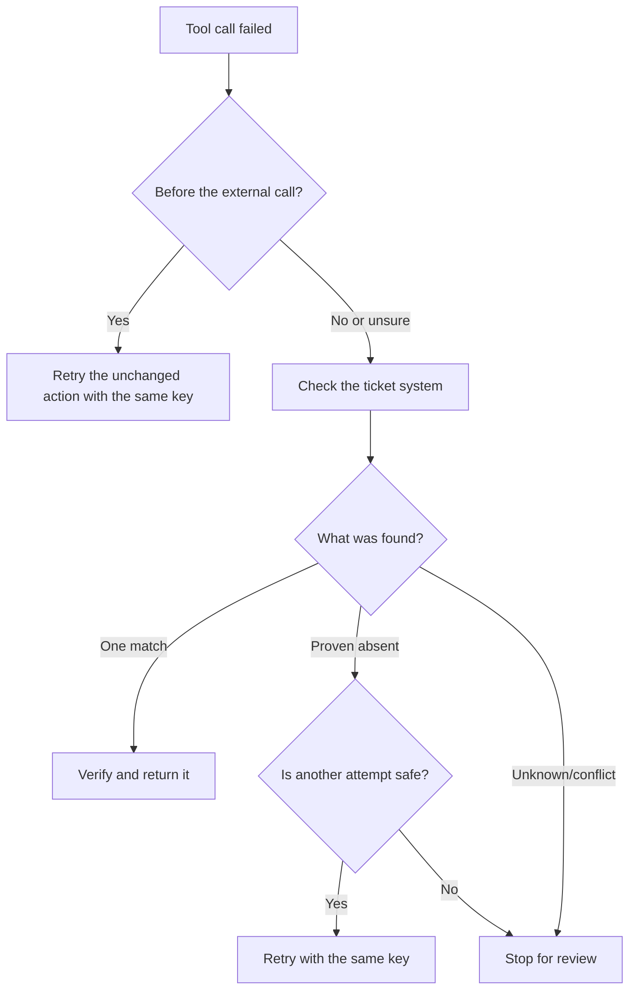

# MCP Tools க்கு பாதுகாப்பான மீண்டும் முயற்சிகள்: நம்பகத்தன்மை சைட்கார் மாதிரி

பதில் காணாமல் இருப்பது அந்த நடவடிக்கை இல்லையென பொருள் கொள்ள முடியாது. ஒரு ஆதரவு-டிக்கெட் கருவி
டிக்கெட் `T-0001` உருவாக்கலாம் மற்றும் பின்னர் கிளையன்ட் முடிவை பார்க்கும் முன் அதன் இணைப்பு துண்டிக்கப்படலாம்
முடிவை. கிளையன்ட் கணிக்காமலேயே மீண்டும் முயற்சித்தால், அது `T-0002` உருவாக்கக்கூடும்.

இந்த பாடம் அந்த அநிச்சிதமான முடிவை எப்படி உணருவது, நோக்கப்பட்ட
செயலுக்காக ஒரு நிலையான அடையாளத்தை பராமரிப்பது மற்றும் மீண்டும் முயற்சிப்பதற்கு முன் டிக்கெட் அமைப்பை சரிபார்ப்பது எப்படி என்பதை காட்டுகிறது.
சேர்க்கப்பட்ட Python பயிற்சி நிலையான நூலகத்துடன் உள்ளூரில் இயக்கப்படுகிறது
மற்றும் SQLite.

## ஏன் ஒரு டைம்ஆவுட் "முடிவு தெரியவில்லை" என்று பொருள் படுகிறது

கிளையன்ட் `create_support_ticket` ஐ செயல்பாட்டு விசை கொண்டு அழைக்கிறது என்று கருதுங்கள்
`op-login-ticket-0001`:



டிக்கெட் உறுதிசெய்யப்பட்ட பிறகுதான் இணைப்பு தோல்வியடைகிறது ஆனால் முடிவு வருவதற்கு முன்பு.
கிளையன்ட் அறிந்திருக்கிறதென்று ஒன்று மட்டுமே: பதில் காணவில்லை. அது செயல்பாடு நடந்ததா என்பதை அறியாது
டிக்கெட் காணப்படவில்லை. செயல்பாட்டு விசையை மீண்டும் பயன்படுத்துவது கருவிக்கு அதை கண்டுபிடித்து திருப்பி வழங்க அனுமதிக்கிறது
`T-0001` உருவாக்குவதற்கு பதிலாக `T-0002`.

## நம்பகத்தன்மை சைட்கார் என்ன செய்கிறது

நம்பகத்தன்மை சைட்கார் என்பது மீட்பு நிலையை ஒரு
கருவியின் சுற்றிலும் வைத்திருக்கும் பயன்பாட்டு குறியீடு. அது ஒரு நூலகம், மிடில்வேர், தரவுத்தளத்தால் ஆதரிக்கப்பட்ட சேவை, அல்லது எளிதாக
கருவி செயலாக்கத்தின் ஒரு பகுதியாக இருக்கலாம். அது தனித்த செயலாக்கமாக இருக்க வேண்டிய அவசியமில்லை,
மற்றும் இது MCP பரிமாண அம்சம் அல்ல.

இந்த சைட்காருக்கு நான்கு பணிகள் உள்ளன:

1. வெளிப்புற அமைப்பை அழைக்கும் முன் நோக்கப்பட்ட செயல்பாட்டை சேமிக்கவும்;
2. ஒரு வேலைக்காரனே மட்டும் அந்த செயலை உரிமைபெற அனுமதிக்கவும்;
3. மோசமான நிலை ஏற்பட்டால் மீட்பதற்குப் போதுமான நிலையைக் காப்பாற்றவும்;
4. முடிவு உறுதியாக இல்லையெனில் வெளிப்புற அமைப்பை சரிபார்க்கவும்.

This lesson targets the final MCP specification `2026-07-28`. MCP has no
protocol-level session, so the operation key is an ordinary tool argument
backed by durable application state. The same pattern also works with earlier
MCP versions.

## Four IDs That Solve Different Problems

These identifiers are related, but they are not interchangeable:

| Identifier | What it identifies | Survives a retry? |
| --- | --- | --- |
| JSON-RPC ID | ஒரு வேண்டுதல் மற்றும் பதில் | இல்லை; புதிய வேண்டுதல் ID-யை பயன்படுத்தவும் |
| MCP Task ID | ஒரு நீண்டநேரம் இயங்கும் பணி | ஆம்; போலிங் செய்ய அதை வைத்திருங்கள் |
| Operation key | ஒரு நோக்கப்பட்ட செயல்பாடு | ஆம்; அந்த செயலுக்காக அதை மீண்டும் பயன்படுத்தவும் |
| Ticket ID | சேமிக்கப்பட்ட முடிவு | ஆம்; சரிபார்ப்புக்குப் பிறகு அதனை திருப்பி வழங்கவும் |

முன்னேற்ற அறிவிப்புகள் மற்றும் டிரேஸ் சூழல் ஒரு வேண்டுதலைக் கண்காணிக்க உதவுகின்றன.
ரத்து கோருதல் வேலை நிறுத்துமாறு கேட்கும். அவற்றில் எதுவும் நகல் டிக்கெட்டினை தடுப்பதில்லை.

## Build the Guard

Create the operation key before the first tool call and save it with the
workflow. Every attempt to create the same intended ticket uses the same key:

```json
{
  "operation_key": "op-login-ticket-0001",
  "title": "Cannot sign in"
}
```

A different intended ticket gets a new key. In production, generate an opaque,
unguessable value instead of putting customer data into the key.

Here is the complete MCP tool schema used in this lesson:

```json
{
  "name": "create_support_ticket",
  "title": "Create support ticket",
  "description": "Creates or recovers one support ticket for an operation key.",
  "inputSchema": {
    "$schema": "https://json-schema.org/draft/2020-12/schema",
    "type": "object",
    "properties": {
      "operation_key": {
        "type": "string",
        "minLength": 16,
        "maxLength": 128,
        "description": "Stable key reused for the same intended action."
      },
      "title": {
        "type": "string",
        "minLength": 1,
        "maxLength": 200
      }
    },
    "required": ["operation_key", "title"],
    "additionalProperties": false
  },
  "outputSchema": {
    "$schema": "https://json-schema.org/draft/2020-12/schema",
    "type": "object",
    "properties": {
      "ticket_id": {
        "type": "string"
      },
      "operation_key": {
        "type": "string"
      },
      "status": {
        "type": "string",
        "const": "verified"
      }
    },
    "required": ["ticket_id", "operation_key", "status"],
    "additionalProperties": false
  }
}
```

The authenticated caller identity comes from server context, not from
model-supplied tool input. Scope each stored operation to:

- that caller, tenant, or service account;
- the tool name and version; and
- a hash of the normalized inputs that define the external action.

The input hash answers a simple question: "Is this retry asking for the same
ticket?" If the key already belongs to a different title, reject the call.
Returning an earlier result for changed input would hide a contract error.

Save the claim with one atomic database operation. "Atomic" means two workers
cannot both observe an empty record and both become the owner. A process-local
lock is not enough when another server instance can receive the retry.

The workflow creates the key while the action is `planned`. The sample then
persists these states:

- `claimed`: ஒரு வேலைக்காரன் செயல்பாட்டை ஒதுக்கியுள்ளது;
- `completed`: டிக்கெட் அமைப்பு ஒரு முடிவைத் திருப்பி வழங்கியுள்ளது; மற்றும்
- `verified`: டிக்கெட் அமைப்பில் இருந்து ஒரு வாசிப்பு முடிவை உறுதிப்படுத்துகிறது.

A crash can leave the stored state at `claimed` even after the ticket was
created. Treat every nonterminal claim as uncertain until external evidence
settles it. Do not assume that `claimed` means "nothing happened."

## Recover Before You Retry

When a tool call fails, decide what is known before sending another external
write:



Validation that fails before the ticket API is called is a known failure.
Retry an unchanged action with the same operation key. If correcting the input
changes the intended ticket, create a new key for that new action.

If the request may have reached the ticket system, reconcile it first.
Reconciliation means comparing the saved claim with the authoritative ticket
record. Return the existing ticket when exactly one matching record is found.
Retry only when the ticket is conclusively absent and the downstream contract
makes another attempt safe.

"Not found" is not always conclusive. A provider with eventually consistent
search may need a bounded wait and another check. If the system cannot be
searched, gives conflicting results, or cannot safely deduplicate another
attempt, stop and report `outcome unknown`. Stopping here is sometimes called
"failing closed": the workflow refuses to guess.

## Evidence, Tasks, and Cancellation

A tool response says what the tool reported. A stored checkpoint says what the
workflow recorded. The strongest evidence comes from the system that owns the
result: for this example, a read from the ticket system that finds exactly one
matching ticket.

Match the evidence to the risk. A provider message ID may be enough for a
low-risk notification. Payments, deployments, and destructive actions may
need provider status, ledger, or manual review evidence.

The MCP Tasks extension complements this pattern for long-running work. A Task
ID lets the client resume polling after a disconnect, but it does not identify
or deduplicate the ticket itself. When Tasks is used, the identities connect
like this:

```text
operation key -> Task ID -> ticket ID -> verification evidence
```

Cancellation is cooperative, not a rollback. The ticket may still be created
after cancellation is acknowledged, so an uncertain result still needs
reconciliation.

## Run the Failure-Injection Exercise

The sample uses two SQLite files: one represents the operation store and the
other represents the external ticket system. There is no transaction spanning
both files. The failure is injected after the ticket commits but before the
sidecar records completion.

நேரடி Python முறை `caller_id` ஐ அங்கீகரிக்கப்பட்ட
சர்வர் சூழலுக்கான பிரதிநிதியாக ஏற்கிறது. `caller_id` ஐ மாடல்-கட்டுப்படுத்தப்படும் MCP உள்ளீடு
ஸ்கீமாவிற்கு சேர்க்காதீர்கள்.

சோதனைகள் இயக்குவதற்கு முன் முடிவை கணிக்கவும்:

| பாதை | மீண்டும் முயன்றபின் முடிவு | டிக்கெட் எண்ணிக்கை |
| --- | --- | --- |
| Blind retry | Creates `T-0002` after losing the response for `T-0001` | 2 |
| Guarded retry | Finds and returns `T-0001` | 1 |

Run:

```bash
cd 08-BestPractices/reliability-sidecars/python
python -m unittest discover -p "test_*.py" -v
```

The six tests show that:

1. a blind retry creates a duplicate;
2. response loss plus a restart recovers one ticket from a durable claim;
3. a verified retry reuses the saved result;
4. changed input or conflicting external evidence is rejected;
5. an existing claim without external evidence stops safely; and
6. concurrent claims admit one owner without regressing a verified result.

Open the sample:

- [Python implementation](../../../../08-BestPractices/reliability-sidecars/python/reliability_sidecar.py)
- [Deterministic tests](../../../../08-BestPractices/reliability-sidecars/python/test_reliability_sidecar.py)

The sample intentionally omits stale-claim leases. A production takeover
policy needs a bounded lease, atomic ownership transfer, and another external
check before executing.

## Optional Community Implementation

Agent Enhancer Utilities is one community implementation of this
application-level pattern. Its planner selects a recovery approach, while its
checkpoint records claim and uncertain-result states. The domain tool or MCP
server still performs and verifies the real action. This service is not part
of the MCP specification and is not required for this lesson.

| Lesson concept | Agent Enhancer piece | Important limit |
| --- | --- | --- |
| Recovery plan | `workflow-guard-planner` | Does not call the domain tool |
| Claim and recovery | `workflow-checkpoint` | `external_proof` stays `false` |
| Exact sidecar replay | `lab.invoke_tool` | Uses a separate idempotency key |
| Verify the real action | Destination search/read-back | Domain MCP owns it |

For an exact retry of one sidecar call, `lab.invoke_tool` accepts an outer
`idempotency_key`. That key identifies the sidecar invocation; it is not the
business `operation_key` used for the ticket.

The tagged public contract and an optional networked example are available
here:

- [Reliability Sidecar Contract v1](https://github.com/artiehinz/Agent-Enhancer-Utilities/blob/v1.6.0/docs/RELIABILITY_SIDECAR_CONTRACT_V1.md)
- [Planner and mock-domain example](https://github.com/artiehinz/Agent-Enhancer-Utilities/tree/v1.6.0/examples/reliability-sidecar)

These links illustrate the application pattern. They do not claim that the
hosted service conforms to MCP `2026-07-28`, and checkpoint state never counts
as external proof of the ticket.

## Production Checklist

- [ ] Create and save the operation key before the first external attempt.
- [ ] Bind the key to caller, tool version, and normalized input hash.
- [ ] Reject changed input under an existing key.
- [ ] Admit one owner with an atomic shared-store operation.
- [ ] Forward the key to the downstream provider when it supports idempotency.
- [ ] Reconcile uncertain outcomes before another write.
- [ ] Keep verified results and evidence for the full retry window.
- [ ] Stop for review when the external outcome cannot be established safely.

## References

- [MCP Specification `2026-07-28`](https://modelcontextprotocol.io/specification/2026-07-28)
- [MCP `2026-07-28` tool guidance](https://modelcontextprotocol.io/specification/2026-07-28/server/tools)
- [MCP Tasks extension](https://modelcontextprotocol.io/extensions/tasks/overview)
- [JSON-RPC 2.0 specification](https://www.jsonrpc.org/specification)

---

<!-- CO-OP TRANSLATOR DISCLAIMER START -->
**மறுப்பு**:
இந்த ஆவணம் AI மொழிபெயர்ப்பு சேவை [Co-op Translator](https://github.com/Azure/co-op-translator) பயன்படுத்தி மொழிபெயர்க்கப்பட்டுள்ளது. நாங்கள் துல்லியத்திற்காக முயற்சி செய்துள்ளோம், ஆனால் தானாக செய்யப்படும் மொழிபெயர்ப்புகளில் பிழைகள் அல்லது தவறுகள் இருக்கலாம் என்பதை கவனத்தில் கொள்ளவும். அசல் ஆவணம் அதன் தாய்மொழியில் அதிகாரப்பூர்வ ஆதாரமாக கருதப்பட வேண்டும். முக்கியமான தகவல்களுக்கு, தொழில்நுட்பமான மனித மொழிபெயர்ப்பு பரிந்துரைக்கப்படுகிறது. இந்த மொழிபெயர்ப்பைப் பயன்படுத்துவதால் ஏற்படும் எந்த தவறான புரிதல்கள் அல்லது தவறான விளக்கத்திற்கும் நாங்கள் பொறுப்பில்வில்லை.
<!-- CO-OP TRANSLATOR DISCLAIMER END -->