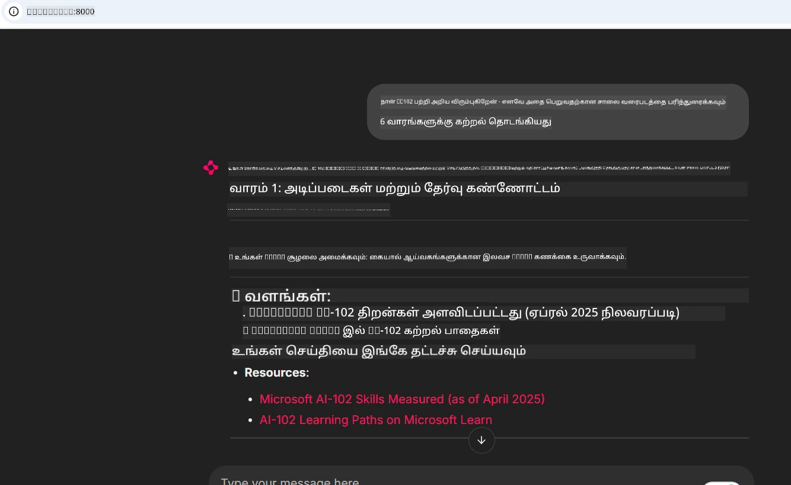
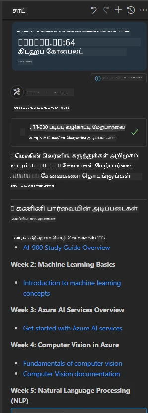

# வழக்கு ஆய்வு: வாடிக்கையாளர் மூலம் Microsoft Learn Docs MCP சர்வருடன் இணைத்தல்

உங்கள் குறியீட்டில் ஒரு சிக்கலைத் தீர்க்க முயற்சிக்கும் போது, நீங்கள் எப்பொழுதாவது ஆவண தளங்கள், Stack Overflow மற்றும் முடிவில்லாத தேடல் பொறி டேப்கள் இடையே சுழற்சி செய்யும் நிலையில் இருந்தீர்களா? நீங்கள் ஒரு இரண்டாவது மானிட்டரை ஆவணங்களுக்காக மட்டும் வைத்திருக்கலாம், அல்லது எப்போதும் உங்கள் IDE மற்றும் ஒரு உலாவியை இடையே alt-tab செய்கிறீர்கள். உங்கள் பணிச்சுற்றுவட்டத்தில் ஆவணங்களை நேரடியாக கொண்டு வந்தால் எப்படி இருக்கும்—உங்கள் செயலிகளிலும், உங்கள் IDE-இலும், அல்லது உங்கள் சொந்த தனிப்பயன் கருவிகளிலும் ஒருங்கிணைக்கப்படுமா? இந்த வழக்கு ஆய்வில், உங்கள் சொந்த வாடிக்கையாளர் செயலியிலிருந்து நேரடியாக Microsoft Learn Docs MCP சர்வருடன் எப்படி இணைப்பதைப் பார்ப்போம்.

## கண்ணோட்டம்

நவீன மேம்பாடு குறியீட்டை எழுதியிருப்பதுதான் அல்ல—சரி நேரத்தில் சரியான தகவலைக் கண்டுபிடிப்பதே முக்கியம். ஆவணங்கள் எங்கும் இருக்கின்றன, ஆனால் அவை பெரும்பாலும் நீங்கள் அவற்றை அதிகம் தேவைப்படும் இடத்தில் இல்லை: உங்கள் கருவிகள் மற்றும் பணிச்சுற்றுவட்டங்களில். ஆவணங்களை நேரடியாக உங்கள் செயலிகளுக்கு ஒருங்கிணைப்பதன் மூலம், நீங்கள் நேரத்தைச் சேமித்து, சூழல் மாறுதலை குறைத்து, உற்பத்தித்திறனை கூட்ட முடியும். இந்த பகுதியில், Microsoft Learn Docs MCP சர்வருடன் ஒரு வாடிக்கையாளரை எவ்வாறு இணைப்பது என்று காட்டுவோம், எனவே நீங்கள் உங்கள் செயலியை விட்டு வெளியே போகாமல் நேரடி, சூழல்-அறிவுள்ள ஆவணங்களை அணுக முடியும்.

இணைப்பை நிறுவுவது, கோரிக்கை அனுப்புவது மற்றும் ஸ்ட்ரீமிங் பதில்களை திறம்பட கையாள்வதற்கான செயல்முறையை நாம் நடைபயிலும் வகையில் காட்டுவோம். இந்த அணுகுமுறை உங்கள் பணிச்சுற்றுவட்டத்தை எளிதாக்குவதோடு மட்டுமின்றி, புத்திசாலிதனமான, உதவிகரமான மேம்பாட்டுக் கருவிகளை அமைக்கும் வாய்வையும் திறக்கும்.

## கற்றலின் நோக்கங்கள்

இதை ஏன் செய்கிறோம்? ஏனெனில் சிறந்த மேம்பாட்டாளர் அனுபவங்கள் தடைகள் இல்லாமல் செயல்படுபவை. உங்கள் குறியீடு எடிட்டர், чат்போட் அல்லது வலை செயலி Microsoft Learn இன் சமீபத்திய உள்ளடக்கத்தை உடனே பயன்படுத்தி உங்கள் ஆவணக் கேள்விகளுக்கு உடனடி பதில்கள் வழங்கும் உலகத்தை கற்பனை செய்யுங்கள். இந்த அத்தியாயம் முடிந்து நிச்சயமாக நீங்கள் எப்படி:

- ஆவணங்களுக்கான MCP சர்வர்-வாடிக்கையாளர் தொடர்பின் அடிப்படைகளை புரிந்து கொள்வது
- Microsoft Learn Docs MCP சர்வருடன் இணைக்கக் கன்சோல் அல்லது வலை செயலி உருவாக்குவது
- நேரடியாக ஆவணங்களைப் பெற ஸ்ட்ரீமிங் HTTP வாடிக்கையாளர்களை பயன்படுத்துவது
- உங்கள் செயலியில் ஆவண பதில்களை பதிவு செய்து புரிந்து கொள்ளுதல்

இந்த திறன்கள் எப்படி எதிர்வினைத்தன்மையல்லாமல், உண்மையால் தொடர்புடைய மற்றும் சூழல்-அறிவுள்ள கருவிகளை உருவாக்க உதவுமென நீங்கள் காண்பீர்கள்.

## நிலைமை 1 - MCP உடன் நேரடி ஆவண மீட்டெடு

இந்த நிலைமையில், Microsoft Learn Docs MCP சர்வருடன் ஒரு வாடிக்கையாளரை இணைப்பது எப்படி என்பதை காட்சியளிப்போம், எனவே நீங்கள் உங்கள் செயலியை விட்டு வெளியே போகாமலும், நேரடி, சூழல்-அறிவுள்ள ஆவணங்களை அணுக முடியும்.

இதைப் நடைமுறையில் பார்க்கலாம். உங்கள் பணியாக Microsoft Learn Docs MCP சர்வருடன் இணைக்கக்கூடிய செயலியை எழுதுதல், `microsoft_docs_search` கருவியை வலைப்பரப்பில் அழைத்தல் மற்றும் ஸ்ட்ரீமிங் பதிலை கன்சோலில் பதிவு செய்தல் ஆகும்.

### ஏன் இந்த அணுகுமுறை?
ஏனெனில் இது மேலதிக ஒருங்குடைப்புகளை உருவாக்கும் அடித்தளமே—எதுவும், நீங்கள் чат்போட், IDE விரிவாக்கம் அல்லது வலை டாஷ்போர்டு இயக்க விரும்புகிறீர்களோ.

இந்த நிலைமைக்கு குறியீடு மற்றும் வழிமுறைகள் இந்த வழக்கு ஆய்வில் உள்ள [`solution`](./solution/README.md) கோப்பகத்தில் உள்ளது. படிகள் நீங்கள் இணைப்பை அமைப்பதை வழிநடத்தும்:
- இணைப்புக்கு அதிகாரபூர்வ MCP SDK மற்றும் ஸ்ட்ரீமிங் HTTP வாடிக்கையாளரை பயன்படுத்தவும்
- ஆவணங்களை பெற, `microsoft_docs_search` கருவியை வினாவுடன் அழைக்கவும்
- சரியான பதிவு மற்றும் பிழை கையாளுதலை நடைமுறைப்படுத்தவும்
- பயனர்கள் பல தேடல் வினாக்களை உள்ளிடக்கூடிய இன்டராக்க்டிவ் கன்சோல் இடைமுகத்தை உருவாக்கவும்

இந்த நிலைமை எவ்வாறு:
- Docs MCP சர்வருடன் இணைப்பது
- வினா அனுப்புவது
- முடிவுகளை பிரித்து அச்சிடுவது

இங்கு தீர்வு இயங்கும் படி இருக்கலாம்:

```
Prompt> What is Azure Key Vault?
Answer> Azure Key Vault is a cloud service for securely storing and accessing secrets. ...
```

கீழே குறைந்தபட்ச மாதிரி தீர்வு உள்ளது. முழு குறியீடு மற்றும் விவரங்கள் தீர்வு கோப்பகத்தில் கிடைக்கின்றன.

<details>
<summary>Python</summary>

```python
import asyncio
from mcp.client.streamable_http import streamablehttp_client
from mcp import ClientSession

async def main():
    async with streamablehttp_client("https://learn.microsoft.com/api/mcp") as (read_stream, write_stream, _):
        async with ClientSession(read_stream, write_stream) as session:
            await session.initialize()
            result = await session.call_tool("microsoft_docs_search", {"query": "Azure Functions best practices"})
            print(result.content)

if __name__ == "__main__":
    asyncio.run(main())
```

- முழுமையான செயலாக்கம் மற்றும் பதிவு குறித்து, [`scenario1.py`](../../../../09-CaseStudy/docs-mcp/solution/python/scenario1.py) பார்க்கவும்.
- நிறுவல் மற்றும் பயன்பாட்டு வழிமுறைக்காக, அதே கோப்பகத்தில் உள்ள [`README.md`](./solution/python/README.md) கோப்பை பார்க்கவும்.
</details>


## நிலைமை 2 - MCP உடன் இன்டராக்க்டிவ் படிப்புத் திட்டம் ஜெனரேட்டர் வலை செயலி

இந்த நிலைமையில், Docs MCP-ஐ ஒரு வலை மேம்பாட்டு திட்டத்தில் ஒருங்கிணைப்பது எப்படி என்பதை கற்றுக்கொள்வீர்கள். நோக்கம், பயனர்கள் Microsoft Learn ஆவணங்களை நேரடியாக ஒரு வலை இடைமுகத்திலிருந்து தேட முடியும் ஆகும், உங்கள் செயலியில் அல்லது தளத்தில் ஆவணங்களை உடனடி அணுகல் அளிப்பது.

நீங்கள் எப்படி செய்வது என்பதைக் காண்பீர்கள்:
- ஒரு வலை செயலியை அமைப்பது
- Docs MCP சர்வருடன் இணைப்பது
- பயனர் உள்ளீட்டை கையாள்வதும் முடிவுகளை காட்டுவதும்

இங்கு தீர்வு இயங்கும் படி இருக்கலாம்:

```
User> I want to learn about AI102 - so suggest the roadmap to get it started from learn for 6 weeks

Assistant> Here’s a detailed 6-week roadmap to start your preparation for the AI-102: Designing and Implementing a Microsoft Azure AI Solution certification, using official Microsoft resources and focusing on exam skills areas:

---
## Week 1: Introduction & Fundamentals
- **Understand the Exam**: Review the [AI-102 exam skills outline](https://learn.microsoft.com/en-us/credentials/certifications/exams/ai-102/).
- **Set up Azure**: Sign up for a free Azure account if you don't have one.
- **Learning Path**: [Introduction to Azure AI services](https://learn.microsoft.com/en-us/training/modules/intro-to-azure-ai/)
- **Focus**: Get familiar with Azure portal, AI capabilities, and necessary tools.

....more weeks of the roadmap...

Let me know if you want module-specific recommendations or need more customized weekly tasks!
```

கீழே குறைந்தபட்ச மாதிரி தீர்வு உள்ளது. முழு குறியீடு மற்றும் விவரங்கள் தீர்வு கோப்பகத்தில் கிடைக்கின்றன.



<details>
<summary>Python (Chainlit)</summary>

Chainlit என்பது உரையாடல் குறித்த AI வலை செயலிகளை உருவாக்கும் கட்டமைப்பு. இது MCP கருவிகளை அழைத்து முடிவுகளை நேரடியாகக் காட்டும் விதமாக இன்டராக்க்டிவ் чат்போட்டுகளையும் உதவியாளர்களையும் உருவாக்க எளிதாக்குகிறது. இது விரைவு மாதிரிப்பதற்கும் பயனர் நண்பர் இடைமுகங்களுக்கு மிகவும் பொருத்தமானது.

```python
import chainlit as cl
import requests

MCP_URL = "https://learn.microsoft.com/api/mcp"

@cl.on_message
def handle_message(message):
    query = {"question": message}
    response = requests.post(MCP_URL, json=query)
    if response.ok:
        result = response.json()
        cl.Message(content=result.get("answer", "No answer found.")).send()
    else:
        cl.Message(content="Error: " + response.text).send()
```

- முழுமையான செயலாக்கத்திற்கு, [`scenario2.py`](../../../../09-CaseStudy/docs-mcp/solution/python/scenario2.py) பார்க்கவும்.
- அமைப்பும் இயக்கும் விதிகளுக்கு, [`README.md`](./solution/python/README.md) பார்க்கவும்.
</details>


## நிலைமை 3: VS Code-இல் MCP சர்வருடன் in-Editor Docs

Microsoft Learn Docs ஐ உங்கள் VS Code-இல் நேரடியாக பெற விரும்பினால் (உலாவி டேப்களை மாற்றாமல்), உங்கள் எடிட்டரில் MCP சர்வரை பயன்படுத்த முடியும். இதனால் நீங்கள்:
- உங்கள் குறியீட்டு சூழலை விட்டு வெளியே போகாமல் VS Code-இல் ஆவணங்களைத் தேடிப் படிக்க முடியும்.
- நேரடியாக README அல்லது பாடம் கோப்புகளில் ஆவணங்களை குறிக்கவும் இணைப்புகளைச் சேர்க்கவும்.
- GitHub Copilot மற்றும் MCP ஐ இணைத்து ஒருங்கிணைக்கப்பட்ட AI இயக்கும் ஆவண பணிச்சுற்றுவட்டத்தை பயன்படுத்தவும்.

**நீங்கள் எப்படி செய்வது என்பதைக் காண்பீர்கள்:**
- உங்கள் பணிச்சுற்றுவட்ட மூலத்தில் செல்லுபடியான `.vscode/mcp.json` கோப்பை சேர் (கீழே உதாரணக் காணவும்).
- MCP பேனலை திறக்க அல்லது VS Code கட்டளை பட்டியலை பயன்படுத்தி ஆவணங்களை தேடவும் மற்றும் சேர்க்கவும்.
- வேலை செய்துவந்தபோது நேரடியாக உங்கள் மார்க்டவுன் கோப்புகளில் ஆவணங்களை குறிக்கவும்.
- இந்த பணிச்சுற்றுவட்டத்தை GitHub Copilot உடன் இணைத்து மேலும் உற்பத்தித்திறனை மேம்படுத்தவும்.

VS Code-இல் MCP சர்வரை அமைக்கும் உதாரணம் இதோ:

```json
{
  "servers": {
    "LearnDocsMCP": {
      "url": "https://learn.microsoft.com/api/mcp"
    }
  }
}
```

</details>

> திரைபடங்கள் மற்றும் படி படி வழிகாட்டலுடன் விரிவான நடைபடிகளை காண [`README.md`](./solution/scenario3/README.md) பார்க்கவும்.



இந்த அணுகுமுறை தொழில்நுட்ப பாடங்கள் உருவாக்குவோர், ஆவணங்களை எழுதுவோர் மற்றும் அடிக்கடி குறிச்சொற்களை பார்ப்போர் அனைவருக்கும் சிறந்தது.

## முக்கிய குறிப்பு

ஆவணங்களை நேரடியாக உங்கள் கருவிகளுக்கு ஒருங்கிணைப்பது வெறும் வசதியல்ல—it ஒரு உற்பத்தித்திறன் மாற்றிதான். Microsoft Learn Docs MCP சர்வருடன் உங்கள் வாடிக்கையாளர் மூலம் இணைத்து, நீங்கள்:

- உங்கள் குறியீடு மற்றும் ஆவணங்களுக்கிடையே சூழல் மாறுதலை நீக்க முடியும்
- காலक्रमோட்டமான, சூழல்-அறிவுள்ள ஆவணங்களை நேரடியாக பெற முடியும்
- புத்திசாலித்தனமான, இன்டராக்டிவ் மேம்பாட்டுக் கருவிகளை உருவாக்க முடியும்

இந்த திறன்கள் உங்கள் தீர்வுகளை திறம்படவும், பயன்படுத்த மகிழ்ச்சியானவையும் ஆக உதவும்.

## கூடுதல் வளங்கள்

உங்கள் புரிதலை ஆழப்படுத்த, இந்த அதிகாரபூர்வ வளங்களை ஆராயவும்:

- [Microsoft Learn Docs MCP Server (GitHub)](https://github.com/MicrosoftDocs/mcp)
- [Azure MCP Server தொடங்கல் (mcp-python)](https://learn.microsoft.com/en-us/azure/developer/azure-mcp-server/get-started#create-the-python-app)
- [Azure MCP Server என்றால் என்ன?](https://learn.microsoft.com/en-us/azure/developer/azure-mcp-server/)
- [Model Context Protocol (MCP) அறிமுகம்](https://modelcontextprotocol.io/introduction)
- [MCP Server-இலிருந்து பிளக்கின்களைச் சேர்த்தல் (Python)](https://learn.microsoft.com/en-us/semantic-kernel/concepts/plugins/adding-mcp-plugins)

## அடுத்தது என்ன

- திரும்ப: [வழக்கு ஆய்வுகள் கண்ணோட்டம்](../README.md)
- தொடர: [Module 10: Microsoft Foundry Toolkit உடன் AI பணிச்சுற்றுவட்டங்களை எளிமைப்படுத்துதல்](../../10-StreamliningAIWorkflowsBuildingAnMCPServerWithAIToolkit/README.md)

---

<!-- CO-OP TRANSLATOR DISCLAIMER START -->
**மறுப்பு**:
இந்த ஆவணம் AI மொழிபெயர்ப்பு சேவை [Co-op Translator](https://github.com/Azure/co-op-translator) பயன்படுத்தி மொழிபெயர்க்கப்பட்டுள்ளது. நாங்கள் துல்லியத்திற்காக முயற்சி செய்துள்ளோம், ஆனால் தானாக செய்யப்படும் மொழிபெயர்ப்புகளில் பிழைகள் அல்லது தவறுகள் இருக்கலாம் என்பதை கவனத்தில் கொள்ளவும். அசல் ஆவணம் அதன் தாய்மொழியில் அதிகாரப்பூர்வ ஆதாரமாக கருதப்பட வேண்டும். முக்கியமான தகவல்களுக்கு, தொழில்நுட்பமான மனித மொழிபெயர்ப்பு பரிந்துரைக்கப்படுகிறது. இந்த மொழிபெயர்ப்பைப் பயன்படுத்துவதால் ஏற்படும் எந்த தவறான புரிதல்கள் அல்லது தவறான விளக்கத்திற்கும் நாங்கள் பொறுப்பில்வில்லை.
<!-- CO-OP TRANSLATOR DISCLAIMER END -->