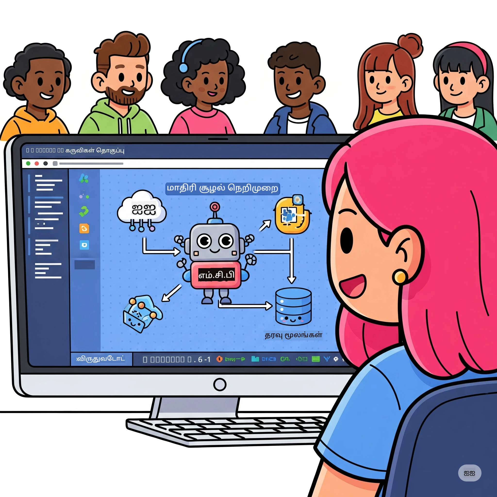

# AI பணிமூலதனத்தை சீரமைத்தல்: Microsoft Foundry Toolkit உடன் MCP சர்வரை உருவாக்குதல்

## 🎯  கண்ணோட்டம்

_(இந்த படத்தை சொடுக்கி இந்த பாடம் காணொளியை பார்க்கவும்)_

**Model Context Protocol (MCP) பயிற்சி வகுப்புக்கு வரவேற்கிறோம்!** இந்த விரிவான கைபயிற்சி வகுப்பு AI பயன்பாட்டுப் பணிமூலதனத்தை மாற்றுவதற்கான இரண்டு முன்னணி தொழில்நுட்பங்களை ஒருங்கிணைத்துள்ளது:

> **உகந்த குறிப்பு:** பயிற்சி வகுப்பு குறியீடு MCP உடன் கட்டப்பட்டது மற்றும் சோதிக்கப்பட்டது
> `2025-11-25`, மேலுள்ள பதற்றுநிகழ்காட்சி மூலம் காட்டப்பட்டுள்ளது. புதிய நெறிமுறை அமலாக்கங்களுக்கு
> [தற்போதைய `2026-07-28` விளக்கம்](https://modelcontextprotocol.io/specification/2026-07-28/)
> ஐ பயன்படுத்தவும் மற்றும் SDK வெளியீட்டு குறிப்புகளை ஆய்வு செய்து
> ஆய்வகங்களை மாற்றவும்.

- **🔗 Model Context Protocol (MCP)**: பிணைந்த AI-கருவி ஒருங்கிணைப்புக்கு ஒரு திறந்த தரநிலை
- **🛠️ Microsoft Foundry Toolkit VS Code விரிவாக்கம்**: Microsoft இன் சக்திவாய்ந்த AI மேம்பாட்டு விரிவாக்கம்

### 🎓 நீங்கள் கற்கப்போகும் விஷயங்கள்

இந்த பயிற்சி வகுப்பின் முடிவில், நீங்கள் AI மாதிரிகளையும் நிஜ உலக கருவிகள் மற்றும் சேவைகளையும் இணைக்கும் அறிவார்ந்த பயன்பாடுகளை உருவாக்குவதில் திறமையாக இருப்பீர்கள். தானையாக்கப்பட்ட சோதனைகள் முதல் தனிப்பயன் API ஒருங்கிணைப்புகள் வரை, நீங்கள் சிக்கலான வணிக சவால்களை தீர்க்க நடைமுறை திறன்களை பெறுவீர்கள்.

## 🏗️ தொழில்நுட்ப குவியல்

### 🔌 Model Context Protocol (MCP)

MCP என்பது **"AI க்கான USB-C"** - AI மாதிரிகளை வெளியுறைப்படுத்தும் கருவிகள் மற்றும் தரவுத் தெருக்களுடன் இணைக்கும் ஒரு பொது தரநிலை.

**✨ முக்கிய அம்சங்கள்:**

- 🔄 **செம்மையான ஒருங்கிணைப்பு**: AI-கருவி இணைப்புகளுக்கு பொதுநிலை இடைமுகம்
- 🏛️ **நெகிழ்வான கட்டமைப்பு**: உள்ளூர் மற்றும் தொலைவுநிலை சேவையகங்கள் stdio/SSE வழியாக
- 🧰 **பெரிய சூழல்**: கருவிகள், தூண்டுதல்கள் மற்றும் வளங்கள் ஒரே நெறிமுறையில்
- 🔒 **தொழில்சார் தயாரியல்**: நுழைவுக் கட்டுப்பாடு மற்றும் நம்பகத்தன்மை செய்தியுடன்

**🎯 MCP அவசியம்ஈன் காரணம்:**
USB-C கம்பி குழப்பங்களை ஒழித்தது போல, MCP AI ஒருங்கிணைப்புக்களின் சிக்கல்களை அகற்றுகிறது. ஒரே நெறிமுறை, நிரம்பிய வாய்ப்புகள்.

### 🤖 Microsoft Foundry Toolkit VS Code விரிவாக்கம்

Microsoft இன் முன்னணி AI மேம்பாட்டு விரிவாக்கம், Vue Code ஐ சக்திவாய்ந்த AI காரகரமாக மாற்றுகிறது.

**🚀 முக்கிய திறன்கள்:**

- 📦 **மாதிரி கேட்டலாக்**: Azure AI, GitHub, Hugging Face, Ollama போன்றவற்றிலிருந்து மாதிரிகள் அணுகல்
- ⚡ **உள்ளூர் தீர்மானம்**: ONNX-இல் விருத்தி செய்யப்பட்ட CPU/GPU/NPU இயக்கம்
- 🏗️ **ஏஜெண்ட் கட்டமைப்பாளர்**: MCP ஒருங்கிணைப்புடன் காணொளி AI முகவர் மேம்பாடு
- 🎭 **பன்முக வடிவம்**: உரை, பார்வை மற்றும் கட்டமைக்கப்பட்ட வெளியீடு ஆதரவு

**💡 மேம்பாட்டு நன்மைகள்:**

- கட்டமைப்பு தேவையற்ற மாதிரி பொருத்தம்
- காணொளி தூண்டுதல் பொறியியல்
- நேரடி சோதனை மேடையை உருவாக்குதல்
- MCP சர்வர் ஒருங்கிணைப்புப்போல தொடர்ந்த இணைப்பு

## 📚 கற்றல் பயணம்

### [🚀 மாடுல் 1: Microsoft Foundry Toolkit அடிப்படைகள்](./lab1/README.md)

**கால அவதி**: 15 நிமிடங்கள்

- 🛠️ Microsoft Foundry Toolkit ஐ VS Code க்காக நிறுவி அமைக்கவும்
- 🗂️ மாதிரி கேட்டலாக் ஆராய்ச்சி (100+ மாதிரிகள் GitHub, ONNX, OpenAI, Anthropic, Google இலிருந்து)
- 🎮 நேரடி மாதிரி சோதனைக்கான உற்சாகமான ஆட்டப்பந்தய மேடையை கற்கவும்
- 🤖 முதன்மை AI முகவரை ஏஜெண்ட் கட்டமைப்பாளரோடு உருவாக்கு
- 📊 உள்ளமைந்த அளவுகோல்கள் (F1, பொருத்தம், ஒத்துழைப்பு, அமைப்பு) மூலம் மாதிரி செயல்திறன் மதிப்பீடு செய்
- ⚡ தொகுப்பு செயலாக்கமும் பன்முக ஆதரவையும் கற்றுக்கொள்

**🎯 கற்றல் முடிவு**: Microsoft Foundry Toolkit திறன்களை முழுமையாகப் புரிந்து செயல்படு AI முகவரை உருவாக்குங்கள்

### [🌐 மாடுல் 2: Microsoft Foundry Toolkit உடன் MCP அடிப்படைகள்](./lab2/README.md)

**கால அவதி**: 20 நிமிடங்கள்

- 🧠 Model Context Protocol (MCP) கட்டமைப்பு மற்றும் கான்செப்ட்களை ஆராய்வு செய்க
- 🌐 Microsoft இன் MCP சர்வர் சூழலைப் பார்வையிடு
- 🤖 Playwright MCP சர்வரை பயன்படுத்தி உலாவி தானியக்கம் முகவரை உருவா
- 🔧 MCP சர்வர்களை Microsoft Foundry Toolkit Agent Builder உடன் ஒருங்கிணைக்கவும்
- 📊 உங்கள் முகவர்களில் MCP கருவிகளை அமைத்து சோதனை செய்க
- 🚀 MCP சக்தியுள்ள முகவர்களை உற்பத்திக்காக ஏற்றுமதி செய் மற்றும் நகர்க்க

**🎯 கற்றல் முடிவு**: MCP மூலம் வெளி கருவிகளுடன் கூடிய அதிவேக AI முகவரை வெளியிடு

### [🔧 மாடுல் 3: Microsoft Foundry Toolkit உடன் மேம்பட்ட MCP மேம்பாடு](./lab3/README.md)

**கால அவதி**: 20 நிமிடங்கள்

- 💻 Microsoft Foundry Toolkit பயன்படுத்தி தனிப்பயன் MCP சர்வர்களை உருவாக்கு
- 🐍 அண்மைய MCP Python SDK (v1.9.3) ஐ அமைத்து பயன்படுத்தவும்
- 🔍 திருத்தத்திற்குப் MCP Inspector ஐ அமைத்து பயன்பாடு செய்
- 🛠️ வானிலை MCP சர்வரை தொழில்முறை திருத்த பணிமுறைகளுடன் கட்டமைக்கவும்
- 🧪 Agent Builder மற்றும் Inspector சூழலில் MCP சர்வர்களை திருத்து

**🎯 கற்றல் முடிவு**: நவீன கருவிகளைப் பரிசோதித்து தனிப்பயன் MCP சர்வர்களை உருவாக்கி திருத்து

### [🐙 மாடுல் 4: நடைமுறை MCP மேம்பாடு - தனிப்பயன் GitHub கிளோன் சர்வர்](./lab4/README.md)

**கால அவதி**: 30 நிமிடங்கள்

- 🏗️ உருவாக்கும் பணிமுறைகளுக்கு நிஜ உலக GitHub கிளோன் MCP சர்வரை உருவாக்கு
- 🔄 சான்றிதழ் மற்றும் பிழை கையாளுதலுடன் புத்திசாலி அட்டை காப்பியெடுப்பு செயல்படுத்து
- 📁 புத்திசாலி டைரக்டரி மேலாண்மை மற்றும் VS Code ஒருங்கிணைப்பு உருவாக்கு
- 🤖 தனிப்பயன் MCP கருவிகளுடன் GitHub Copilot Agent Mode ஐ பயன்படுத்து
- 🛡️ உற்பத்தி சார்ந்த நம்பகத்தன்மையும் பல தள கூட்டு தன்மையும் பொருத்து

**🎯 கற்றல் முடிவு**: நேரடி மேம்பாட்டு பணிமுறைகள் எளிமையாக்க MCP சர்வரை வெளியிடு

## 💡 நிஜ உலக பயன்பாடுகள் மற்றும் தாக்கம்

### 🏢 நிறுவன பயன்பாடுகள்

#### 🔄 DevOps தானியக்கம்

உங்கள் மேம்பாட்டு பணிமுறையை அறிவார்ந்த தானியக்கத்துடன் மாற்றுங்கள்:

- **புத்திசாலி அட்டை மேலாண்மை**: AI இயக்கிய குறியீடு மதிப்பீடு மற்றும் இணைப்பு முடிவுகள்
- **அறிவார்ந்த CI/CD**: குறியீடு மாற்றங்களுக்கு அடிப்படையான தானியக்க குழாய்முறை மேம்பாடு
- **பிழை வகைப்பாடு**: தானாக பிழைகள் வகைப்படுத்தி ஒதுக்கீடு செய்தல்

#### 🧪 தர நிறைவு புரட்சி

AI இயக்கிய தானியக்கத்துடன் சோதனையை மேம்படுத்து:

- **அறிவார்ந்த சோதனை உருவாக்கம்**: தானாக முழுமையான சோதனை தொகுதிகளை உருவாக்கு
- **காணொளி பின்னோக்குச் சோதனை**: AI இயக்கிய UI மாற்றம் கண்டறிதல்
- **செயல்திறன் கண்காணிப்பு**: முன்கூட்டியே பிரச்சனைகள் கண்டறிந்து தீர்ப்பு

#### 📊 தரவுத் குழாய் அறிவு

புத்திசாலியான தரவு செயலாக்க பணிமுறைகள் உருவாக்குங்கள்:

- **இயங்கும் ETL செயல்முறைகள்**: தானாகத் தானாக தரவு மாற்றங்களை சுருக்கி மேம்படுத்தல்
- **தப்புகளை கண்டறிதல்**: நேரடி தரம் கண்காணிப்பு
- **அறிவார்ந்த வழி நடத்தல்**: புத்திசாலியான தரவு ஓட்ட மேலாண்மை

#### 🎧 வாடிக்கையாளர் அனுபவ மேம்பாடு

சிறந்த வாடிக்கையாளர் தொடர்புகளை உருவாக்குங்கள்:

- **சூழல் அறிவுடைய ஆதரவு**: வாடிக்கையாளர் வரலாற்றுடன் AI முகவர்கள்
- **முன்கூட்டிய பிரச்சனை தீர்வு**: கணிப்புத் துறையாளர் சேவை
- **பன்முக சேனல் ஒருங்கிணைப்பு**: தளங்களுக்கு இடையேயான ஒருங்கிணைந்த AI அனுபவம்

## 🛠️ முன் கொள்கைகள் மற்றும் அமைத்தல்

### 💻 கணினி தேவைகள்

| கூறு | தேவைகள் | குறிப்புகள் |
|-----------|-------------|-------|
| **செயல்பாட்டு முறைமை** | Windows 10+, macOS 10.15+, Linux | எந்தவொரு சமகால இயக்க முறைமை |
| **Visual Studio Code** | சமீபத்திய நிலையான பதிப்பு | Microsoft Foundry Toolkit க்கான அவசியம் |
| **Node.js** | v18.0+ மற்றும் npm | MCP சர்வர் மேம்பாட்டிற்கானது |
| **Python** | 3.10+ | Python MCP சர்வர்களுக்கு விருப்பம் |
| **மெமரி** | குறைந்தபட்சம் 8GB RAM | உள்ளூர் மாதிரிகளுக்கு 16GB பரிந்துரைக்கப்படுகிறது |

### 🔧 மேம்பாட்டு சூழல்

#### பரிந்துரைக்கப்படும் VS Code விரிவாக்கங்கள்

- **Microsoft Foundry Toolkit** (ms-windows-ai-studio.windows-ai-studio)
- **Python** (ms-python.python)
- **Python Debugger** (ms-python.debugpy)
- **GitHub Copilot** (GitHub.copilot) - விருப்பமாக இருந்தாலும் உதவிகரமாகும்

#### விருப்ப கருவிகள்

- **uv**: சமகால Python தொகுப்பு மேலாளி
- **MCP Inspector**: MCP சர்வர்களுக்கான காணொளி திருத்தும் கருவி
- **Playwright**: வலை தானியக்க எடுத்துக்காட்டுகளுக்கு

## 🎖️ கற்றல் முடிவுகள் மற்றும் சான்றிதழ் பாதை

### 🏆 திறன் மேற்பார்வை சரிபார்ப்பு பட்டியல்

இந்த பயிற்சி வகுப்பை முடித்து, நீங்கள் இந்த திறன்களில் துல்லியமாகும்:

#### 🎯 முக்கிய திறன்கள்

- [ ] **MCP நெறிமுறை திறமை**: கட்டமைப்பு மற்றும் செயலாக்க முறைமைகளை ஆழமாக புரிதல்
- [ ] **Microsoft Foundry Toolkit நுட்பம்**: Microsoft Foundry Toolkit ஐ விரைவான மேம்பாட்டிற்கு நிபுணத்துவமாகப் பயன்படுத்தல்
- [ ] **தனிப்பயன் சர்வர் மேம்பாடு**: MCP உற்பத்தி சர்வர்களை உருவாக்கி, வெளியிட்டு பராமரித்தல்
- [ ] **கருவி ஒருங்கிணைப்பு சிறப்பு**: AI களை உள்ளமைவு மேம்பாட்டு பணிகள் உடன் எளிதாக இணைத்தல்
- [ ] **சிக்கல்-தீர்க்கும் பயன்பாடு**: கற்ற திறன்களை நேரடி வணிக சவால்களுடன் பயன்படுத்தல்

#### 🔧 தொழில்நுட்ப திறன்கள்

- [ ] VS Code இல் Microsoft Foundry Toolkit ஐ அமைத்து செயல்படுத்துதல்
- [ ] தனிப்பயன் MCP சர்வர்களை வடிவமைத்து செயல்படுத்துதல்
- [ ] Microsoft Foundry மாதிரிகளுடன் MCP கட்டமைப்பை ஒருங்கிணைத்தல்
- [ ] Playwright பயன்படுத்தி தானியக்க சோதனை பணிமுறைகளை உருவாக்குதல்
- [ ] உற்பத்தி பயன்பாட்டிற்கு AI முகவர்களை வெளியிடுதல்
- [ ] MCP சர்வர் செயல்திறனை திருத்தி மேம்படுத்துதல்

#### 🚀 மேம்பட்ட திறன்கள்

- [ ] நிறுவன அளவிலான AI ஒருங்கிணைப்புக்களை வடிவமைத்தல்
- [ ] AI பயன்பாடுகளுக்கான பாதுகாப்பு சிறந்த நடைமுறைகளை செயல்படுத்துதல்
- [ ] பரிணாமமான MCP சர்வர் கட்டமைப்புகளை வடிவமைத்தல்
- [ ] சிறப்பு துறைகளுக்கான தனிப்பயன் கருவிக் சங்கிலிகளை உருவாக்குதல்
- [ ] AI-பாரம்பரிய மேம்பாட்டில் மற்றவர்களுக்கு வழிகாட்டுதல்

## 📖 கூடுதல் வளங்கள்

- [MCP விளக்கம் (2026-07-28)](https://modelcontextprotocol.io/specification/2026-07-28/)
- [Microsoft Foundry Toolkit GitHub சேமிப்பு](https://github.com/microsoft/vscode-ai-toolkit)
- [மாதிரி MCP சர்வர்கள் தொகுப்பு](https://github.com/modelcontextprotocol/servers)
- [சிறந்த நடைமுறைகள் கையேடு](https://modelcontextprotocol.io/docs/best-practices)
- [OWASP MCP தலைசிறந்த 10](https://microsoft.github.io/mcp-azure-security-guide/mcp/) - பாதுகாப்பு சிறந்த நடைமுறைகள்

---

**🚀 உங்கள் AI மேம்பாட்டு பணிமூலத்தையும் மாற்ற தயாரா?**

MCP மற்றும் Microsoft Foundry Toolkit உடன் அறிவார்ந்த பயன்பாடுகளின் எதிர்காலத்தைக் சேர்ந்து உருவாக்குவோம்!

## அடுத்து என்ன?

தொடரவும்: [Module 11: MCP Server Hands-On Labs](../11-MCPServerHandsOnLabs/README.md)

---

<!-- CO-OP TRANSLATOR DISCLAIMER START -->
**மறுப்பு**:
இந்த ஆவணம் AI மொழிபெயர்ப்பு சேவை [Co-op Translator](https://github.com/Azure/co-op-translator) பயன்படுத்தி மொழிபெயர்க்கப்பட்டுள்ளது. நாங்கள் துல்லியத்திற்காக முயற்சி செய்துள்ளோம், ஆனால் தானாக செய்யப்படும் மொழிபெயர்ப்புகளில் பிழைகள் அல்லது தவறுகள் இருக்கலாம் என்பதை கவனத்தில் கொள்ளவும். அசல் ஆவணம் அதன் தாய்மொழியில் அதிகாரப்பூர்வ ஆதாரமாக கருதப்பட வேண்டும். முக்கியமான தகவல்களுக்கு, தொழில்நுட்பமான மனித மொழிபெயர்ப்பு பரிந்துரைக்கப்படுகிறது. இந்த மொழிபெயர்ப்பைப் பயன்படுத்துவதால் ஏற்படும் எந்த தவறான புரிதல்கள் அல்லது தவறான விளக்கத்திற்கும் நாங்கள் பொறுப்பில்வில்லை.
<!-- CO-OP TRANSLATOR DISCLAIMER END -->