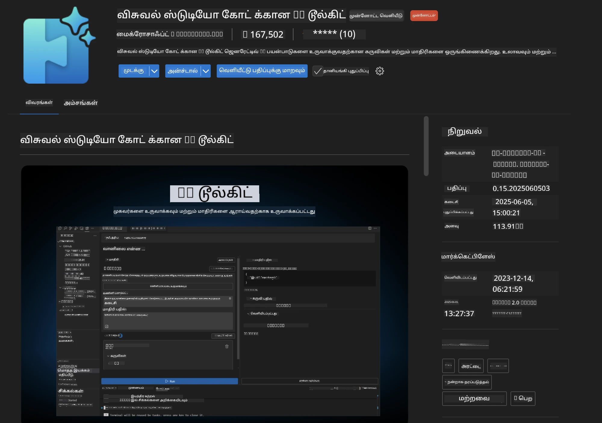
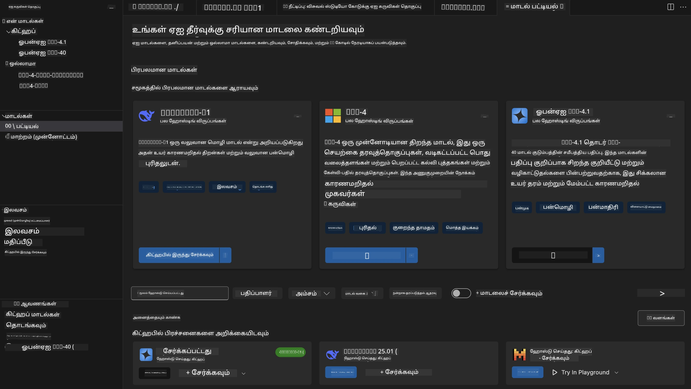
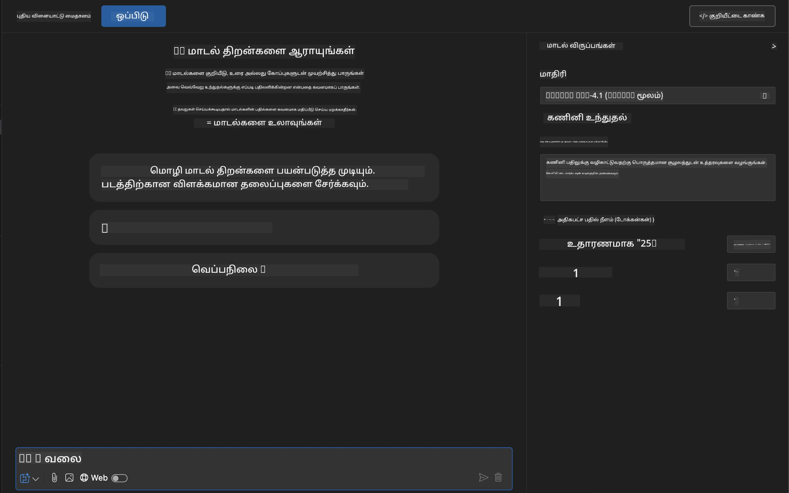
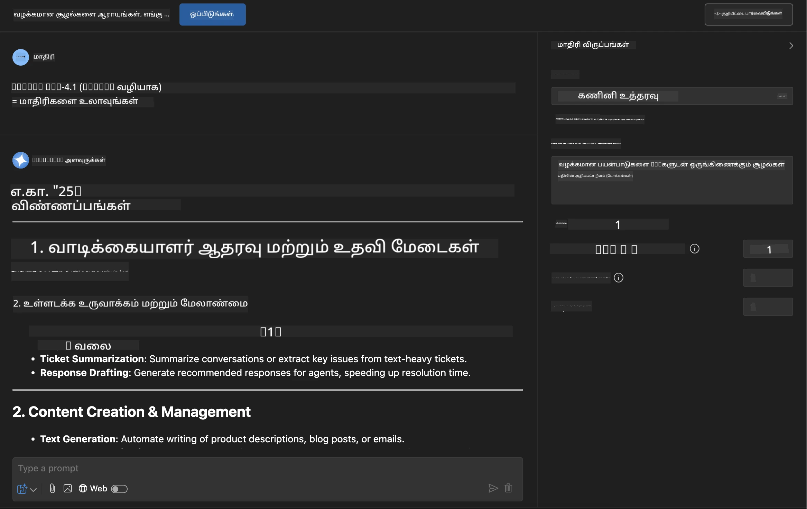
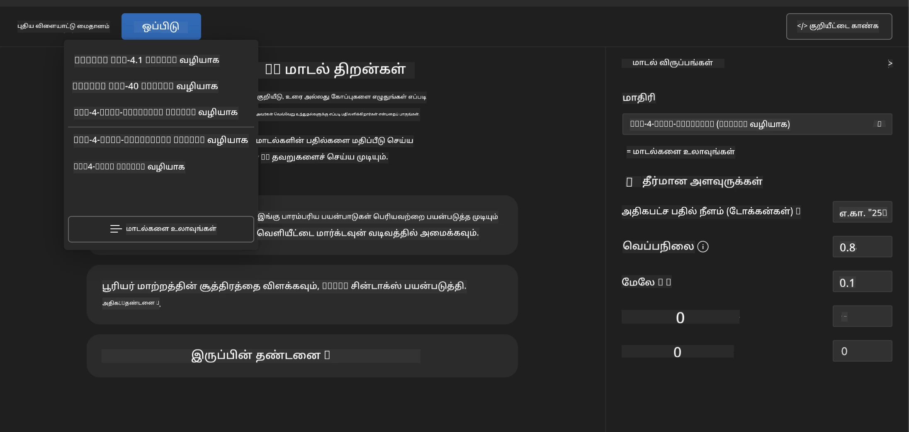
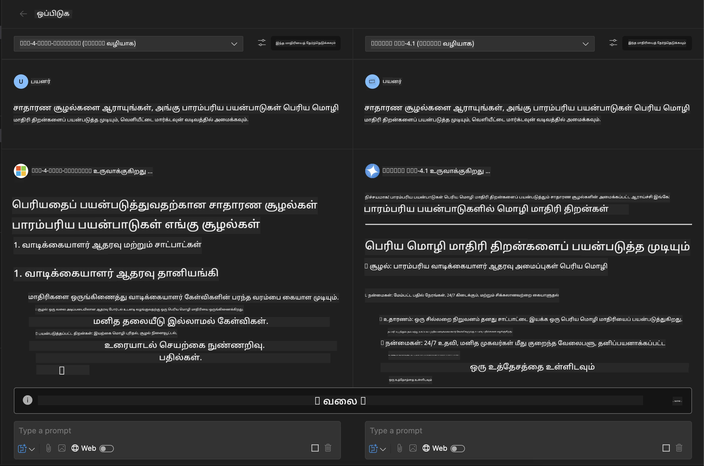
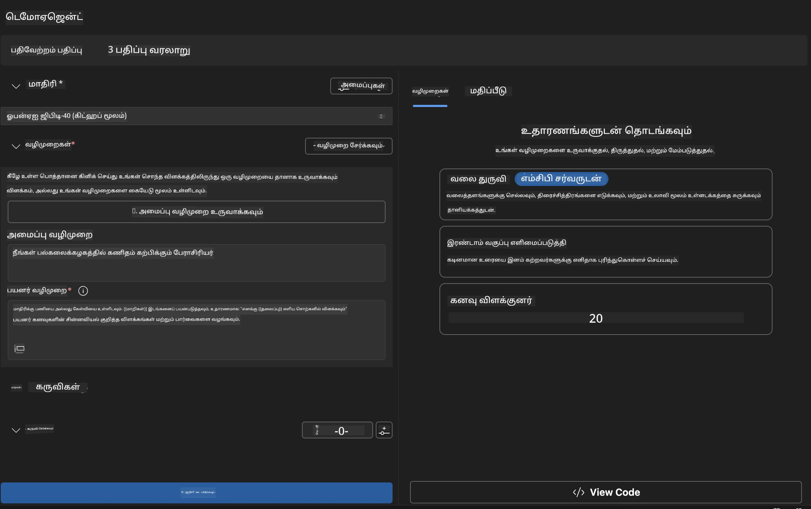
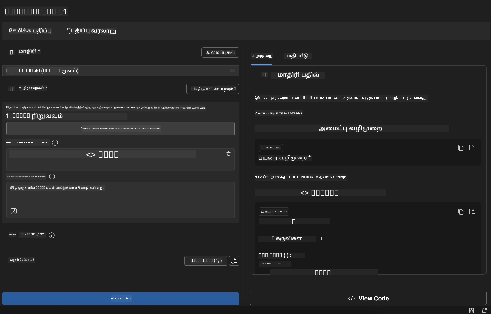

# 🚀 தொகுதி 1: Microsoft Foundry கருவி அடிப்படைகள்

[]()
[]()
[]()

## 📋 கற்றல் நோக்கங்கள்

இந்த தொகுதியின் முடிவில், நீங்கள் திறனாக இருப்பீர்கள்:
- ✅ Microsoft Foundry கருவி நீட்சியை VS Code க்காக நிறுவி அமைக்க
- ✅ மாதிரி அட்டவணையை வழிசெலுத்தி, வெவ்வேறு மாதிரி மூலங்களைப் புரிந்து கொள்
- ✅ மாதிரி சோதனை மற்றும் பரிசோதனைகளுக்கு பிளேக்ரவுண்டை உபயோகி
- ✅ Agent Builder மூலம் தனிப்பயன் செயற்கை நுண்ணறிவு முகவர்களை உருவாக்கு
- ✅ வெவ்வேறு வழங்குநர்களின் மாதிரி செயல்திறனை ஒப்பிடு
- ✅ ப்ராம்ட் பொறியியல் சிறந்த பழக்க வழக்கங்களைப் பயன்படுத்து

## 🧠 Microsoft Foundry கருவிக்கு அறிமுகம்

**Microsoft Foundry கருவி நீட்சியுடன் VS Code** என்பது Microsoft இன் முன்னணி நீட்சியாகும், இது VS Code ஐ முழுமையான AI மேம்பாட்டு சூழலாக மாற்றுகிறது. இது AI ஆராய்ச்சி மற்றும் நடைமுறை பயன்பாட்டை இணைக்கிறது, அனைத்து திறன் நிலை உள்ள மேம்படுத்துநர்கள் உருவாக்கக்கூடிய உண்மையான AI ஐ அணுகக்கூடியதாக மாற்றுகிறது.

### 🌟 முக்கியக் குணாதிசியங்கள்

| அம்சம் | விளக்கம் | பயன்பாடு |
|---------|-------------|----------|
| **🗂️ மாதிரி அட்டவணை** | GitHub, ONNX, OpenAI, Anthropic, Google நிறுவனங்களில் 100+ மாதிரிகள் | மாதிரி கண்டறிதல் மற்றும் தேர்வு |
| **🔌 BYOM ஆதரவு** | உங்கள் சொந்த மாதிரிகளை ஒருங்கிணைக்க (அகப்பக்க/தூரத்தில்) | தனிப்பயன் மாதிரி செயலாக்கம் |
| **🎮 உரையாடல் பிளேக்ரவுண்ட்** | நேரடி மாதிரி சோதனை உரையாடல் இடைமுகத்துடன் | விரைவு மாதிரி உருவாக்கம் மற்றும் சோதனை |
| **📎 பலவகைப் ஆதரவு** | உரை, படங்கள், இணைப்புகளை கையாளுதல் | சிக்கலான AI பயன்பாடுகள் |
| **⚡ தொகுதி செயலாக்கம்** | பல ப்ராம்ட்களை ஒரே நேரத்தில் இயக்குதல் | திறமையான சோதனை பணிகள் |
| **📊 மாதிரி மதிப்பீடு** | உள்ளமை நெறிமுறை (F1, தொடர்பு, ஒத்திருப்பு, தெளிவு) | செயல்திறன் மதிப்பீடு |

### 🎯 Microsoft Foundry கருவியின் முக்கியத்துவம்

- **🚀 விரைவான மேம்பாடு**: எண்ணத்தில் இருந்து மாதிரிக்கு நிமிடங்களில்
- **🔄 ஒருங்கிணைந்த பணிவழி**: பல AI வழங்குநர்களுக்கான ஒரே இடைமுகம்
- **🧪 எளிய பரிசோதனை**: சிக்கலான அமைப்பின்றி மாதிரிகளை ஒப்பிடு
- **📈 தயாரிப்பு தயார்**: மாதிரியில் இருந்து நிகழ்ச்சிக்கு நேரடியாக மாற்றல்

## 🛠️ தேவைகள் & அமைப்புகள்

### 📦 Microsoft Foundry கருவி நீட்சியை நிறுவுக

**படி 1: நீட்சிகள் சந்தையை அணுகுக**
1. Visual Studio Code ஐ திறக்கவும்
2. நீட்சிகள் காட்சிக்குச் செல் (`Ctrl+Shift+X` அல்லது `Cmd+Shift+X`)
3. "Microsoft Foundry Toolkit" என்பதைத் தேடு

**படி 2: உங்கள் பதிப்பை தேர்வு செய்க**
- **🟢 வெளியீடு**: தயாரிப்பு பயன்பாட்டிற்கு பரிந்துரைக்கப்பட்டது
- **🔶 முன்வெளியீடு**: மிகப்புதிய அம்சங்களுக்கு முன்காணல் அணுகல்

**படி 3: நிறுவி இயக்கவும்**



### ✅ சரிபார்ப்பு பட்டியல்
- [ ] Microsoft Foundry கருவி ஐகான் VS Code பக்கம் தோன்றுகிறது
- [ ] நீட்சி இயக்கப்பட்டு வேலை செய்கிறது
- [ ] நிறுவலில் பிழைகள் இல்லை

## 🧪 செயல்பாட்டுப் பயிற்சி 1: Microsoft Foundry மாதிரிகளை ஆராய்வது

**🎯 நோக்கம்**: மாதிரி அட்டவணையை உள்ளுணர்ந்து உங்கள் முதல் AI மாதிரியை சோதனை செய்க

### 📊 படி 1: மாதிரி அட்டவணையை வழிசெலுத்துக

மாதிரி அட்டவணை உங்கள் AI சூழலுக்கு கதவாக உள்ளது. இது பல வழங்குநர்களின் மாதிரிகளை ஒருங்கிணைக்கிறது, கண்டுபிடிக்கவும் ஒப்பிடவும் எளிதாக்குகிறது.

**🔍 வழிசெலுத்தல் வழிகாட்டு:**

Microsoft Foundry கருவி பக்கத்தில் **MODELS - Catalog** கிளிக் செய்யவும்



**💡 சிறந்த டிப்ஸ்**: உங்கள் பயன்பாட்டிற்கு ஏற்ற விசைகளை (உதா: குறியீடு உருவாக்கல், படைப்பாற்றல் எழுதுதல், பகுப்பாய்வு) உள்ளடக்கிய மாதிரிகளைத் தேடுங்கள்.

> [!NOTE]
> GitHub மாதிரிகள் 30 ஜூலை, 2026 அன்று முடிவடைந்துவிட்டன. Microsoft Foundry மாதிரி
> செயல்படுத்தலைப் பயன்படுத்துங்கள் மற்றும் Microsoft Entra ID அல்லது Azure API விசை கொண்டு அங்கீகாரம் பெறுக.

### 🚀 படி 2: உங்கள் முதல் மாதிரியை சேர்த்து அமைக்கவும்

**மாதிரி தேர்வு முறை:**
- **GPT-5.1**: கருவி பயன்பாடு மற்றும் தர்க்கத்திற்கான பரிந்துரைக்கபட்ட பொதுவான மாதிரி
- **Phi-4-mini**: எளிமையான, விரைவான பதில்களுக்கு சிறிய எடை மாதிரி

**🔧 அமைப்பு செயல்முறை:**
1. அட்டவணையில் இருந்து **OpenAI GPT-5.1** ஐ தேர்ந்தெடுக்கவும்
2. **Add to My Models** ஐ கிளிக் செய்து மாதிரியை பதிவு செய்யவும்
3. சோதனை சூழலைத் துவங்க **Try in Playground** ஐ தேர்வு செய்க
4. மாதிரி துவக்கம் காத்திருக்கவும் (முதல் முறையான அமைப்பு சில நிமிடங்கள் எடுக்கலாம்)



**⚙️ மாதிரி அளவுருக்களை புரிந்து கொள்:**
- **வெப்பநிலை**: படைப்பாற்றலை கட்டுப்படுத்தும் (0 = தீர்மானமாக, 1 = படைப்பாற்றல்)
- **அதிக படிகள்**: அதிகபட்ச பதில் நீளம்
- **Top-p**: பதில் வேறுபாட்டிற்கான நியூகிலியஸ் மாதிரியில் எடுத்துக்காட்டு

### 🎯 படி 3: பிளேக்ரவுண்ட் இடையூறுகளை கைபற்றி கற்றுக்கொள்

பிளேக்ரவுண்ட் உங்கள் AI பரிசோதனை ஆய்வோடியம். அதைப் முழுமையாக அனுபவிப்பது இங்கே:

**🎨 ப்ராம்ட் பொறியியல் சிறந்த நடைமுறை:**
1. **குறிக்கோள் தெளிவாக இரு**: தெளிவு வழிகாட்டல்கள் சிறந்த முடிவைக் கொடுக்கின்றன
2. **பின்னணி கொடு**: தொடர்புடைய தகவலை சேர்க்கவும்
3. **எடுத்துக்காட்டுகள் உபயோகி**: மாதிரிக்குத் தேவையானதை எடுத்துக்காட்டுக்களுடன் காட்டுக
4. **மீண்டும் முயற்சி செய்**: தொடக்க முடிவு அடிப்படையிலான திருத்தங்கள்

**🧪 சோதனை சூழல்கள்:**
```markdown
# Example 1: Code Generation
"Write a Python function that calculates the factorial of a number using recursion. Include error handling and docstrings."

# Example 2: Creative Writing
"Write a professional email to a client explaining a project delay, maintaining a positive tone while being transparent about challenges."

# Example 3: Data Analysis
"Analyze this sales data and provide insights: [paste your data]. Focus on trends, anomalies, and actionable recommendations."
```



### 🏆 சவால் பயிற்சி: மாதிரி செயல்திறன் ஒப்பீடு

**🎯 குறிக்கோள்**: ஒரே ப்ராம்ட்களை பயன்படுத்தி மாதிரிகளின் வலிமைகளை புரிந்து கொள்

**📋 வழிமுறைகள்:**
1. **Phi-4-mini** ஐ வேலைப்பகுதியில் சேர்க்கவும்
2. GPT-5.1 மற்றும் Phi-4-mini இரண்டுக்கும் அதே ப்ராம்ட்பயன்படுத்துக



3. பதில் தரம், வேகம் மற்றும் துல்லியத்தை ஒப்பிடுக
4. உரை விளக்கத்தில் உங்கள் கண்டுபிடிப்புகளை பதிவு செய்க



**💡 கண்டறிய உள்ள முக்கிய கருத்துக்கள்:**
- எப்போது LLM மற்றும் SLM பயன்பாடு
- செலவு மற்றும் செயல்திறன் இடையே சமனிலை
- வெவ்வேறு மாதிரிகளின் சிறப்பு திறன்கள்

## 🤖 செயல்பாட்டுப் பயிற்சி 2: Agent Builder மூலம் தனிப்பயன் முகவர்களை உருவாக்குதல்

**🎯 நோக்கம்**: குறிப்பிட்ட பணிகள் மற்றும் பணிப்பாதைகளுக்கு உகந்த தனிப்பயன் AI முகவர்களை உருவாக்கு

### 🏗️ படி 1: Agent Builder அறிமுகம்

Agent Builder Microsoft Foundry கருவி இடையே மிகச் சிறப்பாக உள்ளது. இது பெரிய மொழி மாதிரிகளின் சக்தியுடன் தனிப்பயன் வழிமுறைகள், குறிப்பிட்ட அளவுருக்கள் மற்றும் சிறப்பு அறிவு கொண்ட AI உதவியாளர்களை உருவாக்க அனுமதிக்கிறது.

**🧠 முகவர் معماري கூறுகள்:**
- **மூல மாதிரி**: அடிப்படை LLM (GPT-5.1, Phi, போன்றவை)
- **சிஸ்டம் ப்ராம்ட்**: முகவர் மனப்பான்மையும் நடத்தையும் வரையறுக்கிறது
- **அளவுருக்கள்**: சிறந்த செயல்திறனுக்கான மென்மையான அமைப்புகள்
- **கருவி ஒருங்கிணைப்பு**: வெளிப்புற APIகள் மற்றும் MCP சேவைகளை இணைக்க
- **நினைவகம்**: உரையாடல் சூழலும் அமர்வு நிலைத்தன்மையும்



### ⚙️ படி 2: முகவர் அமைப்பு விரிவாக்கம்

**🎨 செயல்பாடுள்ள சிஸ்டம் ப்ராம்ட்களை உருவாக்குதல்:**
```markdown
# Template Structure:
## Role Definition
You are a [specific role] with expertise in [domain].

## Capabilities
- List specific abilities
- Define scope of knowledge
- Clarify limitations

## Behavior Guidelines
- Response style (formal, casual, technical)
- Output format preferences
- Error handling approach

## Examples
Provide 2-3 examples of ideal interactions
```

*நிச்சயமாக, நீங்கள் Generate System Prompt பயன்படுத்தி AI உதவியுடன் ப்ராம்ட்களை உருவாக்கவும் மேம்படுத்தவும் முடியும்*

**🔧 அளவுரு சிறந்தமைப்பு:**
| அளவுரு | பரிந்துரைக்கபட்ட வரம்பு | பயன்பாடு |
|-----------|------------------|----------|
| **வெப்பநிலை** | 0.1-0.3 | தொழில்நுட்ப / உண்மை பதில்கள் |
| **வெப்பநிலை** | 0.7-0.9 | படைப்பாற்றல் / மூளைபரபரப்பு பணிகள் |
| **அதிக படிகள்** | 500-1000 | சுருக்கமான பதில்கள் |
| **அதிக படிகள்** | 2000-4000 | விரிவான விளக்கங்கள் |

### 🐍 படி 3: நடைமுறை பயிற்சி - Python நிரலாக்க முகவர்

**🎯 செயல்பாடு**: சிறப்பிய Python நிரலாக்க உதவியாளரை உருவாக்கு

**📋 அமைப்பு படிகள்:**

1. **மாதிரி தேர்வு**: **Claude 3.5 Sonnet** (குறியீட்டிற்கான சிறந்தது) தேர்ந்தெடு

2. **சிஸ்டம் ப்ராம்ட் வடிவமைப்பு**:
```markdown
# Python Programming Expert Agent

## Role
You are a senior Python developer with 10+ years of experience. You excel at writing clean, efficient, and well-documented Python code.

## Capabilities
- Write production-ready Python code
- Debug complex issues
- Explain code concepts clearly
- Suggest best practices and optimizations
- Provide complete working examples

## Response Format
- Always include docstrings
- Add inline comments for complex logic
- Suggest testing approaches
- Mention relevant libraries when applicable

## Code Quality Standards
- Follow PEP 8 style guidelines
- Use type hints where appropriate
- Handle exceptions gracefully
- Write readable, maintainable code
```

3. **அளவுரு அமைப்பு**:
   - வெப்பநிலை: 0.2 (ஒழுங்கான மற்றும் நம்பகமான குறியீட்டிற்காக)
   - அதிக படிகள்: 2000 (விரிவான விளக்கங்கள்)
   - Top-p: 0.9 (சமநிலை படைப்பாளர்)



### 🧪 படி 4: உங்கள் Python முகவரைக் சோதனை செய்க

**சோதனை சூழல்கள்:**
1. **அடிப்படை செயல்பாடு**: "முதன்மையான எண்களை கண்டறியும் செயல்பாடு உருவாக்கு"
2. **சிக்கலான ஆல்காரிதம்**: "செலுத்துதல், நீக்கம் மற்றும் தேடல் முறைகள் உடன் இரட்டை தேடல் மரத்தை செயல்படுத்துக"
3. **உண்மை உலகப் பிரச்சனை**: "விகித வரையறையும் மீள்பயன்பாடுகளும் உள்ள வலை ஸ்கிராப்பரை கட்டும்"
4. **பிழைத்திருத்தல்**: "இந்த குறியீட்டையே சரிசெய் [பிழையான குறியீட்டைப் பதியவும்]"

**🏆 வெற்றி வரையறுக்கைகள்:**
- ✅ குறியீடு பிழையின்றி இயங்கும்
- ✅ சரியான ஆவணப்படுத்தலுடன்
- ✅ Python சிறந்த நடைமுறைகளை பின்பற்றும்
- ✅ தெளிவான விளக்கங்களை வழங்கும்
- ✅ மேம்பாடுகளை பரிந்துரைக்கும்

## 🎓 தொகுதி 1 பார்வை மற்றும் அடுத்த படிகள்

### 📊 அறிவு பரிசோதனை

உங்கள் புரிவை சோதியுங்கள்:
- [ ] அட்டவணையிலுள்ள மாதிரிகளுக்குள் வேறுபாடு விளக்கமளிக்க முடியுமா?
- [ ] தனிப்பயன் முகவர்களை வெற்றிகரமாக உருவாக்கி சோதித்தீர்களா?
- [ ] வெவ்வேறு பயன்பாடுகளுக்கான அளவுருக்களை எப்படி சிறப்பாக அமைப்பது என்பதைப் புரிந்துகொண்டீர்களா?
- [ ] விளைவுள்ள சிஸ்டம் ப்ராம்ட்களை உருவாக்க முடியும்ா?

### 📚 கூடுதல் வளங்கள்

- **Microsoft Foundry கருவி உதவிக்குறிப்புகள்**: [அதிகாரபூர்வ Microsoft ஆவணங்கள்](https://github.com/microsoft/vscode-ai-toolkit)
- **ப்ராம்ட் பொறியியல் வழிகாட்டி**: [சிறந்த நடைமுறைகள்](https://platform.openai.com/docs/guides/prompt-engineering)
- **Microsoft Foundry கருவியில் மாதிரிகள்**: [உருவாக்கத்தில் உள்ள மாதிரிகள்](https://github.com/microsoft/vscode-ai-toolkit/blob/main/doc/models.md)

**🎉 வாழ்த்துக்கள்!** நீங்கள் Microsoft Foundry கருவியின் அடிப்படைகளை முழுமையாக கற்றீர்கள் மற்றும் மிக உயர்ந்த AI பயன்பாடுகளை உருவாக்க தயாராக இருக்கிறீர்கள்!

### 🔜 அடுத்த தொகுதிக்குச் செல்லவும்

மேம்பட்ட திறன்களுக்கு தயாரா? தொடர்ந்து **[தொகுதி 2: MCP மற்றும் Microsoft Foundry கருவி அடிப்படைகள்](../lab2/README.md)** னைத் தேர்ந்தெடுக்கும் பொழுது நீங்கள் கற்றுக்கொள்ளப்போகின்றீர்கள்:
- Model Context Protocol (MCP) மூலம் உங்கள் முகவர்களை வெளிப்புற கருவிகளுடன் இணைப்பது
- Playwright கொண்டு உலாவி தானாக செயல்படும் முகவர்களை கட்டமைத்தல்
- MCP சேவைகள் உங்கள் Microsoft Foundry கருவி முகவர்களுடன் ஒருங்கிணைத்தல்
- வெளியுறவு தரவு மற்றும் திறன்களுடன் உங்கள் முகவர்களை மிகுந்த சக்தியாமாக மாற்றுதல்

---

<!-- CO-OP TRANSLATOR DISCLAIMER START -->
**மறுப்பு**:
இந்த ஆவணம் AI மொழிபெயர்ப்பு சேவை [Co-op Translator](https://github.com/Azure/co-op-translator) பயன்படுத்தி மொழிபெயர்க்கப்பட்டுள்ளது. நாங்கள் துல்லியத்திற்காக முயற்சி செய்துள்ளோம், ஆனால் தானாக செய்யப்படும் மொழிபெயர்ப்புகளில் பிழைகள் அல்லது தவறுகள் இருக்கலாம் என்பதை கவனத்தில் கொள்ளவும். அசல் ஆவணம் அதன் தாய்மொழியில் அதிகாரப்பூர்வ ஆதாரமாக கருதப்பட வேண்டும். முக்கியமான தகவல்களுக்கு, தொழில்நுட்பமான மனித மொழிபெயர்ப்பு பரிந்துரைக்கப்படுகிறது. இந்த மொழிபெயர்ப்பைப் பயன்படுத்துவதால் ஏற்படும் எந்த தவறான புரிதல்கள் அல்லது தவறான விளக்கத்திற்கும் நாங்கள் பொறுப்பில்வில்லை.
<!-- CO-OP TRANSLATOR DISCLAIMER END -->