# 🌐 தொகுதி 2: மைக்ரோசாஃப்ட் ஃபவுண்ட்ரி டூல்கிட் அடிப்படையுடன் MCP


## 📋 கற்றல் நோக்கங்கள்

இத்தொகுதி முடிவில், நீங்கள் திறனாக இருக்கப்போகிறீர்கள்:

- ✅ மாடல் கொண்டர்ட் ப்ரோட்டோகால் (MCP) கட்டமைப்பு மற்றும் நன்மைகள் புரிதல்
- ✅ மைக்ரோசாஃப்டின் MCP சர்வர் சூழல் ஆராய்தல்
- ✅ MCP சர்வர்களை மைக்ரோசாஃப்ட் ஃபவுண்ட்ரி டூல்கிட் ஏஜெண்ட் பில்டருடன் ஒருங்கிணைத்தல்
- ✅ பிளேரைட் MCP பயன்படுத்தி செயல்படும் உலாவி தானியங்கி ஏஜெண்ட் உருவாக்குதல்
- ✅ உங்கள் ஏஜெண்டுகளில் MCP கருவிகளை கட்டமைத்து பரிசோதித்தல்
- ✅ MCP சக்தியுடைய ஏஜென்ட்களை ஏற்றுமதி செய்து தயாரிப்பு பயன்பாட்டுக்கு வைப்பது

## 🎯 தொகுதி 1-இல் துவக்கம் செய்தல்

தொகுதி 1-ல், நாங்கள் மைக்ரோசாஃப்ட் ஃபவுண்ட்ரி டூல்கிட் அடிப்படைகளை கற்றுகொண்டு
முதல் Python ஏஜெண்டை உருவாக்கினோம். இப்போது உங்கள் ஏஜெண்ட்களை **அதிக சக்தி படுத்த** கீழ்காணும்
புதிய அங்கிகள் மற்றும் சேவைகள் மூலம் இணைப்போம்:
**மாடல் கொண்டர்ட் ப்ரோட்டோகால் (MCP)**.

இதை சாதாரண கணக்குப்பொறியாளரிலிருந்து முழு கணினியாக மேம்படுத்துவது போல் நினைக்கவும். உங்கள் AI
ஏஜெண்ட்கள் பின்வருவதை செய்ய முடியும்:

- 🌐 இணையதளங்களை உலாவி தொடர்பு கொள்ள
- 📁 கோப்புகளை அணுகி மாற்றுதல்
- 🔧 நிறுவன அமைப்புகளோடு ஒருங்கிணைத்தல்
- 📊 API-களிலிருந்து நேரடி தரவை செயலாக்குதல்

## 🧠 மாடல் கொண்டர்ட் ப்ரோட்டோகால் (MCP) புரிதல்

### 🔍 MCP என்றால் என்ன?

மாடல் கொண்டர்ட் ப்ரோட்டோகால் (MCP) என்பது **"AI பயன்பாடுகளுக்கான USB-C"** ஆகும்: ஒரு திறந்த
தரநிலை இது பெரிய மொழி மாதிரிகள் (LLMs) ஐ வெளி கருவிகள், தரவு மூலங்கள் மற்றும் சேவைகளுக்கு இணைக்கிறது.
USB-C போன்றது ஒரு ஒரே பொதுவான தொடர்பை வழங்குகிறது, MCP அதே மாதிரியாக AI ஒருங்கிணைப்பின் சிக்கல்களை
ஒரே சீரான புரோட்டோகால் மூலம் குறைக்கிறது.

### 🎯 MCP தீர்க்கும் பிரச்சினை

**MCP க்கு முன்னர்:**

- 🔧 ஒவ்வொரு கருவிக்கும் தனிப்பயன் ஒருங்கிணைப்புகள்
- 🔄 கையக சொத்துரிமைக்குள் Vendor பிணைப்பு  
- 🔒 அதிரடி தொடர்புகளால் பாதுகாப்பு பலவீனங்கள்
- ⏱️ அடிப்படை ஒருங்கிணைப்புகளுக்கு மாதங்கள் வேண்டியது

**MCP உடன்:**

- ⚡ உடனடி கருவி ஒருங்கிணைப்பு
- 🔄 Vendor-ஐ பொருட்படுத்தாத கட்டமைப்பு
- 🛡️ முன்னேற்படுத்தப்பட்ட பாதுகாப்பு நடைமுறைகள்
- 🚀 புதிய திறன்களை நிமிடங்களில் சேர்த்தல்

### 🏗️ MCP கட்டமைப்பு ஆழ்ந்த பார்வை

MCP ஒரு **கிளையண்ட்-சர்வர் கட்டமைப்பைப்** பின்பற்றுகிறது, இது பாதுகாப்பான,

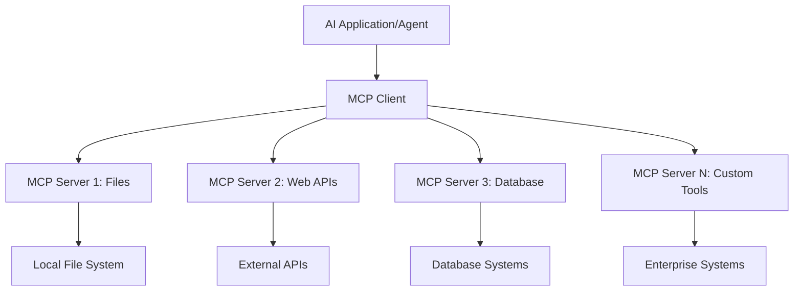

**🔧 முக்கிய கூறுகள்:**

| கூறு | பங்கு | உதாரணங்கள் |
| --------- | ---- | -------- |
| **MCP ஹோஸ்ட்கள்** | MCP சேவைகளைப் பயன்படுத்தும் | VS Code, Foundry Toolkit |
| **MCP கிளையண்ட்கள்** | புரோட்டோகால் தொடர்புகளை கையாளும் | ஹோஸ்ட்களின் உள்ளே |
| **MCP சர்வர்கள்** | திறன்களை வழங்கும் | Playwright, கோப்புகள், Azure, GitHub |
| **டிரான்ஸ்போர்ட் படலம்** | கிளையண்ட்களையும் சர்வர்களையும் இணைக்கும் | stdio, HTTP, WebSockets |

## 🏢 மைக்ரோசாஃப்டின் MCP சர்வர் சூழல்

மைக்ரோசாஃப்ட் MCP சூழலை முன்னெடுத்து, விரிவான
நிறுவனத் தரப்படுத்தப்பட்ட சர்வர்களை வழங்குகிறது, இது செயல்முறை தேவைகளைச் சந்திக்கிறது.

### 🌟 சிறப்புப் படைத்த மைக்ரோசாஃப்ட் MCP சர்வர்கள்

#### 1. ☁️ Azure MCP சர்வர்

**🔗 கிடைக்குள்**: [azure/azure-mcp](https://github.com/azure/azure-mcp)
**🎯 நோக்கம்**: AI ஒருங்கிணைப்புடன் முழுமையான Azure வள மேலாண்மை

**✨ முக்கிய அம்சங்கள்:**

- குறித்த கட்டமைப்பு வழங்கல்
- நேரடி வள கண்காணிப்பு
- செலவு வடிவமைப்பு பரிந்துரைகள்
- பாதுகாப்பு இணக்கமான சோதனை

**🚀 பயன்பாடுகள்:**

- AI உதவியுடன் இடைமுகமாக கட்டமைப்பு நிர்வகித்தல்
- தானாக வள அளவுகோள்வு
- மேகச் செலவு வடிவமைப்பு
- DevOps வேலைப்பாட்டை தானியக்கமாக்கல்

#### 2. 📊 மைக்ரோசாஃப்ட் டேட்டாவர்ஸ் MCP

**📚 ஆவணம்**: [மைக்ரோசாஃப்ட் டேட்டாவர்ஸ் ஒருங்கிணைப்பு](https://go.microsoft.com/fwlink/?linkid=2320176)
**🎯 நோக்கம்**: வணிகத் தரவுக்கு இயற்கை மொழி இடைமுகம்

**✨ முக்கிய அம்சங்கள்:**

- இயற்கை மொழி தரவுத்தளக் கேள்விகள்
- வணிகத் சூழல் புரிதல்
- தனிப்பயன் முன்மொழிவு வடிவங்கள்
- நிறுவனத் தரவு வழிகாட்டு நிலை

**🚀 பயன்பாடுகள்:**

- வணிக நுண்ணறிவு அறிக்கை
- வாடிக்கையாளர் தரவு பகுப்பாய்வு
- விற்பனை குழாய் பார்வைகள்
- இணக்கமான தரவுக் கேள்விகள்

#### 3. 🌐 பிளேரைட் MCP சர்வர்

**🔗 கிடைக்குள்**: [microsoft/playwright-mcp](https://github.com/microsoft/playwright-mcp)
**🎯 நோக்கம்**: உலாவி தானியக்கம் மற்றும் இணைய தொடர்பு திறன்கள்

**✨ முக்கிய அம்சங்கள்:**

- குறுங்கணினிகளை கடந்து தானியக்கமாக்கல் (குரோம், ஃபயர்ஃபாக்ஸ், சஃபாரி)
- அறிவார்ந்த கூறுகளைக் கண்டறிதல்
- ஸ்கிரீன்ஷாட் மற்றும் PDF உருவாக்கல்
- நெட்வொர்க் போக்குவரத்து கண்காணிப்பு

**🚀 பயன்பாடுகள்:**

- தானியக்கச் சோதனை வேலைப்பாடுகள்
- வலைதளம் குவிப்பு மற்றும் தரவு ஈடுபாடு
- UI/UX கண்காணிப்பு
- போட்டி பகுப்பாய்வு தானியக்கம்

#### 4. 📁 கோப்புகள் MCP சர்வர்

**🔗 கிடைக்குள்**: [microsoft/files-mcp-server](https://github.com/microsoft/files-mcp-server)
**🎯 நோக்கம்**: அறிவார்ந்த கோப்பு அமைப்பு செயல்பாடுகள்

**✨ முக்கிய அம்சங்கள்:**

- குறித்த கோப்பு மேலாண்மை
- உள்ளடக்க ஒத்திசைவு
- பதிப்பு கட்டுப்பாட்டு ஒருங்கிணைப்பு
- மெட்டாடேட்டா எடுக்கும் தொழில்

**🚀 பயன்பாடுகள்:**

- ஆவண மேலாண்மை
- குறியீட்டு கிடைநிலைய அமைப்பு
- உள்ளடக்க வெளியீட்டு வேலைப்பாடுகள்
- தரவு பைப்‌லைன் கோப்பு கையாளுதல்

#### 5. 📝 மார்க் இட் டவுன் MCP சர்வர்

**🔗 கிடைக்குள்**: [microsoft/markitdown](https://github.com/microsoft/markitdown)
**🎯 நோக்கம்**: மேம்பட்ட மார்க்டவுன செயலாக்கம் மற்றும் மாற்றுதல்

**✨ முக்கிய அம்சங்கள்:**

- வளமையான மார்க்டவுன பார்சிங்
- வடிவ மாற்றம் (MD ↔ HTML ↔ PDF)
- உள்ளடக்க அமைப்பு பகுப்பாய்வு
- வார்ப்புரு செயலாக்கம்

**🚀 பயன்பாடுகள்:**

- தொழில்நுட்ப ஆவண வேலைப்பாடுகள்
- உள்ளடக்க மேலாண்மை அமைப்புகள்
- அறிக்கை உருவாக்கல்
- அறிவு களஞ்சிய தானியக்கம்

#### 6. 📈 கிளாரிட்டி MCP சர்வர்

**📦 தொகுப்பு**: [@microsoft/clarity-mcp-server](https://www.npmjs.com/package/@microsoft/clarity-mcp-server)
**🎯 நோக்கம்**: இணைய.analytics மற்றும் பயனர் நடத்தை தகவல்கள்

**✨ முக்கிய அம்சங்கள்:**

- ஹீட்மேப் தரவு பகுப்பாய்வு
- பயனர் அமர்வு பதிவு
- செயல்திறன் அளவுகோல்கள்
- மாற்று வாயிலியல் பகுப்பாய்வு

**🚀 பயன்பாடுகள்:**

- இணையதள மேம்பாடு
- பயனர் அனுபவ ஆராய்ச்சி
- A/B சோதனை பகுப்பாய்வு
- வணிக நுண்ணறிவு பணியறைகள்

### 🌍 சமுதாய சூழல்

மைக்ரோசாஃப்டின் சர்வர்களைத் தொடர்ந்து, MCP சூழலில் அடங்கும்:

- **🐙 GitHub MCP**: கிடை நிர்வகிப்பு மற்றும் குறியீடு பகுப்பாய்வு
- **🗄️ தரவுத்தள MCP-கள்**: PostgreSQL, MySQL, MongoDB ஒருங்கிணைப்புகள்
- **☁️ மேக வழங்குநர் MCP-கள்**: AWS, GCP, Digital Ocean கருவிகள்
- **📧 தொடர்பு MCP-கள்**: Slack, Teams, இ-மெயில் ஒருங்கிணைப்புகள்

## 🛠️ கைத்தொலைபேசி ஆய்வகம்: உலாவி தானியக்க ஏஜெண்ட் உருவாக்கல்

**🎯 திட்ட நோக்கம்**: Playwright MCP சர்வரைப் பயன்படுத்தி செம்மையான உலாவி தானியக்க
ஏஜெண்ட் உருவாக்குதல், அது இணையதளங்களை நவிகேட் செய்ய, தகவலை எடுக்க மற்றும்
சிக்கலான இணைய தொடர்புகளைச் செயல் படுத்தும்.

### 🚀 கட்டம் 1: ஏஜெண்ட் அடித்தளம் அமைத்தல்

#### படி 1: உங்கள் ஏஜெண்டை துவக்கவும்

1. **மைக்ரோசாஃப்ட் ஃபவுண்ட்ரி டூல்கிட் ஏஜெண்ட் பில்டரை திறக்கவும்**
2. **புதிய ஏஜெண்ட் உருவாக்கவும்** பின்வரும் அமைப்புகளுடன்:
   - **பெயர்**: `BrowserAgent`
   - **மாடல்**: GPT-5.1 தேர்ந்தெடுக்கவும். பத்தியைப் பார்க்கவும்
      [மைக்ரோசாஃப்ட் ஃபவுண்ட்ரி மாடல் ஓய்வு அட்டவணை](https://learn.microsoft.com/azure/foundry/openai/concepts/model-retirement-schedule)
      தற்போதைய மாடல் ஆயுள் தகவலுக்கு.

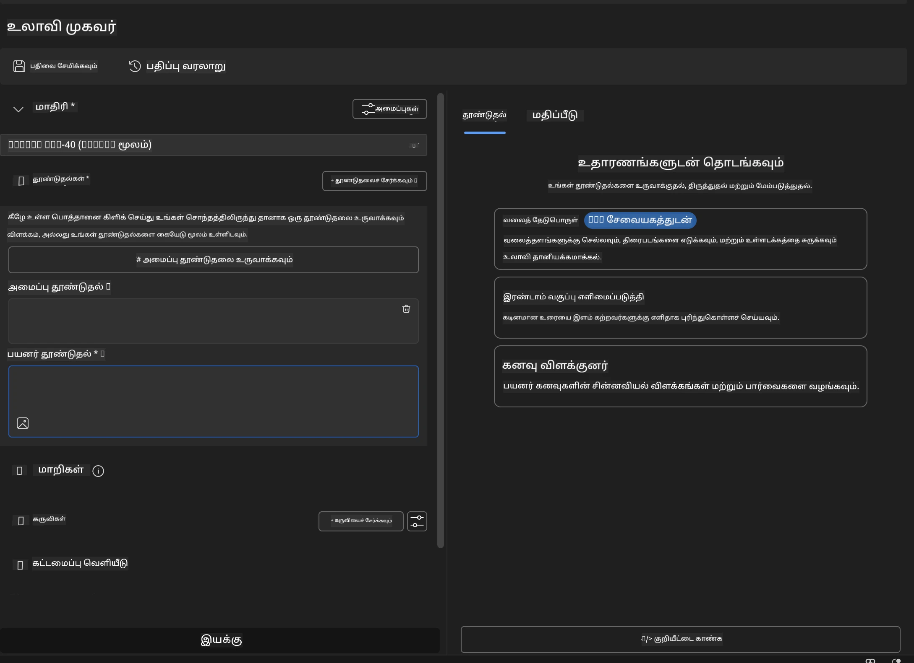

### 🔧 கட்டம் 2: MCP ஒருங்கிணைப்பு பணிகள்

#### படி 3: MCP சர்வர் ஒருங்கிணைப்பு சேர்க்கவும்

1. **ஏஜெண்ட் பில்டரை உள்ள கருவிகள் பகுதியுக்கு செல்லவும்**
2. **"கருவி சேர்க்க" என்பதைக் கிளிக் செய்து ஒருங்கிணைப்பு பட்டியலைத் திறக்கவும்**
3. **கிடைக்கும் விருப்பங்களில் இருந்து "MCP சர்வர்" தேர்வுசெய்க**

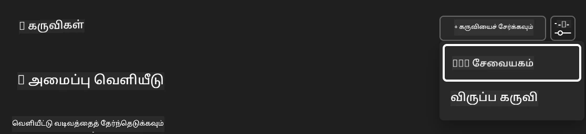

**🔍 கருவி வகைகள் புரிதல்:**

- **உள்ளடக்க கருவிகள்**: முன்-அமைக்கப்பட்ட மைக்ரோசாஃப்ட் ஃபவுண்ட்ரி டூல்கிட் செயல்பாடுகள்
- **MCP சர்வர்கள்**: வெளி சேவை ஒருங்கிணைப்புகள்
- **தனிப்பயன் API-கள்**: உங்கள் சொந்த சேவை முனைப்புள்ளிகள்
- **காரியக் கால்**: நேரடிக் மாடல் செயல்பாடு அணுகல்

#### படி 4: MCP சர்வர் தேர்வு

1. **"MCP சர்வர்" விருப்பத்தைத் தேர்ந்தெடுத்து தொடரவும்**
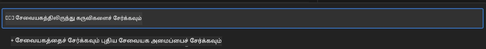

2. **MCP பட்டியலை உலாவி கிடைக்கும் ஒருங்கிணைப்புகளை ஆராயவும்**
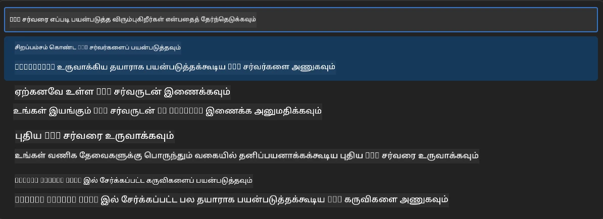

### 🎮 கட்டம் 3: பிளேரைட் MCP அமைப்பு

#### படி 5: பிளேரைட் தேர்வு மற்றும் கட்டமைப்பு

1. **"சிறப்புப் பிடியாக்கப்பட்ட MCP சர்வர்கள்" ஐ அடைவதற்கு கிளிக் செய்யவும்**
2. **சிறப்புப் பட்டியலில் "பிளேரைட்" தேர்வு செய்யவும்**
3. **இயல்புநிலை MCP ஐடி ஏற்கவும் அல்லது உங்கள் சூழலுக்கு மாற்றவும்**

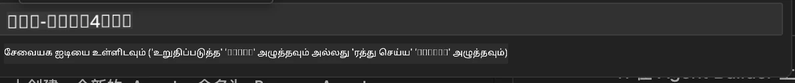

#### படி 6: பிளேரைட் திறன்களை இயக்கு

**🔑 முக்கிய படி**: அதிக செயல்திறனுக்கு அனைத்து பிளேரைட் முறைமைகளையும் தேர்வுசெய்யவும்

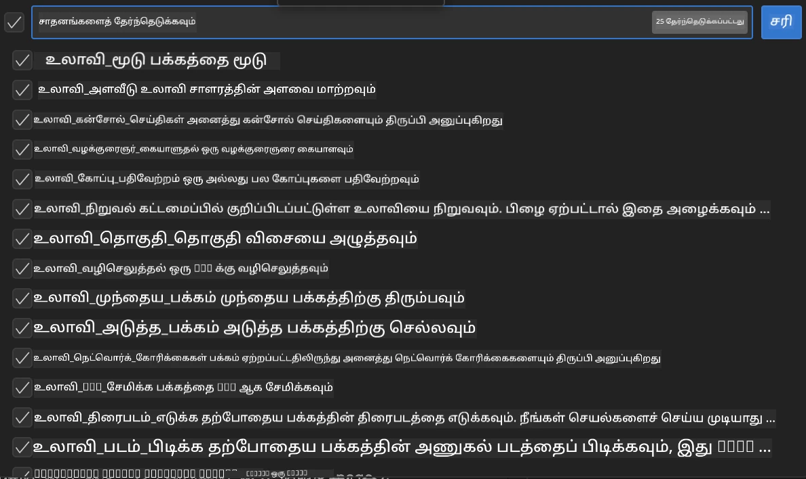

**🛠️ அவசியமான பிளேரைட் கருவிகள்:**

- **நெவிகேட்**: `goto`, `goBack`, `goForward`, `reload`
- **இணையதளம் தொடர்பு**: `click`, `fill`, `press`, `hover`, `drag`
- **ஈடுபாடு**: `textContent`, `innerHTML`, `getAttribute`
- **தசியல்**: `isVisible`, `isEnabled`, `waitForSelector`
- **படம் எடுக்கும்**: `screenshot`, `pdf`, `video`
- **நெட்வொர்க்**: `setExtraHTTPHeaders`, `route`, `waitForResponse`

#### படி 7: ஒருங்கிணைப்பு வெற்றி சரிபார்க்கவும்

**✅ வெற்றி குறியீடுகள்:**

- அனைத்து கருவிகளும் ஏஜெண்ட் பில்டர் இடைமுகத்தில் தோன்ற வேண்டும்
- ஒருங்கிணைப்பு பேனலில் எந்த பிழை செய்திகளும் இல்லை
- பிளேரைட் சர்வர் நிலை "இணைக்கப்பட்டது" என காட்டுகிறது

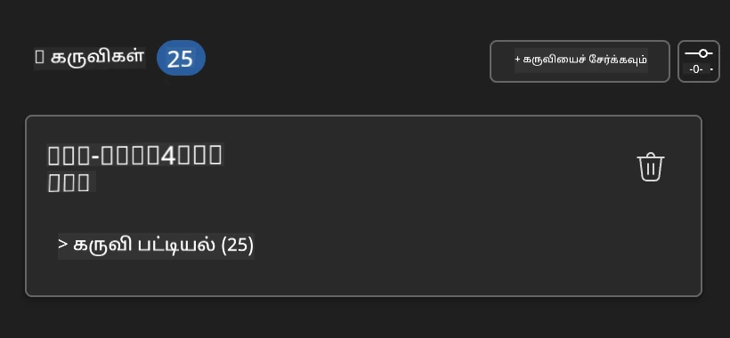

**🔧 பொதுவான பிரச்சினைகள் மற்றும் தீர்வுகள்:**

- **தொடர்பு தோல்வி**: இணையநிலை மற்றும் நெருக்கடியை சோதிக்கவும்
- **கருவிகள் காணப்படவில்லை**: அமைப்பின் போது அனைத்து திறன்களும் தேர்வு செய்யப்பட்டுள்ளதா உறுதி செய்யவும்
- **அனுமதி பிழைகள்**: VS Code க்கு தேவையான முறைமைகள் அனுமதிகள் உள்ளனவா என்பதைக் கண்டறியவும்

### 🎯 கட்டம் 4: மேம்பட்ட முன்மொழிவு பொறியியல்

#### படி 8: அறிவார்ந்த அமைப்பு முன்மொழிவுகள் வடிவமைக்கவும்

பிளேரைட் முழு திறன்களை பயன்படுத்து முன்மொழிவுகளை உருவாக்கவும்:

```markdown
# Web Automation Expert System Prompt

## Core Identity
You are an advanced web automation specialist with deep expertise in browser
automation, web scraping, and user experience analysis. You have access to
Playwright tools for comprehensive browser control.

## Capabilities & Approach
### Navigation Strategy
- Always start with screenshots to understand page layout
- Use semantic selectors (text content, labels) when possible
- Implement wait strategies for dynamic content
- Handle single-page applications (SPAs) effectively

### Error Handling
- Retry failed operations with exponential backoff
- Provide clear error descriptions and solutions
- Suggest alternative approaches when primary methods fail
- Always capture diagnostic screenshots on errors

### Data Extraction
- Extract structured data in JSON format when possible
- Provide confidence scores for extracted information
- Validate data completeness and accuracy
- Handle pagination and infinite scroll scenarios

### Reporting
- Include step-by-step execution logs
- Provide before/after screenshots for verification
- Suggest optimizations and alternative approaches
- Document any limitations or edge cases encountered

## Ethical Guidelines
- Respect robots.txt and rate limiting
- Avoid overloading target servers
- Only extract publicly available information
- Follow website terms of service
```

#### படி 9: மாற்றான பயனர் முன்மொழிவுகளை உருவாக்குதல்

வேறுபட்ட திறன்களை வெளிப்படுத்தும் முன்மொழிவுகளை வடிவமைக்கவும்:

**🌐 இணைய பகுப்பாய்வுக்கான உதாரணம்:**

```markdown
Navigate to github.com/kinfey and provide a comprehensive analysis including:
1. Repository structure and organization
2. Recent activity and contribution patterns  
3. Documentation quality assessment
4. Technology stack identification
5. Community engagement metrics
6. Notable projects and their purposes

Include screenshots at key steps and provide actionable insights.
```

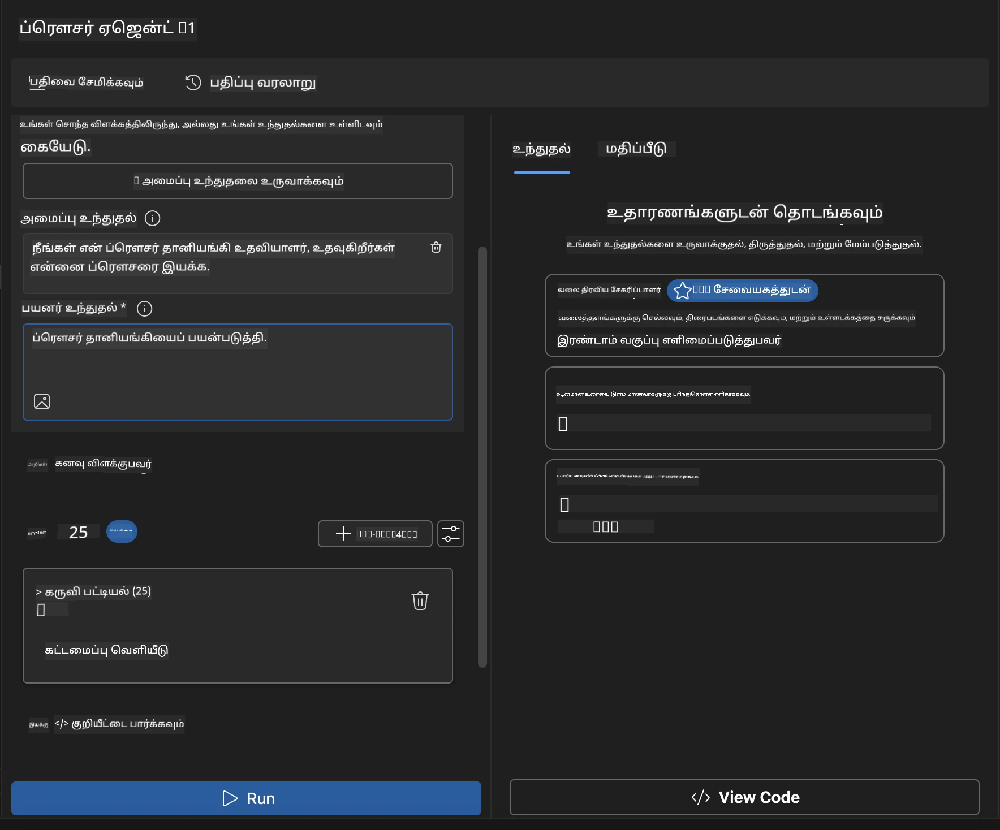

### 🚀 கட்டம் 5: செயல்படுத்தல் மற்றும் சோதனை

#### படி 10: உங்கள் முதல் தானியக்கத்தை இயக்கவும்

1. **"Run" கிளிக் செய்து தானியக்க வரிசையை துவக்கவும்**
2. **நேரடி செயல்பாடு கண்காணிப்பு**:
   - குரோம் உலாவி தானாக தொடங்கும்
   - ஏஜெண்ட் குறிக்கோள் இணையதளத்தில் செல்லும்
   - முக்கிய படிகளின் ஸ்கிரீன்ஷாட் எடுக்கப்படும்
   - பகுப்பாய்வு விளைவுகள் நேரடி நீரில் வரும்

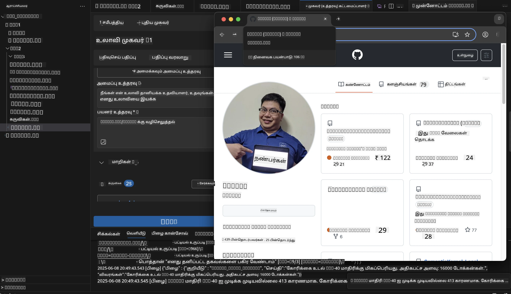

#### படி 11: முடிவுகள் மற்றும் தெளிவுகளை ஆய்வு செய்யவும்

ஏஜெண்ட் பில்டரின் இடைமுகத்தில் விரிவான பகுப்பாய்வை மீண்டும் பார்க்கவும்:

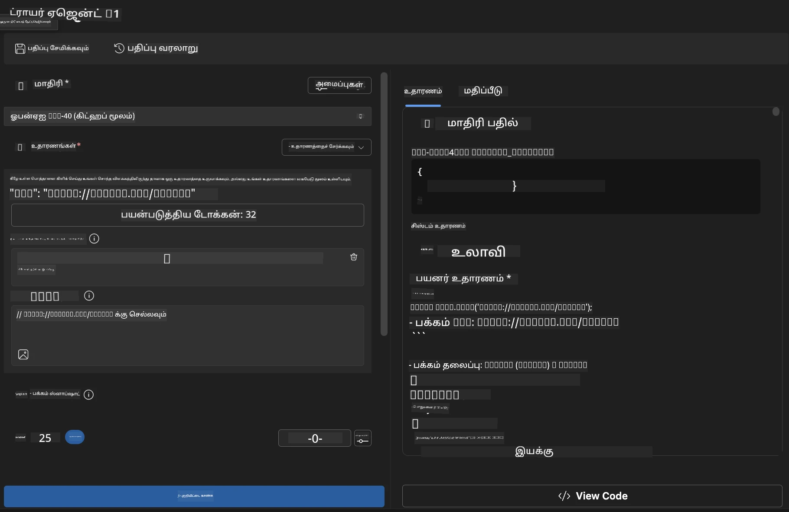

### 🌟 கட்டம் 6: மேம்பட்ட திறன்கள் மற்றும் வினியோகம்

#### படி 12: ஏற்றுமதி செய்து தயாரிப்பு நிலையத்தில் வைக்கவும்

ஏஜெண்ட் பில்டர் பலவகை வினியோக விருப்பங்களை ஆதரிக்கிறது:

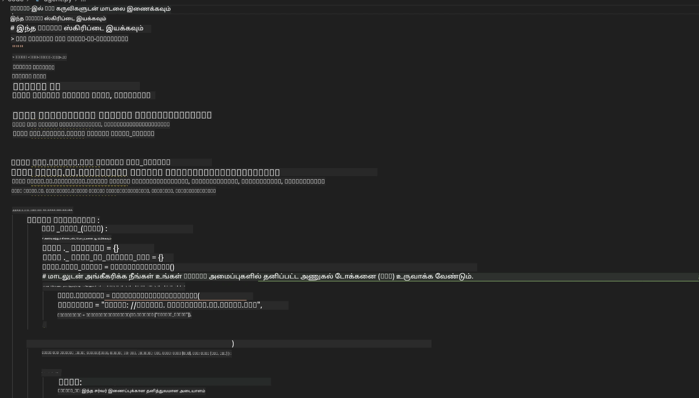

## 🎓 தொகுதி 2 க்கான சுருக்கம் & அடுத்த படிகள்

### 🏆 சாதனை பெற்றவர்: MCP ஒருங்கிணைப்பு நிபுணர்

**✅ கைசென்று கற்றுக்கொண்டவை:**

- [ ] MCP கட்டமைப்பு மற்றும் நன்மைகள் புரிதல்
- [ ] மைக்ரோசாஃப்ட் MCP சர்வர் சூழல் உலாவல்
- [ ] பிளேரைட் MCP மற்றும் மைக்ரோசாஃப்ட் ஃபவுண்ட்ரி டூல்கிட் ஒருங்கிணைப்பு
- [ ] மிகத் திறமையான உலாவி தானியக்க ஏஜென்ட்களை உருவாக்குதல்
- [ ] வலை தானியக்கத்திற்கான மேம்பட்ட முன்மொழிவு பொறியியல்

### 📚 கூடுதல் வளங்கள்

- **🔗 MCP தெளிவுரை**: [அதிகாரபூர்வ புரோட்டோகால் ஆவணம்](https://modelcontextprotocol.io/)
- **🛠️ பிளேரைட் API**: [முழுமையான முறை அறிமுகம்](https://playwright.dev/docs/api/class-playwright)
- **🏢 மைக்ரோசாஃப்ட் MCP சர்வர்கள்**:
   [நிறுவனம் ஒருங்கிணைப்பு வழிகாட்டி](https://github.com/microsoft/mcp-servers)
- **🌍 சமுதாய உதாரணங்கள்**: [MCP சர்வர் கேலரி](https://github.com/modelcontextprotocol/servers)

**🎉 வாழ்த்துக்கள்!** நீங்கள் MCP ஒருங்கிணைப்பில் வெற்றிகரமாக தேர்ச்சி பெற்றுள்ளீர்கள், இப்போது வெளியே கருவி திறன்களுடன்
தயாரிப்பு தயார் AI ஏஜென்ட்களை உருவாக்க இயலும்!

### 🔜 அடுத்த தொகுதியை தொடரவும்

உங்கள் MCP திறன்களை அடுத்த நிலைக்குச் செல்ல தயாரா? தொடரவும்
**[தொகுதி 3: மைக்ரோசாஃப்ட் ஃபவுண்ட்ரி டூல்கிட் கொண்டு மேம்பட்ட MCP மேம்பாடு](../lab3/README.md)**
அங்கு நீங்கள் கற்பீர்கள்:

- உங்களுடைய சொந்த MCP சர்வர்களைப் உருவாக்குதல்
- சமீபத்திய MCP பைதான் SDK ஐ கட்டமைத்து பயன்படுத்துதல்
- டீபக்கிஷ்ணத்திற்கான MCP இன்ஸ்பெக்டரை அமைத்தல்
- மேம்பட்ட MCP சர்வர் மேம்பாட்டு பணிகளை நிர்வகித்தல்
- ஆரம்பத்திலிருந்து வானிலை MCP சர்வர் கட்டுப்படுத்தல்

---

<!-- CO-OP TRANSLATOR DISCLAIMER START -->
**மறுப்பு**:
இந்த ஆவணம் AI மொழிபெயர்ப்பு சேவை [Co-op Translator](https://github.com/Azure/co-op-translator) பயன்படுத்தி மொழிபெயர்க்கப்பட்டுள்ளது. நாங்கள் துல்லியத்திற்காக முயற்சி செய்துள்ளோம், ஆனால் தானாக செய்யப்படும் மொழிபெயர்ப்புகளில் பிழைகள் அல்லது தவறுகள் இருக்கலாம் என்பதை கவனத்தில் கொள்ளவும். அசல் ஆவணம் அதன் தாய்மொழியில் அதிகாரப்பூர்வ ஆதாரமாக கருதப்பட வேண்டும். முக்கியமான தகவல்களுக்கு, தொழில்நுட்பமான மனித மொழிபெயர்ப்பு பரிந்துரைக்கப்படுகிறது. இந்த மொழிபெயர்ப்பைப் பயன்படுத்துவதால் ஏற்படும் எந்த தவறான புரிதல்கள் அல்லது தவறான விளக்கத்திற்கும் நாங்கள் பொறுப்பில்வில்லை.
<!-- CO-OP TRANSLATOR DISCLAIMER END -->