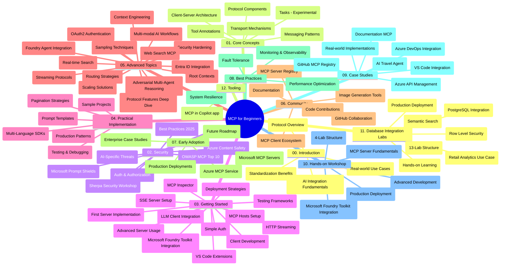

# ஆரம்பக்காரர்களுக்கான மாதிரி வரையறை நெறிமுறை (MCP) - படிப்புக் கையேடு

"ஆரம்பக்காரர்களுக்கான மாதிரி வரையறை நெறிமுறை (MCP)" பாடத்திட்டத்தின் தொகுப்புக் கட்டமைப்பினும் உள்ளடக்கத்தினும் ஒரு கண்ணோட்டத்தை இந்த படிப்புக் கையேடு வழங்குகிறது. தொகுப்பை திறம்பட எளிதாக்கவும் கிடைக்கக் கூடிய வளங்களை முழுமையாக பயன்படுத்தவும் இந்த கையேட்டை பயன்படுத்துங்கள்.

## தொகுப்பு கண்ணோட்டம்

மாதிரி வரையறை நெறிமுறை (MCP) என்பது AI மாதிரிகளுக்கும் வாடிக்கையாளர் பயன்பாடுகளுக்குமான மோதுச்சிக்கான ஒரு நிலையான படிமுறை ஆகும். ஆரம்பத்தில் Anthropic உருவாக்கியது இது இனிமேல் அதிகாரப்பூர்வ GitHub அமைப்பின் மூலமாக MCP சமுதாயத்தின் பராமரிப்பில் உள்ளது. இந்த தொகுப்பில் C#, Java, JavaScript, Python மற்றும் TypeScript மொழிகளின் செயல்படுத்தும் குறியீடு எடுத்துக்காட்டுகளுடனான விரிவான பாடத்திட்டம் உள்ளது, இது AI வடிவமைப்பாளர்கள், கணினி அமைப்பாளர்கள், மென்பொருள் பொறியாளர்களுக்காக வடிவமைக்கப்பட்டுள்ளது.

## காட்சியியல் பாடத்திட்ட வரைபடம்

## தொகுப்பு கட்டமைப்பு

MCP-இன் வெவ்வேறு அம்சங்களின் மீது கவனம் செலுத்தி, தொகுப்பு பன்னிரண்டு முக்கிய பிரிவுகளாக கட்டமைக்கப்பட்டுள்ளது:

1. **இறுதிச் சுருக்கம் (00-Introduction/)**
   - மாதிரி வரையறை நெறிமுறையின் கண்ணோட்டம்
   - AI வழித்தடங்களில் நிலைப்படுத்தல் ஏன் முக்கியம்
   - நடைமுறை பயன்பாடுகள் மற்றும் நன்மைகள்

2. **மூலம் கருத்துக்கள் (01-CoreConcepts/)**
   - வாடிக்கையாளர்-சேவையாளர் கட்டமைப்பு
   - முக்கிய நெறிமுறை கூறுகள்
   - MCP-இல் செய்தி பரிமாற்ற வழிகள்
   - தற்போதைய விவரிப்பு: [MCP-இல் என்ன மாற்றம் : 2026-07-28 விவரிப்பு](./01-CoreConcepts/mcp-2026-07-28.md) — நிலையற்ற நெறிமுறை மூலக்கூறு, நீட்டிப்பு கட்டமைப்பு மற்றும் இருட்டும்/மாதிரிப்பிடல்/பதிவிடல் நீக்கம்

3. **பாதுகாப்பு (02-Security/)**
   - MCP அடிப்படையிலான அமைப்புகளில் நிகழக்கூடிய பாதுகாப்பு மிரட்டல்கள்
   - செயலாக்கங்களுக்கான சிறந்த நடைமுறைகள்
   - அங்கீகாரம் மற்றும் அங்கீகாராண்மை திட்டங்கள்
   - செயல்பாட்டிற்கான [CIMD மற்றும் DCR அங்கீகார மாதிரி](./02-Security/samples/cimd-dcr-auth/README.md)
   - **விரிவான பாதுகாப்பு ஆவணங்கள்**:
     - MCP பாதுகாப்பு சிறந்த நடைமுறைகள்
     - Azure உள்ளடக்க பாதுகாப்பு செயலாக்கக் கையேடு
     - MCP பாதுகாப்பு கட்டுப்பாடுகள் மற்றும் தொழில்நுட்பங்கள்
     - MCP சிறந்த நடைமுறைகள் விரைவான குறிப்புகள்
   - **முக்கிய பாதுகாப்பு தலைப்புகள்**:
     - குறைகோள் ஊட்டுதல் மற்றும் கருவி நச்சுத்தன்மை தாக்குதல்கள்
     - அமர்வு ஒடுக்குதல் மற்றும் குழப்பமடைந்த அங்கத்தில் பிரச்சினைகள்
     - டோக்கன் வழியாக நுழைவு பாதுகாப்பற்றவை
     - அதிகமான அனுமதிகள் மற்றும் அணுகல் கட்டுப்பாடு
     - AI கூறுகளுக்கான வழங்கல் சங்கிலி பாதுகாப்பு
     - Microsoft குறைகோள் காவலர்கள் ஒருங்கிணைப்பு

4. **துவக்கம் (03-GettingStarted/)**
   - சுற்றுப்புற அமைப்பு மற்றும் அமைப்பு
   - அடிப்படையான MCP சேவையகங்கள் மற்றும் வாடிக்கையாளர்களின் உருவாக்கம்
   - ஏற்கனவே உள்ள பயன்பாடுகளோடு ஒருங்கிணைப்பு
   - பின்வரும் பிரிவுகளைக் கொண்டுள்ளது:
     - முதற் சேவையக நடைமுறை
     - வாடிக்கையாளர் வளர்ச்சி
     - LLM வாடிக்கையாளர் ஒருங்கிணைப்பு
     - VS குறியீட்டு ஒருங்கிணைப்பு
     - சேவையக அனுப்பப்பட்ட நிகழ்வுகள் (SSE) சேவையகம்
     - மேம்பட்ட சேவையக பயன்பாடு
     - HTTP மாற்றல்
    - Microsoft Foundry கருவி ஒருங்கிணைப்பு
     - சோதனை நெறிமுறைகள்
     - பகிர்வு வழிகாட்டிகள்

5. **நடைமுறை செயலாக்கம் (04-PracticalImplementation/)**
   - பல்வேறு நிரல் மொழிகளில் SDK-களை பயன்படுத்துதல்
   - பிழைதிருத்துதல், சோதனை மற்றும் சரிபார்ப்பு தொழில்நுட்பங்கள்
   - மறுபயன்பாடான குறைகோள் மாதிரிகள் மற்றும் பணியாற்று முறைகள் உருவாக்குதல்
   - செயல்படுத்தல் எடுத்துக்காட்டுக்களுடன் மாதிரி திட்டங்கள்

6. **மேம்பட்ட தலைப்புகள் (05-AdvancedTopics/)**
   - சூழல் பொறியியல் தொழில்நுட்பங்கள்
   - Foundry முகவர் ஒருங்கிணைப்பு
   - பன்முறை AI பணியாற்று முறைகள்
   - OAuth2 அங்கீகாரம் முன்னிலைப்படுத்தல்கள்
   - நேரடி தேடல் திறன்கள்
   - நேரடி மாற்றல்
   - கடைசிக் குறிப்புகள் செயலாக்கம்
   - வழிசெலுத்தல் திட்டங்கள்
   - மாதிரிப்பு தொழில்நுட்பங்கள்
   - அளவீடு அணுகுமுறைகள்
   - பாதுகாப்பு கவனிக்கைகள்
   - Entra ID பாதுகாப்பு ஒருங்கிணைப்பு
   - வலை தேடல் ஒருங்கிணைப்பு
   - எதிர்ப்பு பல்கலை முகவர் காரணித்தல் (பாதுகாப்பு வடிவமைப்புகள்)

7. **சமூக பங்களிப்புகள் (06-CommunityContributions/)**
   - குறியீடு மற்றும் ஆவணமிடல் பங்களிப்பது எப்படி
   - GitHub மூலமாக ஒத்துழைப்பு
   - சமூக இயக்கத்தில் முன்னேற்றங்கள் மற்றும் கருத்துக்களைப் பெறுதல்
   - பல MCP வாடிக்கையாளர்களைப் பயன்படுத்துதல் (Claude Desktop, Cline, VSCode)
   - புகழ்பெற்ற MCP சேவையகங்களுடன் வேலை செய்வது, படங்களின் உற்பத்தி உட்பட

8. **ஆரம்பப் பயன்பாட்டின் பாடங்கள் (07-LessonsfromEarlyAdoption/)**
   - நேரடி பயன்பாடுகள் மற்றும் வெற்றிக் கதைகள்
   - MCP அடிப்படையிலான தீர்வுகளை உருவாக்கி வெளியிட்டல்
   - நுட்பம் மற்றும் எதிர்கால திட்டம்
   - **Microsoft MCP சேவையக வழிகாட்டி**: 10 தயாராக்கத்துக்கான Microsoft MCP சேவையகங்களுக்கான முழுமையான வழிகாட்டி, அதில்:
     - Microsoft Learn ஆவணங்கள் MCP சேவையகம்
     - Azure MCP சேவையகம் (15+ சிறப்பு இணைப்பிகள்)
     - GitHub MCP சேவையகம்
     - Azure DevOps MCP சேவையகம்
     - MarkItDown MCP சேவையகம்
     - SQL Server MCP சேவையகம்
     - Playwright MCP சேவையகம்
     - Dev Box MCP சேவையகம்
     - Microsoft Foundry MCP சேவையகம்
     - Microsoft 365 முகவர்கள் கருவி MCP சேவையகம்

9. **சிறந்த நடைமுறைகள் (08-BestPractices/)**
   - செயல்திறன் மேம்பாடுகள் மற்றும் கதவுகள்
   - பிழை பொறுத்த MCP அமைப்புகளை வடிவமைத்தல்
   - சோதனை மற்றும் நம்பகத்தன்மை செய்தித்திட்டங்கள்

10. **வழங்கும் ஆய்வுகள் (09-CaseStudy/)**
    - MCP பலமுகத்தன்மையை வெளிப்படுத்தும் **ஏழு விரிவான வழக்குக் கேஸ்கள்**:
    - **Azure AI பயண முகவர்கள்**: Azure OpenAI மற்றும் AI தேடலின் பன்முக முகவர் ஒழுங்கமைப்பு
    - **Azure DevOps ஒருங்கிணைப்பு**: YouTube தரவுப் புதுப்பிப்புகளுடன் பணிமுறை தானியங்கி செய்யல்
    - **நேரடி ஆவணங்கள் மீட்டெடுக்கும்**: Python தனியார் வாடிக்கையாளர், Web ஏற்று HTTP மாற்றல் உடன்
    - **உரையாடல் படிப்புத்திட்ட ஜெனரேட்டர்**: Chainlit வலை பயன்பாடு உரையாடல் AI உடன்
    - **எடிட்டரில் உள்ள ஆவணங்கள்**: VS குறியீடு ஒருங்கிணைப்பு GitHub Copilot பணியாற்றுகளுடன்
    - **Azure API மேலாண்மை**: நிறுவனம் API ஒருங்கிணைப்புடன் MCP சேவையகம் உருவாக்குதல்
    - **GitHub MCP பங்கு பதிவேடு**: சூழல் மேம்பாடு மற்றும் முகவர் ஒருங்கிணைப்பு மேடை
    - நிறுவனம் ஒருங்கிணைப்பு, டெவலப்பர் உற்பத்தித்திறன் மற்றும் சூழல் மேம்பாட்டுடன் செயல்படுத்தல் எடுத்துக்காட்டுகள்

11. **கையடக்க பணிமனை (10-StreamliningAIWorkflowsBuildingAnMCPServerWithAIToolkit/)**
    - MCP-ஐ Microsoft Foundry கருவியுடன் இணைக்கும் முழுமையான கையடக்க பணிமனை
    - AI மாதிரிகள் மற்றும் எளிய உலக கருவிகள் இடையே புத்திசாலி பயன்பாடுகளை உருவாக்குதல்
    - அடிப்படைகள், தனிப்பயன் சேவையகம், நீக்கம் மற்றும் பகிர்வு வழிமுறைகள் பற்றிய நடைமுறை பகுதிகள்
    - **மரபுத்திறன் வடிவமைப்பு**:
      - மரபுத்திறன் 1: MCP சேவையக அடிப்படைகள்
      - மரபுத்திறன் 2: மேம்பட்ட MCP சேவையகம் வடிவமைப்பு
      - மரபுத்திறன் 3: Microsoft Foundry கருவி ஒருங்கிணைப்பு
      - மரபுத்திறன் 4: உற்பத்தி பகிர்வு மற்றும் அளவீடு
    - படி படியாகக் கையேடு கொண்ட மரபுத்திறன் இயங்கும் மொழிமுறை

12. **MCP சேவையக தரவுத்தள ஒருங்கிணைப்பு மரபுத்திறன்கள் (11-MCPServerHandsOnLabs/)**
    - PostgreSQL ஒருங்கிணைப்புடன் உற்பத்தி நிலை MCP சேவையகங்களை உருவாக்கும் **முழு 13 மரபுத்திறன் கல்வி பாதை**
    - Zava Retail பயன்பாடு உதாரணத்தில் **உலகளாவிய சில்லறை பகுப்பாய்வு செயலாக்கம்**
    - வரிசை நிலை பாதுகாப்பு (RLS), சார்ந்த தேடல் மற்றும் பன்முக வாடிக்கையாளர் தரவு அணுகல்கள் உட்பட **நிறுவன தர அளவுக்கு மாதிரிகள்**
    - **முழு மரபுத்திறன் வடிவமைப்பு**:
      - **மரபுத்திறன்கள் 00-03: அடிப்படைகள்** - அறிமுகம், கட்டமைப்பு, பாதுகாப்பு, சுற்றுப்புற அமைப்பு
      - **மரபுத்திறன்கள் 04-06: MCP சேவையக உருவாக்கம்** - தரவுத்தள வடிவமைப்பு, MCP சேவையக செயல்பாடு, கருவி மேம்பாடு
      - **மரபுத்திறன்கள் 07-09: மேம்பட்ட அம்சங்கள்** - சார்ந்த தேடல், சோதனை மற்றும் பிழைதிருத்தல், VS குறியீடு ஒருங்கிணைப்பு
      - **லேப்கள் 10-12: தயாரிப்பு மற்றும் சிறந்த நடைமுறைகள்** - வெளியீடு, கண்காணிப்பு, மேம்படுத்தல்
    - **உள்வரையியல் கலைகளைக் கடந்து**: FastMCP உடைக்கட்டை, PostgreSQL, Azure OpenAI, Azure Container Apps, Application Insights
    - **கற்றல் பெறுபேறுகள்**: தயாரிப்பு-தயார MCP சர்வர்கள், தரவுத்தள இணைப்பு முறைகள், AI மூலம் இயங்கும் பகுப்பாய்வுகள், நிறுவன பாதுகாப்பு

13. **கருவிகள் (12-tooling/)**
    - Copilot செயலியில் MCP ஐ பயன்படுத்தும் முறை மற்றும் பிற கருவிகள்

## கூடுதலான வளங்கள்

இந்த தொகுப்பில் ஆதரவு வளங்கள் உள்ளன:

- **படங்கள் அடைவு**: பாடத்திட்டம் முழுவதும் பயன்படுத்தப்படும் வரைபடங்கள் மற்றும் விளக்கப்படங்கள்
- **மொழிப்பெயர்ப்புகள்**: ஆவணங்களுக்கான பல்மொழி ஆதரவு மற்றும் தானாக மொழிபெயர்ப்பு வேலைகள்
- **அதிகாரப்பூர்வ MCP வளங்கள்**:
  - [MCP ஆவணம்](https://modelcontextprotocol.io/)
  - [MCP விவரம்](https://modelcontextprotocol.io/specification/2026-07-28/)
  - [MCP GitHub தொகுப்பு](https://github.com/modelcontextprotocol)

## இந்த தொகுப்பை எப்படி பயன்படுத்துவது

1. **வரிசையான கற்றல்**: அமைப்பான கற்றல் அனுபவத்திற்காக அத்தியாயங்களை வரிசைப்படி பின்பற்றவும் (00 முதல் 11 வரை).
2. **மொழி-சூழல் கவனம்**: குறிப்பிட்ட ஒரு நிரல் மொழியில் நீங்கள் ஆர்வமிருக்கின்றால், உங்கள் விருப்ப மொழியில் எடுத்துக்காட்டுகளுக்கான அடைவுகளை ஆராயவும்.
3. **வடிவமைத்த நடைமுறை**: உங்கள் சூழலை அமைத்து முதற்படியான MCP சர்வர் மற்றும் கிளையண்டை உருவாக்க "தொடக்கம்" பகுதிக்குச் செல்லவும்.
4. **மேம்பட்ட ஆராய்ச்சி**: அடிப்படைகள் நன்கு புரிந்தபின், மேம்பட்ட தலைப்புகளுக்கு வடிவமைக்க.
5. **சமூக நுழைவுக் கூட்டம்**: MCP சமூகத்தில் GitHub விவாதங்கள் மற்றும் Discord வாயிலாக உள்நுழைந்து நிபுணர்களும் மற்ற டெவலப்பர்களுடனும் தொடர்பு கொள்ளவும்.

## MCP கிளையண்ட்கள் மற்றும் கருவிகள்

பாடத்திட்டம் பல MCP கிளையண்ட்கள் மற்றும் கருவிகளை உள்ளடக்கியது:

1. **அதிகாரப்பூர்வ கிளையண்ட்கள்**:
   - Visual Studio Code 
   - Visual Studio Code இல் MCP
   - Claude டெஸ்க்டாப்
   - VSCodeவில் Claude 
   - Claude API

2. **சமூக கிளையண்ட்கள்**:
   - Cline (টার்மினல் அடிப்படையிலானது)
   - Cursor (கோட் எடிட்டர்)
   - ChatMCP
   - Windsurf

3. **MCP நிர்வாக கருவிகள்**:
   - MCP CLI
   - MCP மேலாளர்
   - MCP இணைப்பான்
   - MCP வழிமாற்றி

## பிரபலமான MCP சர்வர்கள்

தொகுப்பு பல MCP சர்வர்களை அறிமுகப்படுத்துகிறது, அவற்றில்:

1. **அதிகாரப்பூர்வ Microsoft MCP சர்வர்கள்**:
   - Microsoft Learn Docs MCP சர்வர்
   - Azure MCP சர்வர் (15+ சிறப்பு இணைப்புகளுடன்)
   - GitHub MCP சர்வர்
   - Azure DevOps MCP சர்வர்
   - MarkItDown MCP சர்வர்
   - SQL சர்வர் MCP சர்வர்
   - Playwright MCP சர்வர்
   - Dev Box MCP சர்வர்
   - Microsoft Foundry MCP சர்வர்
   - Microsoft 365 முகவரிகள் கருவி தொகுப்பு MCP சர்வர்

2. **அதிகாரப்பூர்வ குறிப்பு சர்வர்கள்**:
   - கோப்பு அமைப்பு
   - தரவு பெற்றல்
   - நினைவு
   - வரிசையான சிந்தனை

3. **படம் உருவாக்கம்**:
   - Azure OpenAI DALL-E 3
   - Stable Diffusion WebUI
   - பிரதிபலிப்பு

4. **நிர்வாக கருவிகள்**:
   - Git MCP
   - டெர்மினல் கட்டுப்பாடு
   - கோட் உதவியாளர்

5. **சிறப்பு சர்வர்கள்**:
   - SalesForce
   - Microsoft Teams
   - Jira & Confluence

## பங்களிப்பு

இந்த தொகுப்பு சமூகத்தினரின் பங்களிப்புகளை வரவேற்கிறது. MCP சுற்றுச்சூழலுக்கு சிறந்த முறையில் பங்களிக்க சமூக பங்களிப்பு பகுதிக்குச் செல்லவும்.

----

*இந்த பயிற்சி கையேடு கடைசியாக 2026 செப்டம்பர் 9 ஆம் தேதி புதுப்பிக்கப்பட்டது. இது MCP
விவரம் `2026-07-28`, தற்போதைய தரவுத்தொடர்பியல் திருத்தத்தைக் பிரதிபலிக்கிறது. சில கை மேசை
எடுத்துக்காட்டுகள் `2025-11-25` க்கு முறையாக பதிப்பு கொண்டவை இன்றும், அவை SDK மற்றும் கருவிகள்
மாறாதத் தொடர்பியல் API-களை ஏற்றுக்கொள்கின்றன.*

---

<!-- CO-OP TRANSLATOR DISCLAIMER START -->
**மறுப்பு**:
இந்த ஆவணம் AI மொழிபெயர்ப்பு சேவை [Co-op Translator](https://github.com/Azure/co-op-translator) பயன்படுத்தி மொழிபெயர்க்கப்பட்டுள்ளது. நாங்கள் துல்லியத்திற்காக முயற்சி செய்துள்ளோம், ஆனால் தானாக செய்யப்படும் மொழிபெயர்ப்புகளில் பிழைகள் அல்லது தவறுகள் இருக்கலாம் என்பதை கவனத்தில் கொள்ளவும். அசல் ஆவணம் அதன் தாய்மொழியில் அதிகாரப்பூர்வ ஆதாரமாக கருதப்பட வேண்டும். முக்கியமான தகவல்களுக்கு, தொழில்நுட்பமான மனித மொழிபெயர்ப்பு பரிந்துரைக்கப்படுகிறது. இந்த மொழிபெயர்ப்பைப் பயன்படுத்துவதால் ஏற்படும் எந்த தவறான புரிதல்கள் அல்லது தவறான விளக்கத்திற்கும் நாங்கள் பொறுப்பில்வில்லை.
<!-- CO-OP TRANSLATOR DISCLAIMER END -->