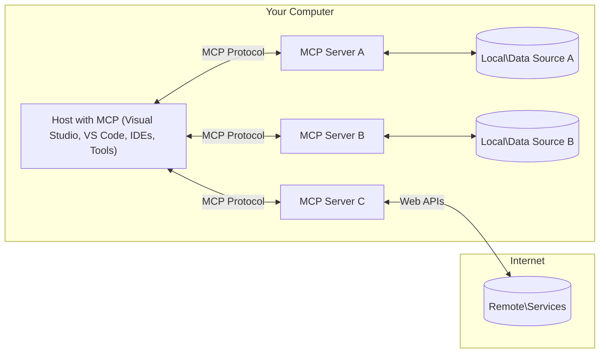

# Mga Pangunahing Konsepto ng MCP: Pagsasamantala sa Model Context Protocol para sa Pagsasama ng AI

[](https://youtu.be/earDzWGtE84)

_(I-click ang larawan sa itaas upang makita ang video ng araling ito)_

Ang [Model Context Protocol (MCP)](https://github.com/modelcontextprotocol) ay isang makapangyarihan, standardisadong balangkas na nag-ooptimize ng komunikasyon sa pagitan ng Large Language Models (LLMs) at mga panlabas na kasangkapan, aplikasyon, at mga pinagkukunan ng datos.
Ang gabay na ito ay magpapaliwanag sa iyo tungkol sa mga pangunahing konsepto ng MCP. Matututuhan mo ang tungkol sa arkitektura ng client-server, mahahalagang bahagi, mekaniks ng komunikasyon, at mga pinakamahusay na kasanayan sa pagpapatupad.

- **Kontrol ng Gumagamit at Pahintulot**: Dapat malinaw na ipakita ng mga host kung anong datos at mga kasangkapan ang inilalantad ng isang
  server, payagan ang mga gumagamit na tanggihan ang mga operasyon, at kumuha ng tahasang kumpirmasyon
  para sa mga sensitibo o mahalagang aksyon. Hindi nangangailangan ang MCP ng kumpirmasyon
  na dialog bago ang bawat tawag sa kasangkapan.

- **Proteksyon sa Privacy ng Datos**: Ang datos ng gumagamit ay inilalantad lamang sa tahasang pahintulot at dapat protektahan ng matibay na mga kontrol sa pag-access sa buong lifecycle ng interaksyon. Ang mga implementasyon ay dapat pigilan ang hindi awtorisadong transmisyon ng datos at panatilihin ang mahigpit na mga hangganan ng privacy.

- **Kaligtasan sa Pagsasagawa ng Kasangkapan**: Dapat ipakita ng mga host ang mga pagsasagawa ng kasangkapan at panatilihing kayang tanggihan ito ng tao. Ang mga sensitibong operasyon ay dapat ipakita ang mga input ng kasangkapan at epekto bago isagawa, na may mga hangganan ng seguridad na pumipigil sa hindi sinasadyang o malisyosong mga aksyon.


- **Seguridad sa Transportasyon**: Ang mga remote na koneksyon ay dapat gumamit ng HTTPS at ng modelo ng awtorisasyon ng MCP. Ang mga lokal na stdio server ay umaasa sa paghihiwalay ng proseso, pinagkakatiwalaang konfigurasyon, at ligtas na paghawak ng mga namanang kredensyal.


#### Mga Patnubay sa Pagpapatupad:

- **Pangangasiwa ng Pahintulot**: Magpatupad ng mga sistemang may pinong antas ng pahintulot na nagpapahintulot sa mga gumagamit na kontrolin kung aling mga server, kasangkapan, at mga yaman ang maa-access
- **Pagpapatunay at Awtorisasyon**: Gumamit ng mga secure na pamamaraan ng pagpapatunay (OAuth, API keys) na may tamang pamamahala ng token at expiration  
- **Pagberipika ng Input**: Beripikahin ang lahat ng mga parameter at input ng datos ayon sa mga itinalagang schema upang maiwasan ang injection attacks
- **Pag-log ng Audit**: Panatilihin ang komprehensibong mga talaan ng lahat ng operasyon para sa seguridad at pagsunod sa regulasyon

## Pangkalahatang-ideya

Tinutuklas ng araling ito ang pangunahing arkitektura at mga bahagi na bumubuo sa ekosisitema ng Model Context Protocol (MCP). Matututuhan mo ang tungkol sa client-server architecture, mga pangunahing bahagi, at mekanismong pangkomunikasyon na nagtutulak ng mga interaksyon sa MCP.

## Pangunahing Mga Layunin ng Pagkatuto

Sa pagtatapos ng araling ito, ikaw ay:

- Mauunawaan ang client-server arkitektura ng MCP.
- Matutukoy ang mga tungkulin at responsibilidad ng mga Host, Client, at Server.
- Masusuri ang mga pangunahing katangian na nagpapaluwag sa MCP bilang isang layer ng pagsasama.
- Matututuhan kung paano dumadaloy ang impormasyon sa loob ng ekosisitema ng MCP.
- Makakakuha ng praktikal na kaalaman sa pamamagitan ng mga halimbawa ng code sa .NET, Java, Python, at JavaScript.

## Arkitektura ng MCP: Masusing Pagsusuri

Ang ekosisitema ng MCP ay binuo sa isang client-server na modelo. Ang modular na istrukturang ito ay nagpapahintulot sa mga aplikasyon ng AI na makipag-ugnayan sa mga kasangkapan, database, API, at mga mapagkukunan ng konteksto nang epektibo. Hatiin natin ang arkitekturang ito sa mga pangunahing bahagi nito.

Sa kanyang core, sumusunod ang MCP sa isang client-server arkitektura kung saan ang isang host application ay maaaring kumonekta sa maraming mga server:



- **MCP Hosts**: Mga programa tulad ng VSCode, Claude Desktop, IDEs, o mga AI tool na nais mag-access ng datos sa pamamagitan ng MCP
- **MCP Clients**: Mga bahagi ng protocol na nagpapanatili ng isang lohikal na relasyon
  sa isang server; ang mga kahilingan ng MCP `2026-07-28` ay hindi nakadepende sa isang persistenteng
  koneksyon o session
- **MCP Servers**: Magagaan na mga programa na bawat isa ay naglalantad ng tiyak na mga kakayahan sa pamamagitan ng standardisadong Model Context Protocol
- **Local Data Sources**: Mga file, database, at serbisyo sa iyong kompyuter na maaaring ma-access nang ligtas ng mga MCP server
- **Remote Services**: Mga panlabas na sistema na available sa internet na maaaring kumonekta ang mga MCP server sa pamamagitan ng mga API.

Ang MCP Protocol ay isang lumalago na standard gamit ang date-based versioning
(YYYY-MM-DD na format). Ang kasalukuyang bersyon ng protocol ay **2026-07-28**. Tingnan ang
[2026-07-28 na pagtutukoy ng protokol](https://modelcontextprotocol.io/specification/2026-07-28/).

> **Kasalukuyang bersyon:** Ang MCP `2026-07-28` ay ginagawang stateless ang protokol sa
> transport layer sa pamamagitan ng pagtanggal sa `initialize` handshake at protocol-level
> session IDs. Formal din nitong inilalatag ang isang Extensions framework at inaalis
> ang Roots, Sampling, at Logging pabor sa mga mas bagong pattern. Tingnan
> [Mga Pagbabago sa MCP: Ang 2026-07-28 na Pagtutukoy](./mcp-2026-07-28.md)
> para sa buong detalye at gabay sa migrasyon. Ang mga halimbawa na tahasang naka-target
> `2025-11-25` ay nananatiling mga aral ng legacy compatibility.

### 1. Mga Host

Sa Model Context Protocol (MCP), ang **Mga Host** ay mga AI application na nagsisilbing pangunahing interface kung saan nakikipag-ugnayan ang mga gumagamit sa protokol. Pinagtutulungan at pinamamahalaan ng mga Host ang mga koneksyon sa maraming MCP server sa pamamagitan ng paglikha ng dedikadong MCP clients para sa bawat koneksyon ng server. Halimbawa ng mga Host ay:

- **Mga AI Application**: Claude Desktop, Visual Studio Code, Claude Code
- **Mga Development Environment**: IDEs at mga code editor na may MCP integration  
- **Mga Custom na Application**: Mga purpose-built na AI agent at tool

Ang **Mga Host** ay mga application na nag-oorganisa ng mga interaksyon ng AI model. Sila ay:

- **Nagsasaayos ng AI Models**: Nagpapatupad o nakikipag-ugnayan sa LLMs para makabuo ng mga sagot at mag-coordinate ng mga workflow ng AI
- **Namamahala ng Client Relationships**: Lumilikha at namamahala ng isang MCP client para sa bawat MCP
  server na ginagamit ng host
- **Kontrol sa User Interface**: Hinahawakan ang daloy ng pag-uusap, interaksyon ng gumagamit, at presentasyon ng mga sagot  
- **Nagpapatupad ng Seguridad**: Kinokontrol ang mga permiso, security constraints, at authentication
- **Humahawak sa Pahintulot ng Gumagamit**: Namamahala sa pag-apruba ng gumagamit para sa pagbabahagi ng data at pagpapatupad ng mga tool


### 2. Mga Client

Ang **Mga Client** ay mga bahagi ng protokol na nilikha ng isang host para sa partikular na MCP
na mga server. Ito ay isang logical na one-to-one relationship, hindi isang pangangailangan para sa
persistent na koneksyon sa network. Sa MCP `2026-07-28`, bawat kahilingan ay
self-contained at maaaring pangasiwaan ng kahit anong instance ng server.

Ang **Mga Client** ay mga connector na bahagi sa loob ng host application. Sila ay:

- **Komunikasyon sa Protokol**: Nagpapadala ng JSON-RPC 2.0 na mga kahilingan sa mga server kasama ang mga prompt at mga tagubilin
- **Pagdiskubre ng Kakayahan**: Gumagamit ng `server/discover` para malaman ang mga suportadong
  bersyon ng protokol, kakayahan, at mga extension ng server
- **Pagpapatupad ng Tool**: Namamahala sa mga kahilingan sa pagpapatupad ng tool mula sa mga modelo at pinoproseso ang mga sagot
- **Real-time Updates**: Humahawak sa mga notification at real-time na update mula sa mga server
- **Pagpoproseso ng Sagot**: Pinoproseso at ine-format ang mga sagot ng server para sa pagpapakita sa mga gumagamit

### 3. Mga Server

Ang **Mga Server** ay mga programa na nagbibigay ng konteksto, mga tool, at kakayahan sa mga MCP client. Maaari silang patakbuhin nang lokal (parehong makina bilang Host) o remote (sa mga panlabas na platform), at responsable sa paghawak ng kahilingan ng client at pagbibigay ng istrukturadong mga sagot. Ang mga server ay nagpapakita ng tiyak na functionality sa pamamagitan ng standardized Model Context Protocol.

Ang **Mga Server** ay mga serbisyo na nagbibigay ng konteksto at kakayahan. Sila ay:

- **Pagpaparehistro ng Tampok**: Nagpapatala at nagpapakita ng magagamit na mga primitive (resources, prompts, tools) sa mga client
- **Pagpoproseso ng Kahilingan**: Tumatanggap at nagpapatupad ng tool call, resource request, at prompt request mula sa mga client
- **Pagbibigay ng Konteksto**: Nagbibigay ng kontekstwal na impormasyon at data upang mapabuti ang mga sagot ng modelo
- **Pamamahala ng Estado**: Pinananatili ang estado ng application gamit ang mga explicit na hawak na ipinapasa
  sa mga kahilingan kapag kailangan; ang MCP `2026-07-28` ay walang protocol-level session
- **Real-time na Mga Notification**: Nagpapadala ng mga notification tungkol sa mga pagbabago sa kakayahan at update sa mga nakakonektang client

Ang mga server ay maaaring idisenyo ng sinuman upang palawakin ang kakayahan ng modelo gamit ang espesyal na functionality, at sumusuporta sila sa parehong lokal at remote na deployment scenarios.

### 4. Mga Server Primitive

Ang mga server sa Model Context Protocol (MCP) ay nagbibigay ng tatlong pangunahing **primitive** na nagtatakda ng pundamental na mga bahagi para sa malawak na interaksyon sa pagitan ng mga client, host, at mga language model. Itong mga primitive ay nagtatakda ng uri ng contextual na impormasyon at mga aksyon na magagamit sa pamamagitan ng protokol.

Maaaring ilantad ng mga MCP server ang kahit anong kumbinasyon ng sumusunod na tatlong pangunahing primitive:

#### Mga Resource 

Ang **Mga Resource** ay pinagmumulan ng data na nagbibigay ng kontekstwal na impormasyon sa mga AI application. Kinakatawan nila ang static o dynamic na nilalaman na maaaring magpabuti ng pag-unawa at paggawa ng desisyon ng modelo:

- **Contextual Data**: Istrakturadong impormasyon at konteksto para sa pagkonsumo ng AI model
- **Mga Knowledge Base**: Repositori ng mga dokumento, artikulo, manwal, at mga pananaliksik
- **Mga Lokal na Pinagmumulan ng Data**: Mga file, database, at lokal na impormasyon ng sistema  
- **Panlabas na Data**: Mga sagot mula sa API, mga web service, at data mula sa mga remote na sistema
- **Dynamic na Nilalaman**: Real-time na data na nagbabago base sa panlabas na kondisyon

Ang mga Resource ay tinutukoy gamit ang mga URI at sumusuporta sa pagdiskubre sa pamamagitan ng `resources/list` at pagkuha gamit ang `resources/read` na mga pamamaraan:

```text
file://documents/project-spec.md
database://production/users/schema
api://weather/current
```

#### Mga Prompt

Ang **Mga Prompt** ay mga reusable template na tumutulong mag-istruktura ng interaksyon sa mga language model. Nagbibigay sila ng standardized na pattern ng interaksyon at mga template ng workflow:

- **Template-based na Interaksyon**: Mga pre-structured na mensahe at pang-umpisang pag-uusap
- **Mga Workflow Template**: Standardized na sekwensya para sa mga karaniwang gawain at interaksyon
- **Mga Few-shot na Halimbawa**: Mga template batay sa halimbawa para sa instruksiyon ng modelo
- **Mga System Prompt**: Pangunahing mga prompt na nagtatakda ng ugali at konteksto ng modelo
- **Dynamic Template**: Mga parameterized na prompt na umaangkop sa partikular na konteksto

Ang mga prompt ay sumusuporta sa variable substitution at maaaring madiskubre sa pamamagitan ng `prompts/list` at makuha gamit ang `prompts/get`:

```markdown
Generate a {{task_type}} for {{product}} targeting {{audience}} with the following requirements: {{requirements}}
```

#### Mga Tool

Ang **Mga Tool** ay mga executable na function na maaaring tawagin ng mga AI model upang magsagawa ng espesipikong mga aksyon. Kinakatawan nila ang mga "pandiwa" ng MCP ecosystem, na nagpapahintulot sa mga modelo na makipag-ugnayan sa mga panlabas na sistema:

- **Mga Executable na Function**: Mga nag-iisang operasyon na maaaring tawagin ng mga modelo gamit ang partikular na mga parameter
- **Integrasyon sa Panlabas na Sistema**: Mga tawag sa API, mga query sa database, operasyon ng file, kalkulasyon
- **Natanging Identidad**: Bawat tool ay may natatanging pangalan, deskripsyon, at schema ng parameter
- **Istrakturadong I/O**: Tumanggap ang mga tool ng validated na mga parameter at nagbabalik ng istrukturado, pormal na mga sagot
- **Mga Kakayahan sa Aksyon**: Pinapahintulutan ang mga modelo na magsagawa ng totoong mga aksyon at kumuha ng live na data

Ang mga tool ay tinutukoy gamit ang JSON Schema para sa validation ng parameter at nadidiskubre sa pamamagitan ng `tools/list` at ipinapatupad gamit ang `tools/call`. Maaari ring magsama ang mga tool ng **mga icon** bilang karagdagang metadata para sa mas mahusay na presentasyon ng UI.

**Mga Anotasyon ng Tool**: Sinusuportahan ng mga tool ang mga behavioral annotation (hal. `readOnlyHint`, `destructiveHint`) na naglalarawan kung ang isang tool ay read-only o destructive, na tumutulong sa mga client na gumawa ng matalinong desisyon tungkol sa pagpapatupad ng tool.

Halimbawa ng depinisyon ng tool:

```typescript
server.tool(
  "search_products", 
  {
    query: z.string().describe("Search query for products"),
    category: z.string().optional().describe("Product category filter"),
    max_results: z.number().default(10).describe("Maximum results to return")
  }, 
  async (params) => {
    // Execute search and return structured results
    return await productService.search(params);
  }
);
```

## Mga Client Primitive

Sa Model Context Protocol (MCP), ang **mga client** ay maaaring maglantad ng primitive na nagpapahintulot sa mga server na humiling ng karagdagang kakayahan mula sa host application. Ang mga client-side primitive na ito ay nagpapahintulot ng mas mayamang, mas interaktibong implementasyon ng server na maaaring ma-access ang kakayahan ng AI model at interaksyon ng gumagamit.

### Sampling

> **Hindi na ginagamit sa MCP `2026-07-28`:** Mananatiling magagamit ang Sampling para sa
> compatibility, ngunit ang mga bagong implementasyon ay dapat direktang makipag-integra sa LLM
> provider API. Karapat-dapat ito para sa pagtanggal sa unang rebisyon ng pagtutukoy
> na inilabas sa o pagkatapos ng Hulyo 28, 2027. Tingnan
> [Mga Pagbabago sa MCP: Ang 2026-07-28 na Pagtutukoy](./mcp-2026-07-28.md).

Pinapayagan ng **Sampling** ang mga server na humiling ng language model completions mula sa AI application ng client. Ang primitive na ito ay nagpapahintulot sa mga server na ma-access ang kakayahan ng LLM nang hindi kinakailangang isama ang sarili nilang dependencies ng modelo:

- **Independyenteng Access sa Modelo**: Maaari humiling ang mga server ng completions nang hindi isinasama ang LLM SDKs o namamahala sa access ng modelo
- **Server-Initiated na AI**: Pinapayagan ang mga server na awtonomong lumikha ng nilalaman gamit ang AI model ng client
- **Recursive LLM Interactions**: Sumusuporta sa mga kumplikadong senaryo kung saan kailangan ng mga server ang tulong ng AI para sa pagproseso
- **Dynamic na Pagbuo ng Nilalaman**: Pinapayagan ang mga server na lumikha ng kontekstwal na mga sagot gamit ang modelo ng host
- **Suporta sa Pagtawag ng Tool**: Maaaring isama ng mga server ang `tools` at `toolChoice` na mga parameter upang payagan ang modelo ng client na tumawag ng mga tool sa panahon ng sampling

Ginagamit ng Sampling ang pamamaraan nga `sampling/createMessage`, kung saan humihiling ang mga server ng
completion mula sa mga client.

### Roots

> **Hindi na ginagamit sa MCP `2026-07-28`:** Mananatiling magagamit ang Roots para sa
> compatibility, ngunit ang mga bagong implementasyon ay dapat magpasa ng mga direktoryo o file sa pamamagitan ng
> mga parameter ng tool, mga resource URI, o server configuration. Karapat-dapat ang Roots
> para sa pagtanggal sa unang rebisyon ng pagtutukoy na ilalabas sa o pagkatapos ng Hulyo
> 28, 2027. Tingnan
> [Mga Pagbabago sa MCP: Ang 2026-07-28 na Pagtutukoy](./mcp-2026-07-28.md).

Nagbibigay ang **Roots** ng standardized na paraan para sa mga client na tukuyin ang filesystem
na lokasyon na may kaugnayan sa mga server:

- **Palatandaan ng Filesystem**: Tinutukoy ang mga direktoryo at file na may kaugnayan sa kahilingan
- **Hiwalay na Awtorisasyon**: Hindi nagbibigay ng access o nagpapatupad ng boundary ng seguridad
- **Kakayahan bawat Kahilingan**: Nag-aanunsyo ang mga client ng suporta sa Roots sa metadata ng kahilingan
- **Pagtukoy gamit ang URI**: Gumagamit ang Roots ng `file://` URI para tukuyin ang accessible na direktoryo at file

Sa MCP `2026-07-28`, humihiling ang server ng `roots/list` sa pamamagitan ng
`InputRequiredResult` habang pinoproseso ang isang suportadong kahilingan ng client. Ibinabalik ng client ang roots kapag nireryretry ang orihinal na kahilingan.


### Elicitation  

Nagpapahintulot ang **Elicitation** sa mga server na humiling ng karagdagang impormasyon o kumpirmasyon mula sa mga gumagamit sa pamamagitan ng interface ng client:

- **Mga Kahilingan ng Input ng Gumagamit**: Maaaring humiling ang mga server ng karagdagang impormasyon kapag kailangan para sa pagpapatupad ng tool
- **Mga Dialogue ng Kumpirmasyon**: Humiling ng pag-apruba mula sa gumagamit para sa sensitibo o may impact na operasyon
- **Mga Interactive Workflow**: Pinapayagan ang mga server na lumikha ng sunud-sunod na pakikipag-ugnayan sa gumagamit
- **Dynamic na Pangangalap ng Parameter**: Nangangalap ng nawawala o opsyonal na mga parameter habang nagpapatupad ng tool

Ginagamit ng Elicitation ang paraan ng `elicitation/create` sa loob ng
`InputRequiredResult` upang kolektahin ang input ng gumagamit sa pamamagitan ng interface ng client.

**Pag-alis ng Mode ng URL**: Maaari ring humiling ang mga server ng pakikipag-ugnayan ng gumagamit batay sa URL, na nagpapahintulot sa mga server na idirekta ang mga gumagamit sa mga panlabas na web page para sa pagpapatotoo, pagkumpirma, o pagpasok ng data.

### Pag-log

> **Hindi na ginagamit sa MCP `2026-07-28`:** Ang pag-log ay nananatiling magagamit para sa
> pagkakatugma, ngunit ang mga bagong implementasyon ay dapat gumamit ng `stderr` na may stdio at
> OpenTelemetry para sa nakaayos na obserbabilidad. Karapat-dapat alisin ang pag-log
> sa unang rebisyon ng espesipikasyon na inilabas sa o pagkatapos ng Hulyo 28, 2027. Tingnan
> [Ano ang Nagbago sa MCP: Ang Espisipikasyon ng 2026-07-28](./mcp-2026-07-28.md).

Pinapayagan ng **Pag-log** ang mga server na magpadala ng nakaayos na mga mensahe ng log sa mga kliyente para sa pag-debug, pagmamanman, at kakayahang makita sa operasyon:

- **Suporta sa Pag-debug**: Pinapahintulutan ang mga server na magbigay ng detalyadong log ng pagpapatupad para sa paglutas ng problema
- **Pagsubaybay sa Operasyon**: Magpadala ng mga update sa katayuan at mga sukatan ng performance sa mga kliyente
- **Pag-uulat ng Error**: Magbigay ng detalyadong konteksto ng error at impormasyon sa pag-diagnose
- **Audit Trails**: Gumawa ng komprehensibong log ng mga operasyon at desisyon ng server

Ipinapadala ang mga mensahe ng pag-log sa mga kliyente upang magbigay ng transparency sa mga operasyon ng server at makatulong sa pag-debug.

## Daloy ng Impormasyon sa MCP

Tinukoy ng Model Context Protocol (MCP) ang isang nakaayos na daloy ng impormasyon sa pagitan ng mga host, kliyente, server, at modelo. Ang pag-unawa sa daloy na ito ay nakatutulong upang linawin kung paano pinoproseso ang mga kahilingan ng gumagamit at kung paano isinama ang mga panlabas na kasangkapan at data sa mga tugon ng modelo.

- **Nagsisimula ang Host ng Koneksyon**  
  Ang aplikasyon ng host (tulad ng IDE o chat interface) ay nagtatatag ng koneksyon sa isang MCP server, karaniwang sa pamamagitan ng STDIO, WebSocket, o ibang suportadong transportasyon.

- **Negosasyon ng Kakayahan**  
  Nagpapalitan ang kliyente (na naka-embed sa host) at ang server ng impormasyon tungkol sa kanilang mga sinusuportahang tampok, kasangkapan, mga pinagkukunan, at mga bersyon ng protokol. Tinitiyak nito na nauunawaan ng parehong panig kung anong mga kakayahan ang magagamit sa session.

- **Kahilingan ng Gumagamit**  
  Nakikipag-ugnayan ang gumagamit sa host (hal., naglalagay ng prompt o utos). Kinokolekta ng host ang input na ito at ipinapasa ito sa kliyente para sa pagproseso.

- **Paggamit ng Pinagkukunan o Kasangkapan**  
  - Maaaring humiling ang kliyente ng dagdag na konteksto o pinagkukunan mula sa server (tulad ng mga file, talaan ng database, o mga artikulo ng knowledge base) upang mapalalim ang pag-unawa ng modelo.
  - Kung matukoy ng modelo na kailangan ang isang kasangkapan (hal., para kumuha ng data, magsagawa ng kalkulasyon, o tumawag sa API), magpapadala ang kliyente ng kahilingan para sa pagsagawa ng kasangkapan sa server, na nagsasaad ng pangalan ng kasangkapan at mga parametro.

- **Pagpapatupad ng Server**  
  Tinatanggap ng server ang kahilingan para sa pinagkukunan o kasangkapan, isinasagawa ang kinakailangang operasyon (tulad ng pagpapatakbo ng function, pagtatanong sa database, o pagkuha ng file), at ibinabalik ang mga resulta sa kliyente sa isang nakaayos na format.

- **Pagbuo ng Tugon**  
  Isinasama ng kliyente ang mga tugon ng server (data ng pinagkukunan, output ng kasangkapan, atbp.) sa nagpapatuloy na pakikipag-ugnayan sa modelo. Ginagamit ng modelo ang impormasyong ito upang bumuo ng komprehensibo at may kontekstong angkop na tugon.

- **Pagpapakita ng Resulta**  
  Tinatanggap ng host ang huling output mula sa kliyente at ipinapakita ito sa gumagamit, kadalasang kinabibilangan ng teksto na ginawa ng modelo at anumang resulta mula sa pagpapatakbo ng mga kasangkapan o pagkuha ng pinagkukunan.

Pinapagana ng daloy na ito ang MCP na suportahan ang mga advanced, interactive, at may kontekstong AI na aplikasyon sa pamamagitan ng walang patid na pagkonekta ng mga modelo sa mga panlabas na kasangkapan at pinagkukunan ng data.

## Arkitektura at Mga Layer ng Protokol

Binubuo ang MCP ng dalawang natatanging arkitekturang layer na nagtutulungan upang magbigay ng kumpletong balangkas ng komunikasyon:

### Data Layer

Pinapatupad ng **Data Layer** ang pangunahing MCP protocol gamit ang **JSON-RPC 2.0** bilang pundasyon nito. Tinatalaga ng layer na ito ang istraktura ng mensahe, semantika, at mga pattern ng pakikipag-ugnayan:

#### Pangunahing Mga Komponent:

- **JSON-RPC 2.0 Protocol**: Lahat ng komunikasyon ay gumagamit ng standardized na JSON-RPC 2.0 na pormat ng mensahe para sa mga tawag sa method, mga tugon, at mga abiso
- **Pangangasiwa ng Lifecycle**: Pinangangasiwaan ang pagsisimula ng koneksyon, negosasyon ng kakayahan, at pagtatapos ng session sa pagitan ng mga kliyente at server
- **Server Primitives**: Pinapahintulutan ang mga server na magbigay ng pangunahing functionality sa pamamagitan ng mga kasangkapan, pinagkukunan, at mga prompt
- **Client Primitives**: Pinapahintulutan ang mga server na humiling ng sampling mula sa LLMs, humingi ng input ng gumagamit, at magpadala ng mga mensahe ng log
- **Real-time Notifications**: Sinusuportahan ang asynchronous na mga abiso para sa mga dynamic update nang hindi nangangailangan ng polling

#### Mga Pangunahing Tampok:

- **Negosasyon ng Bersyon ng Protokol**: Gumagamit ng bersyon batay sa petsa (YYYY-MM-DD) para matiyak ang pagkakatugma
- **Pagdiskubre ng Kakayahan**: Nagpapalitan ang mga kliyente at server ng impormasyon tungkol sa mga sinusuportahang tampok sa pagsisimula
- **Makina na May Estado ang Session**: Pinapanatili ang estado ng koneksyon sa maraming pakikipag-ugnayan para sa continuity ng konteksto

### Transport Layer

Pinangangasiwaan ng **Transport Layer** ang mga channel ng komunikasyon, framing ng mga mensahe, at pagpapatotoo sa pagitan ng mga kalahok sa MCP:

#### Suportadong Mekanismo ng Transport:

1. **STDIO Transport**:
   - Gumagamit ng standard input/output streams para sa direktang komunikasyon ng proseso
   - Pinakamainam para sa mga lokal na proseso sa parehong makina na walang network overhead
   - Karaniwang ginagamit para sa lokal na implementasyon ng MCP server

2. **Streamable HTTP Transport**:
   - Gumagamit ng HTTP POST para sa mga mensahe mula kliyente papuntang server  
   - Opsyonal na Server-Sent Events (SSE) para sa streaming mula sa server papuntang kliyente
   - Pinapagana ang komunikasyon sa malayuang server sa mga network
   - Sinusuportahan ang standard na HTTP authentication (bearer tokens, API keys, custom headers)
   - Inirerekomenda ng MCP ang OAuth para sa secure na token-based na pagpapatotoo

#### Abstraksyon ng Transport:

Ina-abstract ng transport layer ang mga detalye ng komunikasyon mula sa data layer, na nagpapahintulot sa parehong pormat ng mensahe ng JSON-RPC 2.0 sa lahat ng mekanismo ng transport. Pinapayagan ng abstraction na ito ang mga aplikasyon na madaling lumipat sa pagitan ng lokal at malayuang mga server.

### Mga Pagsasaalang-alang sa Seguridad

Dapat sumunod ang mga implementasyon ng MCP sa ilang mga mahahalagang prinsipyo sa seguridad upang matiyak ang ligtas, mapagkakatiwalaan, at protektadong pakikipag-ugnayan sa lahat ng operasyon ng protokol:

- **Pahintulot at Kontrol ng Gumagamit**: Dapat magbigay ang mga gumagamit ng tahasang pahintulot bago ma-access ang anumang data o maisagawa ang anumang operasyon. Dapat may malinaw silang kontrol sa kung anong data ang ibinabahagi at kung aling mga aksyon ang pinahihintulutan, na sinusuportahan ng mga madaling gamitin na interface para sa pagsusuri at pag-apruba ng mga aktibidad.

- **Pribadong Data**: Ang data ng gumagamit ay dapat ibunyag lamang sa pamamagitan ng tahasang pahintulot at dapat protektado ng angkop na mga kontrol sa pag-access. Kailangang pangalagaan ng mga implementasyon ng MCP laban sa hindi awtorisadong pagpapadala ng data at siguraduhin na nananatili ang privacy sa lahat ng pakikipag-ugnayan.

- **Kaligtasan ng Kasangkapan**: Bago tawagin ang anumang kasangkapan, kinakailangan ang tahasang pahintulot ng gumagamit. Dapat may malinaw na pag-unawa ang mga gumagamit sa bawat functionality ng kasangkapan, at kailangang ipatupad ang matibay na hangganan sa seguridad upang maiwasan ang hindi sinasadyang o hindi ligtas na pagpapatakbo ng kasangkapan.

Sa pagsunod sa mga prinsipyong ito sa seguridad, tinitiyak ng MCP na napapanatili ang tiwala, privacy, at kaligtasan ng gumagamit sa lahat ng pakikipag-ugnayan sa protokol habang pinapagana ang makapangyarihang integrasyon ng AI.

## Mga Halimbawa ng Code: Pangunahing Komponent

Nasa ibaba ang mga halimbawa ng code sa ilang popular na lengguwaheng pangprograma na nagpapakita kung paano ipatupad ang mga pangunahing MCP server components at mga kasangkapan.

### Halimbawa sa .NET: Paglikha ng Simpleng MCP Server na may Mga Kasangkapan

Narito ang isang praktikal na halimbawa ng .NET code na nagpapakita kung paano ipatupad ang isang simpleng MCP server na may mga custom na kasangkapan. Ipinapakita ng halimbawang ito kung paano tukuyin at irehistro ang mga kasangkapan, hawakan ang mga kahilingan, at ikonekta ang server gamit ang Model Context Protocol.

```csharp
using System;
using System.Threading.Tasks;
using ModelContextProtocol.Server;
using ModelContextProtocol.Server.Transport;
using ModelContextProtocol.Server.Tools;

public class WeatherServer
{
    public static async Task Main(string[] args)
    {
        // Create an MCP server
        var server = new McpServer(
            name: "Weather MCP Server",
            version: "1.0.0"
        );
        
        // Register our custom weather tool
        server.AddTool<string, WeatherData>("weatherTool", 
            description: "Gets current weather for a location",
            execute: async (location) => {
                // Call weather API (simplified)
                var weatherData = await GetWeatherDataAsync(location);
                return weatherData;
            });
        
        // Connect the server using stdio transport
        var transport = new StdioServerTransport();
        await server.ConnectAsync(transport);
        
        Console.WriteLine("Weather MCP Server started");
        
        // Keep the server running until process is terminated
        await Task.Delay(-1);
    }
    
    private static async Task<WeatherData> GetWeatherDataAsync(string location)
    {
        // This would normally call a weather API
        // Simplified for demonstration
        await Task.Delay(100); // Simulate API call
        return new WeatherData { 
            Temperature = 72.5,
            Conditions = "Sunny",
            Location = location
        };
    }
}

public class WeatherData
{
    public double Temperature { get; set; }
    public string Conditions { get; set; }
    public string Location { get; set; }
}
```

### Halimbawa sa Java: MCP Server Components

Ipinapakita ng halimbawang ito ang parehong MCP server at pagrehistro ng kasangkapan tulad ng sa halimbawang .NET sa itaas, ngunit ipinatupad sa Java.

```java
import io.modelcontextprotocol.server.McpServer;
import io.modelcontextprotocol.server.McpToolDefinition;
import io.modelcontextprotocol.server.transport.StdioServerTransport;
import io.modelcontextprotocol.server.tool.ToolExecutionContext;
import io.modelcontextprotocol.server.tool.ToolResponse;

public class WeatherMcpServer {
    public static void main(String[] args) throws Exception {
        // Create an MCP server
        McpServer server = McpServer.builder()
            .name("Weather MCP Server")
            .version("1.0.0")
            .build();
            
        // Register a weather tool
        server.registerTool(McpToolDefinition.builder("weatherTool")
            .description("Gets current weather for a location")
            .parameter("location", String.class)
            .execute((ToolExecutionContext ctx) -> {
                String location = ctx.getParameter("location", String.class);
                
                // Get weather data (simplified)
                WeatherData data = getWeatherData(location);
                
                // Return formatted response
                return ToolResponse.content(
                    String.format("Temperature: %.1f°F, Conditions: %s, Location: %s", 
                    data.getTemperature(), 
                    data.getConditions(), 
                    data.getLocation())
                );
            })
            .build());
        
        // Connect the server using stdio transport
        try (StdioServerTransport transport = new StdioServerTransport()) {
            server.connect(transport);
            System.out.println("Weather MCP Server started");
            // Keep server running until process is terminated
            Thread.currentThread().join();
        }
    }
    
    private static WeatherData getWeatherData(String location) {
        // Implementation would call a weather API
        // Simplified for example purposes
        return new WeatherData(72.5, "Sunny", location);
    }
}

class WeatherData {
    private double temperature;
    private String conditions;
    private String location;
    
    public WeatherData(double temperature, String conditions, String location) {
        this.temperature = temperature;
        this.conditions = conditions;
        this.location = location;
    }
    
    public double getTemperature() {
        return temperature;
    }
    
    public String getConditions() {
        return conditions;
    }
    
    public String getLocation() {
        return location;
    }
}
```

### Halimbawa sa Python: Pagbubuo ng MCP Server

Ginagamit ng halimbawang ito ang fastmcp, kaya mangyaring tiyaking nai-install mo muna ito:

```python
pip install fastmcp
```
Code Sample:

```python
#!/usr/bin/env python3
import asyncio
from fastmcp import FastMCP
from fastmcp.transports.stdio import serve_stdio

# Create a FastMCP server
mcp = FastMCP(
    name="Weather MCP Server",
    version="1.0.0"
)

@mcp.tool()
def get_weather(location: str) -> dict:
    """Gets current weather for a location."""
    return {
        "temperature": 72.5,
        "conditions": "Sunny",
        "location": location
    }

# Alternative approach using a class
class WeatherTools:
    @mcp.tool()
    def forecast(self, location: str, days: int = 1) -> dict:
        """Gets weather forecast for a location for the specified number of days."""
        return {
            "location": location,
            "forecast": [
                {"day": i+1, "temperature": 70 + i, "conditions": "Partly Cloudy"}
                for i in range(days)
            ]
        }

# Register class tools
weather_tools = WeatherTools()

# Start the server
if __name__ == "__main__":
    asyncio.run(serve_stdio(mcp))
```

### Halimbawa sa JavaScript: Paglikha ng MCP Server

Ipinapakita ng halimbawang ito ang paglikha ng MCP server sa JavaScript at kung paano irehistro ang dalawang kasangkapang may kaugnayan sa panahon.

```javascript
// Using the official Model Context Protocol SDK
import { McpServer } from "@modelcontextprotocol/sdk/server/mcp.js";
import { StdioServerTransport } from "@modelcontextprotocol/sdk/server/stdio.js";
import { z } from "zod"; // For parameter validation

// Create an MCP server
const server = new McpServer({
  name: "Weather MCP Server",
  version: "1.0.0"
});

// Define a weather tool
server.tool(
  "weatherTool",
  {
    location: z.string().describe("The location to get weather for")
  },
  async ({ location }) => {
    // This would normally call a weather API
    // Simplified for demonstration
    const weatherData = await getWeatherData(location);
    
    return {
      content: [
        { 
          type: "text", 
          text: `Temperature: ${weatherData.temperature}°F, Conditions: ${weatherData.conditions}, Location: ${weatherData.location}` 
        }
      ]
    };
  }
);

// Define a forecast tool
server.tool(
  "forecastTool",
  {
    location: z.string(),
    days: z.number().default(3).describe("Number of days for forecast")
  },
  async ({ location, days }) => {
    // This would normally call a weather API
    // Simplified for demonstration
    const forecast = await getForecastData(location, days);
    
    return {
      content: [
        { 
          type: "text", 
          text: `${days}-day forecast for ${location}: ${JSON.stringify(forecast)}` 
        }
      ]
    };
  }
);

// Helper functions
async function getWeatherData(location) {
  // Simulate API call
  return {
    temperature: 72.5,
    conditions: "Sunny",
    location: location
  };
}

async function getForecastData(location, days) {
  // Simulate API call
  return Array.from({ length: days }, (_, i) => ({
    day: i + 1,
    temperature: 70 + Math.floor(Math.random() * 10),
    conditions: i % 2 === 0 ? "Sunny" : "Partly Cloudy"
  }));
}

// Connect the server using stdio transport
const transport = new StdioServerTransport();
server.connect(transport).catch(console.error);

console.log("Weather MCP Server started");
```

Ipinapakita ng halimbawang JavaScript kung paano lumikha ng MCP server gamit ang Model Context Protocol SDK. Ipinapakita nito kung paano irehistro ang dalawang kasangkapan na pinangalanang `weatherTool` at `forecastTool` at gawing magagamit ang mga ito sa mga MCP client sa pamamagitan ng `StdioServerTransport`.

## Seguridad at Awtorisasyon

Kasama sa MCP ang ilang mga built-in na konsepto at mekanismo para sa pamamahala ng seguridad at awtorisasyon sa buong protokol:

1. **Kontrol sa Pahintulot ng Kasangkapan**:  
  Maaaring ipahiwatig ng mga kliyente kung aling mga kasangkapan ang maaaring gamitin ng isang modelo para sa bawat kahilingan o workflow.
  Tinitiyak nito na tanging ang mga tahasang pinahintulutang kasangkapan lamang ang maa-access, na nagpapababa
  ng panganib ng hindi sinasadyang o hindi ligtas na mga operasyon.

2. **Pagpapatotoo**:  
  Maaaring mangailangan ang mga server ng pagpapatotoo bago pahintulutan ang access sa mga kasangkapan, pinagkukunan, o sensitibong operasyon. Maaaring kabilang dito ang API keys, OAuth tokens, o iba pang mga scheme ng pagpapatotoo. Tinitiyak ng wastong pagpapatotoo na tanging mga pinagkakatiwalaang kliyente at gumagamit lamang ang maaaring tumawag sa mga kakayahan sa server.

3. **Pagpapatunay**:  
  Ipinapatupad ang pagpapatunay ng mga parametro para sa lahat ng tawag sa kasangkapan. Bawat kasangkapan ay nagtatakda ng inaasahang mga uri, pormat, at mga restriksyon para sa mga parametro nito, at sinusuri ng server ang mga papasok na kahilingan nang naaayon. Pinipigilan nito ang mga maling porma o malisyosong input mula sa pag-abot sa mga implementasyon ng kasangkapan at tumutulong mapanatili ang integridad ng mga operasyon.

4. **Pagtatakda ng Limitasyon sa Bilis**:  
  Upang maiwasan ang pang-aabuso at matiyak ang patas na paggamit ng mga pinagkukunan ng server, maaaring magpatupad ang mga MCP server ng rate limiting para sa mga tawag sa kasangkapan at access sa pinagkukunan. Maaaring ipatupad ang mga rate limit per user, credential, operasyon, o globally.

By combining these mechanisms, MCP provides a secure foundation for integrating language models with external tools and data sources, while giving users and developers fine-grained control over access and usage.

Sa pamamagitan ng pagsasama ng mga mekanismong ito, nagbibigay ang MCP ng secure na pundasyon para sa integrarasyon ng mga language model sa mga panlabas na kasangkapan at pinagkukunan ng data, habang nagbibigay sa mga gumagamit at developer ng masusing kontrol sa access at paggamit.

## Mga Mensahe ng Protokol at Daloy ng Komunikasyon

Gumagamit ang MCP ng nakaayos na mga mensaheng **JSON-RPC 2.0** upang mapadali ang malinaw at maasahang pakikipag-ugnayan sa pagitan ng mga host, kliyente, at server. Itinatakda ng protokol ang mga espesipikong pattern ng mensahe para sa iba't-ibang uri ng operasyon:

### Pangunahing Uri ng Mensahe

#### **Metadata at Pagdiskubre ng Kahilingan**

- **Metadata kada kahilingan**: Bawat kahilingan sa `2026-07-28` ay nakapaloob sa sarili nito at
  may dalang bersyon ng protokol, pagkakakilanlan ng kliyente, at kakayahan ng kliyente sa `_meta`.
- **`server/discover` Request**: Kumukuha ng mga sinusuportahang bersyon ng protokol, pagkakakilanlan ng server,
  kakayahan, at mga extension kapag kailangan ng kliyente ito.
- **Mga header na streamable HTTP**: Kasama sa mga HTTP request ang `MCP-Protocol-Version` at
  `Mcp-Method`; mga pamamaraan na tumutukoy sa isang tinukoy na kasangkapan o pinagkukunan ay kasama rin ang
  `Mcp-Name`.

Ang `initialize`/`initialized` handshake at mga session ID sa antas ng protokol ay kabilang
sa mga naunang rebisyon ng protokol at hindi bahagi ng MCP `2026-07-28`.

#### **Mga Mensahe ng Pagdiskubre**
- **`tools/list` Request**: Nakakadiskubre ng mga magagamit na kasangkapan mula sa server
- **`resources/list` Request**: Naglilista ng mga magagamit na pinagkukunan (mga pinagmumulan ng data)
- **`prompts/list` Request**: Kumukuha ng magagamit na mga prompt template

#### **Mga Mensahe ng Pagpapatupad**  
- **`tools/call` Request**: Nagsasagawa ng isang partikular na kasangkapan gamit ang mga ibinigay na parametro
- **`resources/read` Request**: Kumukuha ng nilalaman mula sa isang partikular na pinagkukunan
- **`prompts/get` Request**: Kumukuha ng prompt template na may opsyonal na mga parametro

#### **Mga Kahilingan para sa Input mula sa Kliyente**

- **`elicitation/create`**: Humihiling ang server ng input ng gumagamit sa pamamagitan ng kliyente
  habang pinoproseso ang isang kahilingan mula sa kliyente.
- **`sampling/createMessage`**: Hindi na ginagamit na kahilingan ng server para sa isang LLM completion.
- **`roots/list`**: Hindi na ginagamit na kahilingan ng server para sa mga root ng filesystem ng kliyente.

Sa ilalim ng `2026-07-28`, ang mga kahilingan ng input mula sa server papunta sa kliyente ay gumagamit ng multi-round-trip
`InputRequiredResult` pattern sa halip na umasa sa isang persistent session.

#### **Mga Mensahe ng Abiso**
- **`notifications/tools/list_changed`**: Inaasabihan ng server ang kliyente tungkol sa mga pagbabago sa kasangkapan
- **`notifications/resources/list_changed`**: Inaasabihan ng server ang kliyente tungkol sa mga pagbabago sa pinagkukunan  
- **`notifications/prompts/list_changed`**: Inaasabihan ng server ang kliyente tungkol sa mga pagbabago sa prompt

### Istruktura ng Mensahe:

Lahat ng mga mensahe ng MCP ay sumusunod sa pormat ng JSON-RPC 2.0 na may:
- **Mga Mensahe ng Kahilingan**: Kasama ang `id`, `method`, at opsyonal na `params`
- **Mga Mensahe ng Tugon**: Kasama ang `id` at alinman sa `result` o `error`  
- **Mga Mensahe ng Abiso**: Kasama ang `method` at opsyonal na `params` (walang inaasahang `id` o tugon)

Tinitiyak ng nakaayos na komunikasyong ito ang maaasahan, nasusubaybayan, at napaunlad na mga pakikipag-ugnayan na sumusuporta sa mga advanced na senaryo tulad ng mga real-time update, chaining ng kasangkapan, at matibay na paghawak ng error.

### Extension ng Mga Gawain

Sa MCP `2026-07-28`, ang Mga Gawain ay isang opisyal na extension sa halip na isang experimental
pangunahing tampok. Ginagamit nito ang muling disenyo ng `tasks/get`, `tasks/update`, at
lifecycle ng `tasks/cancel`; tinanggal ang `tasks/list`. Ang experimental
`2025-11-25` Tasks API ay hindi backward compatible sa extension na ito. Tingnan
[Ano ang Nagbago sa MCP: Ang Espisipikasyon ng 2026-07-28](./mcp-2026-07-28.md).

Nagbibigay ang **Mga Gawain** ng matibay na execution wrappers para sa deferred na pagkuha ng resulta at
pagsubaybay ng katayuan:

- **Mga Matagal na Operasyon**: Subaybayan ang mahal na computations, automation ng workflow, at batch processing
- **Deferred na Resulta**: Mag-poll para sa katayuan ng gawain at kunin ang mga resulta kapag natapos ang operasyon
- **Pagsubaybay ng Katayuan**: Bantayan ang progreso ng gawain sa pamamagitan ng nakatakdang mga estado ng lifecycle
- **Mga Operasyong Maramihang Hakbang**: Suportahan ang mga komplikadong workflow na sumasaklaw sa maraming pakikipag-ugnayan

Binabalot ng Mga Gawain ang mga karaniwang MCP request upang payagan ang asynchronous na mga pattern ng pagpapatupad para sa mga operasyon na hindi maaaring matapos agad.

## Pangunahing Mga Punto

- **Arkitektura**: Gumagamit ang MCP ng arkitektura na kliyente-server kung saan pinamamahalaan ng mga host ang maraming koneksyon ng kliyente papuntang mga server
- **Mga Kalahok**: Kasama sa ecosystem ang mga host (AI applications), kliyente (mga connector ng protokol), at mga server (mga tagapagbigay ng kakayahan)
- **Mga Mekanismo ng Transport**: Sinusuportahan ng komunikasyon ang stdio (lokal) at Streamable
  HTTP (malayo); tinatanggal ng `2026-07-28` ang standalone na GET event stream
- **Core Primitives**: Nagpapakita ang mga server ng mga kasangkapan (mga executable function), mga pinagkukunan (pinagmumulan ng data), at mga prompt (mga template)
- **Client Primitives**: Suportahan ng elicitation ang input ng gumagamit, habang ang Sampling at
  Roots ay nananatili bilang deprecated na mga tampok para sa pagkakatugma
- **Mga Extension**: Ang opisyal na extension ng Tasks ay nagbibigay ng matibay na mga pambalot para sa mga pangmatagalang operasyon
  na tumatakbo
- **Pundasyon ng Protokol**: Nakabatay sa JSON-RPC 2.0 na may pagba-version batay sa petsa
  (kasalukuyan: `2026-07-28`)
- **Mga Kakayahan sa Real-time**: Sumusuporta sa mga notipikasyon para sa mga dinamiko na pag-update at real-time na pagsasabay
- **Seguridad una**: Tahasang pahintulot ng gumagamit, proteksyon sa privacy ng data, at ligtas na transportasyon ang mga pangunahing kinakailangan

## Ehersisyo

Disenyohin ang isang simpleng MCP na kasangkapan na magiging kapaki-pakinabang sa iyong larangan. Tukuyin:
1. Ano ang magiging pangalan ng kasangkapan
2. Ano ang mga parametro na tatanggapin nito
3. Ano ang magiging resulta o output nito
4. Paano maaaring gamitin ng isang modelo ang kasangkapan na ito upang lutasin ang mga problema ng gumagamit


---

## Ano ang susunod

Susunod: [Kabanata 2: Seguridad](../02-Security/README.md)

Basahin ang [Ano ang mga Pagbabago sa MCP: Ang 2026-07-28 na Espesipikasyon](./mcp-2026-07-28.md)
para sa gabay sa migrasyon mula sa `2025-11-25`.

---

<!-- CO-OP TRANSLATOR DISCLAIMER START -->
**Pagtatanggi**:
Ang dokumentong ito ay isinalin gamit ang serbisyo ng AI translation na [Co-op Translator](https://github.com/Azure/co-op-translator). Bagama't nagsusumikap kami para sa katumpakan, pakatandaan na ang awtomatikong pagsasalin ay maaaring maglaman ng mga pagkakamali o hindi pagkakatugma. Ang orihinal na dokumento sa orihinal nitong wika ang dapat ituring na pangunahing sanggunian. Para sa mahahalagang impormasyon, inirerekomenda ang propesyonal na pagsasalin ng tao. Hindi kami mananagot sa anumang maling pagkakaintindi o maling interpretasyon na nagmula sa paggamit ng pagsasaling ito.
<!-- CO-OP TRANSLATOR DISCLAIMER END -->