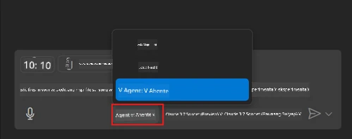
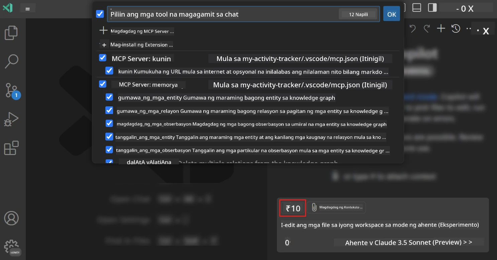
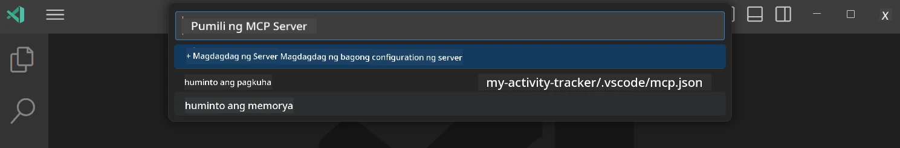
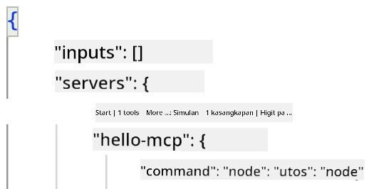
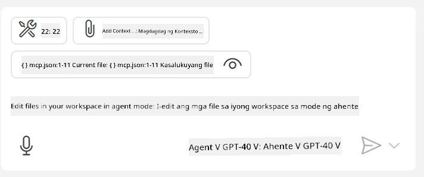
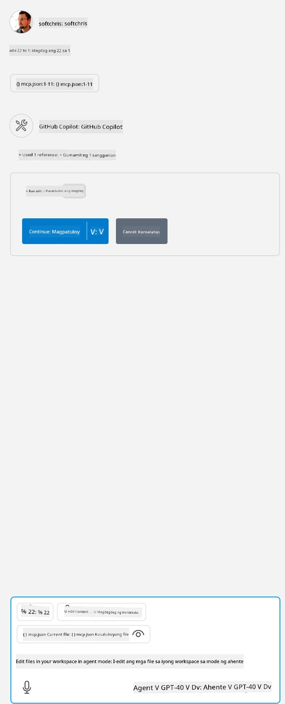

# Paggamit ng server mula sa GitHub Copilot Agent mode

Ang Visual Studio Code at GitHub Copilot ay maaaring kumilos bilang client at gumamit ng MCP Server. Bakit natin gustong gawin iyon, maaaring itanong mo? Well, ibig sabihin nito kahit anong mga feature ng MCP Server ay maaaring magamit na mula mismo sa iyong IDE. Isipin mo na nagdagdag ka ng halimbawa ng GitHub's MCP server, ito ay magpapahintulot sa pagkontrol ng GitHub gamit ang mga prompt sa halip na mag-type ng mga partikular na command sa terminal. O isipin ang kahit ano sa pangkalahatan na makakapagpa-ayos ng iyong karanasan bilang developer na kinokontrol gamit ang natural na wika. Ngayon, nakikita mo na ang benepisyo, 'di ba?

## Pangkalahatang Ideya

Tinuturo ng araling ito kung paano gamitin ang Visual Studio Code at GitHub Copilot Agent mode bilang client para sa iyong MCP Server.

## Mga Layunin ng Pagkatuto

Sa katapusan ng araling ito, magagawa mong:

- Gumamit ng MCP Server gamit ang Visual Studio Code.
- Patakbuhin ang mga kakayahan tulad ng mga tool gamit ang GitHub Copilot.
- I-configure ang Visual Studio Code para hanapin at pamahalaan ang iyong MCP Server.

## Paggamit

Maaari mong kontrolin ang iyong MCP server sa dalawang iba't ibang paraan:

- Interface ng gumagamit, makikita mo kung paano ito ginagawa mamaya sa kabanatang ito.
- Terminal, posible ring kontrolin ang mga bagay mula sa terminal gamit ang `code` executable:

  Para magdagdag ng MCP server sa iyong user profile, gamitin ang --add-mcp na command line option, at ibigay ang JSON server configuration sa anyo {\"name\":\"server-name\",\"command\":...}.

  ```
  code --add-mcp "{\"name\":\"my-server\",\"command\": \"uvx\",\"args\": [\"mcp-server-fetch\"]}"
  ```

### Mga Screenshot





Pag-usapan natin nang mas detalyado kung paano natin ginagamit ang visual interface sa mga susunod na bahagi.

## Pamamaraan

Ganito natin kailangang lapitan ito sa mataas na antas:

- I-configure ang isang file para mahanap ang ating MCP Server.
- Simulan/Kumonekta sa nasabing server para makita ang mga kakayahan nito.
- Gamitin ang mga kakayahang iyon sa pamamagitan ng GitHub Copilot Chat interface.

Magaling, ngayon na naiintindihan natin ang daloy, subukan nating gamitin ang MCP Server sa pamamagitan ng Visual Studio Code sa isang ehersisyo.

## Ehersisyo: Paggamit ng isang server

Sa ehersisyong ito, ika-configure natin ang Visual Studio Code upang mahanap ang iyong MCP server para magamit ito mula sa GitHub Copilot Chat interface.

### -0- Paunang Hakbang, i-enable ang MCP Server discovery

Maaari mong kailanganin i-enable ang discovery ng MCP Servers.

1. Pumunta sa `File -> Preferences -> Settings` sa Visual Studio Code.

1. Hanapin ang "MCP" at i-enable ang `chat.mcp.discovery.enabled` sa settings.json na file.

### -1- Gumawa ng config file

Simulan sa paggawa ng config file sa root ng iyong proyekto, kailangan mong magkaroon ng file na tinatawag na MCP.json at ilagay ito sa folder na .vscode. Dapat ganito ang hitsura:

```text
.vscode
|-- mcp.json
```

Susunod, tignan natin kung paano magdagdag ng server entry.

### -2- I-configure ang server

Idagdag ang sumusunod na nilalaman sa *mcp.json*:

```json
{
    "inputs": [],
    "servers": {
       "hello-mcp": {
           "command": "node",
           "args": [
               "build/index.js"
           ]
       }
    }
}
```

Narito ang simpleng halimbawa kung paano simulan ang isang server na nakasulat sa Node.js, para sa ibang runtime, ituro ang tamang command para simulan ang server gamit ang `command` at `args`.

### -3- Simulan ang server

Ngayon na nakapagdagdag ka na ng entry, simulan natin ang server:

1. Hanapin ang iyong entry sa *mcp.json* at tiyaking makita ang "play" icon:

    

1. I-click ang "play" icon, makikita mo ang tools icon sa GitHub Copilot Chat na dumarami ang bilang ng mga available na tools. Kung i-click ang nasabing tools icon, makikita mo ang listahan ng mga nakarehistrong tools. Maaari mong i-check/uncheck ang bawat tool depende kung gusto mong gamitin ng GitHub Copilot bilang konteksto:

  

1. Para patakbuhin ang isang tool, mag-type ng prompt na alam mong tutugma sa deskripsyon ng isa sa iyong mga tool, halimbawa isang prompt na ganito "add 22 to 1":

  

  Makikita mo ang tugon na nagsasabing 23.

## Takdang Aralin

Subukang magdagdag ng server entry sa iyong *mcp.json* file at tiyaking kaya mong simulan/itigil ang server. Tiyaking maaari ka ring makipag-ugnayan sa mga tool sa iyong server sa pamamagitan ng GitHub Copilot Chat interface.

## Solusyon

[Solusyon](./solution/README.md)

## Mga Pangunahing Natutunan

Ang mga natutunan mula sa kabanatang ito ay ang mga sumusunod:

- Ang Visual Studio Code ay isang mahusay na client na nagpapahintulot sa iyo na gamitin ang maraming MCP Servers at ang kanilang mga tool.
- Ang GitHub Copilot Chat interface ang paraan ng pakikipag-interact mo sa mga server.
- Maaari kang humingi ng inputs mula sa user tulad ng mga API key na maaaring ipasa sa MCP Server kapag kino-configure ang server entry sa *mcp.json* na file.

## Mga Halimbawa

- [Java Calculator](../samples/java/calculator/README.md)
- [.NET Calculator](../../../../03-GettingStarted/samples/csharp)
- [JavaScript Calculator](../samples/javascript/README.md)
- [TypeScript Calculator](../samples/typescript/README.md)
- [Python Calculator](../../../../03-GettingStarted/samples/python)

## Karagdagang Mga Mapagkukunan

- [Visual Studio docs](https://code.visualstudio.com/docs/copilot/chat/mcp-servers)

## Ano Ang Susunod

- Susunod: [Paglikha ng stdio Server](../05-stdio-server/README.md)

---

<!-- CO-OP TRANSLATOR DISCLAIMER START -->
**Pagtatanggi**:
Ang dokumentong ito ay isinalin gamit ang serbisyo ng AI translation na [Co-op Translator](https://github.com/Azure/co-op-translator). Bagama't nagsusumikap kami para sa katumpakan, pakatandaan na ang awtomatikong pagsasalin ay maaaring maglaman ng mga pagkakamali o hindi pagkakatugma. Ang orihinal na dokumento sa orihinal nitong wika ang dapat ituring na pangunahing sanggunian. Para sa mahahalagang impormasyon, inirerekomenda ang propesyonal na pagsasalin ng tao. Hindi kami mananagot sa anumang maling pagkakaintindi o maling interpretasyon na nagmula sa paggamit ng pagsasaling ito.
<!-- CO-OP TRANSLATOR DISCLAIMER END -->