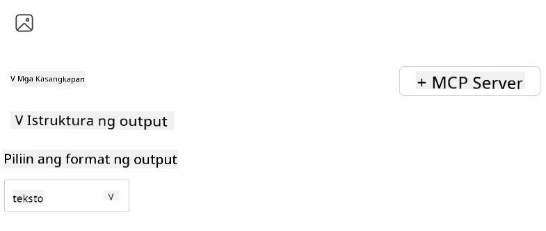
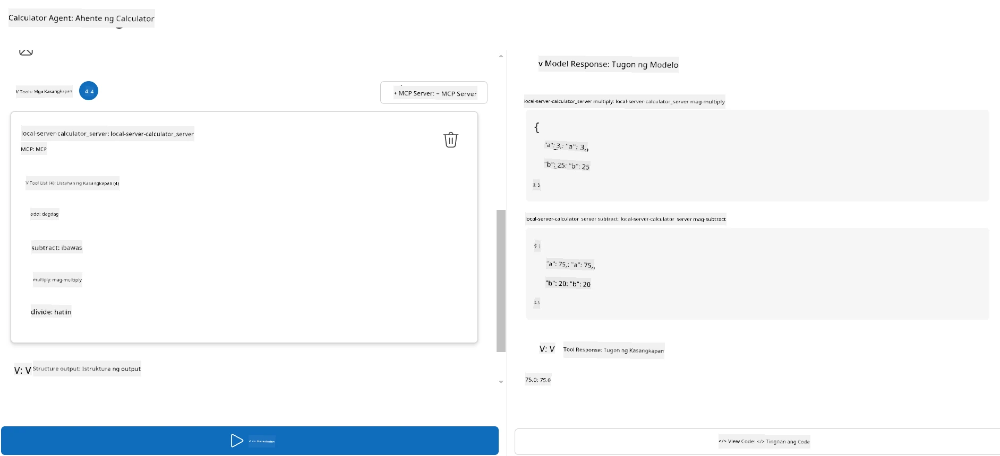

# Pagsasagawa ng server gamit ang Microsoft Foundry Toolkit para sa Visual Studio Code

Kapag bumubuo ka ng isang AI agent, hindi lang ito tungkol sa paggawa ng matatalinong sagot; ito rin ay tungkol sa pagbibigay kakayahan sa iyong agent na kumilos. Dito pumapasok ang Model Context Protocol (MCP). Pinapadali ng MCP para sa mga agent na ma-access ang mga panlabas na tools at serbisyo sa isang pare-parehong paraan. Isipin mo ito na parang isang toolbox na talagang magagamit ng iyong agent.

Halimbawa, kung ikokonekta mo ang isang agent sa iyong calculator MCP server. Biglang makakagawa ang iyong agent ng mga operasyon sa matematika sa pamamagitan lamang ng pagtanggap ng prompt tulad ng “Ano ang 47 times 89?”—hindi na kailangan pang mag-hardcode ng logic o gumawa ng custom na APIs.

## Pangkalahatang-ideya

Saklaw ng araling ito kung paano ikonekta ang isang calculator MCP server sa isang agent gamit ang
[Microsoft Foundry Toolkit para sa Visual Studio Code](https://aka.ms/AIToolkit),
na nagbibigay-daan sa iyong agent na magsagawa ng mga operasyon sa matematika sa pamamagitan ng natural na wika.

Pinapadali ng Microsoft Foundry Toolkit ang pagpapaunlad at pagsubok ng mga generative
AI application gamit ang local at cloud-hosted na mga modelo.

*Tandaan*: Sinusuportahan ng Toolkit sa kasalukuyan ang Python at TypeScript MCP template.

## Mga Layunin ng Pagkatuto

Sa pagtatapos ng araling ito, magagawa mong:

- Gumamit ng MCP server gamit ang Microsoft Foundry Toolkit.
- I-configure ang agent configuration upang payagan itong matagpuan at magamit ang mga tools na ibinibigay ng MCP server.
- Gamitin ang mga MCP tools sa pamamagitan ng natural na wika.

## Paraan

Ganito natin kailangang lapitan ito sa mataas na antas:

- Gumawa ng agent at tukuyin ang system prompt nito.
- Gumawa ng MCP server na may calculator tools.
- Ikonekta ang Agent Builder sa MCP server.
- Subukan ang tool invocation ng agent gamit ang natural na wika.

Maganda, ngayon na nauunawaan natin ang daloy, i-configure natin ang AI agent na gamitin ang mga panlabas na tool sa pamamagitan ng MCP, upang mapalawak ang mga kakayahan nito!

## Mga Kinakailangan

- [Visual Studio Code](https://code.visualstudio.com/)
- [Microsoft Foundry Toolkit para sa Visual Studio Code](https://aka.ms/AIToolkit)

## Ehersisyo: Pagsasagawa ng server

> [!WARNING]
> Paalala para sa mga macOS Users. Kasalukuyan naming iniimbestigahan ang isang isyu na nakakaapekto sa pag-install ng dependency sa macOS. Dahil dito, hindi muna makakumpleto ng mga gumagamit ng macOS ang tutorial na ito sa ngayon. Aayusin namin ang mga tagubilin sa oras na may solusyon na. Salamat sa inyong pagtitiis at pag-unawa!

Sa ehersisyong ito, bubuuin, patatakbuhin, at pagagandahin mo ang isang AI agent gamit ang mga tools mula sa
isang MCP server sa loob ng Visual Studio Code gamit ang Microsoft Foundry Toolkit.

### -0- Paunang hakbang, magdagdag ng Microsoft Foundry GPT-5.1 deployment

Gumawa ng isang Microsoft Foundry resource, i-deploy ang **GPT-5.1**, at idagdag ang deployment
sa **My Models**. Suriin ang
[model retirement schedule](https://learn.microsoft.com/azure/foundry/openai/concepts/model-retirement-schedule)
sa pagpili ng deployment.

1. Buksan ang **Microsoft Foundry Toolkit** mula sa **Activity Bar**.
1. Sa seksyong **Catalog**, piliin ang **Models** upang buksan ang **Model Catalog**. Ang pagpili ng **Models** ay magbubukas ng **Model Catalog** sa bagong editor tab.
1. Ikonekta ang iyong Microsoft Foundry project at piliin ang iyong **GPT-5.1** deployment.
1. I-click ang **+ Add** upang idagdag ang deployment sa iyong listahan ng **My Models**.
1. Sa **Activity Bar**, kumpirmahin na lumalabas ang deployment sa listahan.

### -1- Gumawa ng agent

Pinapahintulutan ka ng **Agent (Prompt) Builder** na gumawa at i-customize ang sarili mong AI-powered agents. Sa seksyong ito, gagawa ka ng bagong agent at mag-aassign ng modelo upang mapatatakbo ang pakikipag-usap.

1. Buksan ang **Microsoft Foundry Toolkit** mula sa **Activity Bar**.
1. Sa seksyong **Tools**, piliin ang **Agent (Prompt) Builder**. Ang pagpili ng **Agent (Prompt) Builder** ay magbubukas nito sa bagong editor tab.
1. I-click ang button na **+ New Agent**. Ilulunsad ng extension ang setup wizard mula sa **Command Palette**.
1. Ipasok ang pangalan na **Calculator Agent** at pindutin ang **Enter**.
1. Sa **Agent (Prompt) Builder**, piliin ang iyong **GPT-5.1** Foundry deployment.

### -2- Gumawa ng system prompt para sa agent

Ngayong na-scaffold mo na ang agent, panahon na upang tukuyin ang kanyang personalidad at layunin. Sa seksyong ito, gagamitin mo ang feature na **Generate system prompt** upang ilarawan ang inaasahang ugali ng agent—sa kasong ito, isang calculator agent—at papasulat nito ang system prompt para sa iyo.

1. Sa seksyong **Prompts**, i-click ang button na **Generate system prompt**. Ang button na ito ay magbubukas sa prompt builder na gumagamit ng AI upang gumawa ng system prompt para sa agent.
1. Sa bintana ng **Generate a prompt**, ipasok ang sumusunod: `You are a helpful and efficient math assistant. When given a problem involving basic arithmetic, you respond with the correct result.`
1. I-click ang button na **Generate**. Magpapakita ang notification sa ibabang-kanang sulok na nagpapatunay na ginagawa ang system prompt. Kapag natapos na ang paggawa ng prompt, lilitaw ito sa field na **System prompt** ng **Agent (Prompt) Builder**.
1. Suriin ang **System prompt** at baguhin kung kinakailangan.

### -3- Gumawa ng MCP server

Ngayong natukoy mo na ang system prompt ng iyong agent—na gumagabay sa kanyang ugali at sagot—panahon na upang lagyan ang agent ng kapaki-pakinabang na mga kakayahan. Sa seksyong ito, gagawa ka ng calculator MCP server na may mga tools upang magsagawa ng addition, subtraction, multiplication, at division. Papayagan ng server na ito ang iyong agent na magsagawa ng mga operasyong matematika nang real-time bilang tugon sa mga natural na salitang prompt.



Kasama sa Microsoft Foundry Toolkit ang mga template para gumawa ng mga MCP server. Gagamitin natin ang Python template para sa calculator MCP server.


1. Piliin ang **+ Add Server**.
1. Piliin ang **Create a New MCP Server**.
1. Piliin ang template na **python-weather**.
1. Piliin ang **Default folder** upang i-save ang MCP server template.
1. Ipasok ang sumusunod na pangalan para sa server: **Calculator**
1. Magbubukas ang bagong window ng Visual Studio Code. Piliin ang **Yes, I trust the authors**.
1. Gamit ang terminal (**Terminal** > **New Terminal**), gumawa ng virtual environment: `python -m venv .venv`
1. Gamit ang terminal, i-activate ang virtual environment:
    1. Windows - `.venv\Scripts\activate`
    1. macOS/Linux - `source .venv/bin/activate`
1. Gamit ang terminal, i-install ang mga dependencies: `pip install -e .[dev]`
1. Sa **Explorer** view ng **Activity Bar**, palawakin ang direktoryo ng **src** at piliin ang **server.py** upang buksan ang file sa editor.
1. Palitan ang code sa file na **server.py** ng sumusunod at i-save:


    ```python
    """
    Sample MCP Calculator Server implementation in Python.

    
    This module demonstrates how to create a simple MCP server with calculator tools
    that can perform basic arithmetic operations (add, subtract, multiply, divide).
    """
    
    from mcp.server.fastmcp import FastMCP
    
    server = FastMCP("calculator")
    
    @server.tool()
    def add(a: float, b: float) -> float:
        """Add two numbers together and return the result."""
        return a + b
    
    @server.tool()
    def subtract(a: float, b: float) -> float:
        """Subtract b from a and return the result."""
        return a - b
    
    @server.tool()
    def multiply(a: float, b: float) -> float:
        """Multiply two numbers together and return the result."""
        return a * b
    
    @server.tool()
    def divide(a: float, b: float) -> float:
        """
        Divide a by b and return the result.
        
        Raises:
            ValueError: If b is zero
        """
        if b == 0:
            raise ValueError("Cannot divide by zero")
        return a / b
    ```

### -4- Patakbuhin ang ahente gamit ang calculator MCP server

Ngayon na may mga tool na ang iyong ahente, panahon na upang gamitin ang mga ito! Sa seksyong ito, magbibigay ka ng mga prompt sa ahente upang subukan at beripikahin kung ginagamit ng ahente ang angkop na tool mula sa calculator MCP server.



Patakbuhin mo ang calculator MCP server sa iyong lokal na makina sa pag-develop gamit ang **Agent Builder** bilang MCP client.

1. Pindutin ang `F5` para simulan ang pag-debug ng MCP server. Magbubukas ang **Agent (Prompt) Builder** sa bagong tab ng editor. Makikita ang status ng server sa terminal.
1. Sa **User prompt** na patlang ng **Agent (Prompt) Builder**, ilagay ang sumusunod na prompt: `I bought 3 items priced at $25 each, and then used a $20 discount. How much did I pay?`
1. I-click ang **Run** na button upang makabuo ng tugon ng ahente.
1. Suriin ang output ng ahente. Dapat matukoy ng modelo na ikaw ay nagbayad ng **$55**.
1. Narito ang paghahati-hati ng mga dapat mangyari:
    - Pinipili ng ahente ang mga tool na **multiply** at **subtract** upang makatulong sa kalkulasyon.
    - Ang nararapat na mga halaga ng `a` at `b` ay itinalaga para sa tool na **multiply**.
    - Ang nararapat na mga halaga ng `a` at `b` ay itinalaga para sa tool na **subtract**.
    - Ang tugon mula sa bawat tool ay ibinibigay sa kani-kanilang **Tool Response**.
    - Ang panghuling output mula sa modelo ay ibinibigay sa panghuling **Model Response**.
1. Magbigay ng karagdagang mga prompt upang lalo pang subukan ang ahente. Maaari mong baguhin ang umiiral na prompt sa patlang na **User prompt** sa pamamagitan ng pag-click sa patlang at pagpapalit ng umiiral na prompt.
1. Kapag natapos ka nang subukan ang ahente, maaari mong itigil ang server sa pamamagitan ng **terminal** sa pagpasok ng **CTRL/CMD+C** upang lumabas.

## Takdang-Aralin

Subukang magdagdag ng karagdagang entry na tool sa iyong **server.py** file (hal: magbalik ng square root ng isang numero). Mag-submit ng karagdagang mga prompt na mangangailangan ang ahente na gamitin ang iyong bagong tool (o mga umiiral na tool). Siguraduhing i-restart ang server upang ma-load ang mga bagong idinagdag na tool.

## Solusyon

[Solusyon](./solution/README.md)

## Pangunahing Mga Aral

Ang mga pangunahing aral mula sa kabanatang ito ay:

- Maaaring gamitin ng Microsoft Foundry Toolkit ang mga MCP server at ang kanilang mga tool.
- Maaari kang magdagdag ng mga bagong tool sa mga MCP server, pinalalawak ang kakayahan ng ahente upang matugunan ang mga nagbabagong pangangailangan.
- Kasama sa Microsoft Foundry Toolkit ang mga template ng MCP server para sa paggawa ng mga custom na tool.

## Karagdagang mga Mapagkukunan

- [Dokumentasyon ng Microsoft Foundry Toolkit](https://aka.ms/AIToolkit/doc)

## Ano ang Susunod
- Susunod: [Pagsusuri at Pag-debug](../08-testing/README.md)

---

<!-- CO-OP TRANSLATOR DISCLAIMER START -->
**Pagtatanggi**:
Ang dokumentong ito ay isinalin gamit ang serbisyo ng AI translation na [Co-op Translator](https://github.com/Azure/co-op-translator). Bagama't nagsusumikap kami para sa katumpakan, pakatandaan na ang awtomatikong pagsasalin ay maaaring maglaman ng mga pagkakamali o hindi pagkakatugma. Ang orihinal na dokumento sa orihinal nitong wika ang dapat ituring na pangunahing sanggunian. Para sa mahahalagang impormasyon, inirerekomenda ang propesyonal na pagsasalin ng tao. Hindi kami mananagot sa anumang maling pagkakaintindi o maling interpretasyon na nagmula sa paggamit ng pagsasaling ito.
<!-- CO-OP TRANSLATOR DISCLAIMER END -->