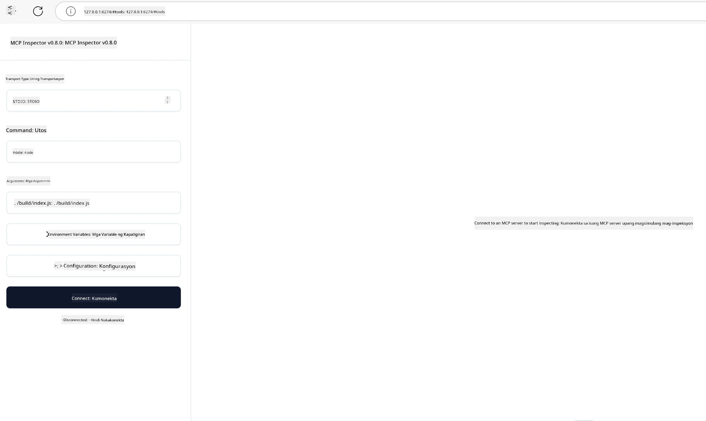

## Pagsusuri at Pag-debug

Bago ka magsimulang magsuri ng iyong MCP server, mahalagang maunawaan ang mga magagamit na kasangkapan at pinakamahusay na mga gawi para sa pag-debug. Ang epektibong pagsusuri ay nagtutiyak na kumikilos ang iyong server ayon sa inaasahan at tumutulong sa iyo na mabilis na matukoy at malutas ang mga isyu. Ang sumusunod na seksyon ay naglalarawan ng mga rekomendadong pamamaraan para sa pag-validate ng iyong MCP na implementasyon.

## Pangkalahatang-ideya

Tinatalakay ng araling ito kung paano pumili ng tamang pamamaraan sa pagsusuri at ang pinakaepektibong kagamitang pampagsubok.

## Mga Layuning Pang-pagkatuto

Sa pagtatapos ng araling ito, magagawa mong:

- Ilahad ang iba't ibang pamamaraan sa pagsusuri.
- Gumamit ng iba't ibang mga kasangkapan upang epektibong subukan ang iyong code.


## Pagsusuri ng MCP Servers

Nagbibigay ang MCP ng mga kasangkapan upang matulungan kang magsuri at mag-debug ng iyong mga server:

- **MCP Inspector**: Isang command line tool na maaaring patakbuhin bilang CLI tool at bilang isang visual tool.
- **Manwal na pagsusuri**: Maaari kang gumamit ng kasangkapan tulad ng curl upang magsagawa ng mga kahilingan sa web, ngunit anumang kasangkapang kayang magpatakbo ng HTTP ay maaari.
- **Unit testing**: Posibleng gamitin ang iyong paboritong testing framework para subukan ang mga tampok ng parehong server at client.

### Paggamit ng MCP Inspector

Naipaliwanag na namin ang paggamit ng kasangkapang ito sa mga nakaraang aralin ngunit pag-usapan natin ito nang bahagya sa mataas na antas. Ito ay isang kasangkapang ginawa sa Node.js at maaari mo itong gamitin sa pamamagitan ng pagtawag sa executable na `npx` na awtomatikong magda-download at mag-i-install ng kasangkapan nang pansamantala at lilinisin ang sarili kapag natapos na nitong patakbuhin ang iyong kahilingan.

Tinutulungan ka ng [MCP Inspector](https://github.com/modelcontextprotocol/inspector) na:

- **Tuklasin ang Mga Kakayahan ng Server**: Awtomatikong tuklasin ang magagamit na mga resources, tools, at prompts
- **Subukan ang Pagsasagawa ng Kasangkapan**: Subukan ang iba't ibang mga parameter at tingnan ang mga tugon nang real-time
- **Tingnan ang Metadata ng Server**: Suriin ang impormasyon ng server, mga schema, at mga configuration

Ganito ang karaniwang takbo ng kasangkapan:

```bash
npx @modelcontextprotocol/inspector node build/index.js
```

Ang utos sa itaas ay nagsisimula ng isang MCP at ang visual interface nito at nagpapalunsad ng lokal na web interface sa iyong browser. Maaari mong asahan ang isang dashboard na nagpapakita ng iyong naka-rehistrong MCP servers, ang kanilang magagamit na mga kasangkapan, resources, at mga prompt. Pinapayagan ka ng interface na ito na interaktibong subukan ang pagsasagawa ng kasangkapan, siyasatin ang metadata ng server, at tingnan ang mga tugon nang real-time, na nagpapadali sa pag-validate at pag-debug ng iyong mga MCP server na implementasyon.

Ganito ang maaaring hitsura nito: 

Maaari mo ring patakbuhin ang kasangkapang ito sa CLI mode kung saan idaragdag mo ang `--cli` na katangian. Narito ang halimbawa ng pagpapatakbo ng kasangkapan sa "CLI" mode na naglilista ng lahat ng mga kasangkapan sa server:

```sh
npx @modelcontextprotocol/inspector --cli node build/index.js --method tools/list
```

### Manwal na Pagsusuri

Bukod sa pagpapatakbo ng inspector tool upang subukan ang mga kakayahan ng server, isa pang kahalintulad na pamamaraan ay ang pagpapatakbo ng isang kliyente na kayang gumamit ng HTTP tulad ng curl.

Sa curl, maaari mong direktang subukan ang MCP servers gamit ang mga HTTP request:

```bash
# Example: Test server metadata
curl http://localhost:3000/v1/metadata

# Example: Execute a tool
curl -X POST http://localhost:3000/v1/tools/execute \
  -H "Content-Type: application/json" \
  -d '{"name": "calculator", "parameters": {"expression": "2+2"}}'
```

Tulad ng makikita mula sa paggamit ng curl sa itaas, gumagamit ka ng POST request upang tawagin ang isang kasangkapan gamit ang payload na binubuo ng pangalan ng kasangkapan at mga parameter nito. Gamitin ang pamamaraan na pinakaangkop sa iyo. Karaniwang mas mabilis gamitin ang CLI tools at nagbibigay-daan itong maiskript, na maaaring maging kapaki-pakinabang sa isang CI/CD na kapaligiran.

### Unit Testing

Gumawa ng mga unit test para sa iyong mga kasangkapan at resources upang matiyak na gumagana ang mga ito ayon sa inaasahan. Narito ang ilang halimbawa ng testing code.

```python
import pytest

from mcp.server.fastmcp import FastMCP
from mcp.shared.memory import (
    create_connected_server_and_client_session as create_session,
)

# Mark the whole module for async tests
pytestmark = pytest.mark.anyio


async def test_list_tools_cursor_parameter():
    """Test that the cursor parameter is accepted for list_tools.

    Note: FastMCP doesn't currently implement pagination, so this test
    only verifies that the cursor parameter is accepted by the client.
    """

 server = FastMCP("test")

    # Create a couple of test tools
    @server.tool(name="test_tool_1")
    async def test_tool_1() -> str:
        """First test tool"""
        return "Result 1"

    @server.tool(name="test_tool_2")
    async def test_tool_2() -> str:
        """Second test tool"""
        return "Result 2"

    async with create_session(server._mcp_server) as client_session:
        # Test without cursor parameter (omitted)
        result1 = await client_session.list_tools()
        assert len(result1.tools) == 2

        # Test with cursor=None
        result2 = await client_session.list_tools(cursor=None)
        assert len(result2.tools) == 2

        # Test with cursor as string
        result3 = await client_session.list_tools(cursor="some_cursor_value")
        assert len(result3.tools) == 2

        # Test with empty string cursor
        result4 = await client_session.list_tools(cursor="")
        assert len(result4.tools) == 2
    
```

Ang naunang code ay gumagawa ng mga sumusunod:

- Ginagamit ang pytest framework na nagpapahintulot sa iyo na gumawa ng mga pagsusuri bilang mga function at gumamit ng mga pahayag na assert.
- Gumagawa ng isang MCP Server na may dalawang magkaibang mga kasangkapan.
- Gumagamit ng `assert` na pahayag upang suriin na natutupad ang ilang mga kundisyon.

Tumingin sa [buong file dito](https://github.com/modelcontextprotocol/python-sdk/blob/main/tests/client/test_list_methods_cursor.py)

Batay sa file sa itaas, maaari mong subukan ang iyong sariling server upang matiyak na nalilikha ang mga kakayahan ayon sa nararapat.

Lahat ng pangunahing SDK ay may katulad na mga seksyon sa pagsusuri kaya maaari mong iakma ito sa iyong napiling runtime.

## Mga Halimbawa

- [Java Calculator](../samples/java/calculator/README.md)
- [.NET Calculator](../../../../03-GettingStarted/samples/csharp)
- [JavaScript Calculator](../samples/javascript/README.md)
- [TypeScript Calculator](../samples/typescript/README.md)
- [Python Calculator](../../../../03-GettingStarted/samples/python) 

## Karagdagang Mga Mapagkukunan

- [Python SDK](https://github.com/modelcontextprotocol/python-sdk)

## Ano Ang Susunod

- Susunod: [Deployment](../09-deployment/README.md)

---

<!-- CO-OP TRANSLATOR DISCLAIMER START -->
**Pagtatanggi**:
Ang dokumentong ito ay isinalin gamit ang serbisyo ng AI translation na [Co-op Translator](https://github.com/Azure/co-op-translator). Bagama't nagsusumikap kami para sa katumpakan, pakatandaan na ang awtomatikong pagsasalin ay maaaring maglaman ng mga pagkakamali o hindi pagkakatugma. Ang orihinal na dokumento sa orihinal nitong wika ang dapat ituring na pangunahing sanggunian. Para sa mahahalagang impormasyon, inirerekomenda ang propesyonal na pagsasalin ng tao. Hindi kami mananagot sa anumang maling pagkakaintindi o maling interpretasyon na nagmula sa paggamit ng pagsasaling ito.
<!-- CO-OP TRANSLATOR DISCLAIMER END -->