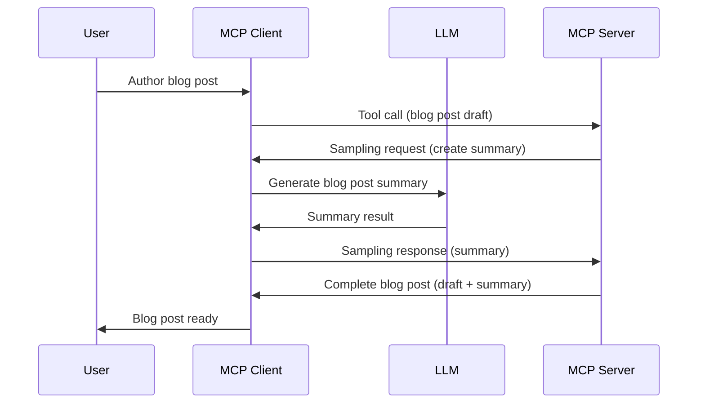

> [!WARNING]
> Ang Sampling ay hindi na ginagamit sa MCP `2026-07-28`. Ang araling ito ay pinananatili para sa
> mga lumang implementasyon. Ang mga bagong server ay dapat direktang kumonekta sa isang LLM
> provider API.

# Sampling - ipasa ang mga tampok sa Client

> Ang Sampling ay nananatili sa `2026-07-28` na espesipikasyon para sa pagiging compatible at maaaring
> tanggalin sa unang rebisyon na lalabas pagkatapos o sa Hulyo 28,
> 2027. Ang mga halimbawa sa araling ito ay maaaring gumamit ng mga SDK API na nagpapatupad ng `2025-11-25`.
> Tingnan ang [Ano ang Nagbago sa MCP: Ang 2026-07-28 na Espesipikasyon](../../01-CoreConcepts/mcp-2026-07-28.md).

Sa mga lumang implementasyon, pinapahintulutan ng Sampling ang MCP server na humingi ng tulong mula sa isang LLM
na pinamamahalaan ng client. Para sa mga bagong implementasyon, tawagan direkta ang napiling LLM provider
.

Tuklasin natin ang ilang mga kaso ng paggamit at kung paano bumuo ng solusyon na may kinalaman sa sampling.

## Pangkalahatang-ideya

Sa araling ito, tututukan natin kung kailan at saan gagamitin ang Sampling at kung paano ito i-configure.

## Mga Layunin sa Pagkatuto

Sa kabanatang ito, gagawin natin ang mga sumusunod:

- Ipaliwanag kung ano ang Sampling at kailan ito gagamitin.
- Ipakita kung paano i-configure ang Sampling sa MCP.
- Magbigay ng mga halimbawa ng Sampling sa aksyon.

## Ano ang Sampling at bakit ito gagamitin?

Ang Sampling ay isang advanced na tampok na gumagana sa ganitong paraan:



### Kahilingan sa Sampling

Ok, ngayon mayroon na tayong pangkalahatang ideya ng isang kapanipaniwalang senaryo, pag-usapan naman natin ang sampling request na ipinapadala ng server pabalik sa client. Ganito ang hitsura ng ganitong request sa JSON-RPC na pormat:

```json
{
  "jsonrpc": "2.0",
  "id": 1,
  "method": "sampling/createMessage",
  "params": {
    "messages": [
      {
        "role": "user",
        "content": {
          "type": "text",
          "text": "Create a blog post summary of the following blog post: <BLOG POST>"
        }
      }
    ],
    "modelPreferences": {
      "hints": [
        {
          "name": "gpt-5.1"
        }
      ],
      "intelligencePriority": 0.8,
      "speedPriority": 0.5
    },
    "systemPrompt": "You are a helpful assistant.",
    "maxTokens": 100
  }
}
```

May ilang bagay dito na karapat-dapat banggitin:

- Ang Prompt, sa ilalim ng content -> text, ay ang prompt natin na isang tagubilin para sa LLM na buodin ang nilalaman ng blog post.

- **modelPreferences**. Ito ay isang bahagi na naglalaman ng kagustuhan, isang rekomendasyon kung anong konfigurasyon ang gagamitin sa LLM. Maaaring piliin ng user na sundin ang mga rekomendasyong ito o baguhin ito. Sa kasong ito, may mga rekomendasyon tungkol sa modelong gagamitin at prayoridad sa bilis at talino.
- **systemPrompt**, ito ang karaniwan mong system prompt na nagbibigay personalidad sa iyong LLM at naglalaman ng mga gabay na tagubilin.
- **maxTokens**, ito ay isa pang property na nagsasabi kung ilang token ang nirekomenda na gamitin para sa task na ito.

### Tugon mula sa Sampling

Ang tugong ito ang ipapadala ng MCP Client pabalik sa MCP Server at resulta ito ng pagtawag ng client sa LLM, paghihintay sa tugon, at pagkatapos ay pagbubuo ng mensaheng ito. Ganito ang maaari itong makita sa JSON-RPC:

```json
{
  "jsonrpc": "2.0",
  "id": 1,
  "result": {
    "role": "assistant",
    "content": {
      "type": "text",
      "text": "Here's your abstract <ABSTRACT>"
    },
    "model": "gpt-5.1",
    "stopReason": "endTurn"
  }
}
```

Ang tugon ay isang buod ng blog post na ayon sa kahilingan. Pinili ng client
ang aktibong `gpt-5.1` deployment mula sa model preference ng server;
ang mga model preferences ay mga rekomendasyon, kaya maaaring pumili ang client ng ibang aktibong
deployment kung kinakailangan.

Ok, ngayon na nauunawaan natin ang pangunahing daloy at isang kapaki-pakinabang na gawain para dito na "paglikha ng blog post + buod", tingnan natin kung ano ang kailangang gawin para gumana ito.

### Mga uri ng mensahe

Ang mga mensahe ng Sampling ay hindi limitado sa teksto lamang kundi maaari ring magpadala ng mga larawan at audio. Ganito ang pagkakaiba ng hitsura ng JSON-RPC:

**Teksto**

```json
{
  "type": "text",
  "text": "The message content"
}
```

**Nilalaman ng larawan**

```json
{
  "type": "image",
  "data": "base64-encoded-image-data",
  "mimeType": "image/jpeg"
}
```

**Nilalaman ng audio**

```json
{
  "type": "audio",
  "data": "base64-encoded-audio-data",
  "mimeType": "audio/wav"
}
```

> NOTE: Para sa kasalukuyang estado at gabay sa paglipat, tingnan ang
> [deprecated Sampling documentation](https://modelcontextprotocol.io/specification/2026-07-28/client/sampling).

## Paano I-configure ang Sampling sa Client

> Paalala: kung server lang ang iyong ginagawa, hindi mo kailangan gumawa ng marami dito.

Sa isang client, kailangan mong tukuyin ang sumusunod na tampok ganito:

```json
{
  "capabilities": {
    "sampling": {}
  }
}
```

Ito ay makikilala kapag inisyalisa ang pinili mong client sa server.

## Halimbawa ng Sampling sa Aksyon - Gumawa ng Blog Post

Gawa tayo ng sampling server nang magkasama, kailangan nating gawin ang mga sumusunod:

1. Gumawa ng isang tool sa Server.
1. Ang tool ay dapat gumawa ng sampling request.
1. Maghintay ang tool ng tugon sa sampling request ng client.
1. Pagkatapos ay iproseso ang resulta ng tool.

Tingnan natin ang kodigo hakbang-hakbang:

### -1- Gumawa ng tool

**python**

```python
@mcp.tool()
async def create_blog(title: str, content: str, ctx: Context[ServerSession, None]) -> str:
    """Create a blog post and generate a summary"""

```

### -2- Gumawa ng sampling request

Palawakin ang tool mo gamit ang sumusunod na kodigo:

**python**

```python
post = BlogPost(
        id=len(posts) + 1,
        title=title,
        content=content,
        abstract=""
    )

prompt = f"Create an abstract of the following blog post: title: {title} and draft: {content} "

result = await ctx.session.create_message(
        messages=[
            SamplingMessage(
                role="user",
                content=TextContent(type="text", text=prompt),
            )
        ],
        max_tokens=100,
)

```

### -3- Maghintay sa tugon at ibalik ang tugon

**python**

```python
post.abstract = result.content.text

posts.append(post)

# return the complete product
return json.dumps({
    "id": post.title,
    "abstract": post.abstract
})
```

### -4- Kumpletong kodigo

**python**

```python
from starlette.applications import Starlette
from starlette.routing import Mount, Host

from mcp.server.fastmcp import Context, FastMCP

from mcp.server.session import ServerSession
from mcp.types import SamplingMessage, TextContent

import json


from uuid import uuid4
from typing import List
from pydantic import BaseModel


mcp = FastMCP("Blog post generator")

# app = FastAPI()

posts = []

class BlogPost(BaseModel):
    id: int
    title: str
    content: str
    abstract: str

posts: List[BlogPost] = []

@mcp.tool()
async def create_blog(title: str, content: str, ctx: Context[ServerSession, None]) -> str:
    """Create a blog post and generate a summary"""

    post = BlogPost(
        id=len(posts) + 1,
        title=title,
        content=content,
        abstract=""
    )

    prompt = f"Create an abstract of the following blog post: title: {title} and draft: {content} "

    result = await ctx.session.create_message(
        messages=[
            SamplingMessage(
                role="user",
                content=TextContent(type="text", text=prompt),
            )
        ],
        max_tokens=100,
    )

    post.abstract = result.content.text

    posts.append(post)

    # return the complete blog post
    return json.dumps({
        "id": post.title,
        "abstract": post.abstract
    })

if __name__ == "__main__":
    print("Starting server...")
    # mcp.run()
    mcp.run(transport="streamable-http")

# run app with: python server.py
```

### -5- Pagsubok nito sa Visual Studio Code

Para subukan ito sa Visual Studio Code, gawin ang mga sumusunod:

1. Simulan ang server sa terminal
1. Idagdag ito sa *mcp.json* (at siguraduhing ito ay naka-start) halimbawang ganito:

   ```json
   "servers": {
      "blog-server": {
        "type": "http",
        "url": "http://localhost:8000/mcp"
      }
   }
   ```

1. Mag-type ng prompt:

   ```text
   create a blog post named "Where Python comes from", the content is "Python is actually named after Monty Python Flying Circus"
   ```

1. Payagan ang sampling na maganap. Sa unang pagsubok, ipapakita sa iyo ang isang dagdag na dialog na kailangan mong tanggapin, pagkatapos ay makikita mo ang normal na dialog na nagtatanong kung nais mong patakbuhin ang isang tool.

1. Suriin ang mga resulta. Makikita mo ang mga resulta nang maayos na naipakita sa GitHub Copilot Chat at maaari mo ring suriin ang raw JSON na tugon.

**Bonus**. May mahusay na suporta sa Visual Studio Code tooling para sa sampling. Maaari mong i-configure ang Sampling access sa iyong naka-install na server sa pamamagitan ng pag-navigate dito nang ganito:

1. Pumunta sa extension section.
1. Piliin ang cog icon para sa iyong naka-install na server sa seksyong "MCP SERVERS - INSTALLED".
1 Piliin ang "Configure Model Access", dito maaari mong piliin kung aling mga Modelo ang pinapayagan ng GitHub Copilot na gamitin kapag nagsasagawa ng sampling. Maaari mo ring makita lahat ng sampling requests na nangyari kamakailan sa pamamagitan ng pagpili ng "Show Sampling requests".

## Tungkulin

Sa tungkuling ito, gagawa ka ng bahagyang ibang Sampling, isang sampling integration na sumusuporta sa pagbuo ng paglalarawan ng produkto. Narito ang iyong senaryo:

**Senaryo**: Ang back office worker sa isang e-commerce ay nangangailangan ng tulong, matagal nang proseso ang paggawa ng mga paglalarawan ng produkto. Kaya, gagawa ka ng solusyon kung saan maaari kang tumawag ng tool na "create_product" na may mga argumento na "title" at "keywords" at ito ay dapat bumuo ng kumpletong produkto kabilang ang patlang na "description" na dapat punan ng LLM ng client.

TIP: gamitin ang mga natutunan mo nang dati upang buuin ang server na ito at ang tool nito gamit ang sampling request.

## Solusyon

[Solusyon](./solution/README.md)

## Mga Pangunahing Punto

Ang Sampling ay isang makapangyarihang tampok na nagpapahintulot sa server na ipasa ang mga gawain sa client kapag kailangan nito ng tulong mula sa LLM.

## Ano ang Susunod

- [Kabanata 4 - Praktikal na Pagpapatupad](../../04-PracticalImplementation/README.md)

---

<!-- CO-OP TRANSLATOR DISCLAIMER START -->
**Pagtatanggi**:
Ang dokumentong ito ay isinalin gamit ang serbisyo ng AI translation na [Co-op Translator](https://github.com/Azure/co-op-translator). Bagama't nagsusumikap kami para sa katumpakan, pakatandaan na ang awtomatikong pagsasalin ay maaaring maglaman ng mga pagkakamali o hindi pagkakatugma. Ang orihinal na dokumento sa orihinal nitong wika ang dapat ituring na pangunahing sanggunian. Para sa mahahalagang impormasyon, inirerekomenda ang propesyonal na pagsasalin ng tao. Hindi kami mananagot sa anumang maling pagkakaintindi o maling interpretasyon na nagmula sa paggamit ng pagsasaling ito.
<!-- CO-OP TRANSLATOR DISCLAIMER END -->