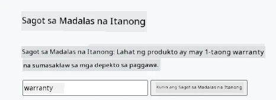
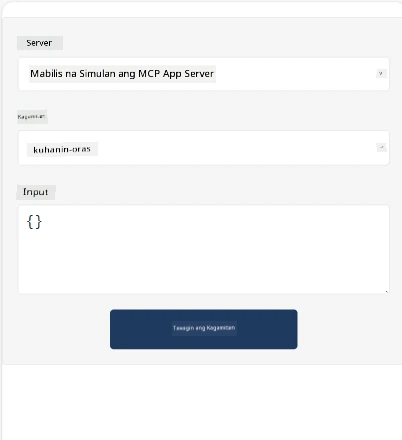
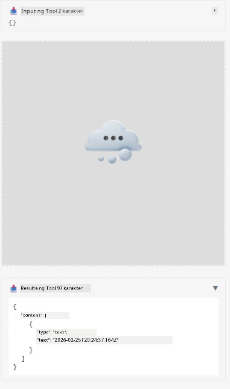

Narito ang isang halimbawa na nagpapakita ng MCP App

## I-install 

1. Pumunta sa folder na *mcp-app*
1. Patakbuhin ang `npm install`, ito ay mag-iinstall ng frontend at backend dependencies

Tiyaking nagko-compile ang backend sa pamamagitan ng pagpapatakbo ng:

```sh
npx tsc --noEmit
```

Walang lalabas na output kung maayos ang lahat.

## Patakbuhin ang backend

> Kailangan ng kaunting dagdag na pagsisikap kung ikaw ay nasa Windows machine dahil ang solusyon ng MCP Apps ay gumagamit ng `concurrently` library para tumakbo na kailangan mong maghanap ng kapalit. Narito ang linya na may problema sa *package.json* sa MCP App:

```json
"start": "concurrently \"cross-env NODE_ENV=development INPUT=mcp-app.html vite build --watch\" \"tsx watch main.ts\""
```

Ang app na ito ay may dalawang bahagi, isang backend na bahagi at isang host na bahagi.

Simulan ang backend sa pamamagitan ng pagtawag ng:

```sh
npm start
```

Dapat itong paandarin ang backend sa `http://localhost:3001/mcp`.

> Tandaan, kung ikaw ay nasa Codespace, maaaring kailanganin mong itakda ang port visibility sa public. Tingnan kung maabot mo ang endpoint sa browser sa pamamagitan ng https://<name ng Codespace>.app.github.dev/mcp

## Opsyon -1 Subukan ang app sa Visual Studio Code

Upang subukan ang solusyon sa Visual Studio Code, gawin ang mga sumusunod:

- Magdagdag ng server entry sa `mcp.json` ganito:

    ```json
    {
        "servers": {
            "my-mcp-server-7178eca7": {
                "url": "http://localhost:3001/mcp",
                "type": "http"
            }
        },
        "inputs": []
    }
    ```

1. I-click ang "start" button sa *mcp.json*
1. Siguruhing bukas ang chat window at i-type ang `get-faq`, makikita mo ang resulta gaya nito:

    

## Opsyon -2- Subukan ang app gamit ang host

Ang repo <https://github.com/modelcontextprotocol/ext-apps> ay naglalaman ng ilang iba't ibang hosts na maaari mong gamitin upang subukan ang iyong MVP Apps.

Magbibigay kami ng dalawang magkaibang opsyon dito:

### Lokal na makina

- Pumunta sa *ext-apps* pagkatapos mong i-clone ang repo.

- I-install ang mga dependencies

   ```sh
   npm install
   ```

- Sa hiwalay na terminal window, pumunta sa *ext-apps/examples/basic-host*

    > kung nasa Codespace, kailangan mong pumunta sa serve.ts at linya 27 at palitan ang http://localhost:3001/mcp ng iyong URL ng Codespace para sa backend, halimbawa https://psychic-xylophone-657rpjgvxpc5g64-3001.app.github.dev/mcp

- Patakbuhin ang host:

    ```sh
    npm start
    ```

    Dapat itong ikonekta ang host sa backend at makikita mo ang app na tumatakbo tulad nito:

    

### Codespace

Kailangan ng kaunting dagdag na pagsisikap upang mapagana ang environment ng Codespace. Upang gamitin ang host sa pamamagitan ng Codespace:

- Tingnan ang direksyon *ext-apps* at pumunta sa *examples/basic-host*.
- Patakbuhin ang `npm install` upang i-install ang mga dependencies
- Patakbuhin ang `npm start` upang simulan ang host.

## Subukan ang app

Subukan ang app sa sumusunod na paraan:

- Piliin ang "Call Tool" na button at makikita mo ang mga resulta gaya nito:

    

Magaling, gumagana na ang lahat.

---

<!-- CO-OP TRANSLATOR DISCLAIMER START -->
**Pagtatanggi**:
Ang dokumentong ito ay isinalin gamit ang serbisyo ng AI translation na [Co-op Translator](https://github.com/Azure/co-op-translator). Bagama't nagsusumikap kami para sa katumpakan, pakatandaan na ang awtomatikong pagsasalin ay maaaring maglaman ng mga pagkakamali o hindi pagkakatugma. Ang orihinal na dokumento sa orihinal nitong wika ang dapat ituring na pangunahing sanggunian. Para sa mahahalagang impormasyon, inirerekomenda ang propesyonal na pagsasalin ng tao. Hindi kami mananagot sa anumang maling pagkakaintindi o maling interpretasyon na nagmula sa paggamit ng pagsasaling ito.
<!-- CO-OP TRANSLATOR DISCLAIMER END -->