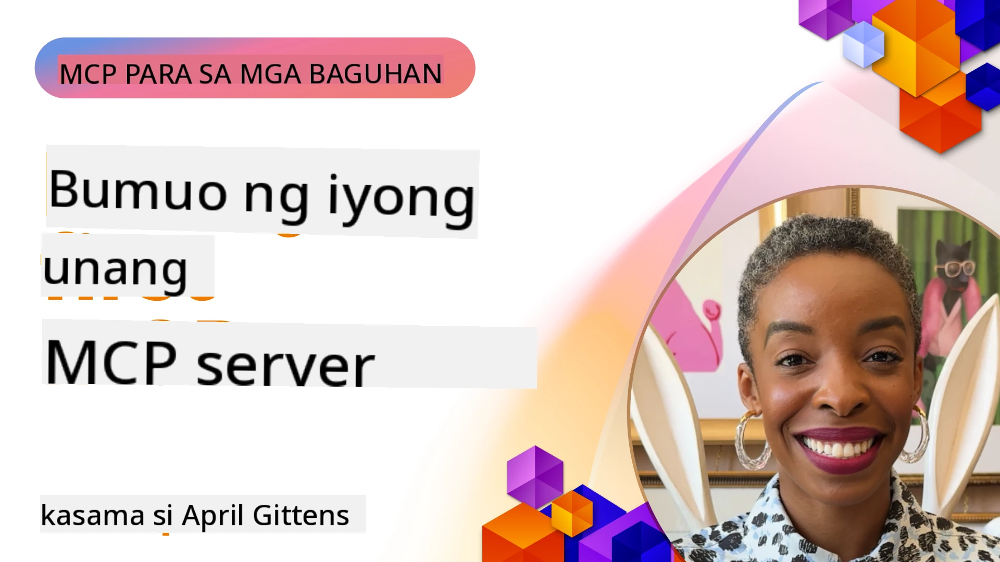

## Pagsisimula  

_(I-click ang larawan sa itaas upang makita ang video ng araling ito)_

Binubuo ang seksyong ito ng ilang mga aralin:

- **1 Ang iyong unang server**, sa unang araling ito, matututuhan mo kung paano gumawa ng iyong unang server at suriin ito gamit ang inspector tool, isang mahalagang paraan upang subukan at i-debug ang iyong server, [sa aralin](01-first-server/README.md)

- **2 Kliyente**, sa araling ito, matututuhan mo kung paano sumulat ng isang kliyente na makakakonekta sa iyong server, [sa aralin](02-client/README.md)

- **3 Kliyente na may LLM**, isang mas mainam na paraan ng pagsusulat ng kliyente ay sa pamamagitan ng pagdaragdag ng LLM dito upang makapagsagawa ng "negoasyon" sa iyong server kung ano ang gagawin, [sa aralin](03-llm-client/README.md)

- **4 Paggamit ng server mode ng GitHub Copilot Agent sa Visual Studio Code**. Dito, tinitingnan natin ang pagpapatakbo ng ating MCP Server mula sa loob ng Visual Studio Code, [sa aralin](04-vscode/README.md)

- **5 stdio Transport Server** ang stdio transport ang inirerekomendang pamantayan para sa lokal na komunikasyon ng MCP server-to-client, nagbibigay ng ligtas na komunikasyon sa subprocess na may built-in na process isolation [sa aralin](05-stdio-server/README.md)

- **6 HTTP Streaming gamit ang MCP (Streamable HTTP)**. Alamin ang pamantayang
	remote transport sa [MCP Specification 2026-07-28](https://modelcontextprotocol.io/specification/2026-07-28/basic/transports/streamable-http),
	at pati na rin ang legacy na session-based implementation na nananatili sa aralin.
	[sa aralin](06-http-streaming/README.md)

- **7 Paggamit ng Microsoft Foundry Toolkit para sa Visual Studio Code** upang kumonsumo at subukan ang iyong MCP clients at servers [sa araling ito](07-aitk/README.md)

- **8 Pagsubok**. Dito tayo tututok kung paano natin maisusubok ang ating server at client sa iba't ibang paraan, [sa aralin](08-testing/README.md)

- **9 Deployment**. Tatalakayin sa kabanatang ito ang iba't ibang paraan ng pag-deploy ng iyong MCP solutions, [sa aralin](09-deployment/README.md)

- **10 Advanced na paggamit ng server**. Saklaw ng kabanatang ito ang advanced na paggamit ng server, [sa aralin](./10-advanced/README.md)

- **11 Auth**. Tatalakayin sa kabanatang ito kung paano magdagdag ng simpleng auth, mula Basic Auth hanggang paggamit ng JWT at RBAC. Hinihikayat kang magsimula dito at pagkatapos ay tingnan ang Advanced Topics sa Kabanata 5 at magsagawa ng karagdagang security hardening sa pamamagitan ng mga rekomendasyon sa Kabanata 2, [sa aralin](./11-simple-auth/README.md)

- **12 MCP Hosts**. I-configure at gamitin ang mga popular na MCP host clients kabilang ang Claude Desktop, Cursor, Cline, at Windsurf. Matututuhan ang mga uri ng transport at troubleshooting, [sa aralin](./12-mcp-hosts/README.md)

- **13 MCP Inspector**. Mag-debug at subukan ang iyong MCP servers nang interactive gamit ang MCP Inspector tool. Matututuhan ang troubleshooting tools, resources, at protocol messages, [sa aralin](./13-mcp-inspector/README.md)

- **14 Sampling**. Matututuhan ang legacy Sampling primitive para sa `2025-11-25` at
	paano lumipat ang mga bagong disenyo sa direktang integrasyon ng LLM provider. Ang Sampling ay
	na-deprecate sa MCP `2026-07-28`. [sa aralin](./14-sampling/README.md)

- **15 MCP Apps**. Gumawa ng MCP Servers na sumasagot rin gamit ang UI instructions, [sa aralin](./15-mcp-apps/README.md)

Ang Model Context Protocol (MCP) ay isang open protocol na nagtatakda kung paano nagbibigay ang mga aplikasyon ng konteksto sa LLMs. Isipin ang MCP tulad ng isang USB-C port para sa mga AI application - nagbibigay ito ng standardisadong paraan ng pagkonekta ng mga AI models sa iba't ibang data sources at mga tools.

## Mga Layunin sa Pagkatuto

Sa pagtatapos ng araling ito, magagawa mong:

- Mag-set up ng mga development environment para sa MCP sa C#, Java, Python, TypeScript, at JavaScript
- Bumuo at mag-deploy ng mga basic MCP servers na may custom na mga tampok (resources, prompts, at tools)
- Gumawa ng mga host application na nakakonekta sa MCP servers
- Magsagawa ng pagsubok at debug sa MCP implementations
- Maunawaan ang mga karaniwang hamon sa setup at ang mga solusyon para dito
- Ikonekta ang iyong MCP implementations sa mga popular na LLM services

## Pagsasaayos ng Iyong MCP Environment

Bago ka magsimulang magtrabaho gamit ang MCP, mahalagang ihanda ang iyong development environment at maunawaan ang pangunahing workflow. Gagabayan ka ng seksyong ito sa mga unang hakbang ng setup upang masigurong maayos ang simula mo sa MCP.

### Mga Kinakailangan

Bago sumabak sa MCP development, tiyakin na mayroon ka:

- **Development Environment**: Para sa napili mong wika (C#, Java, Python, TypeScript, o JavaScript)
- **IDE/Editor**: Visual Studio, Visual Studio Code, IntelliJ, Eclipse, PyCharm, o alinmang modernong code editor
- **Package Managers**: NuGet, Maven/Gradle, pip, o npm/yarn
- **API Keys**: Para sa anumang AI services na plano mong gamitin sa iyong host applications

### Opisyal na mga SDK

Sa mga susunod na kabanata makikita mo ang mga solusyong ginawa gamit ang Python, TypeScript,
Java at .NET. Narito ang mga opisyal na SDKs.

Ang suporta sa SDK para sa MCP `2026-07-28` ay ipinatutupad nang hiwalay ayon sa wika.
Bago patakbuhin ang isang halimbawa, tingnan ang bersyon ng package nito at ang mga tala ng SDK
para sa mga suportadong pagbabago sa protocol. Tingnan ang
[opisyal na listahan ng SDK](https://modelcontextprotocol.io/docs/sdk):
- [C# SDK](https://github.com/modelcontextprotocol/csharp-sdk) - Pinapanatili sa pakikipagtulungan sa Microsoft
- [Java SDK](https://github.com/modelcontextprotocol/java-sdk) - Pinapanatili sa pakikipagtulungan sa Spring AI
- [TypeScript SDK](https://github.com/modelcontextprotocol/typescript-sdk) - Ang opisyal na implementasyon sa TypeScript
- [Python SDK](https://github.com/modelcontextprotocol/python-sdk) - Ang opisyal na implementasyon sa Python (FastMCP)
- [Kotlin SDK](https://github.com/modelcontextprotocol/kotlin-sdk) - Ang opisyal na implementasyon sa Kotlin
- [Swift SDK](https://github.com/modelcontextprotocol/swift-sdk) - Pinapanatili sa pakikipagtulungan ng Loopwork AI
- [Rust SDK](https://github.com/modelcontextprotocol/rust-sdk) - Ang opisyal na implementasyon sa Rust
- [Go SDK](https://github.com/modelcontextprotocol/go-sdk) - Ang opisyal na implementasyon sa Go

## Mga Pangunahing Punto

- Ang pagsasaayos ng MCP development environment ay simple gamit ang mga SDK na nakatuon sa wika
- Ang paggawa ng MCP servers ay nangangailangan ng paglikha at pagrehistro ng mga tools na may malinaw na mga schema
- Ang mga MCP client ay nakakonekta sa mga server at modelo upang mapakinabangan ang mga pinalawak na kakayahan
- Mahalaga ang pagsubok at pag-debug para sa maaasahang MCP implementations
- May mga opsyon sa deployment mula lokal na development hanggang sa mga cloud-based na solusyon

## Pagsasanay

Mayroon kaming isang set ng mga halimbawa na sumusuporta sa mga ehersisyo na makikita mo sa lahat ng kabanata sa seksyong ito. Bukod dito, bawat kabanata ay may sarili ring mga ehersisyo at takdang-aralin

- [Java Calculator](./samples/java/calculator/README.md)
- [.NET Calculator](../../../03-GettingStarted/samples/csharp)
- [JavaScript Calculator](./samples/javascript/README.md)
- [TypeScript Calculator](./samples/typescript/README.md)
- [Python Calculator](../../../03-GettingStarted/samples/python)

## Karagdagang Mga Mapagkukunan

- [Build Agents using Model Context Protocol on Azure](https://learn.microsoft.com/azure/developer/ai/intro-agents-mcp)
- [Remote MCP with Azure Container Apps (Node.js/TypeScript/JavaScript)](https://learn.microsoft.com/samples/azure-samples/mcp-container-ts/mcp-container-ts/)
- [.NET OpenAI MCP Agent](https://learn.microsoft.com/samples/azure-samples/openai-mcp-agent-dotnet/openai-mcp-agent-dotnet/)

## Ano ang susunod

Magsimula sa unang aralin: [Paglikha ng iyong unang MCP Server](01-first-server/README.md)

Sa sandaling matapos mo ang module na ito, magpatuloy sa: [Module 4: Praktikal na Implementasyon](../04-PracticalImplementation/README.md)

---

<!-- CO-OP TRANSLATOR DISCLAIMER START -->
**Pagtatanggi**:
Ang dokumentong ito ay isinalin gamit ang serbisyo ng AI translation na [Co-op Translator](https://github.com/Azure/co-op-translator). Bagama't nagsusumikap kami para sa katumpakan, pakatandaan na ang awtomatikong pagsasalin ay maaaring maglaman ng mga pagkakamali o hindi pagkakatugma. Ang orihinal na dokumento sa orihinal nitong wika ang dapat ituring na pangunahing sanggunian. Para sa mahahalagang impormasyon, inirerekomenda ang propesyonal na pagsasalin ng tao. Hindi kami mananagot sa anumang maling pagkakaintindi o maling interpretasyon na nagmula sa paggamit ng pagsasaling ito.
<!-- CO-OP TRANSLATOR DISCLAIMER END -->