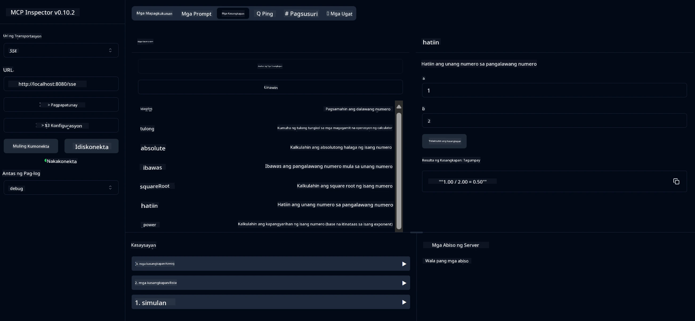

# Pangunahing Calculator MCP Serbisyo

> [!NOTE]
> Ang sample na ito ay gumagamit ng legacy HTTP+SSE transport at target ang isang SDK na compatible
> sa MCP `2025-11-25`. Dapat gumamit ang mga bagong remote server ng `2026-07-28` Streamable
> HTTP support.

Nagbibigay ang serbisyong ito ng mga pangunahing operasyon ng calculator sa pamamagitan ng Model Context Protocol (MCP) gamit ang Spring Boot na may WebFlux transport. Dinisenyo ito bilang isang simpleng halimbawa para sa mga nagsisimula na nag-aaral tungkol sa mga implementasyon ng MCP.

Para sa karagdagang impormasyon, tingnan ang [MCP Server Boot Starter](https://docs.spring.io/spring-ai/reference/api/mcp/mcp-server-boot-starter-docs.html) na dokumentasyon ng sanggunian.

## Pangkalahatang-ideya

Ipinapakita ng serbisyo ang mga sumusunod:
- Suporta para sa SSE (Server-Sent Events)
- Awtomatikong pagrerehistro ng mga tool gamit ang anotasyon ng Spring AI na `@Tool`
- Mga pangunahing function ng calculator:
  - Pagdaragdag, pagbabawas, multiplikasyon, dibisyon
  - Kalkulasyon ng kapangyarihan at square root
  - Modulus (natitirang bahagi) at absolute value
  - Tulong na function para sa mga paglalarawan ng operasyon

## Mga Tampok

Nag-aalok ang serbisyong calculator na ito ng mga sumusunod na kakayahan:

1. **Mga Pangunahing Operasyon sa Aritmetika**:
   - Pagdaragdag ng dalawang numero
   - Pagbabawas ng isang numero mula sa isa pa
   - Pagmumultiply ng dalawang numero
   - Pagdi-divide ng isang numero sa isa pa (may pagsuri sa zero division)

2. **Mga Advanced na Operasyon**:
   - Kalkulasyon ng kapangyarihan (pagtaas ng base sa exponent)
   - Kalkulasyon ng square root (may pagsuri sa negatibong numero)
   - Kalkulasyon ng modulus (natitirang bahagi)
   - Kalkulasyon ng absolute value

3. **Sistema ng Tulong**:
   - Built-in na help function na nagpapaliwanag ng lahat ng magagamit na operasyon

## Paggamit ng Serbisyo

Ipinapakita ng serbisyo ang mga sumusunod na API endpoints sa pamamagitan ng MCP protocol:

- `add(a, b)`: Magdagdag ng dalawang numero
- `subtract(a, b)`: Bawasan ang ikalawang numero mula sa una
- `multiply(a, b)`: I-multiply ang dalawang numero
- `divide(a, b)`: Hatiin ang unang numero sa ikalawa (may zero check)
- `power(base, exponent)`: Kalkulahin ang kapangyarihan ng isang numero
- `squareRoot(number)`: Kalkulahin ang square root (may pagsuri sa negatibong numero)
- `modulus(a, b)`: Kalkulahin ang natitirang bahagi sa paghahati
- `absolute(number)`: Kalkulahin ang absolute value
- `help()`: Kumuha ng impormasyon tungkol sa mga magagamit na operasyon

## Test Client

Kasama ang isang simpleng test client sa pakete ng `com.microsoft.mcp.sample.client`. Ipinapakita ng klase na `SampleCalculatorClient` ang magagamit na mga operasyon ng serbisyong calculator.

## Paggamit ng LangChain4j Client

Kasama sa proyekto ang isang halimbawa ng LangChain4j client sa
`com.microsoft.mcp.sample.client.LangChain4jClient` na nagpapakita kung paano
i-integrate ang serbisyong calculator sa isang Microsoft Foundry model.

### Mga Kinakailangan

1. Gumawa ng isang Microsoft Foundry resource at i-deploy ang isang aktibong modelo tulad ng
   `gpt-5.1`.
2. Itakda ang model endpoint, API key, at pangalan ng deployment:

   ```bash
   export AZURE_OPENAI_ENDPOINT="https://<resource-name>.openai.azure.com"
   export AZURE_OPENAI_API_KEY="<api-key>"
   export AZURE_OPENAI_DEPLOYMENT="gpt-5.1"
   ```

3. Tingnan ang
   [Microsoft Foundry model retirement schedule](https://learn.microsoft.com/azure/foundry/openai/concepts/model-retirement-schedule)
   bago pumili ng deployment.
4. Siguraduhing tumatakbo ang calculator server sa `localhost:8080`.

### Pagpapatakbo ng LangChain4j Client

Ipinapakita ng halimbawa na ito:
- Pagkonekta sa calculator MCP server gamit ang SSE transport
- Paggamit ng LangChain4j upang lumikha ng chat bot na gumagamit ng mga operasyon ng calculator
- Pagsasama sa isang deployed na Microsoft Foundry model

Nagpapadala ang client ng mga sumusunod na halimbawa ng query upang ipakita ang functionality:
1. Pagkalkula ng suma ng dalawang numero
2. Paghahanap ng square root ng isang numero
3. Pagkuha ng impormasyon ng tulong tungkol sa mga magagamit na operasyon ng calculator

Patakbuhin ang halimbawa at tingnan ang console output upang makita kung paano ginagamit ng modelo ng AI ang mga tool ng calculator sa pagtugon sa mga query.

### Pag-configure ng Microsoft Foundry Model

Ginagamit ng LangChain4j client ang Azure OpenAI v1-compatible endpoint na ibinibigay ng
Microsoft Foundry:

```java
String endpoint = System.getenv("AZURE_OPENAI_ENDPOINT");
ChatLanguageModel model = OpenAiOfficialChatModel.builder()
   .baseUrl(endpoint.replaceAll("/+$", "") + "/openai/v1/")
   .apiKey(System.getenv("AZURE_OPENAI_API_KEY"))
   .isAzure(true)
   .modelName(System.getenv().getOrDefault("AZURE_OPENAI_DEPLOYMENT", "gpt-5.1"))
    .timeout(Duration.ofSeconds(60))
    .build();
```

Dapat tugma ang `AZURE_OPENAI_DEPLOYMENT` sa pangalang itinalaga nang ideploy ang modelo, na maaaring iba sa pangalan ng pangunahing modelo.


## Mga Depensiya

Nangangailangan ang proyekto ng mga sumusunod na pangunahing depensiya:

```xml
<!-- For MCP Server -->
<dependency>
    <groupId>org.springframework.ai</groupId>
    <artifactId>spring-ai-starter-mcp-server-webflux</artifactId>
</dependency>

<!-- For LangChain4j integration -->
<dependency>
    <groupId>dev.langchain4j</groupId>
    <artifactId>langchain4j-mcp</artifactId>
    <version>${langchain4j.version}</version>
</dependency>

<!-- For Microsoft Foundry's OpenAI-compatible endpoint -->
<dependency>
    <groupId>dev.langchain4j</groupId>
   <artifactId>langchain4j-open-ai-official</artifactId>
    <version>${langchain4j.version}</version>
</dependency>
```

## Pagbuo ng Proyekto

I-build ang proyekto gamit ang Maven:
```bash
./mvnw clean install -DskipTests
```

## Pagpapatakbo ng Server

### Paggamit ng Java

```bash
java -jar target/calculator-server-0.0.1-SNAPSHOT.jar
```

### Paggamit ng MCP Inspector

Ang MCP Inspector ay isang kapaki-pakinabang na tool para makipag-ugnayan sa mga serbisyo ng MCP. Para gamitin ito sa calculator service na ito:

1. **I-install at patakbuhin ang MCP Inspector** sa isang bagong terminal window:
   ```bash
   npx @modelcontextprotocol/inspector
   ```

2. **Access ang web UI** sa pamamagitan ng pag-click sa URL na ipinakita ng app (karaniwang http://localhost:6274)

3. **I-configure ang koneksyon**:
   - Itakda ang uri ng transport sa "SSE"
   - Itakda ang URL sa SSE endpoint ng iyong tumatakbong server: `http://localhost:8080/sse`
   - I-click ang "Connect"

4. **Gamitin ang mga tool**:
   - I-click ang "List Tools" upang makita ang mga magagamit na operasyon ng calculator
   - Pumili ng tool at i-click ang "Run Tool" upang isagawa ang isang operasyon



### Paggamit ng Docker

Kasama sa proyekto ang isang Dockerfile para sa containerized deployment:

1. **I-build ang Docker image**:
   ```bash
   docker build -t calculator-mcp-service .
   ```

2. **Patakbuhin ang Docker container**:
   ```bash
   docker run -p 8080:8080 calculator-mcp-service
   ```

Ito ay:
- Magbuo ng multi-stage Docker image gamit ang Maven 3.9.9 at Eclipse Temurin 24 JDK
- Lumikha ng optimized container image
- I-expose ang serbisyo sa port 8080
- Simulan ang MCP calculator service sa loob ng container

Maaaring ma-access ang serbisyo sa `http://localhost:8080` kapag tumatakbo na ang container.

## Pag-aayos ng mga Suliranin

### Karaniwang Isyu sa Pagkonekta ng Modelo

1. **Mga error sa pagpapatunay**: Tiyaking ang `AZURE_OPENAI_API_KEY` ay kabilang sa
   resource na tinukoy ng `AZURE_OPENAI_ENDPOINT`.
2. **Deployment hindi matagpuan**: Siguraduhing eksaktong tumutugma ang `AZURE_OPENAI_DEPLOYMENT`
   sa pangalan ng deployment sa Microsoft Foundry.
3. **Rate limiting**: Suriin ang quota ng deployment at ulitin pagkatapos ng interval
   na ibinalik ng serbisyo.

Para sa karagdagang tulong, tingnan ang
[LangChain4j documentation](https://github.com/langchain4j/langchain4j) at
[Microsoft Foundry documentation](https://learn.microsoft.com/azure/ai-foundry/).

---

<!-- CO-OP TRANSLATOR DISCLAIMER START -->
**Pagtatanggi**:
Ang dokumentong ito ay isinalin gamit ang serbisyo ng AI translation na [Co-op Translator](https://github.com/Azure/co-op-translator). Bagama't nagsusumikap kami para sa katumpakan, pakatandaan na ang awtomatikong pagsasalin ay maaaring maglaman ng mga pagkakamali o hindi pagkakatugma. Ang orihinal na dokumento sa orihinal nitong wika ang dapat ituring na pangunahing sanggunian. Para sa mahahalagang impormasyon, inirerekomenda ang propesyonal na pagsasalin ng tao. Hindi kami mananagot sa anumang maling pagkakaintindi o maling interpretasyon na nagmula sa paggamit ng pagsasaling ito.
<!-- CO-OP TRANSLATOR DISCLAIMER END -->