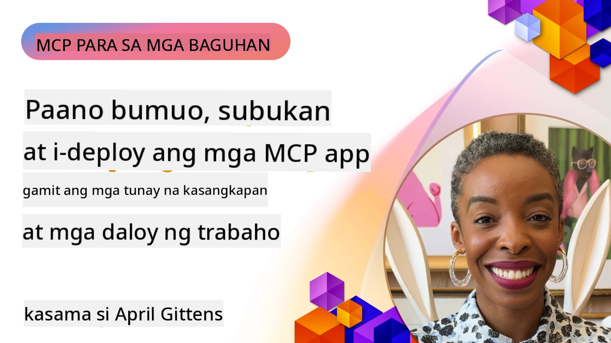

# Praktikal na Pagpapatupad

[](https://youtu.be/vCN9-mKBDfQ)

_(I-click ang larawan sa itaas upang makita ang video ng araling ito)_

Ang praktikal na pagpapatupad ay kung saan nagiging malinaw ang kapangyarihan ng Model Context Protocol (MCP). Habang mahalaga ang pag-unawa sa teorya at arkitektura sa likod ng MCP, lumilitaw ang tunay na halaga kapag inilapat mo ang mga konseptong ito upang bumuo, magsubok, at mag-deploy ng mga solusyon na lumulutas sa mga totoong problema sa mundo. Ang kabanatang ito ay nag-uugnay sa pagitan ng konseptwal na kaalaman at aktwal na pag-develop, ginagabayan ka sa proseso ng pagbibigay-buhay sa mga MCP-based na aplikasyon.

Kung ikaw man ay nagde-develop ng mga intelligent assistant, nag-iintegrate ng AI sa mga daloy ng trabaho ng negosyo, o bumubuo ng mga pasadyang kasangkapan para sa pagproseso ng datos, nagbibigay ang MCP ng isang nababagong pundasyon. Ang disenyo nitong hindi nakadepende sa wika at ang mga opisyal na SDK para sa mga popular na programming language ay ginagawa itong naa-access sa maraming uri ng developer. Sa pamamagitan ng pag-leverage ng mga SDK na ito, maaari kang mabilis na gumawa ng prototype, mag-iterate, at mag-scale ng iyong mga solusyon sa iba't ibang platform at kapaligiran.

Sa mga sumusunod na seksyon, makikita mo ang mga praktikal na halimbawa, sample na code, at mga estratehiya sa deployment na nagpapakita kung paano ipatupad ang MCP sa C#, Java na may Spring, TypeScript, JavaScript, at Python. Matututuhan mo rin kung paano i-debug at subukan ang iyong mga MCP server, pamahalaan ang mga API, at i-deploy ang mga solusyon sa cloud gamit ang Azure. Ang mga hands-on na resources na ito ay idinisenyo upang pabilisin ang iyong pag-aaral at tulungan kang may kumpiyansa na bumuo ng matibay at production-ready na mga MCP application.

## Pangkalahatang-ideya

Ang araling ito ay nakatuon sa mga praktikal na aspeto ng pagpapatupad ng MCP sa iba't ibang mga programming language. Tatalakayin natin kung paano gamitin ang MCP SDKs sa C#, Java gamit ang Spring, TypeScript, JavaScript, at Python upang makabuo ng matibay na mga aplikasyon, mag-debug at magsubok ng mga MCP server, at lumikha ng mga reusable na resources, prompts, at mga kagamitan.

## Mga Layunin sa Pagkatuto

Sa katapusan ng araling ito, magagawa mong:

- Ipatupad ang mga solusyon ng MCP gamit ang opisyal na SDKs sa iba't ibang mga programming language
- I-debug at subukan ang mga MCP server nang sistematiko
- Gumawa at gamitin ang mga tampok ng server (Resources, Prompts, at Tools)
- Disenyo ng epektibong mga MCP workflow para sa komplikadong mga gawain
- I-optimize ang mga implementasyon ng MCP para sa pagganap at pagiging maaasahan

## Opisyal na Mga SDK na Resources

Nag-aalok ang Model Context Protocol ng mga opisyal na SDK para sa maraming mga wika. SDK
suporta para sa MCP `2026-07-28` ay inilalabas nang paisa-isa, kaya suriin ang mga tala ng release ng bawat SDK
at ang bersyon ng package ng halimbawa bago ipalagay ang compatibility ng protocol.
Tingnan ang [opisyal na listahan ng SDK](https://modelcontextprotocol.io/docs/sdk):

- [C# SDK](https://github.com/modelcontextprotocol/csharp-sdk)
- [Java with Spring SDK](https://github.com/modelcontextprotocol/java-sdk) **Tandaan:** nangangailangan ng dependency sa [Project Reactor](https://projectreactor.io). (Tingnan ang [discussion issue 246](https://github.com/orgs/modelcontextprotocol/discussions/246).)
- [TypeScript SDK](https://github.com/modelcontextprotocol/typescript-sdk)
- [Python SDK](https://github.com/modelcontextprotocol/python-sdk)
- [Kotlin SDK](https://github.com/modelcontextprotocol/kotlin-sdk)
- [Go SDK](https://github.com/modelcontextprotocol/go-sdk)

## Paggamit ng MCP SDKs

Ang seksyong ito ay nagbibigay ng mga praktikal na halimbawa ng pag-implementa ng MCP sa iba't ibang mga programming language. Makikita mo ang mga sample code sa direktoryo ng `samples` na inayos ayon sa wika.

### Mga Available na Sample

Ang repository ay naglalaman ng mga [sample implementations](../../../04-PracticalImplementation/samples) sa mga sumusunod na wika:

- [C#](./samples/csharp/README.md)
- [Java with Spring](./samples/java/containerapp/README.md)
- [TypeScript](./samples/typescript/README.md)
- [JavaScript](./samples/javascript/README.md)
- [Python](./samples/python/README.md)

Bawat sample ay nagpapakita ng mga pangunahing konsepto ng MCP at mga pattern ng implementasyon para sa partikular na wika at ecosystem.

### Praktikal na Mga Gabay

Karagdagang mga gabay para sa praktikal na implementasyon ng MCP:

- [Pagination at Malalaking Resulta](./pagination/README.md) - Pamahalaan ang cursor-based pagination para sa mga tool, resources, at malalaking datasets

## Mga Pangunahing Tampok ng Server

Maaaring mag-implementa ang mga MCP server ng anumang kumbinasyon ng mga tampok na ito:

### Mga Resources

Nagbibigay ang mga resources ng konteksto at datos para magamit ng user o AI model:

- Mga dokumento ng repositoryo
- Mga knowledge base
- Mga structured data sources
- Mga file system

### Mga Prompt

Ang mga prompt ay mga templated na mensahe at workflow para sa mga user:

- Mga pre-defined na conversation template
- Mga guided interaction pattern
- Mga specialized na istruktura ng diyalogo

### Mga Tool

Ang mga tool ay mga function na ipinatutupad ng AI model:

- Mga utility sa pagproseso ng datos
- Integrasyon ng external na API
- Kakayahan sa kompyutasyon
- Functionality sa paghahanap

## Mga Sample Implementation: C# Implementation

Naglalaman ang opisyal na C# SDK repository ng ilang sample na implementasyon na nagpapakita ng iba't ibang aspeto ng MCP:

- **Basic MCP Client**: Simpleng halimbawa na nagpapakita kung paano gumawa ng MCP client at tumawag ng mga tool
- **Basic MCP Server**: Minimal na implementasyon ng server na may basic tool registration
- **Advanced MCP Server**: Buong tampok na server na may tool registration, authentication, at error handling
- **ASP.NET Integration**: Mga halimbawa na nagpapakita ng integrasyon sa ASP.NET Core
- **Mga Pattern sa Implementasyon ng Tool**: Iba’t ibang pattern para sa implementasyon ng mga tool na may iba't ibang antas ng komplikasyon

Ang MCP C# SDK ay nasa preview pa at maaaring magbago ang mga API. Patuloy naming ia-update ang blog na ito habang umuunlad ang SDK.

### Mga Pangunahing Tampok

- [C# MCP Nuget ModelContextProtocol](https://www.nuget.org/packages/ModelContextProtocol)
- Pagbuo ng iyong [unang MCP Server](https://devblogs.microsoft.com/dotnet/build-a-model-context-protocol-mcp-server-in-csharp/).

Para sa kumpletong mga sample ng C# implementasyon, bisitahin ang [opisyal na C# SDK samples repository](https://github.com/modelcontextprotocol/csharp-sdk)

## Sample implementation: Java with Spring Implementation

Nag-aalok ang Java with Spring SDK ng matatag na mga pagpipilian para sa MCP implementasyon na may mga enterprise-grade na tampok.

### Mga Pangunahing Tampok

- Integrasyon ng Spring Framework
- Malakas na type safety
- Suporta sa reactive programming
- Komprehensibong error handling

Para sa kumpletong Java with Spring implementation sample, tingnan ang [Java with Spring sample](samples/java/containerapp/README.md) sa samples directory.

## Sample implementation: JavaScript Implementation

Nagbibigay ang JavaScript SDK ng magaan at flexible na paraan sa MCP implementasyon.

### Mga Pangunahing Tampok

- Suporta para sa Node.js at browser
- Promise-based na API
- Madaling integrasyon sa Express at iba pang framework
- Suporta sa WebSocket para sa streaming

Para sa kumpletong JavaScript implementation sample, tingnan ang [JavaScript sample](samples/javascript/README.md) sa samples directory.

## Sample implementation: Python Implementation

Nag-aalok ang Python SDK ng Pythonic na paraan sa MCP implementasyon na may mahusay na integrasyon sa ML framework.

### Mga Pangunahing Tampok

- Suporta sa async/await gamit ang asyncio
- Integrasyon ng FastAPI``
- Simpleng tool registration
- Native na integrasyon sa mga kilalang ML library

Para sa kumpletong Python implementation sample, tingnan ang [Python sample](samples/python/README.md) sa samples directory.

## Pamamahala ng API

Ang Azure API Management ay isang mahusay na sagot kung paano natin mapoprotektahan ang MCP Servers. Ang ideya ay maglagay ng Azure API Management instance sa harap ng iyong MCP Server at hayaang ito ang humawak ng mga tampok na malamang gusto mong magkaroon tulad ng:

- paghihigpit ng rate
- pamamahala ng token
- pagmamanman
- load balancing
- seguridad

### Halimbawa mula sa Azure

Narito ang isang Halimbawa mula sa Azure na eksaktong gumagawa nito, i.e [paglikha ng MCP Server at pagsesecure nito gamit ang Azure API Management](https://github.com/Azure-Samples/remote-mcp-apim-functions-python).

Tingnan kung paano nangyayari ang daloy ng awtorisasyon sa larawan sa ibaba:


Sa larawang nauna, ang mga sumusunod ang nangyayari:

- Ang Authentication/Authorization ay nagaganap gamit ang Microsoft Entra.
- Ang Azure API Management ay kumikilos bilang isang gateway at gumagamit ng mga polisiya para idirekta at pamahalaan ang trapiko.
- Ang Azure Monitor ay nagtatala ng lahat ng request para sa karagdagang pagsusuri.

#### Daloy ng Awtorisasyon

Tingnan natin nang mas detalyado ang daloy ng awtorisasyon:


#### Espesipikasyon ng awtorisasyon ng MCP

Alamin pa tungkol sa
[MCP Authorization specification](https://modelcontextprotocol.io/specification/2026-07-28/basic/authorization/).

## Mag-deploy ng Remote MCP Server sa Azure

Tingnan natin kung kaya nating i-deploy ang halimbawang binanggit natin kanina:

1. Kopyahin ang repo

    ```bash
    git clone https://github.com/Azure-Samples/remote-mcp-apim-functions-python.git
    cd remote-mcp-apim-functions-python
    ```

1. Irehistro ang `Microsoft.App` resource provider.

   - Kung gumagamit ka ng Azure CLI, patakbuhin ang `az provider register --namespace Microsoft.App --wait`.
   - Kung gumagamit ka ng Azure PowerShell, patakbuhin ang `Register-AzResourceProvider -ProviderNamespace Microsoft.App`. Pagkatapos ay patakbuhin ang `(Get-AzResourceProvider -ProviderNamespace Microsoft.App).RegistrationState` pagkalipas ng ilang sandali upang suriin kung kumpleto na ang pagpaparehistro.

1. Patakbuhin ang [azd](https://aka.ms/azd) na utos na ito para mag-provision ng api management service, function app (na may code) at lahat ng iba pang kinakailangang Azure resources

    ```shell
    azd up
    ```

    Dapat i-deploy ng mga utos na ito lahat ng cloud resources sa Azure

### Pagsusuri ng iyong server gamit ang MCP Inspector

1. Sa isang **bagong terminal window**, i-install at patakbuhin ang MCP Inspector

    ```shell
    npx @modelcontextprotocol/inspector
    ```

    Dapat mong makita ang isang interface na katulad ng:

    

1. CTRL click upang i-load ang MCP Inspector web app mula sa URL na ipinapakita ng app (hal. [http://127.0.0.1:6274/#resources](http://127.0.0.1:6274/#resources))
1. Itakda ang uri ng transport sa `SSE`
1. Itakda ang URL sa iyong tumatakbong API Management SSE endpoint na ipinapakita matapos ang `azd up` at **Connect**:

    ```shell
    https://<apim-servicename-from-azd-output>.azure-api.net/mcp/sse
    ```

1. **List Tools**.  I-click ang isang tool at **Run Tool**.  

Kung nagtrabaho ang lahat ng mga hakbang, dapat ay nakakonekta ka na ngayon sa MCP server at nagawa mong tawagan ang isang tool.

## MCP servers para sa Azure

[Remote-mcp-functions](https://github.com/Azure-Samples/remote-mcp-functions-dotnet): Ang set ng mga repository na ito ay mga quickstart template para sa paggawa at pag-deploy ng custom remote MCP (Model Context Protocol) servers gamit ang Azure Functions gamit ang Python, C# .NET o Node/TypeScript.

Nagbibigay ang mga Samples ng kumpletong solusyon na nagpapahintulot sa mga developer na:

- Mag-build at tumakbo nang lokal: Paunlarin at i-debug ang isang MCP server sa lokal na makina
- Mag-deploy sa Azure: Madaling mag-deploy sa cloud gamit ang simpleng azd up command
- Kumonekta mula sa mga kliyente: Kumonekta sa MCP server mula sa iba't ibang mga kliyente kabilang ang VS Code's Copilot agent mode at ang MCP Inspector tool

### Mga Pangunahing Tampok

- Seguridad sa disenyo: Ang MCP server ay secured gamit ang mga key at HTTPS
- Mga opsyon sa Authentication: Sinusuportahan ang OAuth gamit ang built-in auth at/o API Management
- Network isolation: Nagbibigay-daan sa network isolation gamit ang Azure Virtual Networks (VNET)
- Serverless architecture: Ginagamit ang Azure Functions para sa scalable, event-driven na pagpatupad
- Lokal na development: Komprehensibong suporta para sa lokal na pag-develop at debugging
- Simpleng deployment: Pinasimpleng proseso ng deployment sa Azure

Kasama sa repository ang lahat ng kinakailangang configuration files, source code, at mga depinisyon ng imprastruktura upang mabilis makapagsimula sa isang production-ready MCP server implementation.

- [Azure Remote MCP Functions Python](https://github.com/Azure-Samples/remote-mcp-functions-python) - Halimbawang implementasyon ng MCP gamit ang Azure Functions na may Python

- [Azure Remote MCP Functions .NET](https://github.com/Azure-Samples/remote-mcp-functions-dotnet) - Halimbawang implementasyon ng MCP gamit ang Azure Functions na may C# .NET

- [Azure Remote MCP Functions Node/Typescript](https://github.com/Azure-Samples/remote-mcp-functions-typescript) - Halimbawang implementasyon ng MCP gamit ang Azure Functions na may Node/TypeScript.

## Mga Pangunahing Punto

- Nagbibigay ang MCP SDKs ng mga wika-specific na tools para sa pagpapatupad ng matibay na MCP solutions
- Ang proseso ng debugging at testing ay kritikal para sa maaasahang MCP applications
- Ang mga reusable prompt templates ay nagpapahintulot ng pare-parehong AI interactions
- Ang mahusay na dinisenyong mga workflows ay maaaring mag-orchestrate ng kumplikadong mga gawain gamit ang maraming tools
- Ang pagpapatupad ng MCP solutions ay nangangailangan ng pagsasaalang-alang sa seguridad, pagganap, at paghawak ng mga error

## Ehersisyo

Disenyo ng isang praktikal na MCP workflow na tumutugon sa isang totoong problema sa iyong larangan:

1. Tukuyin ang 3-4 na mga tool na magiging kapaki-pakinabang para sa paglutas ng problemang ito
2. Gumawa ng workflow diagram na nagpapakita kung paano nakikipag-ugnayan ang mga tool na ito
3. Ipatupad ang isang basic na bersyon ng isa sa mga tool gamit ang iyong preferred na wika
4. Gumawa ng prompt template na makakatulong sa modelo na epektibong magamit ang iyong tool

## Karagdagang Mga Mapagkukunan

---

## Ano ang Susunod

Susunod: [Advanced Topics](../05-AdvancedTopics/README.md)

---

<!-- CO-OP TRANSLATOR DISCLAIMER START -->
**Pagtatanggi**:
Ang dokumentong ito ay isinalin gamit ang serbisyo ng AI translation na [Co-op Translator](https://github.com/Azure/co-op-translator). Bagama't nagsusumikap kami para sa katumpakan, pakatandaan na ang awtomatikong pagsasalin ay maaaring maglaman ng mga pagkakamali o hindi pagkakatugma. Ang orihinal na dokumento sa orihinal nitong wika ang dapat ituring na pangunahing sanggunian. Para sa mahahalagang impormasyon, inirerekomenda ang propesyonal na pagsasalin ng tao. Hindi kami mananagot sa anumang maling pagkakaintindi o maling interpretasyon na nagmula sa paggamit ng pagsasaling ito.
<!-- CO-OP TRANSLATOR DISCLAIMER END -->