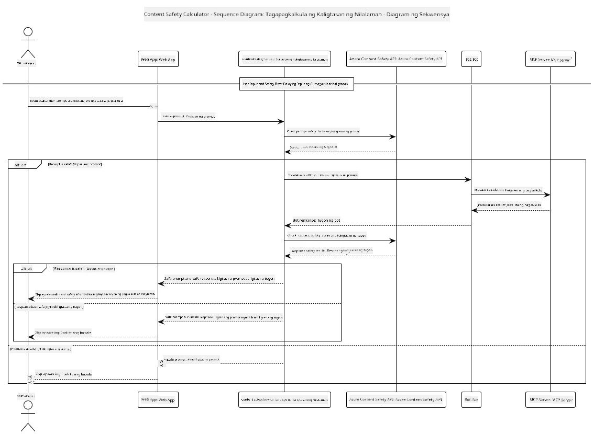

## Arkitektura ng Sistema

Ipinapakita ng proyektong ito ang isang web application na gumagamit ng pagsuri sa kaligtasan ng nilalaman bago ipasa ang mga prompt ng gumagamit sa isang serbisyong calculator gamit ang Model Context Protocol (MCP).



### Paano Ito Gumagana

1. **Input ng Gumagamit**: Ipinapasok ng gumagamit ang prompt ng kalkulasyon sa web interface
2. **Pagsusuri sa Kaligtasan ng Nilalaman (Input)**: Sinusuri ang prompt gamit ang Azure Content Safety API
3. **Desisyon sa Kaligtasan (Input)**:
   - Kung ligtas ang nilalaman (severity < 2 sa lahat ng kategorya), ipinagpapatuloy ito sa calculator
   - Kung ang nilalaman ay minarkahan bilang posibleng mapanganib, humihinto ang proseso at nagpapakita ng babala
4. **Pagsasama ng Calculator**: Pinoproseso ang ligtas na nilalaman ng LangChain4j, na nakikipag-ugnayan sa MCP calculator server
5. **Pagsusuri sa Kaligtasan ng Nilalaman (Output)**: Sinusuri ng Azure Content Safety API ang tugon ng bot
6. **Desisyon sa Kaligtasan (Output)**:
   - Kung ligtas ang tugon ng bot, ipinapakita ito sa gumagamit
   - Kung ang tugon ng bot ay minarkahan bilang posibleng mapanganib, pinalitan ito ng babala
7. **Tugon**: Ipinapakita sa gumagamit ang mga resulta (kung ligtas) kasama ang parehong pagsusuri sa kaligtasan

## Paggamit ng Model Context Protocol (MCP) sa Mga Serbisyo ng Calculator

Ipinapakita ng proyektong ito kung paano gamitin ang Model Context Protocol (MCP) para tawagan ang mga calculator MCP service mula sa LangChain4j. Ginagamit ang isang lokal na MCP server na tumatakbo sa port 8080 para magbigay ng mga operasyon ng calculator.

### Pagsasaayos ng Azure Content Safety Service

Bago gamitin ang mga tampok ng kaligtasan ng nilalaman, kailangan mong gumawa ng Azure Content Safety service resource:

1. Mag-sign in sa [Azure Portal](https://portal.azure.com)
2. I-click ang "Create a resource" at hanapin ang "Content Safety"
3. Piliin ang "Content Safety" at i-click ang "Create"
4. Maglagay ng natatanging pangalan para sa iyong resource
5. Piliin ang iyong subscription at resource group (o gumawa ng bago)
6. Pumili ng suportadong rehiyon (tingnan ang [Region availability](https://azure.microsoft.com/en-us/global-infrastructure/services/?products=cognitive-services) para sa detalye)
7. Piliin ang angkop na pricing tier
8. I-click ang "Create" para i-deploy ang resource
9. Kapag kumpleto na ang deployment, i-click ang "Go to resource"
10. Sa kaliwang pane, sa ilalim ng "Resource Management", piliin ang "Keys and Endpoint"
11. Kopyahin ang alinman sa mga key at ang endpoint URL para gamitin sa susunod na hakbang

### Pagsasaayos ng Mga Environment Variable

Itakda ang Microsoft Foundry model endpoint, API key, at deployment name:
```sh
export AZURE_OPENAI_ENDPOINT="https://<resource-name>.openai.azure.com"
export AZURE_OPENAI_API_KEY="<api-key>"
export AZURE_OPENAI_DEPLOYMENT="gpt-5.1"
```

Para sa mga tampok ng kaligtasan ng nilalaman, itakda:
```sh
export CONTENT_SAFETY_ENDPOINT=<your_content_safety_endpoint>
export CONTENT_SAFETY_KEY=<your_content_safety_key>
```

Ginagamit ng aplikasyon ang mga environment variable na ito para mag-authenticate sa Azure Content Safety service. Kung hindi itatakda ang mga variable na ito, gagamit ang aplikasyon ng placeholder na mga halaga para sa layunin ng demonstrasyon, ngunit hindi gagana nang maayos ang mga tampok ng kaligtasan ng nilalaman.

### Pagsisimula ng Calculator MCP Server

Bago patakbuhin ang kliyente, kailangan mong simulan ang calculator MCP server sa SSE mode sa localhost:8080.

## Paglalarawan ng Proyekto

Ipinapakita ng proyektong ito ang pagsasama ng Model Context Protocol (MCP) sa LangChain4j para tawagan ang mga serbisyo ng calculator. Pangunahing mga tampok ay:

- Paggamit ng MCP para kumonekta sa isang serbisyo ng calculator para sa mga pangunahing operasyon sa matematika
- Dual-layer na pagsusuri sa kaligtasan ng nilalaman sa parehong mga prompt ng gumagamit at mga tugon ng bot
- Pagsasama sa isang deployed na Microsoft Foundry model gamit ang LangChain4j
- Paggamit ng Server-Sent Events (SSE) para sa MCP transport

## Pagsasama ng Kaligtasan ng Nilalaman

Kasama sa proyekto ang komprehensibong mga tampok sa kaligtasan ng nilalaman upang matiyak na parehong mga input ng gumagamit at mga tugon ng sistema ay malaya sa mapanganib na nilalaman:

1. **Pagsusuri sa Input**: Lahat ng prompt ng gumagamit ay sinusuri para sa mga mapanganib na kategorya tulad ng poot, karahasan, self-harm, at sekswal na nilalaman bago ito iproseso.

2. **Pagsusuri sa Output**: Kahit na gumagamit ng mga potensyal na uncensored na modelo, sinusuri ng sistema ang lahat ng nabubuong tugon gamit ang parehong mga filter sa kaligtasan ng nilalaman bago ito ipakita sa gumagamit.

Ang dual-layer na diskarte na ito ay nagsisiguro na nananatiling ligtas ang sistema anuman ang AI model na ginagamit, pinoprotektahan ang mga gumagamit mula sa parehong mapanganib na input at posibleng problemadong AI-generated na output.

## Web Client

Kasama sa aplikasyon ang isang madaling gamitin na web interface na nagpapahintulot sa mga gumagamit na makipag-ugnayan sa Content Safety Calculator system:

### Mga Tampok ng Web Interface

- Simple at intuitibong form para sa pagpasok ng mga prompt ng kalkulasyon
- Dual-layer na pagsuri sa kaligtasan ng nilalaman (input at output)
- Real-time na feedback sa kaligtasan ng prompt at tugon
- Mga color-coded na indicator ng kaligtasan para sa madaling interpretasyon
- Malinis at responsive na disenyo na gumagana sa iba't ibang mga device
- Mga halimbawa ng ligtas na prompt bilang gabay sa mga gumagamit

### Paggamit ng Web Client

1. Simulan ang aplikasyon:
   ```sh
   mvn spring-boot:run
   ```

2. Buksan ang iyong browser at pumunta sa `http://localhost:8087`

3. Ipasok ang prompt ng kalkulasyon sa ibinigay na text area (halimbawa, "Calculate the sum of 24.5 and 17.3")

4. I-click ang "Submit" para iproseso ang iyong kahilingan

5. Tingnan ang mga resulta, na maglalaman ng:
   - Pagsusuri sa kaligtasan ng nilalaman ng iyong prompt
   - Ang kalkuladong resulta (kung ligtas ang prompt)
   - Pagsusuri sa kaligtasan ng nilalaman ng tugon ng bot
   - Anumang babala sa kaligtasan kung ang input o output ay minarkahan

Awtomatikong hinahawakan ng web client ang parehong proseso ng beripikasyon sa kaligtasan ng nilalaman, tinitiyak na ang lahat ng interaksyon ay ligtas at angkop anuman ang AI model na ginagamit.

---

<!-- CO-OP TRANSLATOR DISCLAIMER START -->
**Pagtatanggi**:
Ang dokumentong ito ay isinalin gamit ang serbisyo ng AI translation na [Co-op Translator](https://github.com/Azure/co-op-translator). Bagama't nagsusumikap kami para sa katumpakan, pakatandaan na ang awtomatikong pagsasalin ay maaaring maglaman ng mga pagkakamali o hindi pagkakatugma. Ang orihinal na dokumento sa orihinal nitong wika ang dapat ituring na pangunahing sanggunian. Para sa mahahalagang impormasyon, inirerekomenda ang propesyonal na pagsasalin ng tao. Hindi kami mananagot sa anumang maling pagkakaintindi o maling interpretasyon na nagmula sa paggamit ng pagsasaling ito.
<!-- CO-OP TRANSLATOR DISCLAIMER END -->