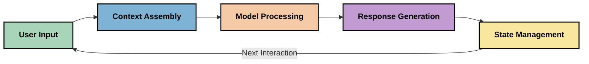
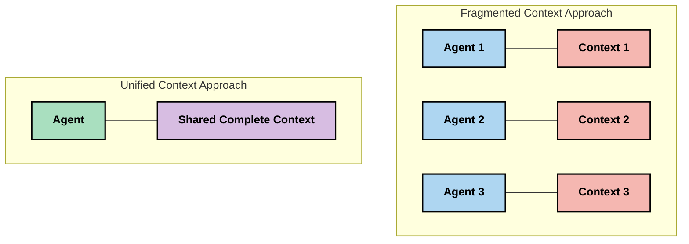
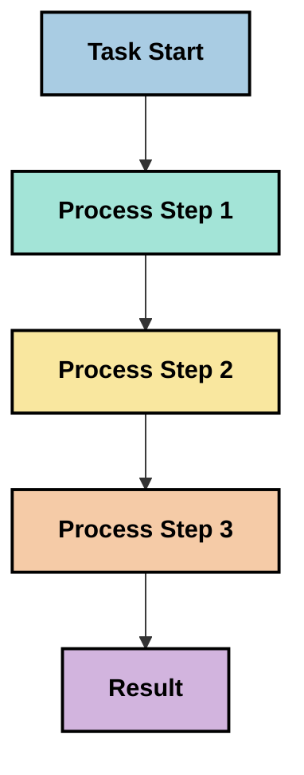
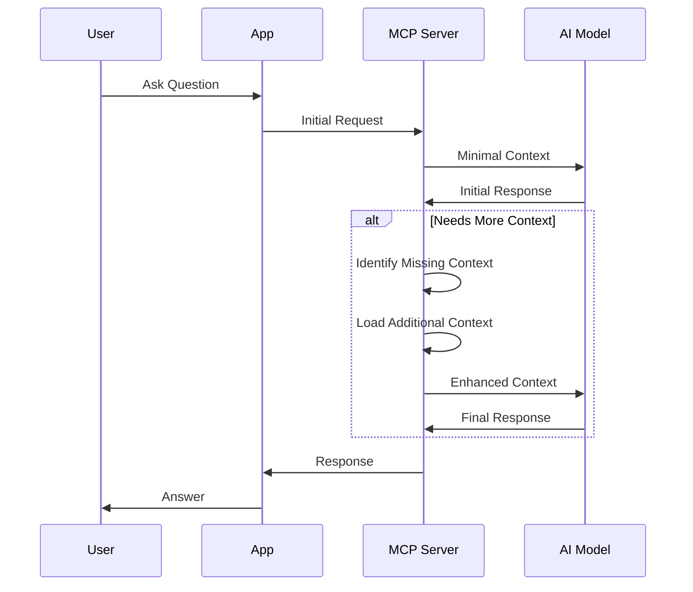
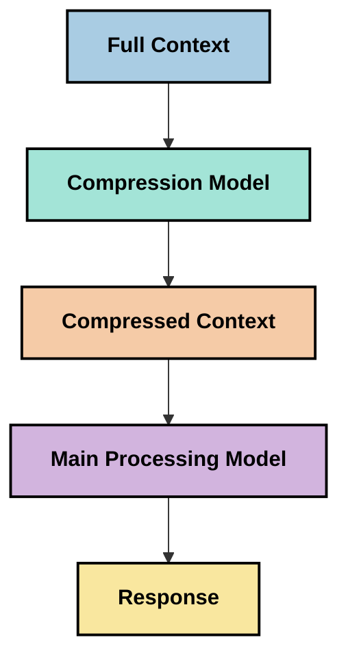
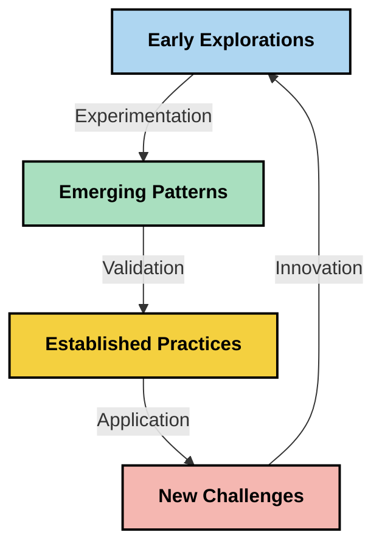

# Context Engineering: Isang Umunahang Konsepto sa MCP Ecosystem

## Pangkalahatang-ideya

Ang context engineering ay isang umuusbong na konsepto sa larangan ng AI na nagsusuri kung paano inaayos, ipinapamahagi, at pinapanatili ang impormasyon sa mga interaksyon sa pagitan ng mga kliyente at mga serbisyo ng AI. Habang umuunlad ang Model Context Protocol (MCP) ecosystem, lalong nagiging mahalaga ang pag-unawa kung paano mabisang pamahalaan ang konteksto. Ipinapakilala ng module na ito ang konsepto ng context engineering at sinusuri ang mga potensyal na aplikasyon nito sa mga implementasyon ng MCP.

## Mga Layunin sa Pag-aaral

Sa pagtatapos ng module na ito, magagawa mong:

- Maunawaan ang umuusbong na konsepto ng context engineering at ang potensyal na papel nito sa mga aplikasyon ng MCP
- Tukuyin ang mga pangunahing hamon sa pamamahala ng konteksto na tinutugunan ng disenyo ng protocol ng MCP
- Suriin ang mga teknik para mapabuti ang pagganap ng modelo sa pamamagitan ng mas mahusay na paghawak ng konteksto
- Isaalang-alang ang mga paraan upang masukat at masuri ang pagiging epektibo ng konteksto
- Ilapat ang mga umuusbong na konseptong ito upang mapabuti ang mga karanasan ng AI gamit ang balangkas ng MCP

## Panimula sa Context Engineering

Ang context engineering ay isang umuusbong na konsepto na nakatuon sa pinag-isipang disenyo at pamamahala ng daloy ng impormasyon sa pagitan ng mga gumagamit, aplikasyon, at mga modelo ng AI. Hindi tulad ng mga nakatuntunang larangan tulad ng prompt engineering, ang context engineering ay patuloy pa ring binubuo ng mga tagapagpraktis habang nagsusumikap silang lutasin ang natatanging mga hamon ng pagbibigay sa mga modelo ng AI ng tamang impormasyon sa tamang oras.

Habang umuunlad ang mga malalaking modelong pangwika (LLMs), lalong naging malinaw ang kahalagahan ng konteksto. Ang kalidad, kaugnayan, at estruktura ng konteksto na ibinibigay natin ay direktang nakakaapekto sa mga output ng modelo. Sinusuri ng context engineering ang ugnayang ito at naghahangad na bumuo ng mga prinsipyo para sa mabisang pamamahala ng konteksto.

> "Sa 2025, napakatalino na ng mga modelo diyan. Ngunit kahit ang pinakamatalinong tao ay hindi magagawang gawin nang epektibo ang kanilang trabaho nang walang konteksto ng kung ano ang hinihingi sa kanila... Ang 'Context engineering' ang susunod na antas ng prompt engineering. Ito ay tungkol sa paggawa nito nang awtomatiko sa isang dinamikong sistema." — Walden Yan, Cognition AI

Maaaring saklawin ng context engineering ang:

1. **Pagpili ng Konteksto**: Pagtukoy kung aling impormasyon ang may kaugnayan para sa isang partikular na gawain
2. **Pag-ayos ng Konteksto**: Pag-organisa ng impormasyon upang mapalaki ang pagkaunawa ng modelo
3. **Paghahatid ng Konteksto**: Pag-optimize kung paano at kailan ipinapadala ang impormasyon sa mga modelo
4. **Pagpapanatili ng Konteksto**: Pamamahala sa estado at ebolusyon ng konteksto sa paglipas ng panahon
5. **Pagsusuri ng Konteksto**: Pagsukat at pagpapabuti ng pagiging epektibo ng konteksto

Ang mga larangan ng pokus na ito ay partikular na may kaugnayan sa MCP ecosystem, na nagbibigay ng isang pamantayang paraan para sa mga aplikasyon upang magbigay ng konteksto sa LLMs.


## Ang Pananaw sa Paglalakbay ng Konteksto

Isang paraan upang mailarawan ang context engineering ay ang pagsubaybay sa landas ng impormasyon sa isang MCP system:



### Mga Pangunahing Yugto sa Paglalakbay ng Konteksto:

1. **Input ng Gumagamit**: Raw na impormasyon mula sa gumagamit (teksto, mga larawan, mga dokumento)
2. **Pagsasama ng Konteksto**: Pagsasama ng input ng gumagamit sa konteksto ng sistema, kasaysayan ng pag-uusap, at iba pang nakuha na impormasyon
3. **Pagproseso ng Modelo**: Pinoproseso ng modelo ng AI ang pinagsamang konteksto
4. **Pagbuo ng Tugon**: Gumagawa ang modelo ng mga output batay sa ibinigay na konteksto
5. **Pamamahala ng Estado**: Ina-update ng sistema ang kanyang panloob na estado batay sa interaksyon

Ipinapakita ng pananaw na ito ang dynamic na kalikasan ng konteksto sa mga AI system at naglalantad ng mahahalagang tanong kung paano pinakamahusay na pamahalaan ang impormasyon sa bawat yugto.

## Mga Umuusbong na Prinsipyo sa Context Engineering

Habang nabubuo ang larangan ng context engineering, ilang mga paunang prinsipyo ang nagsisimulang lumitaw mula sa mga tagapagpraktis. Maaari itong makatulong na gabayan ang mga pagpipilian sa implementasyon ng MCP:

### Prinsipyo 1: Ibahagi nang Kumpleto ang Konteksto

Dapat ibahagi nang buo ang konteksto sa pagitan ng lahat ng bahagi ng isang sistema sa halip na hati-hatiin ito sa maraming ahente o proseso. Kapag nahati ang konteksto, maaaring magka-konflik ang mga desisyon na ginawa sa isang bahagi ng sistema sa iba pang bahagi.



Sa mga aplikasyon ng MCP, nangangahulugan ito ng pagdisenyo ng mga sistema kung saan ang konteksto ay dumadaloy nang tuloy-tuloy sa buong pipeline sa halip na pagiging nakahiwalay.

### Prinsipyo 2: Kilalanin na ang mga Aksyon ay Nagtataglay ng Implicit na Mga Desisyon

Bawat aksyon na ginagawa ng modelo ay nagpapahiwatig ng implicit na mga desisyon kung paano interpretahin ang konteksto. Kapag maraming bahagi ang kumikilos sa magkaibang mga konteksto, maaaring magka-konflik ang mga implicit na desisyong ito, na nagdudulot ng hindi magkakatugmang mga resulta.

Mahalaga ang prinsipyong ito para sa mga aplikasyon ng MCP:
- I-priyoridad ang linear na pagproseso ng mga kumplikadong gawain kaysa sa parallel na pagsasagawa na may hati-hating konteksto
- Tiyakin na lahat ng punto ng pagdedesisyon ay may access sa parehong kontekstwal na impormasyon
- Disenyuhin ang mga sistema kung saan nakikita ng mga huling hakbang ang buong konteksto ng mga naunang desisyon

### Prinsipyo 3: Timbangin ang Lalim ng Konteksto sa Limitasyon ng Bintana

Habang lumalawak ang mga pag-uusap at proseso, umaapaw ang mga bintana ng konteksto. Sinusuri ng epektibong context engineering ang mga pamamaraan upang pamahalaan ang tensyon sa pagitan ng komprehensibong konteksto at mga teknikal na limitasyon.

Mga posibleng pamamaraan na sinusuri ay kinabibilangan ng:
- Compression ng konteksto na pinapanatili ang mahahalagang impormasyon habang binabawasan ang paggamit ng token
- Progessive loading ng konteksto batay sa kaugnayan sa kasalukuyang pangangailangan
- Pagbubuod ng mga naunang interaksyon habang pinapanatili ang mahahalagang desisyon at katotohanan

## Mga Hamon sa Konteksto at Disenyo ng Protocol ng MCP

Ang Model Context Protocol (MCP) ay idinisenyo nang may kamalayan sa mga natatanging hamon ng pamamahala ng konteksto. Nakakatulong ang pag-unawa sa mga hamong ito upang ipaliwanag ang mga pangunahing aspeto ng disenyo ng protocol ng MCP:


### Hamon 1: Limitasyon ng Bintana ng Konteksto
Karamihan sa mga modelo ng AI ay may mga itinalagang sukat ng bintana ng konteksto, na naglilimita sa dami ng impormasyong kanilang mapoproseso nang sabay-sabay.

**Tugon sa Disenyo ng MCP:** 
- Sinusuportahan ng protocol ang estrukturadong, resource-based na konteksto na maaaring matukoy nang mabisang gamitin
- Maaaring hatiin ang mga resource at i-load nang paunti-unti

### Hamon 2: Pagtukoy ng Kaugnayan
Mahirap tukuyin kung aling impormasyon ang pinakamahalaga upang isama sa konteksto.

**Tugon sa Disenyo ng MCP:**
- Likas na nababagay na mga kasangkapan para sa dinamikong pagkuha ng impormasyon batay sa pangangailangan
- Ang mga estrukturadong prompt ay nagpapahintulot ng konsistenteng organisasyon ng konteksto

### Hamon 3: Pagpapatuloy ng Konteksto
Kinakailangan ang masusing pagsubaybay sa konteksto upang mapamahalaan ang estado sa lahat ng interaksyon.

**Tugon sa Disenyo ng MCP:**
- Standardisadong pamamahala ng sesyon
- Malinaw na tinukoy na mga pattern ng interaksyon para sa ebolusyon ng konteksto

### Hamon 4: Multi-Modal na Konteksto
Iba’t ibang uri ng data (teksto, larawan, estrukturadong data) ay nangangailangan ng iba't ibang paghawak.

**Tugon sa Disenyo ng MCP:**
- Dinisenyo ang protocol para tanggapin ang iba't ibang uri ng nilalaman
- Standardisadong representasyon ng multi-modal na impormasyon

### Hamon 5: Seguridad at Privacy
Madalas na naglalaman ang konteksto ng sensitibong impormasyon na kailangang protektahan.

**Tugon sa Disenyo ng MCP:**
- Malinaw na hangganan sa pagitan ng mga responsibilidad ng kliyente at server
- Mga lokal na opsyon sa pagproseso upang mabawasan ang paglalantad ng data

Ang pag-unawa sa mga hamong ito at kung paano ito tinutugunan ng MCP ay nagbibigay ng pundasyon para sa paggalugad ng mas advanced na teknik sa context engineering.

## Mga Umuusbong na Paraan sa Context Engineering

Habang umuunlad ang larangan ng context engineering, ilang mga kahanga-hangang pamamaraan ang lumilitaw. Mga kasalukuyang ideya ito at hindi pa mga ganap na best practices, at malamang ay i-evolve habang nadaragdagan ang karanasan natin sa mga implementasyon ng MCP.

### 1. Linear Processing na Single-Threaded

Sa kaibahan sa mga multi-agent na arkitektura na naghahati-hati ng konteksto, natuklasan ng ilang mga tagapagpraktis na ang single-threaded na linear processing ay nagbubunga ng mas konsistenteng resulta. Ito ay sumasang-ayon sa prinsipyong panatilihin ang pinag-isang konteksto.



Habang maaaring mukhang hindi kasing episyente ang paraang ito kumpara sa parallel processing, madalas itong nagreresulta ng mas magkakaugnay at maaasahang mga output dahil ang bawat hakbang ay nakabatay sa kumpletong pagkaunawa sa mga naunang desisyon.

### 2. Pagchunk ng Konteksto at Pagbibigay-Prioridad

Paghati-hati ng malalaking konteksto sa mga makokontrol na bahagi at pagbibigay-priyoridad sa mga pinaka-mahalaga.

```python
# Conceptual Example: Context Chunking and Prioritization
def process_with_chunked_context(documents, query):
    # 1. Break documents into smaller chunks
    chunks = chunk_documents(documents)
    
    # 2. Calculate relevance scores for each chunk
    scored_chunks = [(chunk, calculate_relevance(chunk, query)) for chunk in chunks]
    
    # 3. Sort chunks by relevance score
    sorted_chunks = sorted(scored_chunks, key=lambda x: x[1], reverse=True)
    
    # 4. Use the most relevant chunks as context
    context = create_context_from_chunks([chunk for chunk, score in sorted_chunks[:5]])
    
    # 5. Process with the prioritized context
    return generate_response(context, query)
```

Ang konseptong nasa itaas ay nagpapakita kung paano natin maaaring hatiin ang malalaking dokumento sa mga piraso na madaling pamahalaan at pumili lamang ng pinaka-makaugnayang bahagi para sa konteksto. Nakakatulong ito upang magtrabaho sa loob ng limitasyon ng bintana ng konteksto habang ginagamit pa rin ang malalaking base ng kaalaman.

### 3. Progresibong Pag-load ng Konteksto

Pag-load ng konteksto nang paunti-unti ayon sa pangangailangan sa halip na sabay-sabay.



Nagsisimula ang progresibong pag-load ng konteksto sa minimal na konteksto at lumalawak lamang kapag kinakailangan. Malaki nitong nababawasan ang paggamit ng token para sa mga simpleng query habang pinapanatili ang kakayahan upang sagutin ang mas kumplikadong mga tanong.

### 4. Pag-compress at Pagbubuod ng Konteksto

Pagpapaliit ng laki ng konteksto habang pinananatili ang mahahalagang impormasyon.



Nakatuon ang pag-compress ng konteksto sa:
- Pagtanggal ng mga redundant na impormasyon
- Pagbubuod ng mahahabang nilalaman
- Pagkuha ng mga pangunahing katotohanan at detalye
- Pagpapanatili ng mga kritikal na elemento ng konteksto
- Pag-optimize para sa kahusayan ng token

Mahalaga ang pamamaraang ito lalo na sa pagpapanatili ng mahahabang pag-uusap sa loob ng mga bintana ng konteksto o para sa episyenteng pagproseso ng malalaking dokumento. May ilang tagapagpraktis na gumagamit ng espesyal na mga modelo para sa pag-compress ng konteksto at pagbubuod ng kasaysayan ng pag-uusap.


## Mga Isinasaalang-alang sa Exploratory Context Engineering

Sa paggalugad natin sa umuusbong na larangan ng context engineering, nararapat isaalang-alang ang ilang titik kapag nagtatrabaho sa mga implementasyon ng MCP. Hindi ito mga kautusang pinakamahusay na gawi kundi mga larangang pagsubok na maaaring magbunga ng mga pagpapabuti sa iyong espesipikong kaso.

### Isaalang-alang ang Iyong Mga Layunin sa Konteksto

Bago magpatupad ng komplikadong mga solusyon sa pamamahala ng konteksto, malinaw na ipahayag kung ano ang iyong nais makamit:
- Ano ang tiyak na impormasyon na kailangan ng modelo upang magtagumpay?
- Alin ang mahalaga at alin ang pangsuporta?
- Ano ang iyong mga limitasyon sa pagganap (latency, limitasyon ng token, gastos)?

### Suriin ang Mga Paunang Paraan ng Layered Context

Nakakamit ng ilang tagapagpraktis ang tagumpay sa pag-aayos ng konteksto sa mga konseptwal na layer:
- **Core Layer**: Mahahalagang impormasyon na palaging kailangan ng modelo
- **Situational Layer**: Konteksto na partikular sa kasalukuyang interaksyon
- **Supporting Layer**: Karagdagang impormasyon na maaaring maging kapaki-pakinabang
- **Fallback Layer**: Impormasyon na dini-access lamang kung kinakailangan

### Siyasatin ang Mga Estratehiya sa Pagkuha

Madalas nakasalalay ang pagiging epektibo ng konteksto sa paraan ng pagkuha ng impormasyon:
- Semantic search at embeddings para sa paghahanap ng konseptwal na kaugnayang impormasyon
- Keyword-based na paghahanap para sa tiyak na mga detalye
- Hybrid na mga pamamaraan na pinagsasama ang iba't ibang paraan ng pagkuha
- Filtering ng metadata upang paliitin ang saklaw batay sa mga kategorya, petsa, o pinagmulan

### Subukan ang Konektibidad ng Konteksto

Maaaring makaapekto ang estruktura at daloy ng iyong konteksto sa pagkaunawa ng modelo:
- Pagsasama-sama ng magkakaugnay na impormasyon
- Paggamit ng pantay-pantay na pormat at organisasyon
- Pagpapanatili ng lohikal o kronolohikal na pagkakasunod-sunod kung ito ay naaangkop
- Pag-iwas sa magkasalungat na impormasyon

### Timbangin ang mga Kahalagahan ng Multi-Agent na Arkitektura

Bagaman popular ang multi-agent na arkitektura sa maraming AI na framework, may mga malalaking hamon ito sa pamamahala ng konteksto:
- Ang pagfragment ng konteksto ay maaaring magdulot ng hindi magkakatugmang mga desisyon sa iba't ibang ahente
- Maaaring magdulot ng mga konflikto ang parallel processing na mahirap ayusin
- Ang overhead ng komunikasyon sa pagitan ng mga ahente ay maaaring makabawas sa mga benepisyo ng performance
- Kinakailangan ang kumplikadong pamamahala ng estado upang mapanatili ang pagkakaugnay

Sa maraming mga kaso, ang single-agent na pamamaraan na may komprehensibong pamamahala ng konteksto ay maaaring magbigay ng mas maaasahang resulta kumpara sa maraming espesyal na ahente na may hati-hating konteksto.

### Bumuo ng Mga Paraan ng Pagsusuri

Upang mapabuti ang context engineering sa paglipas ng panahon, isaalang-alang kung paano mo susukatin ang tagumpay:
- A/B testing ng iba't ibang estruktura ng konteksto
- Pagsubaybay sa paggamit ng token at oras ng tugon
- Pagsubaybay sa kasiyahan ng gumagamit at mga rate ng pagkumpleto ng gawain
- Pagsusuri kung kailan at bakit nabibigo ang mga estratehiya ng konteksto

Ang mga isinasaalang-alang na ito ay kumakatawan sa mga aktibong larangan ng pagsasaliksik sa context engineering. Habang yumayabong ang larangan, malamang na lilitaw ang mas tiyak na mga pattern at gawi.

## Pagsukat ng Epektibo ng Konteksto: Isang Umuusbong na Balangkas

Habang ang context engineering ay sumusulong bilang isang konsepto, nagsisimula ang mga tagapagpraktis na suriin kung paano natin susukatin ang bisa nito. Wala pang ganap na balangkas, ngunit may iba't ibang mga sukatan na isinasaalang-alang na maaaring makatulong gabayan ang mga susunod na gawain.

### Mga Potensyal na Dimensyon ng Pagsusukat


#### 1. Mga Pagsasaalang-alang sa Input Efficiency

- **Ratio ng Konteksto-sa-Tugon**: Gaano karaming konteksto ang kailangan kaugnay ng sukat ng tugon?
- **Paggamit ng Token**: Anong porsyento ng binigay na mga token ng konteksto ang tila nakaimpluwensya sa tugon?
- **Pagpapaliit ng Konteksto**: Gaano kaepektibo natin mapakiusapan ang raw na impormasyon?

#### 2. Mga Pagsasaalang-alang sa Pagganap

- **Epekto sa Latency**: Paano naaapektuhan ng pamamahala ng konteksto ang oras ng tugon?
- **Ekonomiya ng Token**: Epektibo ba nating na-o-optimize ang paggamit ng token?
- **Precision sa Pagkuha**: Gaano kaugnay ang nakuhang impormasyon?
- **Paggamit ng Resource**: Anong mga computational resources ang kailangan?

#### 3. Mga Pagsasaalang-alang sa Kalidad

- **Kaugnayan ng Tugon**: Gaano kahusay tinutugunan ng tugon ang query?
- **Katotohanan**: Pinapabuti ba ng pamamahala ng konteksto ang katuwiran ng mga sagot?
- **Konsistensi**: Konsistente ba ang mga tugon sa magkakahalintulad na mga query?
- **Antas ng Halusinasyon**: Nakababawas ba ang mas mahusay na konteksto sa mga halusinasyon ng modelo?

#### 4. Mga Pagsasaalang-alang sa Karanasan ng Gumagamit

- **Rate ng Follow-up**: Gaano kadalas kailangan ng mga gumagamit ang paglilinaw?
- **Pagkumpleto ng Gawain**: Nagagawa ba ng mga gumagamit na matagumpay na makamit ang kanilang mga layunin?
- **Mga Palatandaan ng Kasiyahan**: Paano binibigyan ng grado ng mga gumagamit ang kanilang karanasan?

### Mga Eksperimentong Paraan sa Pagsusukat

Sa pagsubok ng context engineering sa MCP implementations, isaalang-alang ang mga eksploratoriong paraang ito:

1. **Paghahambing ng Baseline**: Magtatag ng baseline gamit ang simpleng mga paraan ng konteksto bago subukan ang mas sopistikadong mga metodo

2. **Pa unti-unting Pagbabago**: Baguhin ang isang aspeto ng pamamahala ng konteksto sa isang pagkakataon upang ma-isolate ang epekto nito

3. **Pagsusuri na Nakatuon sa Gumagamit**: Pagsamahin ang kwantitatibong mga sukatan sa kwalitatibong feedback ng gumagamit

4. **Pagsusuri ng Kabiguan**: Suriin ang mga kaso kung saan nabibigo ang mga estratehiya ng konteksto upang maunawaan ang mga posibleng pagpapabuti

5. **Pagsusuri ng Multi-Dimensyon**: Isaalang-alang ang mga trade-off sa pagitan ng kahusayan, kalidad, at karanasan ng gumagamit

Ang eksperimentong multi-faceted na pamamaraang ito sa pagsusukat ay tumutugma sa umuusbong na katangian ng context engineering.

## Pangwakas na Mga Kaisipan

Ang context engineering ay isang umuusbong na larangan ng pagsasaliksik na maaaring maging sentral sa mga mabisang aplikasyon ng MCP. Sa pamamagitan ng maingat na pag-isip kung paano dumadaloy ang impormasyon sa iyong sistema, maaari kang lumikha ng mga karanasang AI na mas episyente, tumpak, at mahalaga para sa mga gumagamit.

Ang mga teknik at pamamaraan na inilatag sa module na ito ay kumakatawan sa maagang pag-iisip sa larangang ito, hindi pa mga ganap na gawi. Maaaring maging isang mas tiyak na disiplina ang context engineering habang umuunlad ang mga kakayahan ng AI at lumalawak ang ating pag-unawa. Sa ngayon, ang eksperimento na may kasamang maingat na pagsusukat ay tila ang pinakamabisa.

## Mga Posibleng Hinaharap na Direksyon

Ang larangan ng context engineering ay nasa mga unang bahagi pa lamang, ngunit ilang mga magagandang direksyon ay lumilitaw:

- Malaki ang maiaambag ng mga prinsipyo ng context engineering sa pagganap ng modelo, kahusayan, karanasan ng gumagamit, at pagiging maaasahan
- Ang mga single-threaded na paraan na may komprehensibong pamamahala ng konteksto ay maaaring mas umuna kaysa sa mga multi-agent na arkitektura para sa maraming kaso ng paggamit
- Ang mga espesyal na mga modelo para sa pag-compress ng konteksto ay maaaring maging standard na bahagi ng mga AI pipeline
- Ang tensyon sa pagitan ng kompletong konteksto at limitasyon ng token ay posibleng magbunsod ng inobasyon sa paghawak ng konteksto
- Habang nagiging mas mahusay ang mga modelo sa episyenteng komunikasyong parang tao, mas magiging posible ang tunay na multi-agent na kolaborasyon
- Maaaring umunlad ang mga implementasyon ng MCP upang istandardisa ang mga pattern ng pamamahala ng konteksto na lilitaw mula sa kasalukuyang eksperimentasyon



## Mga Sanggunian

### Opisyal na Mga Sanggunian ng MCP
- [Model Context Protocol Website](https://modelcontextprotocol.io/)
- [Model Context Protocol Specification](https://github.com/modelcontextprotocol/modelcontextprotocol)
- [Dokumentasyon ng MCP](https://modelcontextprotocol.io/docs)
- [MCP C# SDK](https://github.com/modelcontextprotocol/csharp-sdk)
- [MCP Python SDK](https://github.com/modelcontextprotocol/python-sdk)
- [MCP TypeScript SDK](https://github.com/modelcontextprotocol/typescript-sdk)
- [MCP Inspector](https://github.com/modelcontextprotocol/inspector) - Tool sa visual na pagsubok para sa mga MCP server

### Mga Artikulo tungkol sa Context Engineering
- [Huwag Gumawa ng Multi-Agents: Mga Prinsipyo ng Context Engineering](https://cognition.ai/blog/dont-build-multi-agents) - Mga pananaw ni Walden Yan sa mga prinsipyo ng context engineering
- [Isang Praktikal na Gabay sa Paggawa ng Agents](https://cdn.openai.com/business-guides-and-resources/a-practical-guide-to-building-agents.pdf) - Gabay ng OpenAI sa epektibong disenyo ng agent
- [Pagbuo ng Epektibong mga Agent](https://www.anthropic.com/engineering/building-effective-agents) - Paraan ng Anthropic sa pagbuo ng agent

### Kaugnay na Pananaliksik
- [Dynamic Retrieval Augmentation para sa Malalaking Language Models](https://arxiv.org/abs/2310.01487) - Pananaliksik tungkol sa mga dynamic retrieval na pamamaraan
- [Nawala sa Gitna: Paano Ginagamit ng Language Models ang Mahahabang Context](https://arxiv.org/abs/2307.03172) - Mahalagang pananaliksik sa mga pattern ng pagproseso ng context
- [Hierarchical Text-Conditioned Image Generation gamit ang CLIP Latents](https://arxiv.org/abs/2204.06125) - Papel ng DALL-E 2 na may mga pananaw sa pag-aayos ng context
- [Pagsusuri sa Papel ng Context sa Arkitektura ng Malalaking Language Model](https://aclanthology.org/2023.findings-emnlp.124/) - Pinakabagong pananaliksik sa paghawak ng context
- [Multi-Agent Collaboration: Isang Surbey](https://arxiv.org/abs/2304.03442) - Pananaliksik sa mga multi-agent system at ang kanilang mga hamon

### Karagdagang Mga Resorses
- [Mga Teknik sa Pag-optimize ng Context Window](https://learn.microsoft.com/en-us/azure/ai-services/openai/concepts/context-window)
- [Mga Advanced na Teknik ng RAG](https://www.microsoft.com/en-us/research/blog/retrieval-augmented-generation-rag-and-frontier-models/)
- [Dokumentasyon ng Semantic Kernel](https://github.com/microsoft/semantic-kernel)
- [Microsoft Foundry Toolkit para sa Visual Studio Code](https://github.com/microsoft/vscode-ai-toolkit)

## Ano ang susunod 

- [5.15 MCP Custom Transport](../mcp-transport/README.md)

---

<!-- CO-OP TRANSLATOR DISCLAIMER START -->
**Pagtatanggi**:
Ang dokumentong ito ay isinalin gamit ang serbisyo ng AI translation na [Co-op Translator](https://github.com/Azure/co-op-translator). Bagama't nagsusumikap kami para sa katumpakan, pakatandaan na ang awtomatikong pagsasalin ay maaaring maglaman ng mga pagkakamali o hindi pagkakatugma. Ang orihinal na dokumento sa orihinal nitong wika ang dapat ituring na pangunahing sanggunian. Para sa mahahalagang impormasyon, inirerekomenda ang propesyonal na pagsasalin ng tao. Hindi kami mananagot sa anumang maling pagkakaintindi o maling interpretasyon na nagmula sa paggamit ng pagsasaling ito.
<!-- CO-OP TRANSLATOR DISCLAIMER END -->