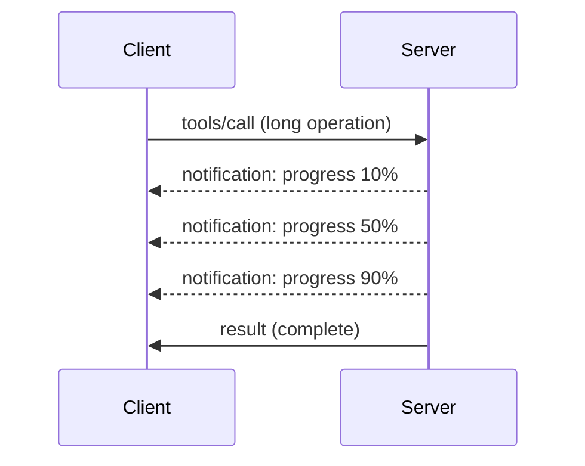

# Malalim na Pagsusuri sa Mga Tampok ng MCP Protocol

Ang gabay na ito ay sumusuri sa mga advanced na tampok ng MCP protocol na lampas sa simpleng paghawak ng tool at resource. Ang pag-unawa sa mga tampok na ito ay tumutulong sa iyo na bumuo ng mas matatag, madaling gamitin, at handa para sa produksyon na mga MCP server.

> **Saklaw ng MCP `2026-07-28`:** ang pagsisimula at pagsasara ng proseso ng server ay nananatiling
> mga alalahanin ng aplikasyon, ngunit ang MCP `initialize` handshake at mga sesyon sa antas ng protocol
> ay tinanggal. Ang seksyon ng Logging sa ibaba ay nananatili para sa mga legacy
> na implementasyon; ang mga bagong server ay dapat gumamit ng `stderr` o OpenTelemetry. Ang Tasks ay
> ngayon ay isang hiwalay na versioned na extension. Tingnan ang
> [Ano ang mga Nagbago sa MCP: Ang Ispecipikasyon ng 2026-07-28](../../01-CoreConcepts/mcp-2026-07-28.md).

## Mga Tampok na Tinalakay

1. **Mga Abiso ng Progreso** - Iulat ang progreso para sa mga operasyon na tumatagal
2. **Pagkansela ng Kahilingan** - Payagan ang mga kliyente na kanselahin ang mga kahilingang nasa gitna pa
3. **Mga Template ng Resource** - Dinamikong mga URI ng resource na may mga parameter
4. **Lifecycle ng Aplikasyon** - Pagsisimula at pagsasara ng proseso ng server
5. **Pagkontrol sa Logging (Legacy)** - Tinanggal na pagsasaayos ng logging ng MCP
6. **Mga Pattern ng Paghawak ng Error** - Konsistent na tugon sa error

---

## 1. Mga Abiso ng Progreso

Para sa mga operasyong tumatagal ng panahon (pagproseso ng data, pag-download ng file, mga tawag sa API), pinananatiling impormado ng mga abiso ng progreso ang mga gumagamit.

### Paano Ito Gumagana



### Implementasyon sa Python

```python
from mcp.server import Server, NotificationOptions
from mcp.types import ProgressNotification
import asyncio

app = Server("progress-server")

@app.tool()
async def process_large_file(file_path: str, ctx) -> str:
    """Process a large file with progress updates."""
    
    # Get file size for progress calculation
    file_size = os.path.getsize(file_path)
    processed = 0
    
    with open(file_path, 'rb') as f:
        while chunk := f.read(8192):
            # Process chunk
            await process_chunk(chunk)
            processed += len(chunk)
            
            # Send progress notification
            progress = (processed / file_size) * 100
            await ctx.send_notification(
                ProgressNotification(
                    progressToken=ctx.request_id,
                    progress=progress,
                    total=100,
                    message=f"Processing: {progress:.1f}%"
                )
            )
    
    return f"Processed {file_size} bytes"

@app.tool()
async def batch_operation(items: list[str], ctx) -> str:
    """Process multiple items with progress."""
    
    results = []
    total = len(items)
    
    for i, item in enumerate(items):
        result = await process_item(item)
        results.append(result)
        
        # Report progress after each item
        await ctx.send_notification(
            ProgressNotification(
                progressToken=ctx.request_id,
                progress=i + 1,
                total=total,
                message=f"Processed {i + 1}/{total}: {item}"
            )
        )
    
    return f"Completed {total} items"
```

### Implementasyon sa TypeScript

```typescript
import { Server } from "@modelcontextprotocol/sdk/server/index.js";

server.setRequestHandler(CallToolSchema, async (request, extra) => {
  const { name, arguments: args } = request.params;
  
  if (name === "process_data") {
    const items = args.items as string[];
    const results = [];
    
    for (let i = 0; i < items.length; i++) {
      const result = await processItem(items[i]);
      results.push(result);
      
      // Send progress notification
      await extra.sendNotification({
        method: "notifications/progress",
        params: {
          progressToken: request.id,
          progress: i + 1,
          total: items.length,
          message: `Processing item ${i + 1}/${items.length}`
        }
      });
    }
    
    return { content: [{ type: "text", text: JSON.stringify(results) }] };
  }
});
```

### Paghawak ng Kliyente (Python)

```python
async def handle_progress(notification):
    """Handle progress notifications from server."""
    params = notification.params
    print(f"Progress: {params.progress}/{params.total} - {params.message}")

# Register handler
session.on_notification("notifications/progress", handle_progress)

# Call tool (progress updates will arrive via handler)
result = await session.call_tool("process_large_file", {"file_path": "/data/large.csv"})
```

---

## 2. Pagkansela ng Kahilingan

Payagan ang mga kliyente na kanselahin ang mga kahilingan na hindi na kailangan o masyadong matagal.

### Implementasyon sa Python

```python
from mcp.server import Server
from mcp.types import CancelledError
import asyncio

app = Server("cancellable-server")

@app.tool()
async def long_running_search(query: str, ctx) -> str:
    """Search that can be cancelled."""
    
    results = []
    
    try:
        for page in range(100):  # Search through many pages
            # Check if cancellation was requested
            if ctx.is_cancelled:
                raise CancelledError("Search cancelled by user")
            
            # Simulate page search
            page_results = await search_page(query, page)
            results.extend(page_results)
            
            # Small delay allows cancellation checks
            await asyncio.sleep(0.1)
            
    except CancelledError:
        # Return partial results
        return f"Cancelled. Found {len(results)} results before cancellation."
    
    return f"Found {len(results)} total results"

@app.tool()
async def download_file(url: str, ctx) -> str:
    """Download with cancellation support."""
    
    async with aiohttp.ClientSession() as session:
        async with session.get(url) as response:
            total_size = int(response.headers.get('content-length', 0))
            downloaded = 0
            chunks = []
            
            async for chunk in response.content.iter_chunked(8192):
                if ctx.is_cancelled:
                    return f"Download cancelled at {downloaded}/{total_size} bytes"
                
                chunks.append(chunk)
                downloaded += len(chunk)
            
            return f"Downloaded {downloaded} bytes"
```

### Pagpapatupad ng Cancellation Context

```python
class CancellableContext:
    """Context object that tracks cancellation state."""
    
    def __init__(self, request_id: str):
        self.request_id = request_id
        self._cancelled = asyncio.Event()
        self._cancel_reason = None
    
    @property
    def is_cancelled(self) -> bool:
        return self._cancelled.is_set()
    
    def cancel(self, reason: str = "Cancelled"):
        self._cancel_reason = reason
        self._cancelled.set()
    
    async def check_cancelled(self):
        """Raise if cancelled, otherwise continue."""
        if self.is_cancelled:
            raise CancelledError(self._cancel_reason)
    
    async def sleep_or_cancel(self, seconds: float):
        """Sleep that can be interrupted by cancellation."""
        try:
            await asyncio.wait_for(
                self._cancelled.wait(),
                timeout=seconds
            )
            raise CancelledError(self._cancel_reason)
        except asyncio.TimeoutError:
            pass  # Normal timeout, continue
```

### Pagkansela mula sa Panig ng Kliyente

```python
import asyncio

async def search_with_timeout(session, query, timeout=30):
    """Search with automatic cancellation on timeout."""
    
    task = asyncio.create_task(
        session.call_tool("long_running_search", {"query": query})
    )
    
    try:
        result = await asyncio.wait_for(task, timeout=timeout)
        return result
    except asyncio.TimeoutError:
        # Request cancellation
        await session.send_notification({
            "method": "notifications/cancelled",
            "params": {"requestId": task.request_id, "reason": "Timeout"}
        })
        return "Search timed out"
```

---

## 3. Mga Template ng Resource

Pinapayagan ng mga template ng resource ang dinamikong paggawa ng URI gamit ang mga parameter, na kapaki-pakinabang para sa mga API at database.

### Pagtukoy ng Mga Template

```python
from mcp.server import Server
from mcp.types import ResourceTemplate

app = Server("template-server")

@app.list_resource_templates()
async def list_templates() -> list[ResourceTemplate]:
    """Return available resource templates."""
    return [
        ResourceTemplate(
            uriTemplate="db://users/{user_id}",
            name="User Profile",
            description="Fetch user profile by ID",
            mimeType="application/json"
        ),
        ResourceTemplate(
            uriTemplate="api://weather/{city}/{date}",
            name="Weather Data",
            description="Historical weather for city and date",
            mimeType="application/json"
        ),
        ResourceTemplate(
            uriTemplate="file://{path}",
            name="File Content",
            description="Read file at given path",
            mimeType="text/plain"
        )
    ]

@app.read_resource()
async def read_resource(uri: str) -> str:
    """Read resource, expanding template parameters."""
    
    # Parse the URI to extract parameters
    if uri.startswith("db://users/"):
        user_id = uri.split("/")[-1]
        return await fetch_user(user_id)
    
    elif uri.startswith("api://weather/"):
        parts = uri.replace("api://weather/", "").split("/")
        city, date = parts[0], parts[1]
        return await fetch_weather(city, date)
    
    elif uri.startswith("file://"):
        path = uri.replace("file://", "")
        return await read_file(path)
    
    raise ValueError(f"Unknown resource URI: {uri}")
```

### Implementasyon sa TypeScript

```typescript
server.setRequestHandler(ListResourceTemplatesSchema, async () => {
  return {
    resourceTemplates: [
      {
        uriTemplate: "github://repos/{owner}/{repo}/issues/{issue_number}",
        name: "GitHub Issue",
        description: "Fetch a specific GitHub issue",
        mimeType: "application/json"
      },
      {
        uriTemplate: "db://tables/{table}/rows/{id}",
        name: "Database Row",
        description: "Fetch a row from a database table",
        mimeType: "application/json"
      }
    ]
  };
});

server.setRequestHandler(ReadResourceSchema, async (request) => {
  const uri = request.params.uri;
  
  // Parse GitHub issue URI
  const githubMatch = uri.match(/^github:\/\/repos\/([^/]+)\/([^/]+)\/issues\/(\d+)$/);
  if (githubMatch) {
    const [_, owner, repo, issueNumber] = githubMatch;
    const issue = await fetchGitHubIssue(owner, repo, parseInt(issueNumber));
    return {
      contents: [{
        uri,
        mimeType: "application/json",
        text: JSON.stringify(issue, null, 2)
      }]
    };
  }
  
  throw new Error(`Unknown resource URI: ${uri}`);
});
```

---

## 4. Lifecycle ng Aplikasyon

Sinasaklaw ng seksyong ito ang pagsisimula at pagsasara ng proseso ng aplikasyon, hindi ang tinanggal na
MCP `initialize` handshake. Ang wastong paghawak ng lifecycle ay nagsisiguro ng malinis na pamamahala ng resource.


### Pamamahala ng Lifecycle sa Python

```python
from mcp.server import Server
from contextlib import asynccontextmanager

app = Server("lifecycle-server")

# Shared state
db_connection = None
cache = None

@asynccontextmanager
async def lifespan(server: Server):
    """Manage server lifecycle."""
    global db_connection, cache
    
    # Startup
    print("🚀 Server starting...")
    db_connection = await create_database_connection()
    cache = await create_cache_client()
    print("✅ Resources initialized")
    
    yield  # Server runs here
    
    # Shutdown
    print("🛑 Server shutting down...")
    await db_connection.close()
    await cache.close()
    print("✅ Resources cleaned up")

app = Server("lifecycle-server", lifespan=lifespan)

@app.tool()
async def query_database(sql: str) -> str:
    """Use the shared database connection."""
    result = await db_connection.execute(sql)
    return str(result)
```

### Lifecycle sa TypeScript

```typescript
import { Server } from "@modelcontextprotocol/sdk/server/index.js";

class ManagedServer {
  private server: Server;
  private dbConnection: DatabaseConnection | null = null;
  
  constructor() {
    this.server = new Server({
      name: "lifecycle-server",
      version: "1.0.0"
    });
    
    this.setupHandlers();
  }
  
  async start() {
    // Initialize resources
    console.log("🚀 Server starting...");
    this.dbConnection = await createDatabaseConnection();
    console.log("✅ Database connected");
    
    // Start server
    await this.server.connect(transport);
  }
  
  async stop() {
    // Cleanup resources
    console.log("🛑 Server shutting down...");
    if (this.dbConnection) {
      await this.dbConnection.close();
    }
    await this.server.close();
    console.log("✅ Cleanup complete");
  }
  
  private setupHandlers() {
    this.server.setRequestHandler(CallToolSchema, async (request) => {
      // Use this.dbConnection safely
      // ...
    });
  }
}

// Usage with graceful shutdown
const server = new ManagedServer();

process.on('SIGINT', async () => {
  await server.stop();
  process.exit(0);
});

await server.start();
```

---

## 5. Pagkontrol sa Logging (Legacy)

> [!WARNING]
> Ang MCP Logging ay tinanggal sa `2026-07-28` at karapat-dapat nang alisin sa
> unang rebisyon ng ispecipikasyon na inilabas sa o pagkatapos ng Hulyo 28, 2027. Ang mga halimbawa
> sa ibaba ay para sa pagiging compatible sa mga lumang implementasyon. Gumamit ng `stderr` kasama
> ang stdio at OpenTelemetry para sa istrukturadong observability sa mga bagong server.

Sinusuportahan ng mga legacy na bersyon ng MCP ang mga server-side na antas ng logging na maaaring kontrolin ng mga kliyente.

### Pagpapatupad ng Mga Antas ng Logging

```python
from mcp.server import Server
from mcp.types import LoggingLevel
import logging

app = Server("logging-server")

# Map MCP levels to Python logging levels
LEVEL_MAP = {
    LoggingLevel.DEBUG: logging.DEBUG,
    LoggingLevel.INFO: logging.INFO,
    LoggingLevel.WARNING: logging.WARNING,
    LoggingLevel.ERROR: logging.ERROR,
}

logger = logging.getLogger("mcp-server")

@app.set_logging_level()
async def set_logging_level(level: LoggingLevel) -> None:
    """Handle client request to change logging level."""
    python_level = LEVEL_MAP.get(level, logging.INFO)
    logger.setLevel(python_level)
    logger.info(f"Logging level set to {level}")

@app.tool()
async def debug_operation(data: str) -> str:
    """Tool with various logging levels."""
    logger.debug(f"Processing data: {data}")
    
    try:
        result = process(data)
        logger.info(f"Successfully processed: {result}")
        return result
    except Exception as e:
        logger.error(f"Processing failed: {e}")
        raise
```

### Pagpapadala ng Mga Mensahe ng Log sa Kliyente

```python
@app.tool()
async def complex_operation(input: str, ctx) -> str:
    """Operation that logs to client."""
    
    # Send log notification to client
    await ctx.send_log(
        level="info",
        message=f"Starting complex operation with input: {input}"
    )
    
    # Do work...
    result = await do_work(input)
    
    await ctx.send_log(
        level="debug",
        message=f"Operation complete, result size: {len(result)}"
    )
    
    return result
```

---

## 6. Mga Pattern ng Paghawak ng Error

Pinapabuti ng konsistent na paghawak ng error ang pag-debug at karanasan ng gumagamit.

### Mga Error Code ng MCP

```python
from mcp.types import McpError, ErrorCode

class ToolError(McpError):
    """Base class for tool errors."""
    pass

class ValidationError(ToolError):
    """Invalid input parameters."""
    def __init__(self, message: str):
        super().__init__(ErrorCode.INVALID_PARAMS, message)

class NotFoundError(ToolError):
    """Requested resource not found."""
    def __init__(self, resource: str):
        super().__init__(ErrorCode.INVALID_REQUEST, f"Not found: {resource}")

class PermissionError(ToolError):
    """Access denied."""
    def __init__(self, action: str):
        super().__init__(ErrorCode.INVALID_REQUEST, f"Permission denied: {action}")

class InternalError(ToolError):
    """Internal server error."""
    def __init__(self, message: str):
        super().__init__(ErrorCode.INTERNAL_ERROR, message)
```

### Istrakturadong Mga Tugon sa Error

```python
@app.tool()
async def safe_operation(input: str) -> str:
    """Tool with comprehensive error handling."""
    
    # Validate input
    if not input:
        raise ValidationError("Input cannot be empty")
    
    if len(input) > 10000:
        raise ValidationError(f"Input too large: {len(input)} chars (max 10000)")
    
    try:
        # Check permissions
        if not await check_permission(input):
            raise PermissionError(f"read {input}")
        
        # Perform operation
        result = await perform_operation(input)
        
        if result is None:
            raise NotFoundError(input)
        
        return result
        
    except ConnectionError as e:
        raise InternalError(f"Database connection failed: {e}")
    except TimeoutError as e:
        raise InternalError(f"Operation timed out: {e}")
    except Exception as e:
        # Log unexpected errors
        logger.exception(f"Unexpected error in safe_operation")
        raise InternalError(f"Unexpected error: {type(e).__name__}")
```

### Paghawak ng Error sa TypeScript

```typescript
import { McpError, ErrorCode } from "@modelcontextprotocol/sdk/types.js";

function validateInput(data: unknown): asserts data is ValidInput {
  if (typeof data !== "object" || data === null) {
    throw new McpError(
      ErrorCode.InvalidParams,
      "Input must be an object"
    );
  }
  // More validation...
}

server.setRequestHandler(CallToolSchema, async (request) => {
  try {
    validateInput(request.params.arguments);
    
    const result = await performOperation(request.params.arguments);
    
    return {
      content: [{ type: "text", text: JSON.stringify(result) }]
    };
    
  } catch (error) {
    if (error instanceof McpError) {
      throw error;  // Already an MCP error
    }
    
    // Convert other errors
    if (error instanceof NotFoundError) {
      throw new McpError(ErrorCode.InvalidRequest, error.message);
    }
    
    // Unknown error
    console.error("Unexpected error:", error);
    throw new McpError(
      ErrorCode.InternalError,
      "An unexpected error occurred"
    );
  }
});
```

---

## Mga Tampok na Sensitibo sa Bersyon

### Tasks Extension

Ang Tasks ay isang opisyal, hiwalay na versioned na extension sa MCP `2026-07-28`. Maaaring magbalik ang isang
server ng task handle mula sa isang tawag sa tool, at pinapatakbo ng kliyente ang task
gamit ang `tasks/get`, `tasks/update`, at `tasks/cancel`. Ang experimental na
`2025-11-25` Tasks API ay hindi pabalik na compatible, at ang `tasks/list` ay hindi na umiiral.


### Mga Annotasyon sa Tool

Naglalarawan ang mga annotasyon sa tool ng pag-uugali tulad ng read-only, destructive, idempotent,
o open-world na operasyon. Ito ay mga pahiwatig at hindi dapat ituring bilang pinagkakatiwalaang
awtorisasyon o mga garantiya sa kaligtasan maliban kung nanggaling ito sa isang pinagkakatiwalaang server.

---

## Ano ang Sunod

- [Module 8 - Pinakamahusay na Praktis](../../08-BestPractices/README.md)
- [5.14 - Context Engineering](../mcp-contextengineering/README.md)
- [MCP Specification Changelog](https://modelcontextprotocol.io/specification/2026-07-28/changelog)

---

## Karagdagang Mga Mapagkukunan

- [Ispecipikasyon ng MCP 2026-07-28](https://modelcontextprotocol.io/specification/2026-07-28/)
- [Mga Error Code ng JSON-RPC 2.0](https://www.jsonrpc.org/specification#error_object)
- [Mga Halimbawa ng Python SDK](https://github.com/modelcontextprotocol/python-sdk/tree/main/examples)
- [Mga Halimbawa ng TypeScript SDK](https://github.com/modelcontextprotocol/typescript-sdk/tree/main/examples)

---

<!-- CO-OP TRANSLATOR DISCLAIMER START -->
**Pagtatanggi**:
Ang dokumentong ito ay isinalin gamit ang serbisyo ng AI translation na [Co-op Translator](https://github.com/Azure/co-op-translator). Bagama't nagsusumikap kami para sa katumpakan, pakatandaan na ang awtomatikong pagsasalin ay maaaring maglaman ng mga pagkakamali o hindi pagkakatugma. Ang orihinal na dokumento sa orihinal nitong wika ang dapat ituring na pangunahing sanggunian. Para sa mahahalagang impormasyon, inirerekomenda ang propesyonal na pagsasalin ng tao. Hindi kami mananagot sa anumang maling pagkakaintindi o maling interpretasyon na nagmula sa paggamit ng pagsasaling ito.
<!-- CO-OP TRANSLATOR DISCLAIMER END -->