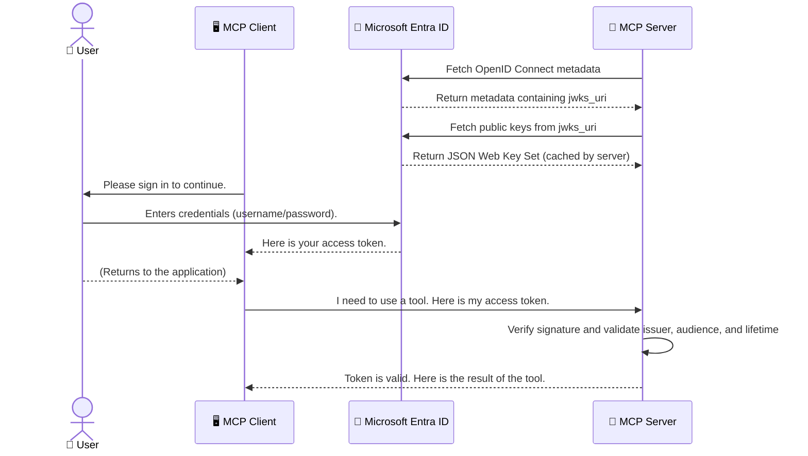

# Pag-secure ng AI Workflows: Entra ID Authentication para sa Model Context Protocol Servers

> [!NOTE]
> Ang remote server code sa leksiyong ito ay nagpo-protekta sa legacy `/sse` at `/message`
> endpoints at tumutok sa MCP `2025-11-25`. Panatilihin ang kanyang pagkakakilanlan at token-validation
> na mga praktis, ngunit gumamit ng `2026-07-28`-compatible na Streamable HTTP transport para sa mga bagong
> implementasyon.

## Panimula
Ang pag-secure ng iyong Model Context Protocol (MCP) server ay kasinghalaga ng pag-lock sa harapang pinto ng iyong bahay. Ang pagbukas ng iyong MCP server ay naglalantad ng iyong mga tools at data sa hindi awtorisadong pag-access, na maaaring magdulot ng mga paglabag sa seguridad. Nagbibigay ang Microsoft Entra ID ng matibay na cloud-based na solusyon sa pamamahala ng pagkakakilanlan at access, na tumutulong na matiyak na tanging mga awtorisadong user at aplikasyon lamang ang maaaring makipag-ugnayan sa iyong MCP server. Sa seksyong ito, matututuhan mo kung paano protektahan ang iyong AI workflows gamit ang Entra ID authentication.

## Mga Layunin sa Pagkatuto
Sa pagtatapos ng seksyong ito, magagawa mong:

- Maunawaan ang kahalagahan ng pag-secure sa MCP servers.
- Ipaliwanag ang mga batayan ng Microsoft Entra ID at OAuth 2.0 authentication.
- Kilalanin ang pagkakaiba sa pagitan ng public at confidential clients.
- Ipatupad ang Entra ID authentication sa parehong local (public client) at remote (confidential client) na MCP server na mga scenario.
- Ilapat ang mga pinakamahusay na gawi sa seguridad kapag gumagawa ng AI workflows.

## Seguridad at MCP

Tulad ng hindi mo iiwanang naka-unlock ang harapang pinto ng iyong bahay, hindi mo rin dapat iwanang bukas ang iyong MCP server para sa sinumang makaka-access. Mahalaga ang pag-secure ng iyong AI workflows para makabuo ng matibay, mapagkakatiwalaan, at ligtas na mga aplikasyon. Ipapakilala sa kabanatang ito ang paggamit ng Microsoft Entra ID para i-secure ang iyong mga MCP servers, siguraduhing tanging awtorisadong mga user at aplikasyon lamang ang makikipag-ugnayan sa iyong mga tools at data.

## Bakit Mahalaga ang Seguridad para sa MCP Servers

Isipin na ang iyong MCP server ay may tool na maaaring magpadala ng mga email o kumonekta sa database ng mga customer. Ang isang hindi ligtas na server ay nangangahulugan na sino man ay maaaring gumamit ng tool na iyon, na magreresulta sa hindi awtorisadong pag-access sa data, spam, o iba pang mapanirang aktibidad.

Sa pamamagitan ng pagpapatupad ng authentication, tinitiyak mo na bawat kahilingan sa iyong server ay na-verify, pinatutunayan ang pagkakakilanlan ng user o aplikasyon na gumagawa ng kahilingan. Ito ang unang at pinaka-mahalagang hakbang sa pag-secure ng iyong AI workflows.

## Panimula sa Microsoft Entra ID

[**Microsoft Entra ID**](https://adoption.microsoft.com/microsoft-security/entra/) ay isang cloud-based na serbisyo sa pamamahala ng pagkakakilanlan at access. Isipin ito bilang isang unibersal na tagapagbantay ng seguridad para sa iyong mga aplikasyon. Hinahawakan nito ang komplikadong proseso ng pag-verify ng pagkakakilanlan ng user (authentication) at pagtukoy kung ano ang kanilang pinapayagan gawin (authorization).

Sa paggamit ng Entra ID, maaari mong:

- Paganahin ang ligtas na pag-sign in para sa mga user.
- Protektahan ang mga APIs at serbisyo.
- Pamahalaan ang mga patakaran sa access mula sa isang sentralisadong lokasyon.

Para sa MCP servers, nagbibigay ang Entra ID ng matibay at kilalang-kilala na solusyon sa pamamahala kung sino ang maaaring ma-access ang mga kakayahan ng iyong server.

---

## Pag-unawa sa Magic: Paano Gumagana ang Entra ID Authentication

Gumagamit ang Entra ID ng mga bukas na pamantayan gaya ng **OAuth 2.0** para hawakan ang authentication. Bagaman maaari itong maging komplikado, ang pangunahing konsepto ay simple at mauunawaan gamit ang isang analohiya.

### Isang Magaan na Panimula sa OAuth 2.0: Ang Valet Key

Isipin ang OAuth 2.0 tulad ng valet service para sa iyong kotse. Kapag dumating ka sa isang restawran, hindi mo ibibigay ang iyong master key sa valet. Sa halip, nagbibigay ka ng **valet key** na may limitadong mga pahintulot—maaari nitong paandarin ang kotse at i-lock ang mga pinto, ngunit hindi nito mabubuksan ang trunk o glove compartment.

Sa analohiyang ito:

- **Ikaw** ang **User**.
- **Ang iyong kotse** ang **MCP Server** na may mahalagang mga tools at data.
- Ang **Valet** ay ang **Microsoft Entra ID**.
- Ang **Parking Attendant** ay ang **MCP Client** (ang aplikasyon na nagtatangkang ma-access ang server).
- Ang **Valet Key** ay ang **Access Token**.

Ang access token ay isang secure na string ng teksto na natatanggap ng MCP client mula sa Entra ID pagkatapos mong mag-sign in. Ipinapakita ng client ang token na ito sa MCP server sa bawat kahilingan. Maaaring beripikahin ng server ang token upang siguruhin na lehitimo ang kahilingan at ang client ay may kinakailangang mga pahintulot, nang hindi kailangang hawakan ang iyong aktwal na mga kredensyal (tulad ng iyong password).

### Ang Daloy ng Authentication

Ganito ang proseso sa praktika:



Hindi tumatawag ang MCP server sa Entra ID para i-validate ang bawat access token. Sa halip,
ito ay kriptograpikong bineripika ang JWT signature gamit ang naka-cache na public key ng Entra ID
at sinusuri ang mga claims ng token, kabilang ang issuer, audience, at lifetime nito.
Binabasa ng server ang `jwks_uri` mula sa OpenID Connect metadata, kumukuha ng public
keys mula sa URI na iyon, at ina-update ang mga ito ng pana-panahon upang mahawakan ang key rotation. Gumamit ng
suportadong token validation library kaysa ipatupad ang lohika na ito
nang sarili mo. Para sa mga detalye, tingnan ang
[Validate tokens in the Microsoft identity platform](https://learn.microsoft.com/entra/identity-platform/access-tokens#validate-tokens).

### Ipinapakilala ang Microsoft Authentication Library (MSAL)

Bago tayo tumutok sa code, mahalagang ipakilala ang isang pangunahing bahagi na makikita mo sa mga halimbawa: ang **Microsoft Authentication Library (MSAL)**.

Ang MSAL ay isang library na ginawa ng Microsoft na nagpapadali nang malaki para sa mga developer na hawakan ang authentication. Sa halip na ikaw pa ang magsulat ng kumplikadong code para hawakan ang mga security token, pamahalaan ang mga sign-in, at mag-refresh ng mga session, inaalagaan ng MSAL ang mabibigat na gawain.

Lubos na inirerekomenda ang paggamit ng isang library tulad ng MSAL dahil:

- **Ligtas ito:** Ipinapatupad nito ang mga industry-standard na protocol at mga pinakamahusay na gawi sa seguridad, binabawasan ang panganib ng mga kahinaan sa iyong code.
- **Pinapasimple nito ang Pag-develop:** Iniaalis nito ang komplikasyon ng OAuth 2.0 at OpenID Connect protocols, na nagpapahintulot sa iyo na magdagdag ng matibay na authentication sa iyong aplikasyon gamit lamang ang ilang linya ng code.
- **Pinananatili ito:** Aktibong pinananatili at ina-update ng Microsoft ang MSAL upang tugunan ang mga bagong banta sa seguridad at mga pagbabago sa platform.

Sinusuportahan ng MSAL ang malawak na hanay ng mga lengguwahe at frameworks ng aplikasyon, kasama ang .NET, JavaScript/TypeScript, Python, Java, Go, at mga mobile platform tulad ng iOS at Android. Nangangahulugan ito na maaari mong gamitin ang parehong consistent na mga pattern ng authentication sa buong teknolohiyang stack mo.

Upang matuto pa tungkol sa MSAL, maaari mong tingnan ang opisyal na [MSAL overview documentation](https://learn.microsoft.com/entra/identity-platform/msal-overview).

---

## Pag-secure ng Iyong MCP Server gamit ang Entra ID: Isang Gabay na Hakbang-hakbang

Ngayon, ating susuriin kung paano mag-secure ng isang local MCP server (na nakikipag-ugnayan sa pamamagitan ng `stdio`) gamit ang Entra ID. Ang halimbawang ito ay gumagamit ng **public client**, na angkop para sa mga aplikasyon na tumatakbo sa makina ng user, tulad ng desktop app o lokal na development server.

### Scenario 1: Pag-secure ng Local MCP Server (gamit ang Public Client)

Sa scenario na ito, titingnan natin ang MCP server na tumatakbo nang lokal, nakikipag-ugnayan sa pamamagitan ng `stdio`, at gumagamit ng Entra ID para mag-authenticate ng user bago payagan ang access sa mga tools nito. Ang server ay magkakaroon ng isang tool na kumukuha ng profile information ng user mula sa Microsoft Graph API.

#### 1. Pag-set Up ng Aplikasyon sa Entra ID

Bago magsulat ng anumang code, kailangan mong irehistro ang iyong aplikasyon sa Microsoft Entra ID. Sinusubaybayan nito ang Entra ID tungkol sa iyong aplikasyon at binibigyan ito ng pahintulot na gamitin ang authentication service.

1. Pumunta sa **[Microsoft Entra portal](https://entra.microsoft.com/)**.
2. Pumunta sa **App registrations** at i-click ang **New registration**.
3. Bigyan ang iyong aplikasyon ng isang pangalan (halimbawa, "My Local MCP Server").
4. Para sa **Supported account types**, piliin ang **Accounts in this organizational directory only**.
5. Maaari mong iwanang blangko ang **Redirect URI** para sa halimbawang ito.
6. I-click ang **Register**.

Kapag narehistro na, tandaan ang **Application (client) ID** at **Directory (tenant) ID**. Kailangan mo ang mga ito sa iyong code.

#### 2. Ang Code: Isang Pagsusuri

Tingnan natin ang mga mahahalagang bahagi ng code na humahawak sa authentication. Ang buong code para sa halimbawang ito ay matatagpuan sa [Entra ID - Local - WAM](https://github.com/Azure-Samples/mcp-auth-servers/tree/main/src/entra-id-local-wam) na folder ng [mcp-auth-servers GitHub repository](https://github.com/Azure-Samples/mcp-auth-servers).

**`AuthenticationService.cs`**

Ang klase na ito ang responsable sa paghawak ng interaksyon sa Entra ID.

- **`CreateAsync`**: Inilulunsad ng method na ito ang `PublicClientApplication` mula sa MSAL (Microsoft Authentication Library). Ito ay kinokonpigura gamit ang `clientId` at `tenantId` ng iyong aplikasyon.
- **`WithBroker`**: Pinapagana nito ang paggamit ng broker (gaya ng Windows Web Account Manager), na nagpo-provide ng mas ligtas at seamless na karanasan sa single sign-on.
- **`AcquireTokenAsync`**: Ito ang pangunahing method. Una nitong sinusubukang kumuha ng token nang tahimik (na nangangahulugang hindi na kailangang mag-sign in muli ang user kung may valid siyang session na). Kung hindi makakuha ng silent token, ipapakita nito ang prompt upang mag-sign in ang user nang interactive.

```csharp
// Simplified for clarity
public static async Task<AuthenticationService> CreateAsync(ILogger<AuthenticationService> logger)
{
    var msalClient = PublicClientApplicationBuilder
        .Create(_clientId) // Your Application (client) ID
        .WithAuthority(AadAuthorityAudience.AzureAdMyOrg)
        .WithTenantId(_tenantId) // Your Directory (tenant) ID
        .WithBroker(new BrokerOptions(BrokerOptions.OperatingSystems.Windows))
        .Build();

    // ... cache registration ...

    return new AuthenticationService(logger, msalClient);
}

public async Task<string> AcquireTokenAsync()
{
    try
    {
        // Try silent authentication first
        var accounts = await _msalClient.GetAccountsAsync();
        var account = accounts.FirstOrDefault();

        AuthenticationResult? result = null;

        if (account != null)
        {
            result = await _msalClient.AcquireTokenSilent(_scopes, account).ExecuteAsync();
        }
        else
        {
            // If no account, or silent fails, go interactive
            result = await _msalClient.AcquireTokenInteractive(_scopes).ExecuteAsync();
        }

        return result.AccessToken;
    }
    catch (Exception ex)
    {
        _logger.LogError(ex, "An error occurred while acquiring the token.");
        throw; // Optionally rethrow the exception for higher-level handling
    }
}
```

**`Program.cs`**

Dito isinet-up ang MCP server at isinama ang authentication service.

- **`AddSingleton<AuthenticationService>`**: Ire-register nito ang `AuthenticationService` sa dependency injection container, kaya magagamit ito ng iba pang bahagi ng aplikasyon (tulad ng ating tool).
- **`GetUserDetailsFromGraph` tool**: Ang tool na ito ay nangangailangan ng instance ng `AuthenticationService`. Bago ito gumawa ng anumang aksyon, tatawagin nito ang `authService.AcquireTokenAsync()` upang makakuha ng valid na access token. Kapag matagumpay ang authentication, gagamitin nito ang token para tumawag sa Microsoft Graph API at kunin ang mga detalye ng user.

```csharp
// Simplified for clarity
[McpServerTool(Name = "GetUserDetailsFromGraph")]
public static async Task<string> GetUserDetailsFromGraph(
    AuthenticationService authService)
{
    try
    {
        // This will trigger the authentication flow
        var accessToken = await authService.AcquireTokenAsync();

        // Use the token to create a GraphServiceClient
        var graphClient = new GraphServiceClient(
            new BaseBearerTokenAuthenticationProvider(new TokenProvider(authService)));

        var user = await graphClient.Me.GetAsync();

        return System.Text.Json.JsonSerializer.Serialize(user);
    }
    catch (Exception ex)
    {
        return $"Error: {ex.Message}";
    }
}
```

#### 3. Paano Lahat ng Ito ay Nagtutulungan

1. Kapag sinubukang gamitin ng MCP client ang `GetUserDetailsFromGraph` tool, una muna itong tatawag sa `AcquireTokenAsync`.
2. Ang `AcquireTokenAsync` ay nagpapa-activate sa MSAL library para mag-check ng valid na token.
3. Kung walang token na matagpuan, gagamit ang MSAL, sa pamamagitan ng broker, ng prompt para mag-sign in ang user gamit ang kanilang Entra ID account.
4. Kapag nakapag-sign in na ang user, maglalabas ang Entra ID ng access token.
5. Makakatanggap ang tool ng token at gagamitin ito para gumawa ng ligtas na tawag sa Microsoft Graph API.
6. Ibinabalik ang mga detalye ng user sa MCP client.

Tinitiyak ng prosesong ito na tanging mga authenticated na user lamang ang maaaring gumamit ng tool, epektibong ni-si-secure ang iyong local MCP server.

### Scenario 2: Pag-secure ng Remote MCP Server (gamit ang Confidential Client)

Kapag ang iyong MCP server ay tumatakbo sa isang remote machine (gaya ng cloud server) at nakikipag-ugnayan gamit ang isang protocol tulad ng HTTP Streaming, magkaiba ang mga kinakailangan sa seguridad. Sa kasong ito, dapat kang gumamit ng **confidential client** at ang **Authorization Code Flow**. Ito ay mas ligtas na pamamaraan dahil hindi kailanman naihahayag ang mga sikreto ng aplikasyon sa browser.

Ang halimbawa na ito ay gumagamit ng TypeScript-based na MCP server na gumagamit ng Express.js para hawakan ang mga HTTP requests.

#### 1. Pag-set Up ng Aplikasyon sa Entra ID

Ang pag-set up sa Entra ID ay katulad ng public client, ngunit may isang mahalagang pagkakaiba: kailangan mong gumawa ng **client secret**.

1. Pumunta sa **[Microsoft Entra portal](https://entra.microsoft.com/)**.
2. Sa iyong app registration, pumunta sa tab na **Certificates & secrets**.
3. I-click ang **New client secret**, bigyan ito ng deskripsyon, at i-click ang **Add**.
4. **Mahalaga:** Kopyahin agad ang value ng secret. Hindi mo na ito muling makikita.
5. Kailangan mo ring i-configure ang isang **Redirect URI**. Pumunta sa tab na **Authentication**, i-click ang **Add a platform**, piliin ang **Web**, at ilagay ang redirect URI para sa iyong aplikasyon (halimbawa, `http://localhost:3001/auth/callback`).

> **⚠️ Mahalagang Paalala sa Seguridad:** Para sa mga production application, mariing inirerekomenda ng Microsoft ang paggamit ng **secretless authentication** tulad ng **Managed Identity** o **Workload Identity Federation** sa halip na client secrets. Ang mga client secrets ay naglalagay ng panganib sa seguridad dahil maaari itong ma-expose o mabigo. Nagbibigay ang mga managed identities ng mas ligtas na pamamaraan sa pamamagitan ng pagtanggal ng pangangailangan na itago ang mga kredensyal sa iyong code o configuration.
>
> Para sa karagdagang impormasyon tungkol sa mga managed identities at kung paano ito ipatupad, tingnan ang [Managed identities for Azure resources overview](https://learn.microsoft.com/entra/identity/managed-identities-azure-resources/overview).

#### 2. Ang Code: Isang Pagsusuri

Ang halimbawang ito ay gumagamit ng session-based na pamamaraan. Kapag nag-authenticate ang user, iniimbak ng server ang access token at refresh token sa session at binibigyan ang user ng session token. Ginagamit ang session token na ito para sa mga kasunod na kahilingan. Ang buong code para sa halimbawang ito ay matatagpuan sa [Entra ID - Confidential client](https://github.com/Azure-Samples/mcp-auth-servers/tree/main/src/entra-id-cca-session) na folder ng [mcp-auth-servers GitHub repository](https://github.com/Azure-Samples/mcp-auth-servers).

**`Server.ts`**

Ang file na ito ay nagse-set up ng Express server at ang MCP transport layer.

- **`requireBearerAuth`**: Ito ay middleware na nagpoprotekta sa `/sse` at `/message` endpoints. Sinusuri nito kung may valid na bearer token sa `Authorization` header ng kahilingan.
- **`EntraIdServerAuthProvider`**: Ito ay custom na klase na nag-iimplementa ng `McpServerAuthorizationProvider` interface. Responsable ito sa paghawak ng OAuth 2.0 flow.
- **`/auth/callback`**: Ang endpoint na ito ang humahawak sa redirect mula sa Entra ID matapos mag-authenticate ang user. Pinagpapalitan nito ang authorization code para sa access token at refresh token.

```typescript
// Simplified for clarity
const app = express();
const { server } = createServer();
const provider = new EntraIdServerAuthProvider();

// Protect the SSE endpoint
app.get("/sse", requireBearerAuth({
  provider,
  requiredScopes: ["User.Read"]
}), async (req, res) => {
  // ... connect to the transport ...
});

// Protect the message endpoint
app.post("/message", requireBearerAuth({
  provider,
  requiredScopes: ["User.Read"]
}), async (req, res) => {
  // ... handle the message ...
});

// Handle the OAuth 2.0 callback
app.get("/auth/callback", (req, res) => {
  provider.handleCallback(req.query.code, req.query.state)
    .then(result => {
      // ... handle success or failure ...
    });
});
```

**`Tools.ts`**

Ang file na ito ay naglalaman ng mga tool na ibinibigay ng MCP server. Ang `getUserDetails` tool ay kahawig ng isa sa naunang halimbawa, ngunit kinukuha nito ang access token mula sa session.

```typescript
// Simplified for clarity
server.setRequestHandler(CallToolRequestSchema, async (request) => {
  const { name } = request.params;
  const context = request.params?.context as { token?: string } | undefined;
  const sessionToken = context?.token;

  if (name === ToolName.GET_USER_DETAILS) {
    if (!sessionToken) {
      throw new AuthenticationError("Authentication token is missing or invalid. Ensure the token is provided in the request context.");
    }

    // Get the Entra ID token from the session store
    const tokenData = tokenStore.getToken(sessionToken);
    const entraIdToken = tokenData.accessToken;

    const graphClient = Client.init({
      authProvider: (done) => {
        done(null, entraIdToken);
      }
    });

    const user = await graphClient.api('/me').get();

    // ... return user details ...
  }
});
```

**`auth/EntraIdServerAuthProvider.ts`**

Ang klase na ito ay humahawak ng lohika para sa:

- Pag-redirect ng user sa pahina ng pag-sign in ng Entra ID.
- Pagpalit ng authorization code para sa access token.
- Pag-iimbak ng mga token sa `tokenStore`.
- Pag-refresh ng access token kapag ito ay nag-expire.

#### 3. Paano Ito Lumalabas Nang Sama-sama

1. Kapag unang sinubukan ng isang user na kumonekta sa MCP server, makikita ng `requireBearerAuth` middleware na wala silang valid na session at ire-redirect sila sa pahina ng pag-sign in ng Entra ID.
2. Mag-sign in ang user gamit ang kanilang Entra ID account.
3. Ire-redirect ng Entra ID ang user pabalik sa `/auth/callback` endpoint gamit ang authorization code.
4. Pinapalitan ng server ang code para sa access token at refresh token, iniimbak ang mga ito, at lumilikha ng session token na ipinapadala sa client.
5. Magagamit na ng client ang session token na ito sa `Authorization` header para sa lahat ng susunod na request sa MCP server.
6. Kapag tinawag ang `getUserDetails` tool, ginagamit nito ang session token upang hanapin ang Entra ID access token at pagkatapos ay ginagamit ito upang tawagan ang Microsoft Graph API.

Mas kumplikado ang flow na ito kaysa sa public client flow, ngunit ito ay kinakailangan para sa mga internet-facing endpoints. Dahil ang mga remote MCP server ay naa-access sa pampublikong internet, kailangan nila ng mas matibay na mga hakbang sa seguridad upang maprotektahan laban sa hindi awtorisadong pag-access at posibleng mga atake.


## Pinakamahuhusay na Kasanayan sa Seguridad

- **Laging gumamit ng HTTPS**: I-encrypt ang komunikasyon sa pagitan ng client at server upang maprotektahan ang mga token mula sa interception.
- **Ipatupad ang Role-Based Access Control (RBAC)**: Huwag lamang suriin *kung* ang user ay na-authenticate; suriin *ano* ang kanilang pinapayagan gawin. Maaari kang magtakda ng mga role sa Entra ID at suriin ang mga ito sa iyong MCP server.
- **Mag-monitor at mag-audit**: I-log ang lahat ng kaganapan sa authentication upang makita at tugunan ang kahina-hinalang aktibidad.
- **Pangasiwaan ang rate limiting at throttling**: Nagpapatupad ang Microsoft Graph at iba pang API ng rate limiting upang maiwasan ang abuso. Magpatupad ng exponential backoff at retry logic sa iyong MCP server upang maayos na maproseso ang HTTP 429 (Too Many Requests) na mga tugon. Isaalang-alang ang pag-caching ng madalas na ina-access na datos upang mabawasan ang mga tawag sa API.
- **Seguraduhin ang pag-iimbak ng token**: I-imbak nang ligtas ang access tokens at refresh tokens. Para sa mga local na aplikasyon, gamitin ang mga secure storage mechanism ng system. Para sa mga server application, isaalang-alang ang paggamit ng encrypted storage o secure key management services gaya ng Azure Key Vault.
- **Pangasiwaan ang pag-expire ng token**: May limitadong buhay ang access tokens. Magpatupad ng awtomatikong pag-refresh ng token gamit ang refresh tokens upang mapanatili ang tuloy-tuloy na karanasan ng user nang hindi na kailangan ng muling pag-authenticate.
- **Isaalang-alang ang paggamit ng Azure API Management**: Habang ang pagtutok ng seguridad nang direkta sa iyong MCP server ay nagbibigay sa iyo ng kontrol, maaaring pamahalaan ng mga API Gateway tulad ng Azure API Management ang maraming mga isyu sa seguridad nang awtomatiko, kabilang ang authentication, authorization, rate limiting, at monitoring. Nagbibigay sila ng sentralisadong layer ng seguridad na nasa pagitan ng iyong mga client at iyong mga MCP server. Para sa karagdagang detalye sa paggamit ng API Gateway sa MCP, tingnan ang aming [Azure API Management Your Auth Gateway For MCP Servers](https://techcommunity.microsoft.com/blog/integrationsonazureblog/azure-api-management-your-auth-gateway-for-mcp-servers/4402690).


##  Mahahalagang Punto

- Mahalaga ang pagsigurado ng iyong MCP server upang maprotektahan ang iyong data at mga tool.
- Nagbibigay ang Microsoft Entra ID ng matibay at nasusukat na solusyon para sa authentication at authorization.
- Gumamit ng **public client** para sa mga lokal na aplikasyon at **confidential client** para sa mga remote na server.
- Ang **Authorization Code Flow** ang pinakaligtas na opsyon para sa mga web application.


## Pagsasanay

1. Isipin ang isang MCP server na maaaring iyong itayo. Ito ba ay isang lokal na server o isang remote na server?
2. Batay sa iyong sagot, gagamit ka ba ng public o confidential client?
3. Anong permiso ang hihingin ng iyong MCP server para sa pagsasagawa ng mga aksyon laban sa Microsoft Graph?


## Mga Hands-on na Pagsasanay

### Pagsasanay 1: Magrehistro ng Aplikasyon sa Entra ID
Pumunta sa Microsoft Entra portal.
Magrehistro ng bagong aplikasyon para sa iyong MCP server.
Itala ang Application (client) ID at Directory (tenant) ID.

### Pagsasanay 2: Siguraduhin ang isang Lokal na MCP Server (Public Client)
- Sundin ang halimbawa ng code upang isama ang MSAL (Microsoft Authentication Library) para sa authentication ng user.
- Subukan ang authentication flow sa pamamagitan ng pagtawag sa MCP tool na kumukuha ng mga detalye ng user mula sa Microsoft Graph.

### Pagsasanay 3: Siguraduhin ang isang Remote na MCP Server (Confidential Client)
- Magrehistro ng confidential client sa Entra ID at gumawa ng client secret.
- I-configure ang iyong Express.js MCP server upang gamitin ang Authorization Code Flow.
- Subukan ang mga protektadong endpoint at kumpirmahin ang token-based na access.

### Pagsasanay 4: Ipatupad ang Pinakamahuhusay na Kasanayan sa Seguridad
- Paganahin ang HTTPS para sa iyong lokal o remote server.
- Ipatupad ang role-based access control (RBAC) sa lohika ng iyong server.
- Magdagdag ng pangasiwa sa pag-expire ng token at seguraduhin ang pag-iimbak ng token.

## Mga Sanggunian

1. **MSAL Overview Documentation**  
   Alamin kung paano pinapagana ng Microsoft Authentication Library (MSAL) ang ligtas na pagkuha ng token sa iba't ibang plataporma:  
   [MSAL Overview on Microsoft Learn](https://learn.microsoft.com/en-gb/entra/msal/overview)

2. **Azure-Samples/mcp-auth-servers GitHub Repository**  
   Mga reperensyang implementasyon ng MCP server na nagpapakita ng mga authentication flow:  
   [Azure-Samples/mcp-auth-servers on GitHub](https://github.com/Azure-Samples/mcp-auth-servers)

3. **Managed Identities for Azure Resources Overview**  
   Unawain kung paano alisin ang mga secret gamit ang system- o user-assigned managed identities:  
   [Managed Identities Overview on Microsoft Learn](https://learn.microsoft.com/en-us/entra/identity/managed-identities-azure-resources/)

4. **Azure API Management: Your Auth Gateway for MCP Servers**  
   Malalim na pagtalakay sa paggamit ng APIM bilang secure OAuth2 gateway para sa MCP server:  
   [Azure API Management Your Auth Gateway For MCP Servers](https://techcommunity.microsoft.com/blog/integrationsonazureblog/azure-api-management-your-auth-gateway-for-mcp-servers/4402690)

5. **Microsoft Graph Permissions Reference**  
   Komprehensibong listahan ng delegated at application permissions para sa Microsoft Graph:  
   [Microsoft Graph Permissions Reference](https://learn.microsoft.com/zh-tw/graph/permissions-reference)


## Mga Resulta sa Pagkatuto
Pagkatapos makumpleto ang seksyong ito, magagawa mong:

- Ipaliwanag kung bakit kritikal ang authentication para sa mga MCP server at AI workflow.
- Itakda at i-configure ang Entra ID authentication para sa parehong lokal at remote na mga senaryo ng MCP server.
- Piliin ang angkop na uri ng client (public o confidential) batay sa deployment ng iyong server.
- Ipatupad ang mga secure coding practices, kasama ang pag-iimbak ng token at role-based authorization.
- Siguraduhing protektado ang iyong MCP server at mga tool mula sa hindi awtorisadong pag-access.

## Ano ang susunod

- [5.13 Model Context Protocol (MCP) Integration with Microsoft Foundry](../mcp-foundry-agent-integration/README.md)

---

<!-- CO-OP TRANSLATOR DISCLAIMER START -->
**Pagtatanggi**:
Ang dokumentong ito ay isinalin gamit ang serbisyo ng AI translation na [Co-op Translator](https://github.com/Azure/co-op-translator). Bagama't nagsusumikap kami para sa katumpakan, pakatandaan na ang awtomatikong pagsasalin ay maaaring maglaman ng mga pagkakamali o hindi pagkakatugma. Ang orihinal na dokumento sa orihinal nitong wika ang dapat ituring na pangunahing sanggunian. Para sa mahahalagang impormasyon, inirerekomenda ang propesyonal na pagsasalin ng tao. Hindi kami mananagot sa anumang maling pagkakaintindi o maling interpretasyon na nagmula sa paggamit ng pagsasaling ito.
<!-- CO-OP TRANSLATOR DISCLAIMER END -->