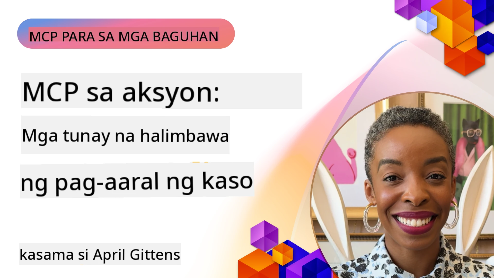

# MCP sa Aksyon: Mga Kaso ng Pag-aaral sa Totoong Mundo

_(I-click ang larawan sa itaas upang panoorin ang video ng leksyong ito)_

Binabago ng Model Context Protocol (MCP) kung paano nakikipag-ugnayan ang mga aplikasyon ng AI sa data, mga kagamitan, at mga serbisyo. Ipinapakita ng seksyong ito ang mga totoong kaso ng pag-aaral na nagpapakita ng mga praktikal na aplikasyon ng MCP sa iba't ibang mga senaryo ng enterprise.

## Pangkalahatang-ideya

Ipinapakita ng seksyong ito ang mga kongkretong halimbawa ng mga pagpapatupad ng MCP, na pinapakita kung paano ginagamit ng mga organisasyon ang protokol na ito upang malutas ang mga kumplikadong hamon sa negosyo. Sa pamamagitan ng pagsusuri sa mga kasong ito, makakakuha ka ng mga pananaw sa kakayahang umangkop, kakayahang palawakin, at mga praktikal na benepisyo ng MCP sa mga totoong sitwasyon.

## Pangunahing Mga Layunin sa Pagkatuto

Sa pagsasaliksik ng mga kasong ito, matututuhan mo:

- Maunawaan kung paano maaaring gamitin ang MCP upang malutas ang mga partikular na problema sa negosyo
- Matutunan ang iba't ibang mga pattern ng integrasyon at mga disenyong arkitektural
- Kilalanin ang mga pinakamahusay na kasanayan sa pagpapatupad ng MCP sa mga kapaligiran ng enterprise
- Makakuha ng mga pananaw tungkol sa mga hamon at solusyon na naranasan sa totoong pagpapatupad
- Matukoy ang mga oportunidad upang magamit ang mga katulad na pattern sa iyong sariling mga proyekto

## Mga Tampok na Kaso ng Pag-aaral

### 1. [Azure AI Travel Agents – Reference Implementation](./travelagentsample.md)

Sinusuri ng kasong ito ang komprehensibong solusyon ng Microsoft na nagpapakita kung paano bumuo ng multi-agent, AI-powered na aplikasyon sa pagpaplano ng paglalakbay gamit ang MCP, Azure OpenAI, at Azure AI Search. Ipinapakita ng proyekto ang:

- Multi-agent orchestration sa pamamagitan ng MCP
- Integrasyon ng enterprise data gamit ang Azure AI Search
- Ligtas, skalableng arkitektura gamit ang mga serbisyo ng Azure
- Mapapalawak na mga kagamitan gamit ang mga reusable na MCP components
- Conversational user experience na pinapagana ng Azure OpenAI

Nagbibigay ang mga detalye ng arkitektura at pagpapatupad ng mahahalagang pananaw sa pagbubuo ng mga kumplikadong multi-agent na sistema gamit ang MCP bilang coordination layer.

### 2. [Pag-update ng Azure DevOps Items mula sa Data ng YouTube](./UpdateADOItemsFromYT.md)

Ipinapakita ng kasong ito ang praktikal na aplikasyon ng MCP para sa awtomatiko ng mga proseso sa workflow. Ipinapakita nito kung paano magagamit ang mga MCP tools upang:

- Kunin ang data mula sa mga online na platform (YouTube)
- I-update ang mga work items sa mga sistema ng Azure DevOps
- Lumikha ng mga paulit-ulit na automation workflow 
- Mag-integrate ng data sa iba't ibang mga sistema

Ipinapakita ng halimbawa na ito kung paano kahit ang mga simpleng pagpapatupad ng MCP ay maaaring magbigay ng malaking pagtaas sa kahusayan sa pamamagitan ng pag-automate ng mga rutinang gawain at pagpapabuti ng pagkakaugnay ng data sa mga sistema.

### 3. [Real-Time na Pagkuha ng Dokumentasyon gamit ang MCP](./docs-mcp/README.md)

Ginagabayan ka ng kasong ito sa pagkonekta ng isang Python console client sa isang Model Context Protocol (MCP) server upang kumuha at mag-log ng real-time, context-aware na dokumentasyon ng Microsoft. Matututuhan mo kung paano:

- Kumonekta sa isang MCP server gamit ang Python client at ang opisyal na MCP SDK
- Gumamit ng streaming HTTP clients para sa mahusay at real-time na pagkuha ng data
- Tawagan ang mga dokumentasyon tool sa server at i-log ang mga tugon nang direkta sa console
- Isama ang napapanahong dokumentasyon ng Microsoft sa iyong workflow nang hindi umaalis sa terminal

Kasama sa kabanata ang isang hands-on na asignatura, isang minimal na sample ng working code, at mga link sa karagdagang mapagkukunan para sa mas malalim na pagkatuto. Tingnan ang buong walkthrough at code sa naka-link na kabanata upang maunawaan kung paano makakabago ang MCP sa access ng dokumentasyon at produktibidad ng developer sa console-based na mga kapaligiran.

### 4. [Interactive Study Plan Generator Web App gamit ang MCP](./docs-mcp/README.md)

Ipinapakita ng kasong ito kung paano bumuo ng isang interactive web application gamit ang Chainlit at Model Context Protocol (MCP) para makagawa ng personalized na mga plano ng pag-aaral para sa anumang paksa. Maaaring tukuyin ng mga user ang isang subject (tulad ng "AI-900 certification") at habang ng pag-aaral (hal. 8 linggo), at magbibigay ang app ng lingguhan-lingguhang breakdown ng mga inirekomendang nilalaman. Pinapagana ng Chainlit ang isang conversational chat interface, na ginagawang kaakit-akit at tatanggapin ang karanasan.

- Conversational web app na pinapagana ng Chainlit
- Mga prompt na pinamumunuan ng user para sa paksa at tagal
- Lingguhan-lingguhang mga rekomendasyon ng nilalaman gamit ang MCP
- Real-time, adaptable na mga tugon sa chat interface

Ipinapakita ng proyekto kung paano maaaring pagsamahin ang conversational AI at MCP upang makalikha ng dinamiko, user-driven na mga kasangkapan sa edukasyon sa isang modernong web environment.

### 5. [In-Editor Docs gamit ang MCP Server sa VS Code](./docs-mcp/README.md)

Ipinapakita ng kasong ito kung paano mo maaaring dalhin ang Microsoft Learn Docs nang direkta sa iyong VS Code environment gamit ang MCP server—wala nang palipat-lipat sa mga browser tab! Makikita mo kung paano:

- Agarang maghanap at magbasa ng docs sa loob ng VS Code gamit ang MCP panel o command palette
- Mag-refer sa dokumentasyon at magpasok ng mga link nang direkta sa iyong README o course markdown files
- Gamitin ang GitHub Copilot at MCP nang magkasama para sa seamless, AI-powered na dokumentasyon at mga workflow ng code
- I-validate at pagandahin ang iyong dokumentasyon gamit ang real-time na feedback at tumpak na Microsoft-sourced na impormasyon
- Isama ang MCP sa mga workflow ng GitHub para sa tuloy-tuloy na validation ng dokumentasyon

Kasama sa pagpapatupad ang:

- Halimbawa ng `.vscode/mcp.json` configuration para sa madaling setup
- Mga walkthrough na may screenshot ng karanasan sa loob ng editor
- Mga tip para sa pagsasama ng Copilot at MCP para sa pinakamataas na produktibidad

Ang senaryong ito ay perpekto para sa mga may-akda ng kurso, manunulat ng dokumentasyon, at mga developer na nais manatiling nakatuon sa kanilang editor habang nagtatrabaho gamit ang docs, Copilot, at mga validation tools—lahat ay pinalakas ng MCP.

### 6. [Paglikha ng APIM MCP Server](./apimsample.md)

Nagbibigay ang kasong ito ng hakbang-hakbang na gabay kung paano lumikha ng isang MCP server gamit ang Azure API Management (APIM). Saklaw nito ang:

- Pag-set up ng isang MCP server sa Azure API Management
- Pagpapakita ng mga API operation bilang mga tool ng MCP
- Pag-configure ng mga polisiya para sa rate limiting at seguridad
- Pagsusuri ng MCP server gamit ang Visual Studio Code at GitHub Copilot

Ipinapakita ng halimbawa na ito kung paano gamitin ang mga kakayahan ng Azure upang makalikha ng matibay na MCP server na maaaring magamit sa iba't ibang aplikasyon, pinapalakas ang integrasyon ng mga AI system sa mga API ng enterprise.

### 7. [GitHub MCP Registry — Pinapabilis ang Agentic Integration](https://github.com/mcp)

Sinusuri ng kasong ito kung paano tinutugunan ng GitHub MCP Registry, na inilunsad noong Setyembre 2025, ang isang kritikal na hamon sa AI ecosystem: ang pira-pirasong pagtuklas at deployment ng mga Model Context Protocol (MCP) server.

#### Pangkalahatang-ideya
Nilulutas ng **MCP Registry** ang lumalaking problema ng mga nagkalat na MCP server sa mga repositoryo at rehistro, na dati ay nagpapabagal at nagdudulot ng mga error sa integrasyon. Pinapahintulutan ng mga server na ito ang mga AI agent na makipag-ugnayan sa mga panlabas na sistema tulad ng mga API, database, at mga pinagmumulan ng dokumentasyon.

#### Pahayag ng Problema
Nakaharap ang mga developer sa mga agentic workflow sa ilang hamon:
- **Mahinang discoverability** ng mga MCP server sa iba't ibang platform
- **Ulit-ulit na mga tanong sa setup** na nagkalat sa mga forum at dokumentasyon
- **Mga panganib sa seguridad** mula sa mga hindi beripikado at hindi pinagkakatiwalaang pinagkukunan
- **Kakulangan sa standardisasyon** sa kalidad at pagkakatugma ng server

#### Arkitektura ng Solusyon
Pinagsasama-sama ng GitHub MCP Registry ang mga mapagkakatiwalaang MCP server na may mga pangunahing tampok:
- **One-click install** na integrasyon sa pamamagitan ng VS Code para sa maayos na setup
- **Signal-over-noise sorting** ayon sa stars, aktibidad, at pagpapatunay ng komunidad
- **Direktang integrasyon** sa GitHub Copilot at iba pang MCP-compatible na mga tool
- **Open contribution model** na nagpapahintulot sa parehong community at enterprise partners na mag-ambag

#### Epekto sa Negosyo
Naghatid ang rehistro ng mga nasusukat na pagpapabuti:
- **Mas mabilis na onboarding** para sa mga developer gamit ang mga tool tulad ng Microsoft Learn MCP Server, na nagsi-stream ng opisyal na dokumentasyon nang diretso sa mga agent
- **Pinahusay na produktibidad** sa pamamagitan ng mga espesyal na server tulad ng `github-mcp-server`, na nagpapahintulot ng natural language GitHub automation (paglikha ng PR, CI reruns, pag-scan ng code)
- **Mas matibay na tiwala sa ecosystem** sa pamamagitan ng curated listings at transparent na mga pamantayan sa configuration

#### Estratehikong Halaga
Para sa mga practitioner na nagdadalubhasa sa agent lifecycle management at reproducible workflows, nagbibigay ang MCP Registry ng:
- **Modular agent deployment** na kakayahan gamit ang mga standardized na bahagi
- **Registry-backed evaluation pipelines** para sa pare-parehong pagsusuri at pagpapatunay
- **Cross-tool interoperability** na nagpapahintulot ng seamless integration sa iba't ibang AI platform

Ipinapakita ng kasong ito na ang MCP Registry ay higit pa sa isang directory—ito ay isang foundational platform para sa scalable, totoong mundo na integrasyon ng modelo at deployment ng agentic na sistema.

### 8. [Pag-publish sa Social Networks mula sa isang Agent](./publora-social-publishing.md)

Pinaglalakad ng kasong ito ang isang **remote MCP server na kayang magsulat** — isa na ang mga tool ay kumikilos ng hindi na mababawi sa ngalan ng user — gamit ang social publishing bilang halimbawa. Gumagawa ang isang agent ng draft ng post, inaprubahan ito ng tao, at ini-schedule ng server ito sa mga network.

Ang kawili-wiling bahagi ay ang mga disenyo ng limitasyon na ipinapataw ng publishing, na naaangkop sa anumang server na nagsusulat sa halip na bumabasa:

- **Bukas na pagtuklas, authenticated execution** — sina `tools/list` ay sinasagot nang walang credentials upang makapag-introspect ang mga registry at client, habang bawat `tools/call` ay nangangailangan ng token at kung hindi ay nagbabalik ng `401` na may `WWW-Authenticate` header
- **OAuth registration nang walang out-of-band na hakbang** — dynamic client registration ngayon, na may Client ID Metadata Documents bilang direksyon na tinutukoy ng `2026-07-28` specification
- **Tool annotations** (`readOnlyHint`, `destructiveHint`, `idempotentHint`) na ginagamit ng mga client para magpasya kung ano ang dapat kumpirmahin — mga palatandaan sa halip na pagpapatupad, at isang bagay na inaasahan na ng mga connector directory sa pagsusuri
- **Hindi maaaring imbentuhing mga identifier**, kaya ang isang halucinadong halaga ay malakas na nabibigo sa halip na kumilos sa kapani-paniwalang hitsura nito
- **Idempotency keys sa mga post-creating tools**, kaya ang retry ng agent runtime ay hindi nagiging doble na pag-publish
- **Isang no-op target na inilalarawan sa tool schema** na sumusubok sa buong write path ngunit walang na-publish, para sa mga tagasuri at CI

Nagtatapos ang kabanata sa isang maikling checklist na maaari mong ipatupad sa server na iyong binubuo.

## Konklusyon

Ipinapakita ng walong komprehensibong kasong ito ang kahanga-hangang kakayahang umangkop at mga praktikal na aplikasyon ng Model Context Protocol sa iba't ibang totoong sitwasyon. Mula sa kumplikadong multi-agent travel planning systems at enterprise API management hanggang sa streamlined documentation workflows at ang rebolusyonaryong GitHub MCP Registry, ipinapakita ng mga halimbawa kung paano nagbibigay ang MCP ng isang standardized, scalable na paraan para ikonekta ang mga AI system sa mga tool, data, at serbisyo na kailangan nila upang maghatid ng natatanging halaga.

Saklaw ng mga kaso ng pag-aaral ang maraming dimensyon ng pagpapatupad ng MCP:
- **Integrasyon ng Enterprise**: Azure API Management at automation ng Azure DevOps
- **Multi-Agent Orchestration**: Pagpaplano ng paglalakbay gamit ang mga koordinadong AI agent
- **Produktibidad ng Developer**: Integrasyon ng VS Code at real-time na access sa dokumentasyon
- **Pag-unlad ng Ecosystem**: GitHub MCP Registry bilang isang foundational platform
- **Mga Aplikasyong Pang-edukasyon**: Interactive study plan generators at conversational interfaces

Sa pag-aaral ng mga pagpapatupad na ito, makakakuha ka ng mahahalagang pananaw sa:
- **Mga pattern ng arkitektura** para sa iba't ibang sukat at gamit na kaso
- **Mga estratehiya sa pagpapatupad** na naghahalubilo ng functionality at maintainability
- **Mga konsiderasyon sa seguridad at scalability** para sa mga production deployment
- **Pinakamahusay na kasanayan** para sa pag-develop ng MCP server at client integrasyon
- **Ecosystem thinking** para sa pagbuo ng magkakaugnay na mga AI-powered na solusyon

Ipinapakita ng mga halimbawa na ito nang sama-sama na ang MCP ay hindi lamang isang teoretikal na balangkas kundi isang mature, production-ready na protokol na nagpapahintulot sa mga praktikal na solusyon sa mga kumplikadong hamon sa negosyo. Kung gumagawa ka man ng mga simpleng automation tool o sopistikadong multi-agent na sistema, ang mga pattern at paraan na ipinakita dito ay nagbibigay ng matibay na pundasyon para sa iyong sariling MCP na mga proyekto.

## Karagdagang Mga Mapagkukunan

- [Azure AI Travel Agents GitHub Repository](https://github.com/Azure-Samples/azure-ai-travel-agents)
- [Azure DevOps MCP Tool](https://github.com/microsoft/azure-devops-mcp)
- [Playwright MCP Tool](https://github.com/microsoft/playwright-mcp)
- [Microsoft Docs MCP Server](https://github.com/MicrosoftDocs/mcp)
- [GitHub MCP Registry — Pinapabilis ang Agentic Integration](https://github.com/mcp)
- [MCP Community Examples](https://github.com/microsoft/mcp)

## Ano Pa ang Susunod

- Nakaraan: [Module 8: Best Practices](../08-BestPractices/README.md)
- Susunod: [Module 10: Streamlining AI Workflows: Building an MCP Server with Microsoft Foundry Toolkit](../10-StreamliningAIWorkflowsBuildingAnMCPServerWithAIToolkit/README.md)

---

<!-- CO-OP TRANSLATOR DISCLAIMER START -->
**Pagtatanggi**:
Ang dokumentong ito ay isinalin gamit ang serbisyo ng AI translation na [Co-op Translator](https://github.com/Azure/co-op-translator). Bagama't nagsusumikap kami para sa katumpakan, pakatandaan na ang awtomatikong pagsasalin ay maaaring maglaman ng mga pagkakamali o hindi pagkakatugma. Ang orihinal na dokumento sa orihinal nitong wika ang dapat ituring na pangunahing sanggunian. Para sa mahahalagang impormasyon, inirerekomenda ang propesyonal na pagsasalin ng tao. Hindi kami mananagot sa anumang maling pagkakaintindi o maling interpretasyon na nagmula sa paggamit ng pagsasaling ito.
<!-- CO-OP TRANSLATOR DISCLAIMER END -->