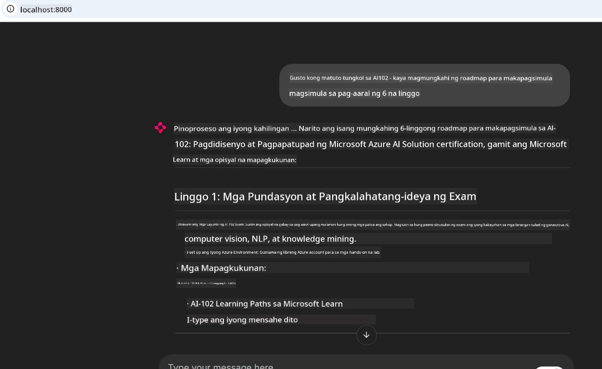
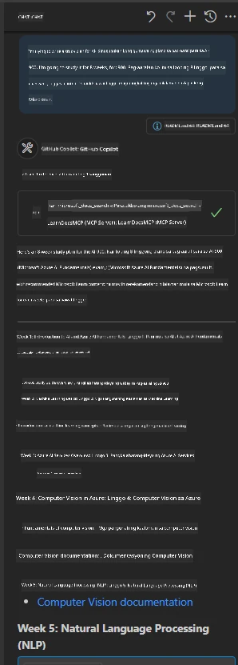

# Pag-aaral ng Kaso: Pagkonekta sa Microsoft Learn Docs MCP Server mula sa isang Kliyente

Naranasan mo na bang magpalipat-lipat sa pagitan ng mga site ng dokumentasyon, Stack Overflow, at walang katapusang mga tab ng search engine, habang sinusubukan mong lutasin ang isang problema sa iyong code? Marahil ay may second monitor ka lang para sa docs, o palagi kang nagpapalit-palit ng Alt-tab sa pagitan ng iyong IDE at browser. Hindi ba mas maganda kung maipadadala mo ang dokumentasyon mismo sa iyong workflow—integrado sa iyong mga app, iyong IDE, o kahit na sa iyong sariling mga customized na tool? Sa pag-aaral ng kasong ito, tatalakayin natin kung paano gawin iyan sa pamamagitan ng direktang pagkonekta sa Microsoft Learn Docs MCP server mula sa iyong sariling client application.

## Pangkalahatang-ideya

Ang makabagong pag-unlad ay higit pa sa pagsulat lang ng code—ito ay tungkol sa paghahanap ng tamang impormasyon sa tamang oras. Nasa lahat ng dako ang dokumentasyon, ngunit bihira itong makita kung saan ito pinaka-kailangan: sa loob ng iyong mga tool at workflow. Sa pamamagitan ng integrasyon ng pagkuha ng dokumentasyon nang direkta sa iyong mga aplikasyon, makakatipid ka ng oras, mababawasan ang paglipat-lipat ng konteksto, at mapapalakas ang produktibidad. Sa seksyong ito, ipapakita namin kung paano kumonekta ang isang kliyente sa Microsoft Learn Docs MCP server, upang ma-access mo ang real-time, context-aware na dokumentasyon nang hindi umaalis sa iyong app.

Dadalhin ka namin sa proseso ng pagtatatag ng koneksyon, pagpapadala ng kahilingan, at epektibong paghawak sa mga streaming response. Ang pamamaraang ito ay hindi lamang nagpapadali sa iyong workflow kundi nagbubukas din ng pinto para sa paggawa ng mas matalino at mas kapaki-pakinabang na mga developer tool.

## Mga Layunin sa Pagkatuto

Bakit natin ito ginagawa? Dahil ang pinakamahusay na karanasan ng developer ay yung nag-aalis ng mga hadlang. Isipin ang isang mundo kung saan kaagad na nasasagot ng iyong code editor, chatbot, o web app ang iyong mga tanong sa dokumentasyon, gamit ang pinakabagong nilalaman mula sa Microsoft Learn. Sa pagtatapos ng kabanatang ito, malalaman mo kung paano:

- Unawain ang mga batayan ng MCP server-client na komunikasyon para sa dokumentasyon
- Magpatupad ng isang console o web application upang kumonekta sa Microsoft Learn Docs MCP server
- Gumamit ng streaming HTTP client para sa real-time na pagkuha ng dokumentasyon
- Mag-log at bigyang-kahulugan ang mga sagot sa dokumentasyon sa iyong aplikasyon

Makikita mo kung paano makakatulong ang mga kakayahang ito sa paggawa ng mga tool na hindi lang reaktibo, kundi tunay na interactive at context-aware.

## Senaryo 1 - Real-Time na Pagkuha ng Dokumentasyon gamit ang MCP

Sa senaryong ito, ipapakita namin kung paano kumonekta ang isang kliyente sa Microsoft Learn Docs MCP server, upang ma-access mo ang real-time, context-aware na dokumentasyon nang hindi umaalis sa iyong app.

Isabuhay natin ito. Ang iyong gawain ay gumawa ng isang app na kumokonekta sa Microsoft Learn Docs MCP server, tinatawag ang `microsoft_docs_search` tool, at nag-log ng streaming response sa console.

### Bakit ang pamamaraang ito?
Dahil ito ang pundasyon para sa paggawa ng mas advanced na integrasyon—kung nais mong magpatakbo ng chatbot, extension sa IDE, o dashboard sa web.

Makikita mo ang code at mga tagubilin para sa senaryong ito sa [`solution`](./solution/README.md) na folder sa loob ng pag-aaral ng kaso. Gabay ang mga hakbang sa pagtatakda ng koneksyon:
- Gamitin ang opisyal na MCP SDK at streamable HTTP client para sa koneksyon
- Tawagan ang `microsoft_docs_search` tool gamit ang query parameter upang kumuha ng dokumentasyon
- Magpatupad ng wastong pag-log at paghawak ng error
- Gumawa ng interactive console interface para payagan ang mga user na magpasok ng maramihang mga query sa paghahanap

Ipinapakita ng senaryong ito kung paano:
- Kumonekta sa Docs MCP server
- Magpadala ng query
- I-parse at i-print ang mga resulta

Ganito maaaring magmukhang ang pagpapatakbo ng solusyon:

```
Prompt> What is Azure Key Vault?
Answer> Azure Key Vault is a cloud service for securely storing and accessing secrets. ...
```

Narito ang isang minimal na halimbawa ng solusyon. Ang buong code at mga detalye ay makukuha sa solution folder.

<details>
<summary>Python</summary>

```python
import asyncio
from mcp.client.streamable_http import streamablehttp_client
from mcp import ClientSession

async def main():
    async with streamablehttp_client("https://learn.microsoft.com/api/mcp") as (read_stream, write_stream, _):
        async with ClientSession(read_stream, write_stream) as session:
            await session.initialize()
            result = await session.call_tool("microsoft_docs_search", {"query": "Azure Functions best practices"})
            print(result.content)

if __name__ == "__main__":
    asyncio.run(main())
```

- Para sa kumpletong implementasyon at pag-log, tingnan ang [`scenario1.py`](../../../../09-CaseStudy/docs-mcp/solution/python/scenario1.py).
- Para sa mga tagubilin sa pag-install at paggamit, tingnan ang [`README.md`](./solution/python/README.md) na file sa parehong folder.
</details>


## Senaryo 2 - Interactive Study Plan Generator Web App gamit ang MCP

Sa senaryong ito, matututuhan mong i-integrate ang Docs MCP sa isang proyekto sa pag-develop ng web. Layunin nitong pahintulutan ang mga user na maghanap ng Microsoft Learn documentation nang direkta mula sa isang web interface, kaya nagiging agad-agad na accessible ang dokumentasyon sa loob ng iyong app o site.

Makikita mo kung paano:
- Mag-set up ng isang web app
- Kumonekta sa Docs MCP server
- Hawakan ang input ng user at ipakita ang mga resulta

Ganito maaaring magmukhang ang pagpapatakbo ng solusyon:

```
User> I want to learn about AI102 - so suggest the roadmap to get it started from learn for 6 weeks

Assistant> Here’s a detailed 6-week roadmap to start your preparation for the AI-102: Designing and Implementing a Microsoft Azure AI Solution certification, using official Microsoft resources and focusing on exam skills areas:

---
## Week 1: Introduction & Fundamentals
- **Understand the Exam**: Review the [AI-102 exam skills outline](https://learn.microsoft.com/en-us/credentials/certifications/exams/ai-102/).
- **Set up Azure**: Sign up for a free Azure account if you don't have one.
- **Learning Path**: [Introduction to Azure AI services](https://learn.microsoft.com/en-us/training/modules/intro-to-azure-ai/)
- **Focus**: Get familiar with Azure portal, AI capabilities, and necessary tools.

....more weeks of the roadmap...

Let me know if you want module-specific recommendations or need more customized weekly tasks!
```

Narito ang isang minimal na halimbawa ng solusyon. Ang buong code at mga detalye ay makukuha sa solution folder.



<details>
<summary>Python (Chainlit)</summary>

Ang Chainlit ay isang framework para sa paggawa ng mga conversational AI web app. Pinapadali nito ang paggawa ng interactive na chatbots at assistant na maaaring tumawag sa MCP tools at magpakita ng mga resulta nang real time. Ideal ito para sa mabilisang prototyping at user-friendly na mga interface.

```python
import chainlit as cl
import requests

MCP_URL = "https://learn.microsoft.com/api/mcp"

@cl.on_message
def handle_message(message):
    query = {"question": message}
    response = requests.post(MCP_URL, json=query)
    if response.ok:
        result = response.json()
        cl.Message(content=result.get("answer", "No answer found.")).send()
    else:
        cl.Message(content="Error: " + response.text).send()
```

- Para sa kumpletong implementasyon, tingnan ang [`scenario2.py`](../../../../09-CaseStudy/docs-mcp/solution/python/scenario2.py).
- Para sa mga tagubilin sa setup at pagpapatakbo, tingnan ang [`README.md`](./solution/python/README.md).
</details>


## Senaryo 3: In-Editor Docs gamit ang MCP Server sa VS Code

Kung gusto mong makakuha ng Microsoft Learn Docs nang direkta sa loob ng iyong VS Code (sa halip na palaging magpalipat-lipat ng browser tabs), maaari mong gamitin ang MCP server sa iyong editor. Pinapayagan ka nitong:
- Maghanap at magbasa ng docs sa VS Code nang hindi umaalis sa iyong coding environment.
- Mag-refer sa dokumentasyon at maglagay ng mga link nang direkta sa iyong README o mga file ng kurso.
- Pagsamahin ang GitHub Copilot at MCP para sa isang seamless, AI-powered na workflow ng dokumentasyon.

**Makikita mo kung paano:**
- Magdagdag ng isang valid na `.vscode/mcp.json` file sa ugat ng iyong workspace (tingnan ang halimbawa sa ibaba).
- Buksan ang MCP panel o gamitin ang command palette sa VS Code upang maghanap at magsingit ng docs.
- Mag-refer ng dokumentasyon nang direkta sa iyong mga markdown file habang nagtatrabaho.
- Pagsamahin ang workflow na ito sa GitHub Copilot para sa mas mataas na produktibidad.

Narito ang isang halimbawa kung paano i-set up ang MCP server sa VS Code:

```json
{
  "servers": {
    "LearnDocsMCP": {
      "url": "https://learn.microsoft.com/api/mcp"
    }
  }
}
```

</details>

> Para sa detalyadong walkthrough kasama ang mga screenshot at hakbang-hakbang na gabay, tingnan ang [`README.md`](./solution/scenario3/README.md).



Ang pamamaraang ito ay ideal para sa sinumang gumagawa ng mga teknikal na kurso, sumusulat ng dokumentasyon, o nagde-develop ng code na may madalas na pangangailangan sa reference.

## Pangunahing Mga Natutunan

Ang direktang pag-integrate ng dokumentasyon sa iyong mga tool ay hindi lang para sa kaginhawaan—ito ay pagbabagong pang-produktibidad. Sa pamamagitan ng pagkonekta sa Microsoft Learn Docs MCP server mula sa iyong client, maaari mong:

- Alisin ang paglipat-lipat ng konteksto sa pagitan ng iyong code at dokumentasyon
- Kumuha ng up-to-date, context-aware na docs nang real time
- Bumuo ng mas matalino at mas interactive na mga developer tool

Ang mga kasanayang ito ay tutulong sa iyo na lumikha ng mga solusyon na hindi lang epektibo, kundi kaaya-ayang gamitin.

## Karagdagang Mga Mapagkukunan

Upang palalimin ang pag-unawa, tuklasin ang mga opisyal na mapagkukunan na ito:

- [Microsoft Learn Docs MCP Server (GitHub)](https://github.com/MicrosoftDocs/mcp)
- [Simulan ang Azure MCP Server (mcp-python)](https://learn.microsoft.com/en-us/azure/developer/azure-mcp-server/get-started#create-the-python-app)
- [Ano ang Azure MCP Server?](https://learn.microsoft.com/en-us/azure/developer/azure-mcp-server/)
- [Pagpapakilala sa Model Context Protocol (MCP)](https://modelcontextprotocol.io/introduction)
- [Magdagdag ng mga plugin mula sa isang MCP Server (Python)](https://learn.microsoft.com/en-us/semantic-kernel/concepts/plugins/adding-mcp-plugins)

## Ano ang Susunod

- Bumalik sa: [Pangkalahatang-ideya ng Case Studies](../README.md)
- Magpatuloy sa: [Modulo 10: Streamlining AI Workflows gamit ang Microsoft Foundry Toolkit](../../10-StreamliningAIWorkflowsBuildingAnMCPServerWithAIToolkit/README.md)

---

<!-- CO-OP TRANSLATOR DISCLAIMER START -->
**Pagtatanggi**:
Ang dokumentong ito ay isinalin gamit ang serbisyo ng AI translation na [Co-op Translator](https://github.com/Azure/co-op-translator). Bagama't nagsusumikap kami para sa katumpakan, pakatandaan na ang awtomatikong pagsasalin ay maaaring maglaman ng mga pagkakamali o hindi pagkakatugma. Ang orihinal na dokumento sa orihinal nitong wika ang dapat ituring na pangunahing sanggunian. Para sa mahahalagang impormasyon, inirerekomenda ang propesyonal na pagsasalin ng tao. Hindi kami mananagot sa anumang maling pagkakaintindi o maling interpretasyon na nagmula sa paggamit ng pagsasaling ito.
<!-- CO-OP TRANSLATOR DISCLAIMER END -->