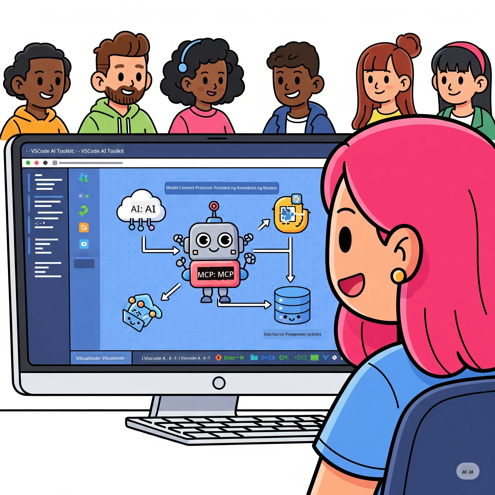
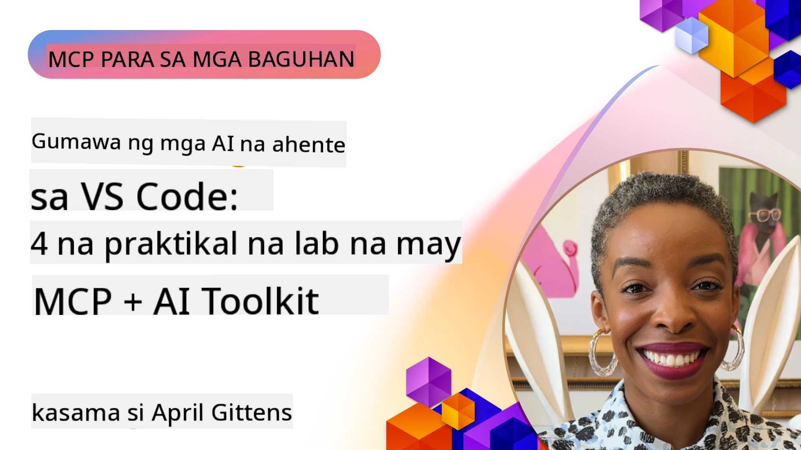

# Pagpapadali ng Mga Daloy ng Trabaho sa AI: Pagtatayo ng MCP Server gamit ang Microsoft Foundry Toolkit

## 🎯  Pangkalahatang-ideya

_(I-click ang larawan sa itaas upang mapanood ang video ng araling ito)_

Maligayang pagdating sa **Model Context Protocol (MCP) Workshop**! Ang komprehensibong hands-on na workshop na ito ay pinagsasama ang dalawang makabagong teknolohiya upang baguhin ang pagbuo ng aplikasyon ng AI:

> **Tala sa Pagkakatugma:** ang code ng workshop ay itinayo at nasubukan gamit ang MCP
> `2025-11-25`, gaya ng ipinakita sa badge sa itaas. Gamitin ang
> [kasalukuyang `2026-07-28` specification](https://modelcontextprotocol.io/specification/2026-07-28/)
> para sa mga bagong implementasyon ng protocol at suriin ang mga tala ng paglabas ng SDK bago
> ilipat ang mga lab.

- **🔗 Model Context Protocol (MCP)**: Isang bukas na pamantayan para sa tuloy-tuloy na integrasyon ng AI-tool
- **🛠️ Microsoft Foundry Toolkit Extension for VS Code**: Makapangyarihang extension ng AI development ng Microsoft

### 🎓 Ano ang Matututuhan Mo

Sa pagtatapos ng workshop na ito, matututuhan mong gumawa ng matatalinong aplikasyon na nag-uugnay ng mga AI model sa mga totoong mundo na mga tool at serbisyo. Mula sa automated testing hanggang sa custom API integrations, magkakaroon ka ng praktikal na kasanayan upang lutasin ang mga komplikadong hamon ng negosyo.

## 🏗️ Teknolohiyang Ginamit

### 🔌 Model Context Protocol (MCP)

Ang MCP ay ang **"USB-C para sa AI"** - isang unibersal na pamantayan na kumokonekta sa mga AI model sa mga panlabas na tool at pinagmumulan ng data.

**✨ Pangunahing Katangian:**

- 🔄 **Standardized Integration**: Unibersal na interface para sa koneksyon ng AI-tool
- 🏛️ **Flexible Architecture**: Mga lokal at remote na server gamit ang stdio/SSE transport
- 🧰 **Rich Ecosystem**: Mga tool, prompt, at mga resources sa isang protocol
- 🔒 **Enterprise-Ready**: Naka-built-in na seguridad at pagiging maaasahan

**🎯 Bakit Mahalaga ang MCP:**
Katulad ng pag-alis ng USB-C sa gulo ng mga kable, nilulutas ng MCP ang komplikasyon ng mga AI integration. Isang protocol, walang katapusang posibilidad.

### 🤖 Microsoft Foundry Toolkit Extension for VS Code

Pangunahing AI development extension ng Microsoft na ginagawang isang AI powerhouse ang VS Code.

**🚀 Pangunahing Kakayahan:**

- 📦 **Model Catalog**: Access sa mga modelo mula sa Azure AI, GitHub, Hugging Face, Ollama
- ⚡ **Local Inference**: ONNX-optimized CPU/GPU/NPU execution
- 🏗️ **Agent Builder**: Biswal na pagbuo ng AI agent gamit ang MCP integration
- 🎭 **Multi-Modal**: Suporta sa teksto, bisyon, at istrakturang output

**💡 Mga Benepisyo sa Pag-develop:**

- Zero-config na deployment ng modelo
- Biswal na prompt engineering
- Real-time na testing playground
- Seamless na integrasyon ng MCP server

## 📚 Paglalakbay sa Pagkatuto

### [🚀 Module 1: Microsoft Foundry Toolkit Fundamentals](./lab1/README.md)

**Tagal**: 15 minuto

- 🛠️ I-install at i-configure ang Microsoft Foundry Toolkit para sa VS Code
- 🗂️ Tuklasin ang Model Catalog (100+ na modelo mula sa GitHub, ONNX, OpenAI, Anthropic, Google)
- 🎮 Masterin ang Interactive Playground para sa real-time na testing ng modelo
- 🤖 Gumawa ng iyong unang AI agent gamit ang Agent Builder
- 📊 Suriin ang performance ng modelo gamit ang mga built-in na metric (F1, relevance, similarity, coherence)
- ⚡ Matutunan ang batch processing at suporta sa multi-modal

**🎯 Resulta ng Pagkatuto**: Lumikha ng functional na AI agent na may malawak na pag-unawa sa mga kakayahan ng Microsoft Foundry Toolkit

### [🌐 Module 2: MCP with Microsoft Foundry Toolkit Fundamentals](./lab2/README.md)

**Tagal**: 20 minuto

- 🧠 Masterin ang Model Context Protocol (MCP) arkitektura at konsepto
- 🌐 Tuklasin ang MCP server ecosystem ng Microsoft
- 🤖 Gumawa ng browser automation agent gamit ang Playwright MCP server
- 🔧 Isama ang MCP servers sa Microsoft Foundry Toolkit Agent Builder
- 📊 I-configure at subukan ang MCP tools sa loob ng iyong mga agent
- 🚀 I-export at i-deploy ang MCP-powered agents para sa produksiyon

**🎯 Resulta ng Pagkatuto**: I-deploy ang AI agent na pinalakas ng mga panlabas na tool gamit ang MCP

### [🔧 Module 3: Advanced MCP Development with Microsoft Foundry Toolkit](./lab3/README.md)

**Tagal**: 20 minuto

- 💻 Lumikha ng mga custom MCP server gamit ang Microsoft Foundry Toolkit
- 🐍 I-configure at gamitin ang pinakabagong MCP Python SDK (v1.9.3)
- 🔍 I-set up at gamitin ang MCP Inspector para sa debugging
- 🛠️ Bumuo ng Weather MCP Server gamit ang propesyonal na debugging workflows
- 🧪 Mag-debug ng MCP servers sa parehong Agent Builder at Inspector na mga environment

**🎯 Resulta ng Pagkatuto**: Mag-develop at mag-debug ng custom MCP server gamit ang makabagong mga tool

### [🐙 Module 4: Praktikal na MCP Development - Custom GitHub Clone Server](./lab4/README.md)

**Tagal**: 30 minuto

- 🏗️ Bumuo ng totoong mundo na GitHub Clone MCP Server para sa mga workflow ng development
- 🔄 Magpatupad ng smart repository cloning na may validation at error handling
- 📁 Lumikha ng intelligent directory management at VS Code integration
- 🤖 Gumamit ng GitHub Copilot Agent Mode na may custom MCP tools
- 🛡️ I-apply ang production-ready reliability at cross-platform compatibility

**🎯 Resulta ng Pagkatuto**: I-deploy ang production-ready MCP server na nagpapadali sa mga tunay na workflow sa development

## 💡 Mga Aplikasyon sa Totoong Mundo at Epekto

### 🏢 Mga Gamit sa Enterprise

#### 🔄 DevOps Automation

Baguhin ang iyong workflow sa development gamit ang matalinong automation:

- **Smart Repository Management**: AI-driven na pagsusuri ng code at mga desisyon sa pag-merge
- **Intelligent CI/CD**: Automated na optimisasyon ng pipeline base sa pagbabago ng code
- **Issue Triage**: Awtomatikong klasipikasyon ng bug at pagpapatatalaga

#### 🧪 Rebolusyon sa Quality Assurance

Pataas ang antas ng testing gamit ang AI-powered automation:

- **Intelligent Test Generation**: Awtomatikong paglikha ng komprehensibong mga test suite
- **Visual Regression Testing**: AI-powered na pagtuklas ng pagbabago sa UI
- **Performance Monitoring**: Proaktibong pagtukoy at paglutas ng mga isyu

#### 📊 Data Pipeline Intelligence

Bumuo ng mas matalino na mga workflow sa pagproseso ng data:

- **Adaptive ETL Processes**: Mga self-optimizing na pag-transform ng data
- **Anomaly Detection**: Real-time na pagmamanman ng kalidad ng data
- **Intelligent Routing**: Matalinong pamamahala ng daloy ng data

#### 🎧 Pagpapahusay sa Karanasan ng Customer

Lumikha ng natatanging interaksyon sa mga customer:

- **Context-Aware Support**: Mga AI agent na may access sa kasaysayan ng customer
- **Proactive Issue Resolution**: Predictive na serbisyo sa customer
- **Multi-Channel Integration**: Pinagsamang karanasan sa AI sa iba't ibang platform

## 🛠️ Mga Kinakailangan at Pagsisimula

### 💻 Mga Kinakailangan sa Sistema

| Component | Kinakailangan | Tala |
|-----------|--------------|-------|
| **Operating System** | Windows 10+, macOS 10.15+, Linux | Anumang modernong OS |
| **Visual Studio Code** | Pinakabagong stable na bersyon | Kinakailangan para sa Microsoft Foundry Toolkit |
| **Node.js** | v18.0+ at npm | Para sa pagbuo ng MCP server |
| **Python** | 3.10+ | Opsyonal para sa mga Python MCP server |
| **Memory** | Minimum 8GB RAM | 16GB inirerekomenda para sa mga lokal na modelo |

### 🔧 Kapaligiran sa Pag-develop

#### Mga Rekomendadong Extension sa VS Code

- **Microsoft Foundry Toolkit** (ms-windows-ai-studio.windows-ai-studio)
- **Python** (ms-python.python)
- **Python Debugger** (ms-python.debugpy)
- **GitHub Copilot** (GitHub.copilot) - Opsyonal ngunit kapaki-pakinabang

#### Opsyonal na Mga Tool

- **uv**: Modernong package manager para sa Python
- **MCP Inspector**: Biswal na tool para sa debugging ng MCP servers
- **Playwright**: Para sa mga halimbawa ng web automation

## 🎖️ Mga Resulta sa Pagkatuto at Landas ng Sertipikasyon

### 🏆 Checklist ng Mastery sa Kasanayan

Sa pagtatapos ng workshop na ito, maabot mo ang mastery sa:

#### 🎯 Pangunahing Kasanayan

- [ ] **MCP Protocol Mastery**: Malalim na pag-unawa sa arkitektura at disenyo ng implementasyon
- [ ] **Microsoft Foundry Toolkit Proficiency**: Ekspertong paggamit ng Microsoft Foundry Toolkit para sa mabilisang pag-develop
- [ ] **Custom Server Development**: Pagtatayo, pag-deploy, at pagpapanatili ng production MCP server
- [ ] **Tool Integration Excellence**: Walang putol na pag-uugnay ng AI sa umiiral na workflow sa development
- [ ] **Problem-Solving Application**: Paglalapat ng mga natutunang kasanayan sa tunay na hamon ng negosyo

#### 🔧 Teknikal na Kasanayan

- [ ] I-set up at i-configure ang Microsoft Foundry Toolkit sa VS Code
- [ ] Disenyo at implementasyon ng custom na MCP server
- [ ] Integrasyon ng Microsoft Foundry models sa MCP arkitektura
- [ ] Lumikha ng automated testing workflows gamit ang Playwright
- [ ] I-deploy ang mga AI agent para sa production use
- [ ] I-debug at i-optimize ang performance ng MCP server

#### 🚀 Mas Mataas na Kakayahan

- [ ] Arkitekto ng enterprise-scale na integrasyon ng AI
- [ ] Implementasyon ng pinakamahusay na praktis sa seguridad para sa mga aplikasyon ng AI
- [ ] Disenyo ng scalable na MCP server arkitektura
- [ ] Lumikha ng mga custom tool chains para sa mga partikular na domain
- [ ] Gumabay sa iba sa AI-native development

## 📖 Karagdagang Mga Mapagkukunan

- [MCP Specification (2026-07-28)](https://modelcontextprotocol.io/specification/2026-07-28/)
- [Microsoft Foundry Toolkit GitHub Repository](https://github.com/microsoft/vscode-ai-toolkit)
- [Sample MCP Servers Collection](https://github.com/modelcontextprotocol/servers)
- [Best Practices Guide](https://modelcontextprotocol.io/docs/best-practices)
- [OWASP MCP Top 10](https://microsoft.github.io/mcp-azure-security-guide/mcp/) - Mga pinakamahusay na praktis sa seguridad

---

**🚀 Handa ka na bang baguhin ang iyong workflow sa pagbuo ng AI?**

Sama-sama natin itayo ang hinaharap ng matatalinong aplikasyon gamit ang MCP at Microsoft Foundry Toolkit!

## Ano ang Susunod

Magpatuloy sa: [Module 11: MCP Server Hands-On Labs](../11-MCPServerHandsOnLabs/README.md)

---

<!-- CO-OP TRANSLATOR DISCLAIMER START -->
**Pagtatanggi**:
Ang dokumentong ito ay isinalin gamit ang serbisyo ng AI translation na [Co-op Translator](https://github.com/Azure/co-op-translator). Bagama't nagsusumikap kami para sa katumpakan, pakatandaan na ang awtomatikong pagsasalin ay maaaring maglaman ng mga pagkakamali o hindi pagkakatugma. Ang orihinal na dokumento sa orihinal nitong wika ang dapat ituring na pangunahing sanggunian. Para sa mahahalagang impormasyon, inirerekomenda ang propesyonal na pagsasalin ng tao. Hindi kami mananagot sa anumang maling pagkakaintindi o maling interpretasyon na nagmula sa paggamit ng pagsasaling ito.
<!-- CO-OP TRANSLATOR DISCLAIMER END -->