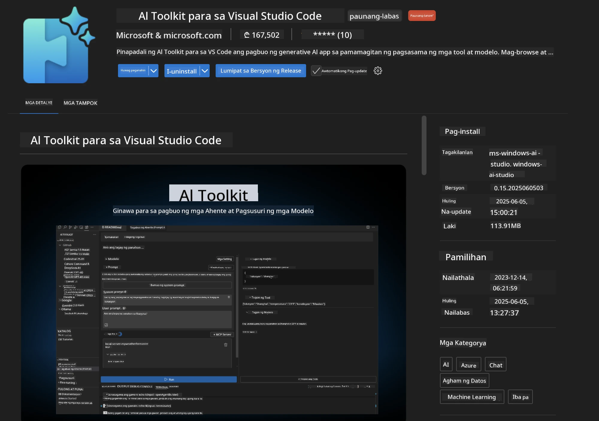
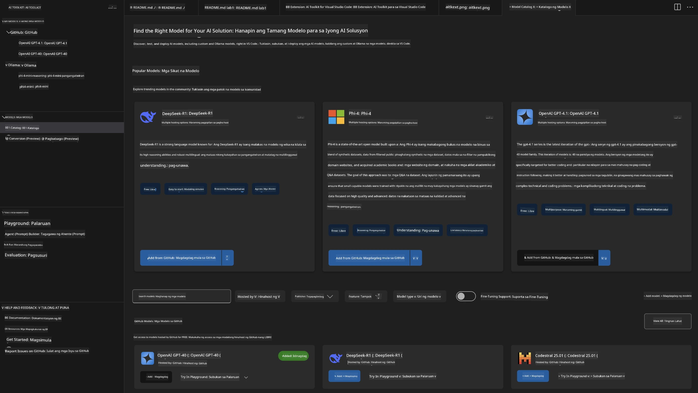
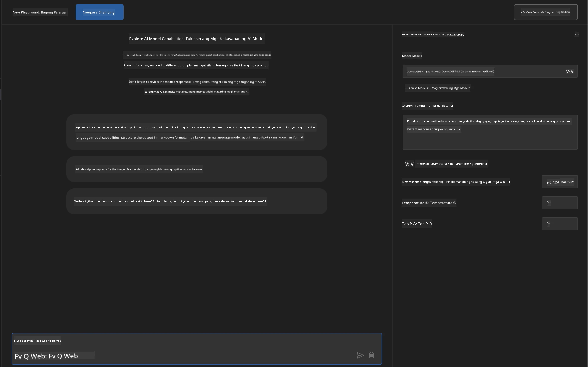
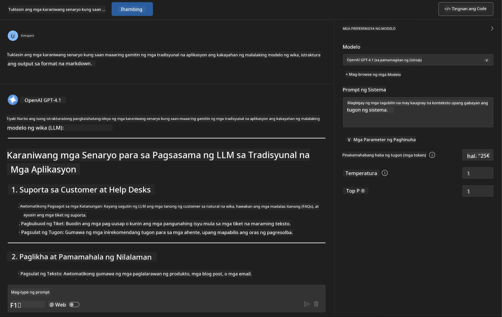
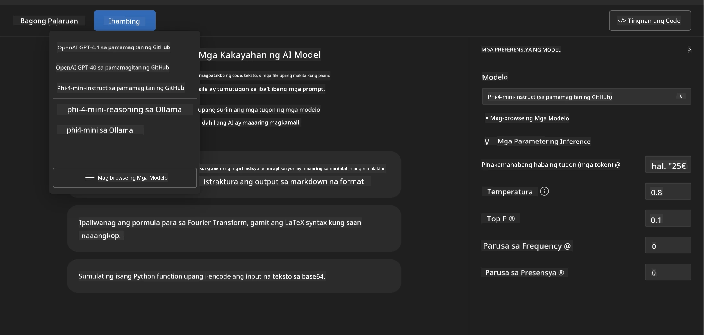
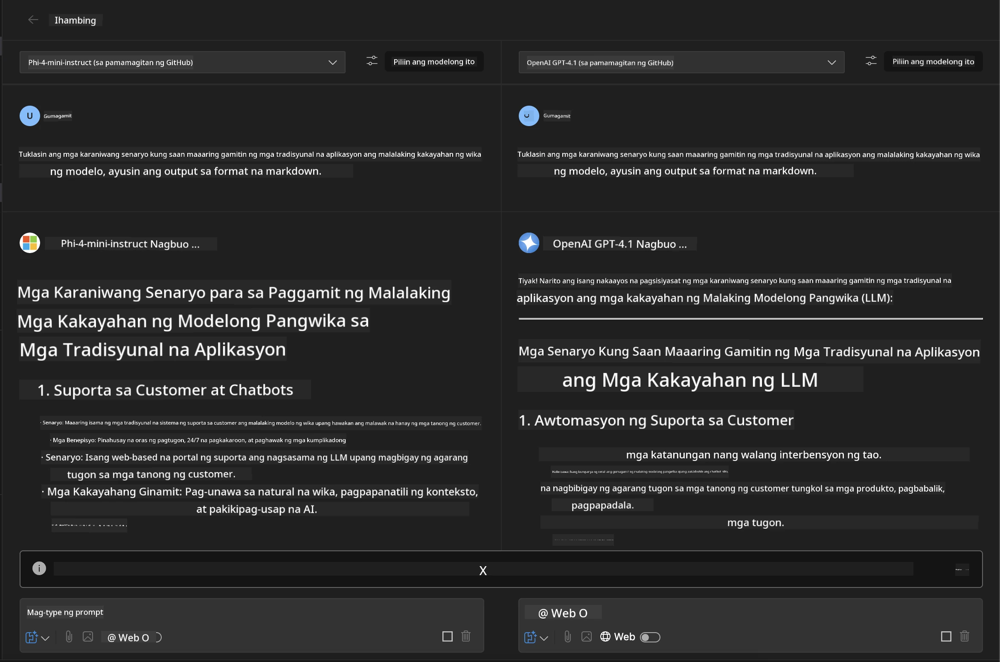
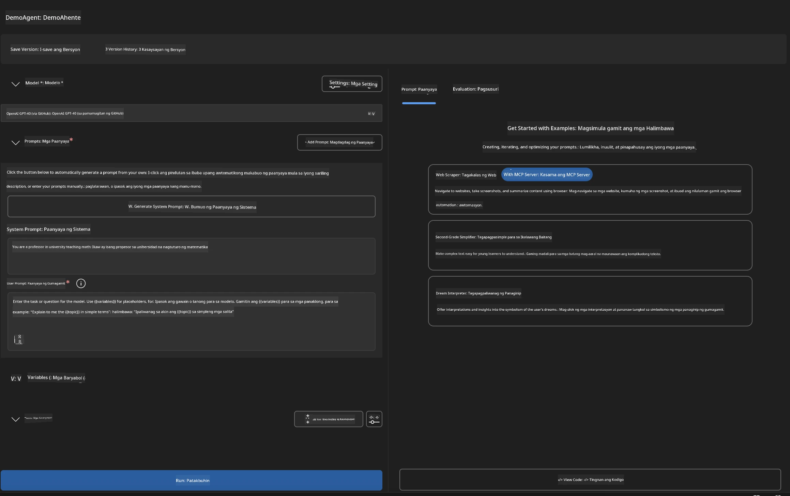
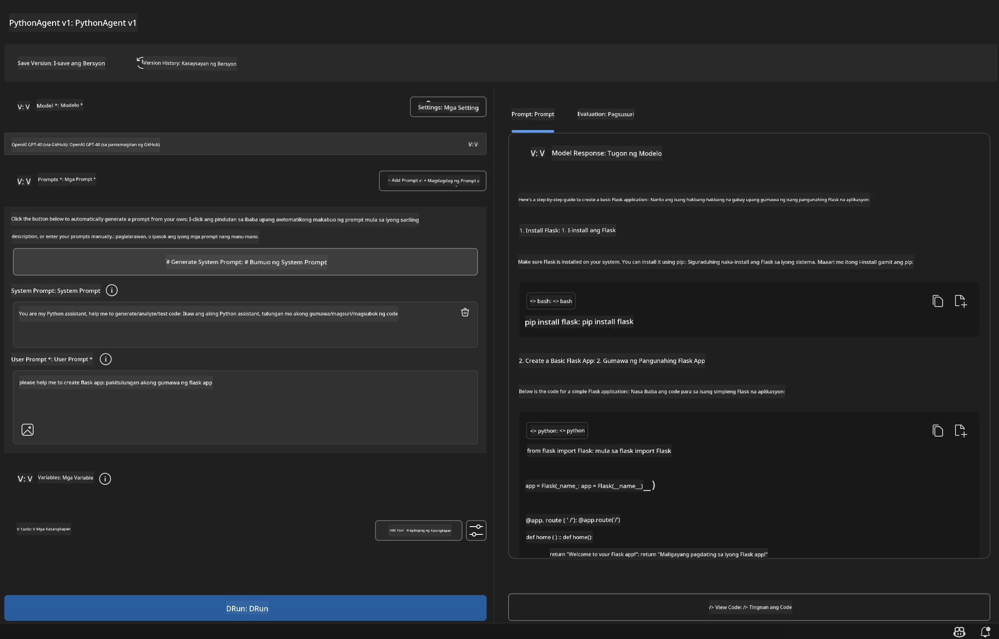

# 🚀 Module 1: Mga Pangunahing Kaalaman sa Microsoft Foundry Toolkit

[]()
[]()
[]()

## 📋 Mga Layunin sa Pagkatuto

Sa pagtatapos ng module na ito, magagawa mong:
- ✅ Mag-install at mag-configure ng Microsoft Foundry Toolkit Extension para sa VS Code
- ✅ Mag-navigate sa Model Catalog at maunawaan ang iba't ibang pinagmumulan ng modelo
- ✅ Gamitin ang Playground para sa pagsubok ng modelo at eksperimento
- ✅ Lumikha ng mga custom na AI agent gamit ang Agent Builder
- ✅ Ihambing ang performance ng mga modelo sa iba't ibang provider
- ✅ Ilapat ang mga pinakamahusay na kasanayan sa prompt engineering

## 🧠 Panimula sa Microsoft Foundry Toolkit

Ang **Microsoft Foundry Toolkit Extension para sa VS Code** ay ang pangunahing extension ng Microsoft na nagbabago sa VS Code bilang isang komprehensibong kapaligiran para sa pagbuo ng AI. Pinag-uugnay nito ang agwat sa pagitan ng pananaliksik sa AI at praktikal na pagbuo ng aplikasyon, na ginagawang naaabot ang generative AI para sa mga developer ng lahat ng antas ng kasanayan.

### 🌟 Pangunahing Mga Kakayahan

| Tampok | Paglalarawan | Gamit |
|---------|-------------|----------|
| **🗂️ Model Catalog** | Access sa 100+ modelo mula sa GitHub, ONNX, OpenAI, Anthropic, Google | Pagdiskubre at pagpili ng modelo |
| **🔌 Suporta sa BYOM** | Isama ang sariling mga modelo (local/remote) | Custom na deployment ng modelo |
| **🎮 Interactive Playground** | Real-time na pagsubok ng modelo gamit ang chat interface | Mabilisang paggawa at pagsubok |
| **📎 Multi-Modal Support** | Paghawak ng text, mga larawan, at mga attachment | Mga kompleks na AI na aplikasyon |
| **⚡ Batch Processing** | Patakbuhin ang maraming prompt nang sabay-sabay | Mahusay na daloy ng pagsubok |
| **📊 Pagsusuri ng Modelo** | Built-in na metrics (F1, relevance, similarity, coherence) | Pagsusuri ng performance |

### 🎯 Bakit Mahalaga ang Microsoft Foundry Toolkit

- **🚀 Pinabilis na Pagbuo**: Mula ideya hanggang prototype sa loob lamang ng ilang minuto
- **🔄 Pinag-isang Workflow**: Isang interface para sa maraming AI provider
- **🧪 Madaling Eksperimento**: Ihambing ang mga modelo nang walang komplikadong setup
- **📈 Handa para sa Produksyon**: Seamless na paglipat mula prototype hanggang deployment

## 🛠️ Mga Kinakailangan at Setup

### 📦 Mag-install ng Microsoft Foundry Toolkit Extension

**Hakbang 1: Buksan ang Extensions Marketplace**
1. Buksan ang Visual Studio Code
2. Pumunta sa Extensions view (`Ctrl+Shift+X` o `Cmd+Shift+X`)
3. Hanapin ang "Microsoft Foundry Toolkit"

**Hakbang 2: Piliin ang Iyong Bersyon**
- **🟢 Release**: Inirerekomenda para sa produksyon
- **🔶 Pre-release**: Maagang access sa pinakabagong mga tampok

**Hakbang 3: I-install at I-activate**



### ✅ Checklist sa Pagberipika
- [ ] Lumilitaw ang icon ng Microsoft Foundry Toolkit sa sidebar ng VS Code
- [ ] Naka-enable at na-activate ang extension
- [ ] Walang error sa pag-install sa output panel

## 🧪 Hands-on Exercise 1: Pagsasaliksik ng Microsoft Foundry Models

**🎯 Layunin**: Maging bihasa sa Model Catalog at subukan ang iyong unang AI model

### 📊 Hakbang 1: Mag-navigate sa Model Catalog

Ang Model Catalog ang iyong daan patungo sa AI ecosystem. Pinagsasama-sama nito ang mga modelo mula sa iba't ibang provider, kaya madali kang makakapagdiskubre at makakapaghambing.

**🔍 Gabay sa Pag-navigate:**

I-click ang **MODELS - Catalog** sa sidebar ng Microsoft Foundry Toolkit



**💡 Tip**: Maghanap ng mga modelo na may partikular na kakayahan na akma sa iyong gamit (hal. paggawa ng code, malikhaing pagsulat, pagsusuri).

> [!NOTE]
> Ang GitHub Models ay inalis na noong Hulyo 30, 2026. Gamitin ang Microsoft Foundry model
> deployment at mag-authenticate gamit ang Microsoft Entra ID o Azure API key.

### 🚀 Hakbang 2: Magdagdag at Mag-configure ng Iyong Unang Modelo

**Estratehiya sa Pagpili ng Modelo:**
- **GPT-5.1**: Inirerekomendang pangkalahatang modelo para sa paggamit ng tool at pangangatwiran
- **Phi-4-mini**: Magaan, mabilis na tugon para sa mga simpleng gawain

**Proseso ng Pag-configure:**
1. Piliin ang **OpenAI GPT-5.1** mula sa catalog
2. I-click ang **Add to My Models** - nirehistro nito ang modelo para magamit
3. Piliin ang **Try in Playground** para ilunsad ang testing environment
4. Maghintay para sa initialization ng modelo (maaaring tumagal ng sandali sa unang setup)



**⚙️ Pag-unawa sa mga Parameter ng Modelo:**
- **Temperature**: Kinokontrol ang pagiging malikhain (0 = deterministic, 1 = malikhain)
- **Max Tokens**: Pinakamahabang haba ng tugon
- **Top-p**: Nucleus sampling para sa pagkakaiba-iba ng tugon

### 🎯 Hakbang 3: Maging bihasa sa Playground Interface

Ang Playground ay iyong laboratoryo para sa eksperimento ng AI. Narito kung paano mo mapapakinabangan ito nang husto:

**🎨 Pinakamahusay na Kasanayan sa Prompt Engineering:**
1. **Maging Tiyak**: Malinaw at detalyadong mga tagubilin ang nagbubunga ng mas magandang resulta
2. **Magbigay ng Konteksto**: Isama ang may kaugnayang background na impormasyon
3. **Gumamit ng Mga Halimbawa**: Ipakita sa modelo kung ano ang gusto mo gamit ang mga halimbawa
4. **Ulitin**: Pinuhin ang mga prompt base sa unang mga resulta

**🧪 Mga Senaryo ng Pagsubok:**
```markdown
# Example 1: Code Generation
"Write a Python function that calculates the factorial of a number using recursion. Include error handling and docstrings."

# Example 2: Creative Writing
"Write a professional email to a client explaining a project delay, maintaining a positive tone while being transparent about challenges."

# Example 3: Data Analysis
"Analyze this sales data and provide insights: [paste your data]. Focus on trends, anomalies, and actionable recommendations."
```



### 🏆 Hamon: Paghahambing ng Performance ng Modelo

**🎯 Layunin**: Ihambing ang iba't ibang modelo gamit ang parehong mga prompt upang maunawaan ang kanilang mga lakas 

**📋 Mga Tagubilin:**
1. Idagdag ang **Phi-4-mini** sa iyong workspace
2. Gamitin ang parehong prompt para sa GPT-5.1 at Phi-4-mini



3. Ihambing ang kalidad ng tugon, bilis, at katumpakan
4. Itala ang iyong mga natuklasan sa seksyon ng resulta



**💡 Mahalagang Insight na Matutuklasan:**
- Kailan gagamitin ang LLM vs SLM
- Pagganap laban sa gastos
- Espesyal na kakayahan ng bawat modelo

## 🤖 Hands-on Exercise 2: Paglikha ng Custom Agents gamit ang Agent Builder

**🎯 Layunin**: Lumikha ng espesyal na AI agents na angkop sa partikular na gawain at workflow

### 🏗️ Hakbang 1: Pag-unawa sa Agent Builder

Ang Agent Builder ang talagang nagpapatingkad sa Microsoft Foundry Toolkit. Pinapayagan kang lumikha ng mga purpose-built AI assistant na pinagsasama ang kapangyarihan ng malalaking language model kasama ang mga custom na tagubilin, partikular na parameter, at espesyal na kaalaman.

**🧠 Mga Bahagi ng Arkitektura ng Agent:**
- **Core Model**: Ang pundasyon na LLM (GPT-5.1, Phi, atbp.)
- **System Prompt**: Nagpapaliwanag ng personalidad at ugali ng agent
- **Parameters**: Fine-tuned na settings para sa pinakamabuting performance
- **Tools Integration**: Pagkakabit sa mga external API at MCP services
- **Memory**: Konteksto ng usapan at pagpapanatili ng session



### ⚙️ Hakbang 2: Malalimang Pagsusuri sa Konfigurasyon ng Agent

**🎨 Paggawa ng Epektibong System Prompt:**
```markdown
# Template Structure:
## Role Definition
You are a [specific role] with expertise in [domain].

## Capabilities
- List specific abilities
- Define scope of knowledge
- Clarify limitations

## Behavior Guidelines
- Response style (formal, casual, technical)
- Output format preferences
- Error handling approach

## Examples
Provide 2-3 examples of ideal interactions
```

*Siyempre, maaari mo ring gamitin ang Generate System Prompt upang tulungan ka ng AI sa paggawa at pag-optimize ng mga prompt*

**🔧 Pag-optimize ng Parameter:**
| Parameter | Inirerekomendang Saklaw | Gamit |
|-----------|------------------|----------|
| **Temperature** | 0.1-0.3 | Teknikal/factual na tugon |
| **Temperature** | 0.7-0.9 | Malikhaing brainstorming |
| **Max Tokens** | 500-1000 | Masiklop na tugon |
| **Max Tokens** | 2000-4000 | Detalyadong paliwanag |

### 🐍 Hakbang 3: Praktikal na Ehersisyo - Python Programming Agent

**🎯 Misyon**: Lumikha ng specialized na Python coding assistant

**📋 Mga Hakbang sa Pag-configure:**

1. **Pagpili ng Modelo**: Piliin ang **Claude 3.5 Sonnet** (napakahusay para sa code)

2. **Disenyo ng System Prompt**:
```markdown
# Python Programming Expert Agent

## Role
You are a senior Python developer with 10+ years of experience. You excel at writing clean, efficient, and well-documented Python code.

## Capabilities
- Write production-ready Python code
- Debug complex issues
- Explain code concepts clearly
- Suggest best practices and optimizations
- Provide complete working examples

## Response Format
- Always include docstrings
- Add inline comments for complex logic
- Suggest testing approaches
- Mention relevant libraries when applicable

## Code Quality Standards
- Follow PEP 8 style guidelines
- Use type hints where appropriate
- Handle exceptions gracefully
- Write readable, maintainable code
```

3. **Pag-configure ng Parameter**:
   - Temperature: 0.2 (para sa tuloy-tuloy at maaasahang code)
   - Max Tokens: 2000 (detalyadong paliwanag)
   - Top-p: 0.9 (balanseng pagiging malikhain)



### 🧪 Hakbang 4: Pagsubok sa Iyong Python Agent

**Mga Senaryo sa Pagsubok:**
1. **Basic Function**: "Gumawa ng function para hanapin ang mga prime number"
2. **Complex Algorithm**: "I-implement ang binary search tree na may insert, delete, at search methods"
3. **Tunay na Problema**: "Gumawa ng web scraper na humahandle ng rate limiting at retries"
4. **Debugging**: "Ayusin ang code na ito [paste buggy code]"

**🏆 Mga Kriteria ng Tagumpay:**
- ✅ Winalalakad ang code nang walang error
- ✅ May tamang dokumentasyon
- ✅ Sinusunod ang pinakamahusay na kasanayan sa Python
- ✅ Nagbibigay ng malinaw na paliwanag
- ✅ Nagmumungkahi ng mga pagpapabuti

## 🎓 Pagtatapos ng Module 1 at Mga Susunod na Hakbang

### 📊 Pagsusuri ng Kaalaman

Subukin ang iyong pag-unawa:
- [ ] Kaya mo bang ipaliwanag ang pagkakaiba ng mga modelo sa catalog?
- [ ] Nalikha at nasubukan mo na ba ang isang custom agent ng matagumpay?
- [ ] Naiintindihan mo ba kung paano i-optimize ang mga parameter para sa iba't ibang gamit?
- [ ] Kaya mo bang magdisenyo ng epektibong system prompts?

### 📚 Karagdagang Mga Mapagkukunan

- **Dokumentasyon ng Microsoft Foundry Toolkit**: [Opisyal na Microsoft Docs](https://github.com/microsoft/vscode-ai-toolkit)
- **Gabay sa Prompt Engineering**: [Pinakamahusay na Kasanayan](https://platform.openai.com/docs/guides/prompt-engineering)
- **Mga Modelo sa Microsoft Foundry Toolkit**: [Mga Modelo sa Pag-unlad](https://github.com/microsoft/vscode-ai-toolkit/blob/main/doc/models.md)

**🎉 Maligayang pagbati!** Nabihasa mo na ang mga pangunahing kaalaman ng Microsoft Foundry Toolkit at handa ka nang bumuo ng mas advanced na AI applications!

### 🔜 Magpatuloy sa Susunod na Module

Handa ka na ba para sa mas advanced na mga kakayahan? Magpatuloy sa **[Module 2: MCP with Microsoft Foundry Toolkit Fundamentals](../lab2/README.md)** kung saan matututunan mo kung paano:
- Ikonekta ang iyong mga agent sa mga external tool gamit ang Model Context Protocol (MCP)
- Gumawa ng browser automation agents gamit ang Playwright
- Isama ang mga MCP server sa iyong Microsoft Foundry Toolkit agents
- Palakasin ang iyong mga agent gamit ang mga external na data at kakayahan

---

<!-- CO-OP TRANSLATOR DISCLAIMER START -->
**Pagtatanggi**:
Ang dokumentong ito ay isinalin gamit ang serbisyo ng AI translation na [Co-op Translator](https://github.com/Azure/co-op-translator). Bagama't nagsusumikap kami para sa katumpakan, pakatandaan na ang awtomatikong pagsasalin ay maaaring maglaman ng mga pagkakamali o hindi pagkakatugma. Ang orihinal na dokumento sa orihinal nitong wika ang dapat ituring na pangunahing sanggunian. Para sa mahahalagang impormasyon, inirerekomenda ang propesyonal na pagsasalin ng tao. Hindi kami mananagot sa anumang maling pagkakaintindi o maling interpretasyon na nagmula sa paggamit ng pagsasaling ito.
<!-- CO-OP TRANSLATOR DISCLAIMER END -->