# 🌐 Module 2: MCP kasama ang Microsoft Foundry Toolkit Fundamentals


## 📋 Mga Layunin sa Pagkatuto

Sa pagtatapos ng module na ito, magagawa mong:

- ✅ Maunawaan ang arkitektura at mga benepisyo ng Model Context Protocol (MCP)
- ✅ Tuklasin ang MCP server ecosystem ng Microsoft
- ✅ Isama ang mga MCP server sa Microsoft Foundry Toolkit Agent Builder
- ✅ Bumuo ng isang functional na browser automation agent gamit ang Playwright MCP
- ✅ I-configure at subukan ang mga MCP tools sa loob ng iyong mga agent
- ✅ I-export at i-deploy ang mga MCP-powered na agent para sa production use

## 🎯 Pagpapatuloy mula sa Module 1

Sa Module 1, na-master natin ang mga pangunahing kaalaman sa Microsoft Foundry Toolkit at nakalikha ng ating
unang Python Agent. Ngayon ay **papalakasin** natin ang iyong mga agent sa pamamagitan ng pagkonekta nila
sa mga external tool at serbisyo gamit ang makabagong
**Model Context Protocol (MCP)**.

Isipin ito bilang pag-upgrade mula sa simpleng calculator patungo sa isang buong computer. Ang iyong mga AI
agent ay magkakaroon ng kakayahan na:

- 🌐 Mag-browse at makipag-interact sa mga website
- 📁 Mag-access at manipulahin ang mga file
- 🔧 Makipag-integrate sa mga enterprise system
- 📊 Mag-proseso ng real-time data mula sa mga API

## 🧠 Pag-unawa sa Model Context Protocol (MCP)

### 🔍 Ano ang MCP?

Ang Model Context Protocol (MCP) ay ang **"USB-C para sa mga AI application"**: isang bukas na
standard na nagkokonekta ng Large Language Models (LLMs) sa mga external na tool, pinanggagalingan ng data,
at mga serbisyo. Tulad ng USB-C na naglalaan ng isang unibersal na connector, ang MCP
ay nagpapabawas sa komplikasyon ng AI integration sa pamamagitan ng isang standardized protocol.

### 🎯 Ang Problema na Nilulutas ng MCP

**Bago ang MCP:**

- 🔧 Custom integrations para sa bawat tool
- 🔄 Vendor lock-in sa mga proprietary na solusyon  
- 🔒 Mga kahinaan sa seguridad mula sa ad-hoc na koneksyon
- ⏱️ Buwan ng pag-develop para sa mga basic integration

**Sa MCP:**

- ⚡ Plug-and-play na integrasyon ng tool
- 🔄 Vendor-agnostic na arkitektura
- 🛡️ Built-in na mga pinakamahusay na kasanayan sa seguridad
- 🚀 Ilang minuto lang para magdagdag ng bagong kakayahan

### 🏗️ Malalim na Pagtingin sa Arkitektura ng MCP

Ang MCP ay sumusunod sa **client-server architecture** na lumilikha ng isang secure at scalable ecosystem:

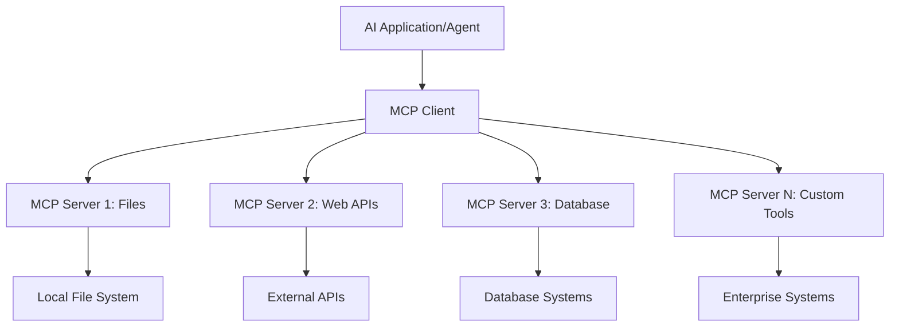

**🔧 Pangunahing Komponent:**

| Komponent | Papel | Mga Halimbawa |
| --------- | ---- | ---------- |
| **MCP Hosts** | Kumokonsumo ng mga MCP service | VS Code, Foundry Toolkit |
| **MCP Clients** | Nagha-handle ng mga koneksyon sa protocol | Built into hosts |
| **MCP Servers** | Nagbibigay ng mga kakayahan | Playwright, Files, Azure, GitHub |
| **Transport Layer** | Nagkokonekta ng clients at servers | stdio, HTTP, WebSockets |

## 🏢 Ecosystem ng MCP Server ng Microsoft

Nangunguna ang Microsoft sa MCP ecosystem sa pamamagitan ng komprehensibong suite ng
mga enterprise-grade na server na tumutugon sa mga pangangailangan ng totoong negosyo.

### 🌟 Tampok na Microsoft MCP Server

#### 1. ☁️ Azure MCP Server

**🔗 Repository**: [azure/azure-mcp](https://github.com/azure/azure-mcp)
**🎯 Layunin**: Komprehensibong pamamahala ng Azure resource kasama ang AI integration

**✨ Mga Pangunahing Katangian:**

- Declarative na provisioning ng imprastraktura
- Real-time na pagmamanman ng resource
- Mga rekomendasyon para sa pag-optimize ng gastos
- Pag-check ng seguridad at pagsunod

**🚀 Mga Use Case:**

- Infrastructure-as-Code gamit ang tulong ng AI
- Automated scaling ng mga resource
- Pag-optimize ng gastos sa cloud
- Pag-automate ng workflow ng DevOps

#### 2. 📊 Microsoft Dataverse MCP

**📚 Dokumentasyon**: [Microsoft Dataverse Integration](https://go.microsoft.com/fwlink/?linkid=2320176)
**🎯 Layunin**: Natural language interface para sa datos ng negosyo

**✨ Mga Pangunahing Katangian:**

- Natural language na mga database query
- Pag-unawa sa konteksto ng negosyo
- Mga custom na prompt template
- Pamamahala ng datos ng enterprise

**🚀 Mga Use Case:**

- Ulat sa business intelligence
- Pagsusuri ng datos ng customer
- Insights sa sales pipeline
- Mga query para sa compliance data

#### 3. 🌐 Playwright MCP Server

**🔗 Repository**: [microsoft/playwright-mcp](https://github.com/microsoft/playwright-mcp)
**🎯 Layunin**: Kakayahan sa browser automation at web interaction

**✨ Mga Pangunahing Katangian:**

- Cross-browser automation (Chrome, Firefox, Safari)
- Intelligent na pagtuklas ng elemento
- Pagkuha ng screenshot at paggawa ng PDF
- Pagmamanman ng network traffic

**🚀 Mga Use Case:**

- Mga automated testing workflow
- Web scraping at pagkuha ng datos
- Pagmamanman ng UI/UX
- Automation ng competitive analysis

#### 4. 📁 Files MCP Server

**🔗 Repository**: [microsoft/files-mcp-server](https://github.com/microsoft/files-mcp-server)
**🎯 Layunin**: Matalinong operasyon sa file system

**✨ Mga Pangunahing Katangian:**

- Declarative na pamamahala ng file
- Pag-sync ng nilalaman
- Integrasyon sa version control
- Pagkuha ng metadata

**🚀 Mga Use Case:**

- Pamamahala ng dokumentasyon
- Organisasyon ng code repository
- Mga workflow sa pag-publish ng nilalaman
- Paghawak ng file sa data pipeline

#### 5. 📝 MarkItDown MCP Server

**🔗 Repository**: [microsoft/markitdown](https://github.com/microsoft/markitdown)
**🎯 Layunin**: Advanced na pagproseso at manipulasyon ng Markdown

**✨ Mga Pangunahing Katangian:**

- Mayamang parsing ng Markdown
- Pag-convert ng format (MD ↔ HTML ↔ PDF)
- Pagsusuri ng istruktura ng nilalaman
- Pagproseso ng template

**🚀 Mga Use Case:**

- Mga workflow sa teknikal na dokumentasyon
- Mga content management system
- Paggawa ng ulat
- Automation ng knowledge base

#### 6. 📈 Clarity MCP Server

**📦 Package**: [@microsoft/clarity-mcp-server](https://www.npmjs.com/package/@microsoft/clarity-mcp-server)
**🎯 Layunin**: Web analytics at mga insight sa user behavior

**✨ Mga Pangunahing Katangian:**

- Pagsusuri ng heatmap data
- Pag-record ng mga user session
- Mga metric ng performance
- Pagsusuri ng conversion funnel

**🚀 Mga Use Case:**

- Pag-optimize ng website
- Pananaliksik sa user experience
- Pagsusuri ng A/B testing
- Business intelligence dashboards

### 🌍 Community Ecosystem

Bukod sa mga server ng Microsoft, kabilang sa MCP ecosystem ang:

- **🐙 GitHub MCP**: Pamamahala ng repository at pagsusuri ng code
- **🗄️ Database MCPs**: Integrasyon sa PostgreSQL, MySQL, MongoDB
- **☁️ Cloud Provider MCPs**: Mga tool ng AWS, GCP, Digital Ocean
- **📧 Communication MCPs**: Slack, Teams, integrasyon sa email

## 🛠️ Hands-On Lab: Pagbuo ng Browser Automation Agent

**🎯 Layunin ng Proyekto**: Gumawa ng matalinong browser automation agent gamit ang
Playwright MCP server na maaaring mag-navigate sa mga website, kumuha ng impormasyon, at
magsagawa ng komplikadong web interaction.

### 🚀 Yugto 1: Pagsisimula ng Agent

#### Hakbang 1: I-initialize ang Iyong Agent

1. **Buksan ang Microsoft Foundry Toolkit Agent Builder**
2. **Gumawa ng Bagong Agent** gamit ang sumusunod na configuration:
   - **Pangalan**: `BrowserAgent`
   - **Modelo**: Piliin ang GPT-5.1. Tingnan ang
      [Microsoft Foundry model retirement schedule](https://learn.microsoft.com/azure/foundry/openai/concepts/model-retirement-schedule)
      para sa kasalukuyang impormasyon sa lifecycle ng modelo.

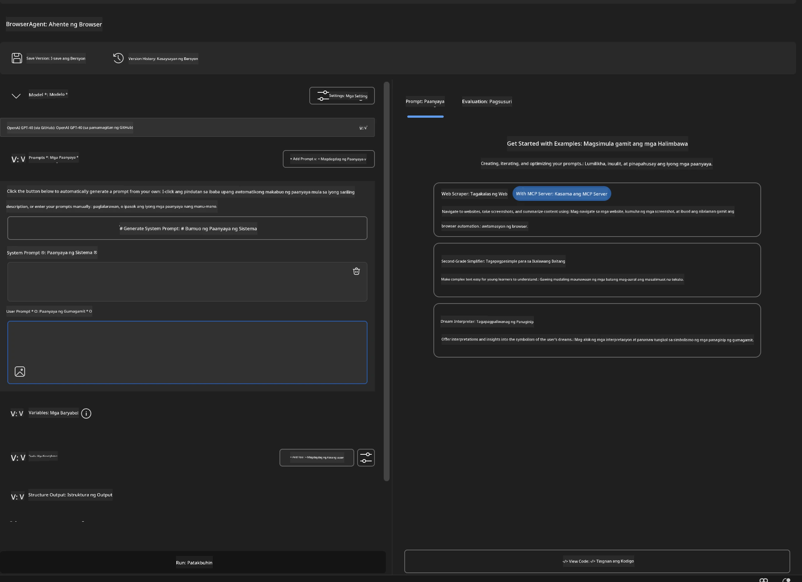

### 🔧 Yugto 2: MCP Integration Workflow

#### Hakbang 3: Magdagdag ng MCP Server Integration

1. **Pumunta sa Tools Section** sa Agent Builder
2. **I-click ang "Add Tool"** upang buksan ang integration menu
3. **Piliin ang "MCP Server"** mula sa mga available na pagpipilian

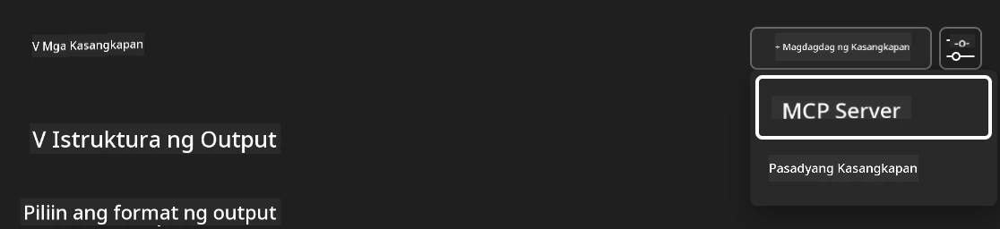

**🔍 Pag-unawa sa Mga Uri ng Tool:**

- **Built-in Tools**: Mga pre-configured na Microsoft Foundry Toolkit function
- **MCP Servers**: Mga external service integration
- **Custom APIs**: Sariling mga service endpoint
- **Function Calling**: Direktang access sa function ng modelo

#### Hakbang 4: Pagpili ng MCP Server

1. **Piliin ang opsyon na "MCP Server"** upang magpatuloy
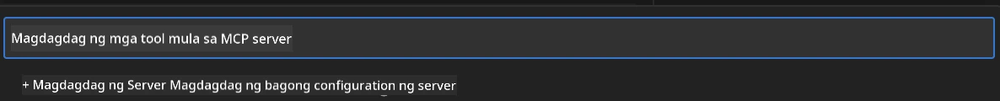

2. **Mag-browse sa MCP Catalog** upang tuklasin ang mga available na integrasyon
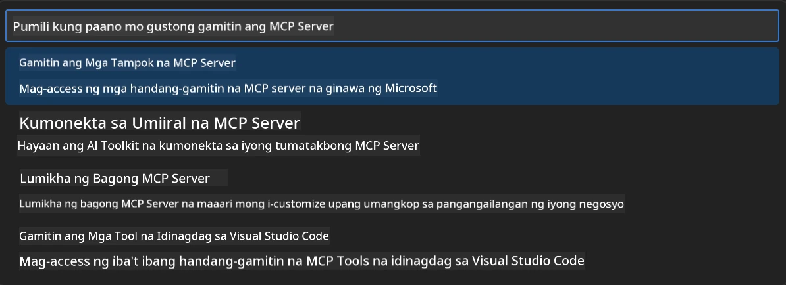

### 🎮 Yugto 3: Pag-configure ng Playwright MCP

#### Hakbang 5: Piliin at I-configure ang Playwright

1. **I-click ang "Use Featured MCP Servers"** upang ma-access ang mga verified na server ng Microsoft
2. **Piliin ang "Playwright"** mula sa listahan ng featured
3. **Tanggapin ang Default MCP ID** o i-customize para sa iyong environment

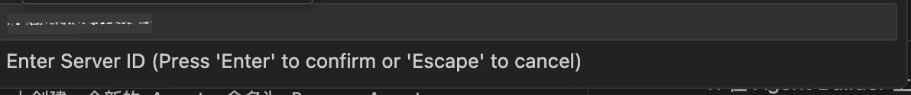

#### Hakbang 6: I-enable ang Mga Kakayahan ng Playwright

**🔑 Mahalagang Hakbang**: Piliin ang **LAHAT** ng mga available na method ng Playwright para sa pinakamataas na functionality

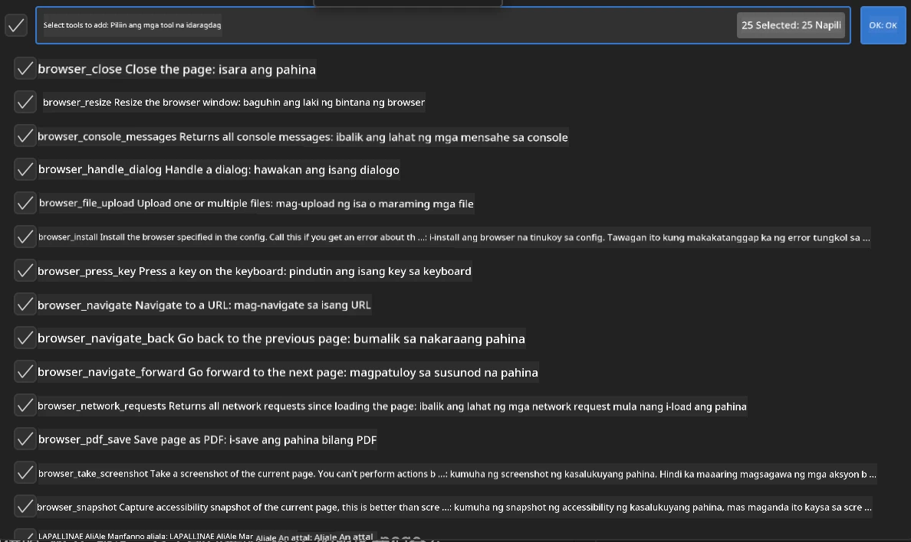

**🛠️ Mahahalagang Tool ng Playwright:**

- **Navigation**: `goto`, `goBack`, `goForward`, `reload`
- **Interaction**: `click`, `fill`, `press`, `hover`, `drag`
- **Extraction**: `textContent`, `innerHTML`, `getAttribute`
- **Validation**: `isVisible`, `isEnabled`, `waitForSelector`
- **Capture**: `screenshot`, `pdf`, `video`
- **Network**: `setExtraHTTPHeaders`, `route`, `waitForResponse`

#### Hakbang 7: Suriin ang Tagumpay ng Integrasyon

**✅ Mga Palatandaan ng Tagumpay:**

- Lahat ng tool ay lumalabas sa Agent Builder interface
- Walang error message sa integration panel
- Ipinapakita ng status ng Playwright server na "Connected"

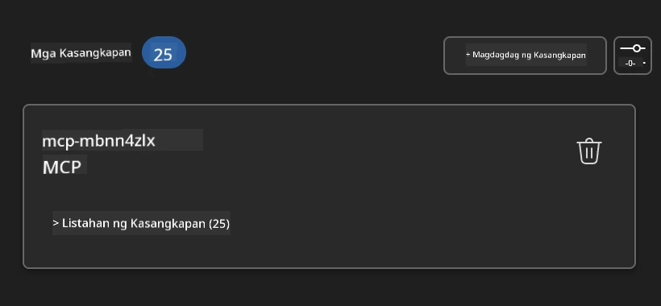

**🔧 Paghawak sa Karaniwang Problema:**

- **Connection Failed**: Suriin ang koneksyon sa internet at mga setting ng firewall
- **Missing Tools**: Siguraduhing lahat ng kakayahan ay napili sa pagsisimula
- **Permission Errors**: Tiyaking may tamang permiso ang VS Code sa system

### 🎯 Yugto 4: Advanced na Prompt Engineering

#### Hakbang 8: Disenyuhin ang Intelligent System Prompts

Gumawa ng sopistikadong mga prompt na ginagamit ang buong kakayahan ng Playwright:

```markdown
# Web Automation Expert System Prompt

## Core Identity
You are an advanced web automation specialist with deep expertise in browser
automation, web scraping, and user experience analysis. You have access to
Playwright tools for comprehensive browser control.

## Capabilities & Approach
### Navigation Strategy
- Always start with screenshots to understand page layout
- Use semantic selectors (text content, labels) when possible
- Implement wait strategies for dynamic content
- Handle single-page applications (SPAs) effectively

### Error Handling
- Retry failed operations with exponential backoff
- Provide clear error descriptions and solutions
- Suggest alternative approaches when primary methods fail
- Always capture diagnostic screenshots on errors

### Data Extraction
- Extract structured data in JSON format when possible
- Provide confidence scores for extracted information
- Validate data completeness and accuracy
- Handle pagination and infinite scroll scenarios

### Reporting
- Include step-by-step execution logs
- Provide before/after screenshots for verification
- Suggest optimizations and alternative approaches
- Document any limitations or edge cases encountered

## Ethical Guidelines
- Respect robots.txt and rate limiting
- Avoid overloading target servers
- Only extract publicly available information
- Follow website terms of service
```

#### Hakbang 9: Gumawa ng Dynamic User Prompts

Disenyuhin ang mga prompt na nagpapakita ng iba't ibang kakayahan:

**🌐 Halimbawa ng Web Analysis:**

```markdown
Navigate to github.com/kinfey and provide a comprehensive analysis including:
1. Repository structure and organization
2. Recent activity and contribution patterns  
3. Documentation quality assessment
4. Technology stack identification
5. Community engagement metrics
6. Notable projects and their purposes

Include screenshots at key steps and provide actionable insights.
```

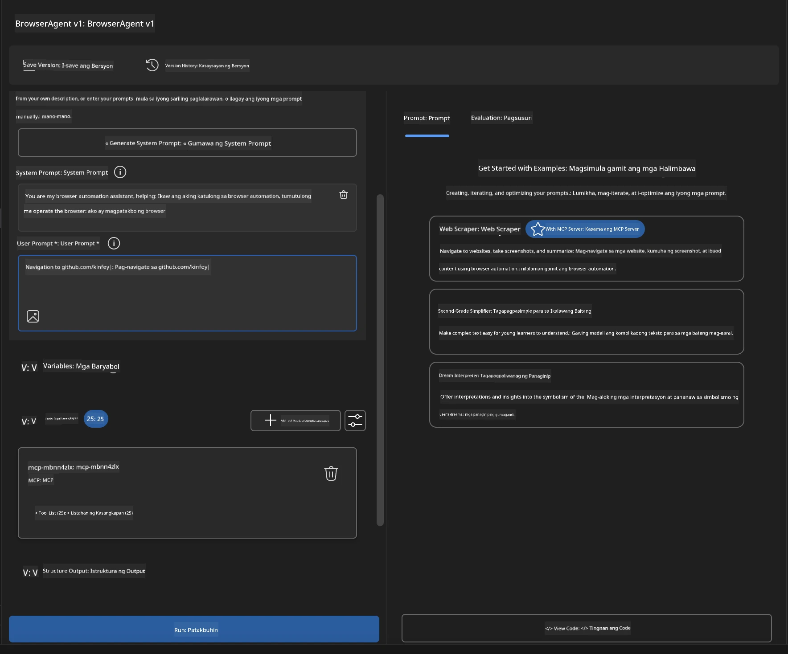

### 🚀 Yugto 5: Pagpapatupad at Pagsubok

#### Hakbang 10: Patakbuhin ang Iyong Unang Automation

1. **I-click ang "Run"** upang ilunsad ang automation sequence
2. **Bantayan ang Real-time Execution**:
   - Awtomatikong magbubukas ang Chrome browser
   - Mag-navigate ang agent sa target na website
   - Kinukuha ng mga screenshot ang bawat mahalagang hakbang
   - Dumadaloy ang mga resulta ng pagsusuri nang real-time

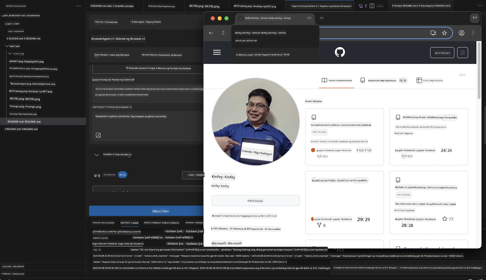

#### Hakbang 11: Suriin ang Mga Resulta at Insight

Tingnan ang komprehensibong pagsusuri sa interface ng Agent Builder:

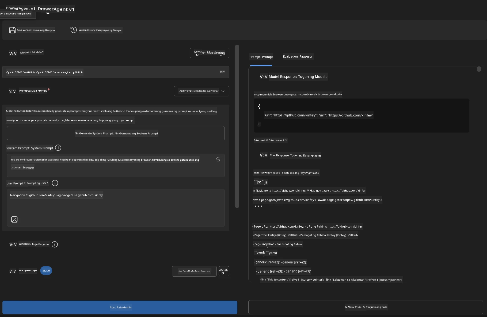

### 🌟 Yugto 6: Mga Advanced na Kakayahan at Deployment

#### Hakbang 12: Export at Production Deployment

Sinusuportahan ng Agent Builder ang maraming opsyon sa deployment:

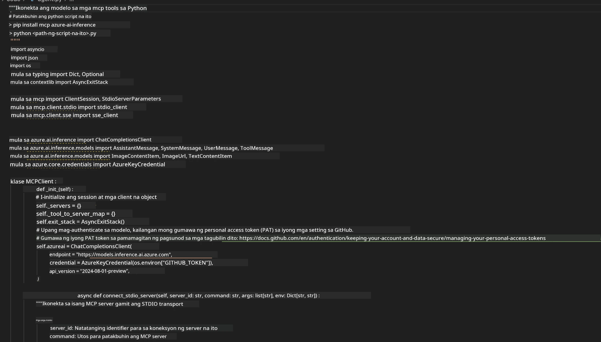

## 🎓 Buod ng Module 2 & Mga Susunod na Hakbang

### 🏆 Nakuha ang Achievement: MCP Integration Master

**✅ Mga Kasanayang Na-master:**

- [ ] Pag-unawa sa arkitektura at mga benepisyo ng MCP
- [ ] Pag-navigate sa MCP server ecosystem ng Microsoft
- [ ] Pagsasama ng Playwright MCP sa Microsoft Foundry Toolkit
- [ ] Pagbuo ng sopistikadong browser automation agent
- [ ] Advanced na prompt engineering para sa web automation

### 📚 Karagdagang Mga Resource

- **🔗 MCP Specification**: [Opisyal na Dokumento ng Protocol](https://modelcontextprotocol.io/)
- **🛠️ Playwright API**: [Kumpletong Reference ng Method](https://playwright.dev/docs/api/class-playwright)
- **🏢 Microsoft MCP Servers**:
   [Enterprise Integration Guide](https://github.com/microsoft/mcp-servers)
- **🌍 Mga Halimbawa mula sa Komunidad**: [MCP Server Gallery](https://github.com/modelcontextprotocol/servers)

**🎉 Binabati kita!** Matagumpay mong na-master ang integrasyon ng MCP at maaari ka
nang bumuo ng AI agent na handa para sa production na may kakayahan sa mga external tool!

### 🔜 Magpatuloy sa Susunod na Module

Handa ka na bang dalhin sa mas mataas na antas ang iyong kasanayan sa MCP? Magpatuloy sa
**[Module 3: Advanced MCP Development with Microsoft Foundry Toolkit](../lab3/README.md)**
kung saan matututuhan mo kung paano:

- Gumawa ng sarili mong custom MCP server
- I-configure at gamitin ang pinakabagong MCP Python SDK
- I-set up ang MCP Inspector para sa debugging
- Ma-master ang mga advanced na workflow sa MCP server development
- Bumuo ng isang Weather MCP Server mula sa simula

---

<!-- CO-OP TRANSLATOR DISCLAIMER START -->
**Pagtatanggi**:
Ang dokumentong ito ay isinalin gamit ang serbisyo ng AI translation na [Co-op Translator](https://github.com/Azure/co-op-translator). Bagama't nagsusumikap kami para sa katumpakan, pakatandaan na ang awtomatikong pagsasalin ay maaaring maglaman ng mga pagkakamali o hindi pagkakatugma. Ang orihinal na dokumento sa orihinal nitong wika ang dapat ituring na pangunahing sanggunian. Para sa mahahalagang impormasyon, inirerekomenda ang propesyonal na pagsasalin ng tao. Hindi kami mananagot sa anumang maling pagkakaintindi o maling interpretasyon na nagmula sa paggamit ng pagsasaling ito.
<!-- CO-OP TRANSLATOR DISCLAIMER END -->