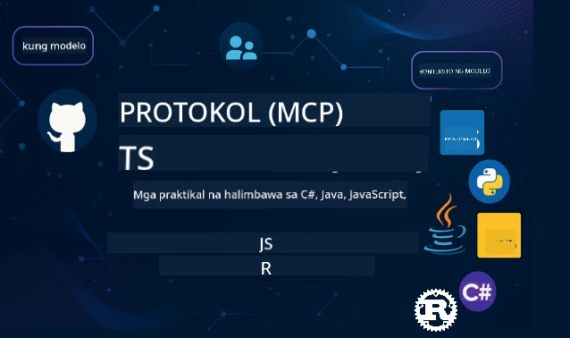

 

[](https://GitHub.com/microsoft/mcp-for-beginners/graphs/contributors)
[](https://GitHub.com/microsoft/mcp-for-beginners/issues)
[](https://GitHub.com/microsoft/mcp-for-beginners/pulls)
[](http://makeapullrequest.com)
[](https://mcptoplist.com/server/mcp.so%2Fmcp-for-beginners%2Fmicrosoft)

[](https://GitHub.com/microsoft/mcp-for-beginners/watchers)
[](https://GitHub.com/microsoft/mcp-for-beginners/fork)
[](https://GitHub.com/microsoft/mcp-for-beginners/stargazers)


[](https://discord.gg/nTYy5BXMWG)

Sundin ang mga hakbang na ito upang makapagsimula gamit ang mga resources na ito:
1. **I-fork ang Repository**: I-click ang [](https://GitHub.com/microsoft/mcp-for-beginners/fork)
2. **I-clone ang Repository**:   `git clone https://github.com/microsoft/mcp-for-beginners.git`
3. **Sumali sa** [](https://discord.gg/nTYy5BXMWG)


### 🌐 Suporta para sa Maramihang Wika

#### Mga salin na pinananatili gamit ang [Co-op Translator](https://github.com/Azure/co-op-translator)

<!-- CO-OP TRANSLATOR LANGUAGES TABLE START -->
[Arabic](../ar/README.md) | [Bengali](../bn/README.md) | [Bulgarian](../bg/README.md) | [Burmese (Myanmar)](../my/README.md) | [Chinese (Simplified)](../zh-CN/README.md) | [Chinese (Traditional, Hong Kong)](../zh-HK/README.md) | [Chinese (Traditional, Macau)](../zh-MO/README.md) | [Chinese (Traditional, Taiwan)](../zh-TW/README.md) | [Croatian](../hr/README.md) | [Czech](../cs/README.md) | [Danish](../da/README.md) | [Dutch](../nl/README.md) | [Estonian](../et/README.md) | [Finnish](../fi/README.md) | [French](../fr/README.md) | [German](../de/README.md) | [Greek](../el/README.md) | [Hebrew](../he/README.md) | [Hindi](../hi/README.md) | [Hungarian](../hu/README.md) | [Indonesian](../id/README.md) | [Italian](../it/README.md) | [Japanese](../ja/README.md) | [Kannada](../kn/README.md) | [Khmer](../km/README.md) | [Korean](../ko/README.md) | [Lithuanian](../lt/README.md) | [Malay](../ms/README.md) | [Malayalam](../ml/README.md) | [Manipuri (Meitei Mayek)](../mni/README.md) | [Marathi](../mr/README.md) | [Nepali](../ne/README.md) | [Nigerian Pidgin](../pcm/README.md) | [Norwegian](../no/README.md) | [Persian (Farsi)](../fa/README.md) | [Polish](../pl/README.md) | [Portuguese (Brazil)](../pt-BR/README.md) | [Portuguese (Portugal)](../pt-PT/README.md) | [Punjabi (Gurmukhi)](../pa/README.md) | [Romanian](../ro/README.md) | [Russian](../ru/README.md) | [Serbian (Cyrillic)](../sr/README.md) | [Slovak](../sk/README.md) | [Slovenian](../sl/README.md) | [Spanish](../es/README.md) | [Swahili](../sw/README.md) | [Swedish](../sv/README.md) | [Tagalog (Filipino)](./README.md) | [Tamil](../ta/README.md) | [Telugu](../te/README.md) | [Thai](../th/README.md) | [Turkish](../tr/README.md) | [Ukrainian](../uk/README.md) | [Urdu](../ur/README.md) | [Vietnamese](../vi/README.md)

> **Mas gusto mo bang mag-clone nang lokal?**
>
> Ang repositoryong ito ay mayroong mahigit 50 na pagsasalin ng wika na nagpapalaki nang malaki sa laki ng pag-download. Upang mag-clone nang walang mga pagsasalin, gamitin ang sparse checkout:
>
> **Bash / macOS / Linux:**
> ```bash
> git clone --filter=blob:none --sparse https://github.com/microsoft/mcp-for-beginners.git
> cd mcp-for-beginners
> git sparse-checkout set --no-cone '/*' '!translations' '!translated_images'
> ```
>
> **CMD (Windows):**
> ```cmd
> git clone --filter=blob:none --sparse https://github.com/microsoft/mcp-for-beginners.git
> cd mcp-for-beginners
> git sparse-checkout set --no-cone "/*" "!translations" "!translated_images"
> ```
>
> Bibigyan ka nito ng lahat ng kailangan mo para makumpleto ang kurso nang mas mabilis ang pag-download.
<!-- CO-OP TRANSLATOR LANGUAGES TABLE END -->

# 🚀 Kurikulum ng Model Context Protocol (MCP) para sa mga Nagsisimula

## **Matutunan ang MCP sa pamamagitan ng Mga Halimbawang Kodigo sa C#, Java, JavaScript, Rust, Python, at TypeScript**

## 🧠 Pangkalahatang-ideya ng Kurikulum ng Model Context Protocol
Maligayang pagdating sa iyong paglalakbay sa Model Context Protocol! Kung nagtaka ka kung paano nakikipag-usap ang mga AI application sa iba't ibang tool at serbisyo, malalaman mo ngayon ang eleganteng solusyon na nagbabago kung paano bumuo ang mga developer ng matatalinong sistema.

Isipin ang MCP bilang isang unibersal na tagasalin para sa mga AI application - katulad ng kung paano pinapayagan kang kumonekta ng anumang device sa iyong computer gamit ang USB ports, pinapayagan ng MCP ang mga AI model na kumonekta sa anumang tool o serbisyo sa isang standardisadong paraan. Kung ikaw man ay gumagawa ng iyong unang chatbot o nagtatrabaho sa mga kumplikadong workflow ng AI, ang pag-unawa sa MCP ay magbibigay sa iyo ng kapangyarihan na lumikha ng mas may kakayahan at mas flexible na mga application.

Ang kurikulum na ito ay dinisenyo nang may pasensya at pag-aalaga para sa iyong pag-aaral. Magsisimula tayo sa mga simpleng konsepto na alam mo na at unti-unting bubuuin ang iyong kasanayan gamit ang hands-on na pagsasanay sa iyong paboritong wikang pang-programa. Bawat hakbang ay may malinaw na paliwanag, praktikal na mga halimbawa, at maraming suporta habang naglalakbay ka.

Sa oras na matapos mo ang paglalakbay na ito, magkakaroon ka ng kumpiyansa na magtayo ng sarili mong mga MCP server, isama ang mga ito sa mga kilalang AI platform, at maintindihan kung paano binabago ng teknolohiyang ito ang kinabukasan ng pag-develop ng AI. Simulan natin ang kapana-panabik na paglalakbay na ito nang magkasama!

### Opisyal na Dokumentasyon at mga Espesipikasyon

Ang kasalukuyang rebisyon ng protocol ay **MCP Specification 2026-07-28**. Ang MCP
specification ay gumagamit ng date-based versioning (YYYY-MM-DD format) upang maging malinaw ang compatibility ng protocol.


> **Paalala sa bersyon:** tinuturo ng kurikulum na ito ang kasalukuyang `2026-07-28`
> mga konsepto, kasama na ang stateless requests, ang Extensions framework, at ang
> deprecation ng Roots, Sampling, at Logging. May ilang hands-on na mga halimbawa
> na nananatiling malinaw na naka-version sa `2025-11-25` habang umaangkop pa ang suporta ng SDK. Tingnan
> ang [What's Changed in MCP: The 2026-07-28 Specification](./01-CoreConcepts/mcp-2026-07-28.md)
> para sa mga pagbabago at gabay sa migration.

Ang mga resources na ito ay magiging mas mahalaga habang lumalago ang iyong pag-unawa, pero huwag mag-alala na basahin lahat agad-agad. Magsimula sa mga bahagi na pinaka-interesado ka!
- 📘 [MCP Documentation](https://modelcontextprotocol.io/) – Ito ang iyong pangunahing resource para sa sunud-sunod na mga tutorial at gabay ng gumagamit. Ang dokumentasyon ay isinulat para sa mga nagsisimula, nagbibigay ng malinaw na mga halimbawa na maaari mong sundan sa iyong sariling bilis.
- 📜 [MCP Specification](https://modelcontextprotocol.io/specification/2026-07-28) – Isipin ito bilang iyong komprehensibong reference manual. Habang ikinukumpleto mo ang kurikulum, babalik ka dito upang tingnan ang mga espesyal na detalye at tuklasin ang mga advanced na tampok.
- 📜 [MCP Specification Versioning](https://modelcontextprotocol.io/specification/versioning) – Nagtataglay ito ng impormasyon tungkol sa kasaysayan ng bersyon ng protocol at kung paano ginagamit ng MCP ang date-based versioning (YYYY-MM-DD format).
- 🧑‍💻 [MCP GitHub Repository](https://github.com/modelcontextprotocol) – Dito mo makikita ang mga SDK, tools, at mga halimbawa ng kodigo sa maraming wika ng programa. Isa itong kayamanan ng mga praktikal na halimbawa at mga komponenteng handang gamitin.
- 🌐 [MCP Community](https://github.com/orgs/modelcontextprotocol/discussions) – Sumali sa kapwa nagtututo at mga bihasang developer sa mga diskusyon tungkol sa MCP. Isa itong suportadong komunidad kung saan malugod ang mga tanong at malaya ang pagbabahagi ng kaalaman.
  
## Mga Layunin ng Pagkatuto

Sa pagtatapos ng kurikulum na ito, mararamdaman mong may kumpiyansa at kasiyahan sa iyong mga bagong kakayahan. Narito kung ano ang iyong makakamit:

• **Maunawaan ang mga pundasyon ng MCP**: Maiintindihan mo kung ano ang Model Context Protocol at bakit ito ang nagrerebolusyon sa kung paano nagtutulungan ang mga AI application, gamit ang mga analogiya at halimbawa na madaling maintindihan.

• **Bumuo ng iyong unang MCP server**: Lilikha ka ng gumaganang MCP server sa iyong paboritong wika ng programa, simula sa mga simpleng halimbawa at unti-unting palalalimin ang iyong kasanayan.

• **Ikonekta ang mga AI model sa totoong mga tool**: Matututuhan mo kung paano tulayin ang pagitan ng mga AI model at mga aktwal na serbisyo, na nagbibigay ng makapangyarihang mga bagong kakayahan sa iyong mga application.

• **Ipapatupad ang mga pinakamahusay na gawi sa seguridad**: Maiintindihan mo kung paano mapanatiling ligtas ang iyong mga implementasyon ng MCP, pinoprotektahan ang kapwa iyong mga application at mga user.

• **I-deploy nang may kumpiyansa**: Malalaman mo kung paano ilipat ang iyong mga proyekto ng MCP mula sa development papunta sa production, gamit ang mga praktikal na estratehiya sa deployment na gumagana sa totoong mundo.

• **Sumali sa komunidad ng MCP**: Magiging bahagi ka ng lumalaking komunidad ng mga developer na humuhubog sa kinabukasan ng pag-develop ng AI application.

## Mahalagang Pangunahing Kaalaman

Bago tayo sumabak sa mga detalye ng MCP, siguraduhin muna natin na komportable ka sa ilang mga pundamental na konsepto. Huwag mag-alala kung hindi ka eksperto sa mga paksang ito – ipapaliwanag namin ang lahat ng kailangan mong malaman habang naglalakad tayo!

### Pag-unawa sa mga Protocol (Ang Pundasyon)

Isipin ang isang protocol bilang mga patakaran para sa isang pag-uusap. Kapag tumawag ka sa isang kaibigan, pareho ninyong alam na sasabihin ng "hello" kapag sumagot, magpapalitan ng salita, at sasabihing "goodbye" kapag tapos na. Kailangan din ng mga computer program ang katulad na mga patakaran para makipag-usap nang epektibo.

Ang MCP ay isang protocol - isang set ng mga pinagkasunduang patakaran na tumutulong sa mga AI model at application na magkaroon ng produktibong "pag-uusap" sa mga tool at serbisyo. Katulad ng pagpapasimple ng komunikasyon ng tao sa pamamagitan ng mga patakaran sa pag-uusap, pinapadali ng MCP ang komunikasyon ng AI application na maging mas maaasahan at makapangyarihan.

### Mga Relasyon ng Client-Server (Paano Nagkakasundo ang mga Program)

Araw-araw mo nang ginagamit ang mga relasyon ng client-server! Kapag gumagamit ka ng web browser (ang client) para bisitahin ang isang website, kumokonekta ka sa isang web server na nagpapadala sa iyo ng nilalaman ng pahina. Alam ng browser kung paano humiling ng impormasyon, at alam ng server kung paano tumugon.

Sa MCP, may katulad tayong relasyon: ang mga AI model ay kumikilos bilang mga client na humihiling ng impormasyon o aksyon, habang ang mga MCP server ang nagbibigay ng mga kakayahang iyon. Para itong pagkakaroon ng matulunging katulong (ang server) na maaaring utusan ng AI na gumawa ng mga tiyak na gawain.

### Bakit Mahalaga ang Standardisasyon (Paggawa ng Pagsasama)

Isipin mo kung ang bawat tagagawa ng kotse ay gumagamit ng iba't ibang hugis ng gas pump - mangangailangan ka ng iba’t ibang adapter para sa bawat kotse! Ang standardisasyon ay nangangahulugang pagsang-ayon sa karaniwang mga pamamaraan para magtrabaho nang maayos ang mga bagay-bagay.

Nagbibigay ang MCP ng ganitong standardisasyon para sa mga AI application. Sa halip na ang bawat AI model ay kailangang gumawa ng custom na code para gumana sa bawat tool, nililikha ng MCP ang isang unibersal na paraan para sila ay makipagkomunika. Nangangahulugan ito na maaaring bumuo ang mga developer ng mga tool nang minsan lang at gumana ito sa maraming iba't ibang AI system.

## 🧭 Pangkalahatang-ideya ng Iyong Landas sa Pagkatuto

Ang iyong paglalakbay sa MCP ay maingat na inayos upang unti-unting bumuo ng iyong kumpiyansa at kasanayan. Bawat yugto ay nagpapakilala ng mga bagong konsepto habang pinapalakas ang mga natutunan mo na.

### 🌱 Yugto ng Pundasyon: Pag-unawa sa mga Pangunahing Kaalaman (Mga Module 0-2)

Dito nagsisimula ang iyong pakikipagsapalaran! Ipapakilala namin sa iyo ang mga konsepto ng MCP gamit ang mga pamilyar na analogiya at simpleng mga halimbawa. Maiintindihan mo kung ano ang MCP, bakit ito umiiral, at kung paano ito nakapaloob sa mas malaking mundo ng pag-develop ng AI.

• **Module 0 - Panimula sa MCP**: Magsisimula tayo sa paggalugad kung ano ang MCP at bakit ito napakahalaga para sa makabagong AI application. Makikita mo ang mga totoong halimbawa ng MCP sa aksyon at maiintindihan kung paano nito nilulutas ang mga karaniwang problema na kinahaharap ng mga developer.

• **Module 1 - Paliwanag sa Mga Pangunahing Konsepto**: Dito matututuhan mo ang mga mahalagang pundasyon ng MCP. Gagamit tayo ng maraming analogiya at visual na halimbawa upang matiyak na ang mga konseptong ito ay maging natural at maiintindihan.

• **Module 2 - Seguridad sa MCP**: Maaaring nakakatakot ang seguridad, pero ipapakita namin kung paano may built-in na mga tampok sa kaligtasan ang MCP at tuturuan ka ng mga pinakamahuhusay na gawi upang maprotektahan ang iyong mga application mula sa simula.

### 🔨 Yugto ng Pagbuo: Paglikha ng Iyong Unang Implementasyon (Module 3)

Ngayon nagsisimula na ang totoong kasiyahan! Makakakuha ka ng hands-on na karanasan sa paggawa ng mga tunay na MCP server at client. Huwag mag-alala - magsisimula tayo nang simple at gagabayan ka sa bawat hakbang.

Kasama sa module na ito ang maraming hands-on na gabay na nagpapahintulot sa iyo na magsanay gamit ang paborito mong programming language. Gagawa ka ng iyong unang server, bubuo ng client upang kumonekta dito, at mag-iintegrate pa gamit ang mga popular na development tools tulad ng VS Code.

Ang bawat gabay ay may kasamang kumpletong mga halimbawa ng code, mga tip sa pag-troubleshoot, at mga paliwanag kung bakit kami gumagawa ng partikular na mga desisyon sa disenyo. Sa pagtatapos ng yugtong ito, magkakaroon ka ng mga gumaganang implementasyon ng MCP na maaaring ipagmalaki!

### 🚀 Yugto ng Paglago: Mga Advanced na Konsepto at Aplikasyon sa Tunay na Mundo (Mga Module 4-5)

Kapag nahasa mo na ang mga batayan, handa ka nang tuklasin ang mas sopistikadong mga tampok ng MCP. Tatalakayin namin ang mga praktikal na estratehiya sa pagpapatupad, mga teknik sa pag-debug, at mga advanced na paksa tulad ng multi-modal AI integration.

Matututuhan mo rin kung paano i-scale ang iyong mga implementasyon ng MCP para sa produktibong paggamit at mag-integrate sa mga cloud platform tulad ng Azure. Inihahanda ka ng mga module na ito upang bumuo ng mga solusyon sa MCP na kayang harapin ang mga hamon sa tunay na mundo.

### 🌟 Yugto ng Pagsasanay: Komunidad at Espesyalisasyon (Mga Module 6-11)

Nakatuon ang huling yugto sa pagsali sa komunidad ng MCP at sa pagseserbisyo sa mga larangang pinaka-interesado ka. Matututuhan mo kung paano mag-ambag sa mga open-source na proyekto ng MCP, magpatupad ng mga advanced na pattern ng authentication, at bumuo ng mga komprehensibong solusyon na may integrated database.

Karapat-dapat pansinin ang Module 11 - ito ay isang kumpletong 13-lab na hands-on learning path na nagtuturo kung paano bumuo ng production-ready na MCP servers na may PostgreSQL integration. Parang isang capstone na proyekto na pinagsasama-sama ang lahat ng iyong natutunan!

### 📚 Kumpletong Estruktura ng Kurikulum

| Module | Paksa | Paglalarawan | Link |
|--------|-------|-------------|------|
| **Module 0-3: Mga Pangunahing Kaalaman** | | | |
| 00 | Panimula sa MCP | Pangkalahatang-ideya ng Model Context Protocol at kahalagahan nito sa AI pipelines | [Basahin pa](./00-Introduction/README.md) |
| 01 | Mga Pangunahing Konsepto na Ipinaliwanag | Malalim na pagtalakay sa mga pangunahing konsepto ng MCP | [Basahin pa](./01-CoreConcepts/README.md) |
| 1.1 | Ano ang Nagbago sa MCP (2026-07-28) | Stateless na protocol, Extensions framework, at mga feature na hindi na gagamitin sa kasalukuyang espesipikasyon | [Gabay](./01-CoreConcepts/mcp-2026-07-28.md) |
| 02 | Seguridad sa MCP | Mga banta sa seguridad at mga pinakamahusay na kasanayan | [Basahin pa](./02-Security/README.md) |
| 2.1 | CIMD at DCR Authorization | Paghahambing ng preferred na pagrehistro ng CIMD sa deprecated na DCR fallback gamit ang protektadong MCP server | [Halimbawa](./02-Security/samples/cimd-dcr-auth/README.md) |
| 03 | Pagsisimula sa MCP | Setup ng kapaligiran, mga basic server/client, integrasyon | [Basahin pa](./03-GettingStarted/README.md) |
| **Module 3: Paggawa ng Iyong Unang Server at Client** | | | |
| 3.1 | Unang Server | Gumawa ng iyong unang MCP server | [Gabay](./03-GettingStarted/01-first-server/README.md) |
| 3.2 | Unang Client | Bumuo ng basic MCP client | [Gabay](./03-GettingStarted/02-client/README.md) |
| 3.3 | Client na may LLM | Pagsasama ng malalaking language models | [Gabay](./03-GettingStarted/03-llm-client/README.md) |
| 3.4 | Integrasyon sa VS Code | Gumamit ng MCP servers sa VS Code | [Gabay](./03-GettingStarted/04-vscode/README.md) |
| 3.5 | stdio Server | Gumawa ng mga server gamit ang stdio transport | [Gabay](./03-GettingStarted/05-stdio-server/README.md) |
| 3.6 | HTTP Streaming | Ipatupad ang HTTP streaming sa MCP | [Gabay](./03-GettingStarted/06-http-streaming/README.md) |
| 3.7 | Microsoft Foundry Toolkit | Gamitin ang Microsoft Foundry Toolkit kasama ang MCP | [Gabay](./03-GettingStarted/07-aitk/README.md) |
| 3.8 | Pagsusulit | Subukan ang implementasyon ng iyong MCP server | [Gabay](./03-GettingStarted/08-testing/README.md) |
| 3.9 | Deployment | I-deploy ang MCP servers sa production | [Gabay](./03-GettingStarted/09-deployment/README.md) |
| 3.10 | Advanced na paggamit ng server | Gamitin ang mga advanced na server para sa mas sopistikadong paggamit ng feature at pinahusay na arkitektura | [Gabay](./03-GettingStarted/10-advanced/README.md) |
| 3.11 | Simpleng auth | Isang kabanata na nagpapakita sa iyo ng auth mula sa simula at RBAC | [Gabay](./03-GettingStarted/11-simple-auth/README.md) |
| 3.12 | MCP Hosts | I-configure ang Claude Desktop, Cursor, Cline, at iba pang MCP hosts | [Gabay](./03-GettingStarted/12-mcp-hosts/README.md) |
| 3.13 | MCP Inspector | I-debug at subukan ang mga MCP server gamit ang Inspector tool | [Gabay](./03-GettingStarted/13-mcp-inspector/README.md) |
| 3.14 | Sampling | Gamitin ang sampling para makipag-collaborate sa client | [Gabay](./03-GettingStarted/14-sampling/README.md) |
| 3.15 | MCP Apps | Bumuo ng MCP Apps | [Gabay](./03-GettingStarted/15-mcp-apps/README.md) |
| **Module 4-5: Praktikal at Advanced** | | | |
| 04 | Praktikal na Pagpapatupad | SDKs, debugging, testing, reusable prompt templates | [Basahin pa](./04-PracticalImplementation/README.md) |
| 4.1 | Pagination | Pamahalaan ang malalaking resulta gamit ang cursor-based pagination | [Gabay](./04-PracticalImplementation/pagination/README.md) |
| 05 | Mga Advanced na Paksa sa MCP | Multi-modal AI, scaling, gamit sa enterprise | [Basahin pa](./05-AdvancedTopics/README.md) |
| 5.1 | Azure Integration | MCP Integration sa Azure | [Gabay](./05-AdvancedTopics/mcp-integration/README.md) |
| 5.2 | Multi-modality | Paggamit ng iba't ibang modality | [Gabay](./05-AdvancedTopics/mcp-multi-modality/README.md) |
| 5.3 | OAuth2 Demo | Implementasyon ng OAuth2 authentication | [Gabay](./05-AdvancedTopics/mcp-oauth2-demo/README.md) |
| 5.4 | Root Contexts | Unawain at ipatupad ang root contexts | [Gabay](./05-AdvancedTopics/mcp-root-contexts/README.md) |
| 5.5 | Routing | Mga estratehiya sa MCP routing | [Gabay](./05-AdvancedTopics/mcp-routing/README.md) |
| 5.6 | Sampling | Mga teknik sa sampling sa MCP | [Gabay](./05-AdvancedTopics/mcp-sampling/README.md) |
| 5.7 | Scaling | I-scale ang mga implementasyon ng MCP | [Gabay](./05-AdvancedTopics/mcp-scaling/README.md) |
| 5.8 | Seguridad | Mga advanced na konsiderasyon sa seguridad | [Gabay](./05-AdvancedTopics/mcp-security/README.md) |
| 5.9 | Web Search | Ipatupad ang kakayahan sa web search | [Gabay](./05-AdvancedTopics/web-search-mcp/README.md) |
| 5.10 | Realtime Streaming | Bumuo ng realtime streaming functionality | [Gabay](./05-AdvancedTopics/mcp-realtimestreaming/README.md) |
| 5.11 | Realtime Search | Ipatupad ang realtime search | [Gabay](./05-AdvancedTopics/mcp-realtimesearch/README.md) |
| 5.12 | Entra ID Auth | Authentication gamit ang Microsoft Entra ID | [Gabay](./05-AdvancedTopics/mcp-security-entra/README.md) |
| 5.13 | Foundry Integration | I-integrate sa Microsoft Foundry | [Gabay](./05-AdvancedTopics/mcp-foundry-agent-integration/README.md) |
| 5.14 | Context Engineering | Mga teknik para sa epektibong context engineering | [Gabay](./05-AdvancedTopics/mcp-contextengineering/README.md) |
| 5.15 | MCP Custom Transport | Mga custom na implementasyon ng Transport | [Gabay](./05-AdvancedTopics/mcp-transport/README.md) |
| 5.16 | Mga Tampok ng Protocol | Mga abiso ng progreso, pagkansela, resource templates | [Gabay](./05-AdvancedTopics/mcp-protocol-features/README.md) |
| 5.17 | Adversarial Multi-Agent Reasoning | Dalawang ahente na nagtatalo sa magkabilang panig gamit ang mga ibinahaging MCP tools, sinusuri ng judge agent | [Gabay](./05-AdvancedTopics/mcp-adversarial-agents/README.md) |
| **Module 6-10: Komunidad at Mga Pinakamahusay na Kasanayan** | | | |
| 06 | Mga Kontribusyon ng Komunidad | Paano mag-ambag sa ekosistema ng MCP | [Gabay](./06-CommunityContributions/README.md) |
| 07 | Mga Insight mula sa Maagang Pagtanggap | Mga kwento ng implementasyon sa tunay na mundo | [Gabay](./07-LessonsfromEarlyAdoption/README.md) |
| 08 | Mga Pinakamahusay na Kasanayan para sa MCP | Performance, fault-tolerance, resilience | [Gabay](./08-BestPractices/README.md) |
| 09 | Mga Pag-aaral ng Kaso ng MCP | Mga praktikal na halimbawa ng implementasyon | [Gabay](./09-CaseStudy/README.md) |
| 10 | Hands-on Workshop | Paggawa ng MCP Server gamit ang Microsoft Foundry Toolkit | [Lab](./10-StreamliningAIWorkflowsBuildingAnMCPServerWithAIToolkit/README.md) |
| **Module 11: MCP Server Hands On Lab** | | | |
| 11 | Integrasyon ng Database sa MCP Server | Komprehensibong 13-lab na hands-on learning path para sa PostgreSQL integration | [Labs](./11-MCPServerHandsOnLabs/README.md) |
| 11.1 | Panimula | Pangkalahatang-ideya ng MCP na may database integration at retail analytics use case | [Lab 00](./11-MCPServerHandsOnLabs/00-Introduction/README.md) |
| 11.2 | Core Architecture | Pag-unawa sa arkitektura ng MCP server, mga layer ng database, at mga pattern sa seguridad | [Lab 01](./11-MCPServerHandsOnLabs/01-Architecture/README.md) |
| 11.3 | Seguridad at Multi-Tenancy | Row Level Security, authentication, at multi-tenant na pag-access sa data | [Lab 02](./11-MCPServerHandsOnLabs/02-Security/README.md) |
| 11.4 | Setup ng Kapaligiran | Pag-setup ng development environment, Docker, mga resource ng Azure | [Lab 03](./11-MCPServerHandsOnLabs/03-Setup/README.md) |
| 11.5 | Disenyo ng Database | Setup ng PostgreSQL, disenyo ng retail schema, at sample data | [Lab 04](./11-MCPServerHandsOnLabs/04-Database/README.md) |
| 11.6 | Implementasyon ng MCP Server | Pagtatayo ng FastMCP server na may database integration | [Lab 05](./11-MCPServerHandsOnLabs/05-MCP-Server/README.md) |
| 11.7 | Pagbuo ng Tool | Gumawa ng mga tool para sa database query at schema introspection | [Lab 06](./11-MCPServerHandsOnLabs/06-Tools/README.md) |
| 11.8 | Semantic Search | Pagpapatupad ng vector embeddings gamit ang Azure OpenAI at pgvector | [Lab 07](./11-MCPServerHandsOnLabs/07-Semantic-Search/README.md) |
| 11.9 | Pagsusulit at Pag-debug | Mga estratehiya sa pagsusulit, mga tool sa pag-debug, at mga pamamaraan sa pag-validate | [Lab 08](./11-MCPServerHandsOnLabs/08-Testing/README.md) |
| 11.10 | Integrasyon sa VS Code | Pag-configure ng VS Code MCP integration at paggamit ng AI Chat | [Lab 09](./11-MCPServerHandsOnLabs/09-VS-Code/README.md) |
| 11.11 | Mga Estratehiya sa Deployment | Docker deployment, Azure Container Apps, at mga konsiderasyon sa scaling | [Lab 10](./11-MCPServerHandsOnLabs/10-Deployment/README.md) |
| 11.12 | Monitoring | Application Insights, pag-log, pag-monitor ng performance | [Lab 11](./11-MCPServerHandsOnLabs/11-Monitoring/README.md) |
| 11.13 | Mga Pinakamahusay na Kasanayan | Pag-optimize ng performance, pag-hardening ng seguridad, at mga tip para sa production | [Lab 12](./11-MCPServerHandsOnLabs/12-Best-Practices/README.md) |
| **Module 12: Mga Tool sa MCP** | | | |
| 12.1 | Tooling | Paggamit ng MCP sa Copilot App | [ Gabay ](./12-tooling/README.md) |

### 💻 Mga Sample Code Projects

Isa sa mga pinaka-kapanapanabik na bahagi ng pag-aaral ng MCP ay makita ang iyong kakayahan sa coding na unti-unting umuunlad. Dinisenyo namin ang aming mga halimbawa ng code upang magsimula nang simple at maging mas sopistikado habang lumalalim ang iyong pag-unawa. Ganito namin ipinapakilala ang mga konsepto - sa code na madaling maintindihan ngunit nagpapakita ng tunay na prinsipyong MCP, mauunawaan mo hindi lamang kung ano ang ginagawa ng code na ito, kundi kung bakit ito ay nakaayos nang ganito at kung paano ito umaangkop sa mas malalaking aplikasyon ng MCP.

#### Mga Pangunahing Sample ng MCP Calculator

| Wika | Paglalarawan | Link |
|----------|-------------|------|
| C# | Halimbawa ng MCP Server | [Tingnan ang Code](./03-GettingStarted/samples/csharp/README.md) |
| Java | MCP Calculator | [Tingnan ang Code](./03-GettingStarted/samples/java/calculator/README.md) |
| JavaScript | MCP Demo | [Tingnan ang Code](./03-GettingStarted/samples/javascript/README.md) |
| Python | MCP Server | [Tingnan ang Code](../../03-GettingStarted/samples/python/mcp_calculator_server.py) |
| TypeScript | Halimbawa ng MCP | [Tingnan ang Code](./03-GettingStarted/samples/typescript/README.md) |
| Rust | Halimbawa ng MCP | [Tingnan ang Code](./03-GettingStarted/samples/rust/README.md) |

#### Mga Advanced na Implementasyon ng MCP

| Wika | Paglalarawan | Link |
|----------|-------------|------|
| C# | Advanced na Halimbawa | [Tingnan ang Code](./04-PracticalImplementation/samples/csharp/README.md) |
| Java na may Spring | Halimbawa ng Container App | [Tingnan ang Code](./04-PracticalImplementation/samples/java/containerapp/README.md) |
| JavaScript | Advanced na Halimbawa | [Tingnan ang Code](./04-PracticalImplementation/samples/javascript/README.md) |
| Python | Komplikadong Implementasyon | [Tingnan ang Code](./04-PracticalImplementation/samples/python/README.md) |
| TypeScript | Halimbawa ng Container | [Tingnan ang Code](./04-PracticalImplementation/samples/typescript/README.md) |


## 🎯 Mga Kinakailangan para sa Pag-aaral ng MCP

Upang makuha ang pinakamahalagang benepisyo mula sa kurikulum na ito, dapat kang magkaroon ng:

- Pangunahing kaalaman sa programming sa kahit isa sa mga sumusunod na wika: C#, Java, JavaScript, Python, o TypeScript
- Pag-unawa sa client-server na modelo at mga API
- Pamilyar sa mga konsepto ng REST at HTTP
- (Opsyonal) Background sa mga konsepto ng AI/ML

- Pagsali sa aming mga talakayan sa komunidad para sa suporta

## 📚 Gabay sa Pag-aaral at mga Mapagkukunan

Kasama sa repository na ito ang ilang mga mapagkukunan upang matulungan kang mag-navigate at mag-aral nang epektibo:

### Gabay sa Pag-aaral

Isang komprehensibong [Gabay sa Pag-aaral](./study_guide.md) ang magagamit upang tulungan kang gamitin nang epektibo ang repository na ito. Ipinapakita ng visual curriculum map kung paano nag-uugnay ang lahat ng mga paksa at nagbibigay ng gabay kung paano gamitin nang mahusay ang mga sample projects. Lalo itong kapaki-pakinabang kung ikaw ay isang visual learner na gustong makita ang kabuuang larawan.

Ang gabay ay may kasamang:
- Isang visual na curriculum map na nagpapakita ng lahat ng mga paksang sakop
- Detalyadong paghahati-hati ng bawat seksyon ng repositoryo
- Gabay kung paano gamitin ang mga sample na proyekto
- Inirerekomendang mga landas ng pag-aaral para sa iba't ibang antas ng kasanayan
- Karagdagang mga mapagkukunan upang dagdagan ang iyong paglalakbay sa pag-aaral

### Tala ng Pagbabago

Pinapanatili namin ang detalyadong [Tala ng Pagbabago](./changelog.md) na sumusubaybay sa lahat ng mahahalagang update sa mga materyales ng kurikulum, upang manatili kang napapanahon sa pinakabagong pagpapabuti at dagdag.
- Mga bagong karagdagang nilalaman
- Mga pagbabago sa estruktura
- Mga pagpapabuti sa tampok
- Mga update sa dokumentasyon

## 🛠️ Paano Gamitin Nang Epektibo Ang Kurikulum Na Ito

Kasama sa bawat aralin sa gabay na ito ang:

1. Malinaw na paliwanag ng mga konsepto ng MCP  
2. Mga live na halimbawa ng code sa iba't ibang wika  
3. Mga ehersisyo upang makabuo ng tunay na mga aplikasyon ng MCP  
4. Dagdag na mga mapagkukunan para sa mga advanced na nag-aaral

## 🎓 Nagsisimula Ang Iyong Paglalakbay Sa MCP

Binabati kita! Kakabagsak mo lang ang unang hakbang sa isang kapana-panabik na paglalakbay na magpapalawak ng iyong kakayahan sa programming at magdudugtong sa iyo sa pinakabagong teknolohiya ng AI development.

### Ang Iyong Naabot Na

Sa pagbabasa ng pagpapakilala na ito, nasimulan mo na ang pagtatayo ng iyong pundasyon sa kaalaman sa MCP. Naiintindihan mo kung ano ang MCP, bakit ito mahalaga, at kung paano susuportahan ng kurikulum na ito ang iyong paglalakbay sa pag-aaral. Isang mahalagang tagumpay iyon at simula ng iyong kadalubhasaan sa mahalagang teknolohiyang ito.

### Ang Pakikipagsapalaran Na Nasa Harap Mo

Habang nagpapatuloy ka sa mga module, tandaan na bawat eksperto ay nagsimula bilang baguhan. Ang mga konseptong maaaring mukhang komplikado ngayon ay magiging likas na bahagi sa iyo habang nag-eensayo at inaaplay mo ang mga ito. Bawat maliit na hakbang ay bumubuo ng makapangyarihang mga kakayahan na maglilingkod sa iyo sa buong karera mo sa pag-develop.

### Ang Iyong Suportang Network

Sumali ka sa komunidad ng mga nag-aaral at eksperto na masigasig sa MCP at nais tumulong sa tagumpay ng iba. Kung ikaw man ay na-stuck sa isang coding challenge o masigasig na ibahagi ang isang breakthrough, nandito ang komunidad upang suportahan ang iyong paglalakbay.

Kung ikaw ay ma-stuck o may mga tanong tungkol sa paggawa ng AI apps, sumali sa mga kapwa nag-aaral at mga bihasang developer sa mga diskusyon tungkol sa MCP. Isa itong suportadong komunidad kung saan malugod ang mga tanong at malayang ibinabahagi ang kaalaman.

[](https://discord.gg/nTYy5BXMWG)

Kung mayroon kang feedback tungkol sa produkto o mga error habang gumagawa, bisitahin:

[](https://aka.ms/foundry/forum)

### Handa Na Bang Magsimula?

Nagsisimula na ang iyong pakikipagsapalaran sa MCP! Simulan sa Module 0 upang sumisid sa iyong unang hands-on na mga karanasan sa MCP, o galugarin ang mga sample na proyekto upang makita ang mga gagawin mo. Tandaan - bawat eksperto ay nagsimula eksaktong kung nasaan ka ngayon, at sa pagtitiyaga at pagpraktis, mamamangha ka sa iyong makakamtan.

Maligayang pagdating sa mundo ng pag-develop ng Model Context Protocol. Magsimula tayo ng isang kamangha-manghang gawain nang magkasama!

## 🤝 Pagsasangkot Sa Komunidad Ng Nag-aaral

Lalong lumalakas ang kurikulum na ito sa mga kontribusyon mula sa mga nag-aaral tulad mo! Kung ikaw ay nag-aayos ng typo, nagmumungkahi ng mas malinaw na paliwanag, o nagdadagdag ng bagong halimbawa, ang iyong mga kontribusyon ay tumutulong sa ibang mga baguhan upang magtagumpay.

Salamat kay Microsoft Valued Professional [Shivam Goyal](https://www.linkedin.com/in/shivam2003/) sa pag-aambag ng mga code sample.

Ang proseso ng kontribusyon ay idinisenyo upang maging malugod at sumusuporta. Karamihan sa mga kontribusyon ay nangangailangan ng Contributor License Agreement (CLA), ngunit ang mga awtomatikong kasangkapang ito ay gagabay sa iyo sa proseso nang maayos.

## 📜 Open Source Learning

Ang buong kurikulum na ito ay magagamit sa ilalim ng MIT [LICENSE](../../LICENSE), ibig sabihin maaari mo itong gamitin, baguhin, at ibahagi nang malaya. Sinusuportahan nito ang aming misyon na gawing accessible ang kaalaman sa MCP sa mga developer kahit saan man.
## 🤝 Mga Patakaran Sa Pagsasangkot

Malugod na tinatanggap ng proyektong ito ang mga kontribusyon at mungkahi.  Karamihan sa mga kontribusyon ay nangangailangan ng iyong pagsang-ayon sa isang
Contributor License Agreement (CLA) na nagsasabi na ikaw ay may karapatan, at talagang 
ipinagkakaloob sa amin, ang mga karapatan na gamitin ang iyong kontribusyon. Para sa mga detalye, bisitahin ang <https://cla.opensource.microsoft.com>.

Kapag nagsumite ka ng pull request, awtomatikong titignan ng CLA bot kung kailangan mong magbigay
ng CLA at bibigyan ng nararapat na marka ang PR (hal. status check, comment). Sundin lang ang mga tagubilin
na ibibigay ng bot. Isang beses mo lang kailangang gawin ito sa lahat ng mga repo na gumagamit ng aming CLA.

Ang proyektong ito ay nagsunod sa [Microsoft Open Source Code of Conduct](https://opensource.microsoft.com/codeofconduct/).
Para sa karagdagang impormasyon, tingnan ang [Code of Conduct FAQ](https://opensource.microsoft.com/codeofconduct/faq/) o
kontakin ang [opencode@microsoft.com](mailto:opencode@microsoft.com) para sa anumang karagdagang tanong o komento.

---

*Handa ka na bang simulan ang iyong paglalakbay sa MCP? Simulan sa [Module 00 - Introduction to MCP](./00-Introduction/README.md) at gawin ang iyong unang mga hakbang sa mundo ng pag-develop ng Model Context Protocol!*


## 🎒 Iba Pang Mga Kurso
Gumagawa ang aming koponan ng iba pang mga kurso! Tingnan ang:

<!-- CO-OP TRANSLATOR OTHER COURSES START -->
### LangChain
[](https://aka.ms/langchain4j-for-beginners)
[](https://aka.ms/langchainjs-for-beginners?WT.mc_id=m365-94501-dwahlin)
[](https://github.com/microsoft/langchain-for-beginners?WT.mc_id=m365-94501-dwahlin)
---

### Azure / Edge / MCP / Agents
[](https://github.com/microsoft/AZD-for-beginners?WT.mc_id=academic-105485-koreyst)
[](https://github.com/microsoft/edgeai-for-beginners?WT.mc_id=academic-105485-koreyst)
[](https://github.com/microsoft/mcp-for-beginners?WT.mc_id=academic-105485-koreyst)
[](https://github.com/microsoft/ai-agents-for-beginners?WT.mc_id=academic-105485-koreyst)

---
 
### Generative AI Series
[](https://github.com/microsoft/generative-ai-for-beginners?WT.mc_id=academic-105485-koreyst)
[-9333EA?style=for-the-badge&labelColor=E5E7EB&color=9333EA)](https://github.com/microsoft/Generative-AI-for-beginners-dotnet?WT.mc_id=academic-105485-koreyst)
[-C084FC?style=for-the-badge&labelColor=E5E7EB&color=C084FC)](https://github.com/microsoft/generative-ai-for-beginners-java?WT.mc_id=academic-105485-koreyst)
[-E879F9?style=for-the-badge&labelColor=E5E7EB&color=E879F9)](https://github.com/microsoft/generative-ai-with-javascript?WT.mc_id=academic-105485-koreyst)

---
 
### Core Learning
[](https://aka.ms/ml-beginners?WT.mc_id=academic-105485-koreyst)
[](https://aka.ms/datascience-beginners?WT.mc_id=academic-105485-koreyst)
[](https://aka.ms/ai-beginners?WT.mc_id=academic-105485-koreyst)
[](https://github.com/microsoft/Security-101?WT.mc_id=academic-96948-sayoung)
[](https://aka.ms/webdev-beginners?WT.mc_id=academic-105485-koreyst)
[](https://aka.ms/iot-beginners?WT.mc_id=academic-105485-koreyst)
[](https://github.com/microsoft/xr-development-for-beginners?WT.mc_id=academic-105485-koreyst)

---
 
### Copilot Series
[](https://aka.ms/GitHubCopilotAI?WT.mc_id=academic-105485-koreyst)
[](https://github.com/microsoft/mastering-github-copilot-for-dotnet-csharp-developers?WT.mc_id=academic-105485-koreyst)
[](https://github.com/microsoft/CopilotAdventures?WT.mc_id=academic-105485-koreyst)
<!-- CO-OP TRANSLATOR OTHER COURSES END -->

---

<!-- CO-OP TRANSLATOR DISCLAIMER START -->
**Pagtatanggi**:
Ang dokumentong ito ay isinalin gamit ang serbisyo ng AI translation na [Co-op Translator](https://github.com/Azure/co-op-translator). Bagama't nagsusumikap kami para sa katumpakan, pakatandaan na ang awtomatikong pagsasalin ay maaaring maglaman ng mga pagkakamali o hindi pagkakatugma. Ang orihinal na dokumento sa orihinal nitong wika ang dapat ituring na pangunahing sanggunian. Para sa mahahalagang impormasyon, inirerekomenda ang propesyonal na pagsasalin ng tao. Hindi kami mananagot sa anumang maling pagkakaintindi o maling interpretasyon na nagmula sa paggamit ng pagsasaling ito.
<!-- CO-OP TRANSLATOR DISCLAIMER END -->