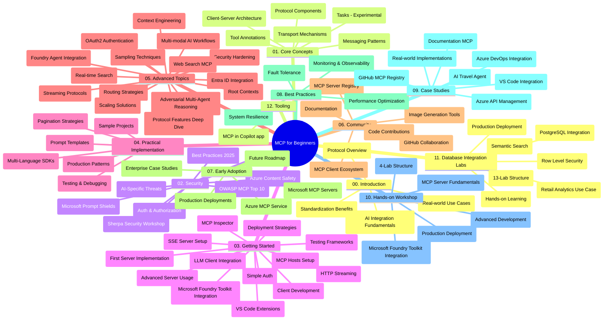

# Model Context Protocol (MCP) para sa mga Nagsisimula - Gabay sa Pag-aaral

Ang gabay sa pag-aaral na ito ay nagbibigay ng pangkalahatang ideya ng istraktura ng repositoryo at nilalaman para sa kurikulum na "Model Context Protocol (MCP) para sa mga Nagsisimula". Gamitin ang gabay na ito upang mag-navigate sa repositoryo nang mahusay at mapakinabangan nang husto ang mga magagamit na mapagkukunan.

## Pangkalahatang-ideya ng Repositoryo

Ang Model Context Protocol (MCP) ay isang pormal na balangkas para sa mga interaksyon sa pagitan ng mga modelo ng AI at mga client application. Orihinal na nilikha ng Anthropic, ngayon ay pinamamahalaan ang MCP ng mas malawak na komunidad ng MCP sa pamamagitan ng opisyal na organisasyon sa GitHub. Ang repositoryo na ito ay naglalaman ng isang komprehensibong kurikulum na may mga praktikal na halimbawa ng code sa C#, Java, JavaScript, Python, at TypeScript, na dinisenyo para sa mga AI developer, arkitekto ng sistema, at mga software engineer.

## Visual Curriculum Map

## Istraktura ng Repositoryo

Ang repositoryo ay inayos sa labindalawang pangunahing seksyon, bawat isa ay nakatuon sa iba't ibang aspeto ng MCP:

1. **Panimula (00-Introduction/)**
   - Pangkalahatang-ideya ng Model Context Protocol
   - Bakit mahalaga ang standardisasyon sa mga AI pipeline
   - Mga praktikal na paggamit at benepisyo

2. **Mga Pangunahing Konsepto (01-CoreConcepts/)**
   - Arkitektura ng client-server
   - Mga pangunahing bahagi ng protocol
   - Mga pattern ng messaging sa MCP
   - Kasalukuyang espesipikasyon: [Ano ang mga Pagbabago sa MCP: Ang 2026-07-28 Espesipikasyon](./01-CoreConcepts/mcp-2026-07-28.md) — ang walang estadong core ng protocol, Extensions framework, at Roots/Sampling/Logging na mga pagtanggal

3. **Seguridad (02-Security/)**
   - Mga banta sa seguridad sa mga sistemang batay sa MCP
   - Mga pinakamahuhusay na gawi para sa pag-secure ng mga implementasyon
   - Mga estratehiya sa authentication at authorization
   - Hands-on [CIMD at DCR authorization sample](./02-Security/samples/cimd-dcr-auth/README.md)
   - **Komprehensibong Dokumentasyon sa Seguridad**:
     - Pinakamahuhusay na Gawi sa Seguridad ng MCP
     - Azure Content Safety Implementation Guide
     - MCP Security Controls and Techniques
     - MCP Best Practices Quick Reference
   - **Mga Pangunahing Paksa sa Seguridad**:
     - Pag-inject ng prompt at mga pag-atake gamit ang tool poisoning
     - Pagkuha ng session at mga problema sa confused deputy
     - Mga kahinaan sa pagpasa ng token
     - Sobrang mga pahintulot at kontrol sa access
     - Seguridad ng supply chain para sa mga bahagi ng AI
     - Integrasyon ng Microsoft Prompt Shields

4. **Pagsisimula (03-GettingStarted/)**
   - Pagsasaayos ng kapaligiran at konfigurasyon
   - Paglikha ng mga pangunahing MCP server at client
   - Integrasyon sa mga umiiral na aplikasyon
   - Kabilang ang mga seksyon para sa:
     - Unang implementasyon ng server
     - Pagbuo ng client
     - Integrasyon ng LLM client
     - Integrasyon sa VS Code
     - Server-Sent Events (SSE) na server
     - Advanced na paggamit ng server
     - HTTP streaming
    - Integrasyon ng Microsoft Foundry Toolkit
     - Mga estratehiya sa testing
     - Mga gabay sa deployment

5. **Praktikal na Implementasyon (04-PracticalImplementation/)**
   - Paggamit ng mga SDK sa iba't ibang lengguwahe ng programming
   - Mga teknik sa debugging, testing, at pag-validate
   - Paglikha ng reusable prompt templates at workflows
   - Mga halimbawa ng proyekto na may mga implementasyon

6. **Mga Advanced na Paksa (05-AdvancedTopics/)**
   - Mga teknik sa context engineering
   - Integrasyon ng foundry agent
   - Multi-modal na AI workflows 
   - Mga demo ng OAuth2 authentication
   - Kakayahan sa real-time na paghahanap
   - Real-time streaming
   - Implementasyon ng root contexts
   - Mga estratehiya sa routing
   - Sampling techniques
   - Mga paraan sa pagpapalawak (scaling)
   - Mga konsiderasyon sa seguridad
   - Integrasyon ng Entra ID security
   - Integrasyon ng web search
   - Adversarial multi-agent reasoning (patterns ng debate)

7. **Mga Kontribusyon ng Komunidad (06-CommunityContributions/)**
   - Paano mag-ambag ng code at dokumentasyon
   - Pakikipagtulungan sa pamamagitan ng GitHub
   - Mga enhancement at feedback na pinapatakbo ng komunidad
   - Paggamit ng iba't ibang MCP client (Claude Desktop, Cline, VSCode)
   - Pakikipagtulungan sa mga sikat na MCP server kabilang ang image generation

8. **Mga Aral mula sa Maagang Pag-ampon (07-LessonsfromEarlyAdoption/)**
   - Mga implementasyon sa totoong mundo at mga kwento ng tagumpay
   - Pagbuo at deployment ng mga MCP-based na solusyon
   - Mga uso at roadmap sa hinaharap
   - **Microsoft MCP Servers Guide**: Komprehensibong gabay sa 10 production-ready Microsoft MCP server kabilang ang:
     - Microsoft Learn Docs MCP Server
     - Azure MCP Server (15+ specialized connectors)
     - GitHub MCP Server
     - Azure DevOps MCP Server
     - MarkItDown MCP Server
     - SQL Server MCP Server
     - Playwright MCP Server
     - Dev Box MCP Server
     - Microsoft Foundry MCP Server
     - Microsoft 365 Agents Toolkit MCP Server

9. **Pinakamahuhusay na Gawi (08-BestPractices/)**
   - Pag-tune ng performance at optimization
   - Disenyo ng fault-tolerant na MCP system
   - Mga estratehiya sa testing at resilience

10. **Mga Case Study (09-CaseStudy/)**
    - **Pitong komprehensibong case study** na nagpapakita ng kakayahan ng MCP sa iba't ibang senaryo:
    - **Azure AI Travel Agents**: Multi-agent orchestration gamit ang Azure OpenAI at AI Search
    - **Integrasyon ng Azure DevOps**: Pag-automate ng workflow processes gamit ang pag-update ng YouTube data
    - **Real-Time na Pagkuha ng Dokumentasyon**: Python console client na may streaming HTTP
    - **Interactive Study Plan Generator**: Chainlit web app na may conversational AI
    - **Dokumentasyon sa In-Editor**: Integrasyon ng VS Code gamit ang GitHub Copilot workflows
    - **Azure API Management**: Enterprise API integration gamit ang paglikha ng MCP server
    - **GitHub MCP Registry**: Development ng ecosystem at agentic integration platform
    - Mga halimbawa ng implementasyon saklaw ang enterprise integration, developer productivity, at development ng ecosystem

11. **Hands-on Workshop (10-StreamliningAIWorkflowsBuildingAnMCPServerWithAIToolkit/)**
    - Komprehensibong hands-on workshop na pinagsasama ang MCP sa Microsoft Foundry Toolkit
    - Pagbuo ng matatalinong aplikasyon na nag-uugnay ng mga AI modelo sa mga totoong gamit
    - Mga praktikal na module na sumasaklaw sa mga pundamental, custom server development, at mga estratehiya para sa production deployment
    - **Istraktura ng Lab**:
      - Lab 1: Mga Pundamental ng MCP Server
      - Lab 2: Advanced MCP Server Development
      - Lab 3: Integrasyon ng Microsoft Foundry Toolkit
      - Lab 4: Production Deployment at Scaling
    - Paraan ng pagkatuto na nakabase sa lab na may mga hakbang-hakbang na panuto

12. **Mga MCP Server Database Integration Labs (11-MCPServerHandsOnLabs/)**
    - **Komprehensibong 13-lab learning path** para sa pagbuo ng production-ready MCP server na may PostgreSQL integration
    - **Implementasyon sa totoong mundo ng retail analytics** gamit ang Zava Retail use case
    - **Mga enterprise-grade na pattern** kabilang ang Row Level Security (RLS), semantic search, at multi-tenant data access
    - **Kumpletong Istraktura ng Lab**:
      - **Labs 00-03: Mga Pundasyon** - Panimula, Arkitektura, Seguridad, Setup ng Kapaligiran
      - **Labs 04-06: Pagbuo ng MCP Server** - Disenyo ng Database, Implementasyon ng MCP Server, Pagbuo ng Tool
      - **Labs 07-09: Mga Advanced na Feature** - Semantic Search, Testing & Debugging, Integrasyon ng VS Code
      - **Labs 10-12: Produksyon at Pinakamahuhusay na Gawi** - Deployment, Pagsubaybay, Optimization
    - **Mga Teknolohiyang Saklaw**: FastMCP framework, PostgreSQL, Azure OpenAI, Azure Container Apps, Application Insights
    - **Mga Resulta ng Pagkatuto**: Production-ready MCP server, mga pattern ng database integration, AI-powered analytics, seguridad sa enterprise

13. **Tooling (12-tooling/)**
    - Matutunan kung paano gamitin ang MCP sa Copilot app at iba pang mga tool

## Karagdagang Mga Mapagkukunan

Kasama sa repositoryo ang mga sumusuportang mapagkukunan:

- **Images folder**: Naglalaman ng mga diagram at ilustrasyon na ginamit sa buong kurikulum
- **Mga Pagsasalin**: Multi-lengguwahe ang suporta na may awtomatikong pagsasalin ng dokumentasyon
- **Opisyal na Mga Mapagkukunan ng MCP**:
  - [Dokumentasyon ng MCP](https://modelcontextprotocol.io/)
  - [Espesipikasyon ng MCP](https://modelcontextprotocol.io/specification/2026-07-28/)
  - [MCP GitHub Repository](https://github.com/modelcontextprotocol)

## Paano Gamitin ang Repositoryong Ito

1. **Sunud-sunod na Pagkatuto**: Sundin ang mga kabanata nang magkakasunod (00 hanggang 11) para sa isang istrukturadong karanasan sa pag-aaral.
2. **Pagtuon sa Tiyak na Lengguwahe**: Kung interesado ka sa isang partikular na programming language, tingnan ang mga sample directory para sa mga implementasyon sa paborito mong wika.
3. **Praktikal na Implementasyon**: Magsimula sa seksyon na "Getting Started" upang isaayos ang iyong kapaligiran at lumikha ng iyong unang MCP server at client.
4. **Mas Malalim na Pagsasaliksik**: Kapag komportable ka na sa mga pangunahing konsepto, sumabak sa mga advanced na paksa upang palawakin ang iyong kaalaman.
5. **Pakikilahok sa Komunidad**: Sumali sa komunidad ng MCP sa pamamagitan ng mga diskusyon sa GitHub at mga channel sa Discord upang makipag-ugnayan sa mga eksperto at kapwa developer.

## Mga MCP Client at Tool

Sinasaklaw ng kurikulum ang iba't ibang MCP client at mga tool:

1. **Opisyal na mga Client**:
   - Visual Studio Code 
   - MCP sa Visual Studio Code
   - Claude Desktop
   - Claude sa VSCode 
   - Claude API

2. **Mga Client ng Komunidad**:
   - Cline (batay sa terminal)
   - Cursor (code editor)
   - ChatMCP
   - Windsurf

3. **Mga Tool sa Pamamahala ng MCP**:
   - MCP CLI
   - MCP Manager
   - MCP Linker
   - MCP Router

## Mga Sikat na MCP Server

Ipinapakilala ng repositoryo ang iba't ibang MCP server, kabilang ang:

1. **Opisyal na Microsoft MCP Server**:
   - Microsoft Learn Docs MCP Server
   - Azure MCP Server (15+ na espesyal na connector)
   - GitHub MCP Server
   - Azure DevOps MCP Server
   - MarkItDown MCP Server
   - SQL Server MCP Server
   - Playwright MCP Server
   - Dev Box MCP Server
   - Microsoft Foundry MCP Server
   - Microsoft 365 Agents Toolkit MCP Server

2. **Opisyal na Reference Server**:
   - Filesystem
   - Fetch
   - Memory
   - Sequential Thinking

3. **Image Generation**:
   - Azure OpenAI DALL-E 3
   - Stable Diffusion WebUI
   - Replicate

4. **Mga Tool sa Pag-develop**:
   - Git MCP
   - Terminal Control
   - Code Assistant

5. **Espesyal na Server**:
   - Salesforce
   - Microsoft Teams
   - Jira & Confluence

## Pag-aambag

Tinatanggap ng repositoryong ito ang mga kontribusyon mula sa komunidad. Tingnan ang seksyong Community Contributions para sa mga gabay kung paano mag-ambag nang epektibo sa ecosystem ng MCP.

----

*Ang gabay na ito sa pag-aaral ay huling na-update noong Setyembre 9, 2026. Ito ay sumasalamin sa MCP
Espesipikasyon `2026-07-28`, ang kasalukuyang bersyon ng protocol. Ang ilang mga hands-on
na halimbawa ay nananatiling may partikular na bersyon sa `2025-11-25` habang ang kanilang mga SDK at tool
ay gumagamit na ng stateless protocol APIs.*

---

<!-- CO-OP TRANSLATOR DISCLAIMER START -->
**Pagtatanggi**:
Ang dokumentong ito ay isinalin gamit ang serbisyo ng AI translation na [Co-op Translator](https://github.com/Azure/co-op-translator). Bagama't nagsusumikap kami para sa katumpakan, pakatandaan na ang awtomatikong pagsasalin ay maaaring maglaman ng mga pagkakamali o hindi pagkakatugma. Ang orihinal na dokumento sa orihinal nitong wika ang dapat ituring na pangunahing sanggunian. Para sa mahahalagang impormasyon, inirerekomenda ang propesyonal na pagsasalin ng tao. Hindi kami mananagot sa anumang maling pagkakaintindi o maling interpretasyon na nagmula sa paggamit ng pagsasaling ito.
<!-- CO-OP TRANSLATOR DISCLAIMER END -->