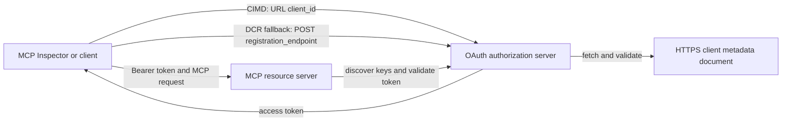

# Ví dụ ủy quyền CIMD và DCR

Ví dụ TypeScript này so sánh hai cách một client OAuth có thể lấy danh tính
trước khi truy cập vào máy chủ MCP được bảo vệ:

- **Tài liệu siêu dữ liệu Client ID (CIMD)** sử dụng một URL HTTPS ổn định làm
  `client_id`. Đây là cơ chế ưu tiên dành cho các client và máy chủ ủy quyền
  không có quan hệ trước đó.
- **Đăng ký Client Động (DCR)** yêu cầu máy chủ ủy quyền phát sinh
  một client ID mờ tại thời gian chạy. MCP `2026-07-28` giữ lại DCR chỉ để tương thích
  ngược.

Mẫu sử dụng MCP TypeScript SDK v2 ổn định và không trạng thái
Mô hình yêu cầu MCP `2026-07-28`. Nó hoạt động với một máy chủ ủy quyền OAuth 2.1/OpenID
Connect bên ngoài như Auth0. Máy chủ MCP là máy chủ tài nguyên:
nó xác thực các token truy cập nhưng không xác thực người dùng hoặc phát hành
token.

## Mục Tiêu Học Tập

Bằng cách hoàn thành mẫu này, bạn sẽ có thể:

- Giải thích tại sao CIMD được ưu tiên hơn DCR cho các client MCP mới.
- Xuất bản một tài liệu CIMD hợp lệ cho một client gốc công khai.
- Cấu hình một máy chủ tài nguyên MCP cho khám phá OAuth và xác thực JWT.
- Thực hành CIMD và DCR với cùng một máy chủ MCP và máy chủ ủy quyền.
- Thực thi một phạm vi OAuth bên trong một công cụ MCP.
- Xác định trách nhiệm thuộc về client, máy chủ tài nguyên, và
  máy chủ ủy quyền.

## Kiến Trúc



Máy chủ ủy quyền lựa chọn và xác thực cơ chế đăng ký.
Máy chủ MCP chỉ thấy tuyên bố `client_id` đã được xác minh kết quả. Một URL HTTPS
có đường dẫn xác định CIMD. Một ID không rõ ràng không đủ để chứng minh DCR vì một
client đã đăng ký trước cũng có thể sử dụng một ID không rõ ràng; cài đặt tùy chọn
`DCR_CLIENT_ID_PREFIX` cung cấp một gợi ý demo cụ thể nhà cung cấp.

## Ưu Tiên Đăng Ký

Các client MCP hỗ trợ mọi cơ chế nên sử dụng thứ tự này:

1. Sử dụng thông tin client đã đăng ký trước khi nó đã có sẵn.
2. Sử dụng CIMD khi máy chủ ủy quyền quảng bá
   `client_id_metadata_document_supported: true`.
3. Chỉ sử dụng DCR như giải pháp dự phòng khi máy chủ quảng bá một
   `registration_endpoint`.
4. Hỏi người dùng thông tin client đã đăng ký trước khi không có điều nào phía trên
   có sẵn.

## Cấu Trúc Dự Án

```text
src/
  config.ts          Environment validation
  dcr.ts             DCR compatibility request
  mcp.ts             MCP tools and scope checks
  oauth.ts           Authorization metadata and JWT verification
  register-dcr.ts    DCR command-line helper
  registration.ts    CIMD document and mechanism classification
  server.ts          Express, OAuth discovery, and MCP endpoint
test/
  dcr.test.ts
  oauth.test.ts
  registration.test.ts
  server.test.ts
```

## Yêu Cầu Trước

- Node.js 20.6 hoặc mới hơn. Các script sử dụng `--env-file` và `--import`.
- Một máy chủ ủy quyền OAuth 2.1/OpenID Connect hỗ trợ:
  - Luồng mã ủy quyền với S256 PKCE.
  - Metadata Tài Nguyên Bảo Vệ OAuth và Chỉ Số Tài Nguyên.
  - JWT token truy cập và một endpoint JWKS.
  - CIMD, cộng với DCR nếu bạn muốn so sánh dự phòng kế thừa.
- MCP Inspector hoặc một client MCP `2026-07-28` khác.
- Một URL HTTPS công khai cho tài liệu CIMD. Một đường hầm phát triển phù hợp
  cho phòng lab; sử dụng một tên miền ổn định trong môi trường sản xuất.

## Cài Đặt và Kiểm Tra

```bash
npm install
npm run build
npm test
```

Mười hai bài kiểm tra sử dụng khóa cục bộ và các endpoint HTTP giả lập. Chúng không yêu cầu
tài khoản máy chủ ủy quyền. Chúng xác minh:

- Hình dạng tài liệu CIMD và ràng buộc URL.
- Phân loại chính xác URL và ID client không rõ ràng.
- Xử lý yêu cầu và phản hồi DCR.
- Từ chối các endpoint DCR không an toàn không phải loopback.
- Xác thực chữ ký JWT, nhà phát hành, đối tượng, thời hạn, ID client và phạm vi.
- Một cuộc gọi MCP `2026-07-28` nội bộ đến `registration-info`.

## Cấu Hình Máy Chủ Ủy Quyền

Tên điều khiển chính xác thay đổi theo nhà cung cấp. Cấu hình các năng lực này:

1. Tạo một API hoặc máy chủ tài nguyên có định danh chính xác khớp với URL MCP
   của bạn, bao gồm `/mcp`, ví dụ như `http://127.0.0.1:3001/mcp`.
2. Sử dụng token truy cập RS256 và bao gồm một tuyên bố `client_id` hoặc `azp`.
3. Thêm quyền hoặc phạm vi `tool:greet`.
4. Bật luồng mã ủy quyền với S256 PKCE cho các ứng dụng gốc công khai.
5. Bật Tài liệu Metadata Client ID.
6. Chỉ để so sánh, bật Đăng ký Động Client.
7. Đảm bảo metadata máy chủ ủy quyền quảng bá:
   - `issuer`
   - `authorization_endpoint`
   - `token_endpoint`
   - `jwks_uri`
   - `client_id_metadata_document_supported: true`
   - `registration_endpoint` khi bật DCR

### Ví dụ Auth0

Đối với Auth0, bật Đăng ký Tài liệu Metadata Client ID, Đăng ký Ứng dụng Động OIDC,
và tính tương thích Tham số Tài nguyên. Tạo một API có định danh là URL MCP chính xác
và thêm quyền `tool:greet`.
Cho phép người dùng thử nghiệm và các client bên thứ ba yêu cầu quyền đó.

Bảng điều khiển nhà cung cấp và tính năng có thể thay đổi theo thời gian. Kiểm tra tài liệu
nhà cung cấp trước khi sử dụng các thiết lập này ngoài phòng thí nghiệm này.

## Cấu hình Mẫu

Tạo `.env` từ ví dụ:

```powershell
Copy-Item .env.example .env
```

Trên shell tương thích bash:

```bash
cp .env.example .env
```

Đặt các giá trị này:

```dotenv
MCP_SERVER_URL=http://127.0.0.1:3001/mcp
AUTHORIZATION_SERVER_ISSUER=https://your-tenant.example.com/
AUTHORIZATION_SERVER_METADATA_URL=https://your-tenant.example.com/.well-known/openid-configuration
CLIENT_METADATA_URL=https://your-public-host.example.com/client-metadata.json
OAUTH_REDIRECT_URIS=http://127.0.0.1:6274/oauth/callback
DCR_CLIENT_ID_PREFIX=tpc_
```

Chi tiết quan trọng:

- `AUTHORIZATION_SERVER_ISSUER` phải khớp chính xác với `issuer` trong metadata
  máy chủ ủy quyền đã phát hiện, bao gồm cả dấu gạch chéo cuối.
- `MCP_SERVER_URL` phải khớp với audience của access token.
- `CLIENT_METADATA_URL` phải sử dụng HTTPS, chứa đường dẫn không phải là gốc,
  và là URL công khai phục vụ tuyến metadata. Các chuỗi truy vấn và đoạn mã
  bị từ chối để tuyến và `client_id` giữ nguyên giống nhau.
- `OAUTH_REDIRECT_URIS` là danh sách trắng phân cách bằng dấu phẩy. Mặc định là MCP
  vòng callback loopback của Inspector.
- `DCR_CLIENT_ID_PREFIX` là tùy chọn và phụ thuộc nhà cung cấp. Để trống nếu nhà cung cấp
  của bạn không có tiền tố DCR đáng tin cậy.

## Xuất bản Tài liệu CIMD

Khởi động một đường hầm chuyển hướng nguồn HTTPS công khai của nó sang `127.0.0.1:3001`.
Đặt `CLIENT_METADATA_URL` thành nguồn đó cộng với `/client-metadata.json`, sau đó chạy:

```bash
npm run build
npm start
```

Xác minh cả hai tài liệu khám phá:

```bash
curl http://127.0.0.1:3001/health
curl http://127.0.0.1:3001/client-metadata.json
curl http://127.0.0.1:3001/.well-known/oauth-protected-resource/mcp
```

`client_id` trả về bởi URL metadata công khai HTTPS phải giống byte-for-byte
với URL đó. Máy chủ ủy quyền phải xác thực tài liệu và
URI chuyển hướng trước khi cấp token.

> [!NOTE]
> Mẫu này lưu trữ tài liệu khách hàng và máy chủ tài nguyên MCP trong một tiến trình
> để giữ phòng thí nghiệm nhỏ gọn. Trong môi trường sản xuất, khách hàng MCP sở hữu
> và lưu trữ tài liệu CIMD của nó riêng biệt với máy chủ tài nguyên.

## So sánh CIMD và DCR

Khởi động MCP Inspector:

```bash
npx @modelcontextprotocol/inspector
```

Sử dụng Streamable HTTP và kết nối tới `http://127.0.0.1:3001/mcp`.

### CIMD (Ưu tiên)

1. Nhập `CLIENT_METADATA_URL` công khai làm OAuth Client ID.
2. Yêu cầu `tool:greet` cùng với mọi phạm vi nhận dạng cần thiết từ nhà cung cấp của bạn.
3. Hoàn thành đăng nhập và đồng ý.
4. Gọi `registration-info`. Nó báo cáo `mechanism: "cimd"`.
5. Gọi `greet` để xác minh việc thực thi phạm vi.

### DCR (Dự phòng tương thích)

1. Xóa trạng thái OAuth đã lưu của Inspector.
2. Để trống OAuth Client ID để Inspector có thể sử dụng
   `registration_endpoint` được quảng bá.
3. Hoàn tất đăng nhập và đồng ý.
4. Gọi `registration-info`.
5. Nếu `DCR_CLIENT_ID_PREFIX` khớp với các ID do nhà cung cấp tạo, công cụ
   sẽ báo cáo `mechanism: "dcr"`; nếu không, nó sẽ báo cáo chính xác
   `opaque-client-id`.

Bạn cũng có thể trình diễn yêu cầu đăng ký trực tiếp:

```bash
npm run build
npm run register:dcr
```

Trợ giúp in ra client ID trả về nhưng không bao giờ in ra client secret.
Xem bất kỳ secret trả về nào như thông tin nhạy cảm và lưu trữ nó trong kho bí mật phù hợp.

## Công cụ

| Công cụ | Phạm vi yêu cầu | Mục đích |
| --- | --- | --- |
| `registration-info` | Client đã xác minh | Báo cáo loại client ID |
| `greet` | `tool:greet` | Trình diễn ủy quyền từng công cụ |

## Ghi chú bảo mật

- Xác thực chữ ký JWT qua điểm cuối JWKS của máy chủ ủy quyền.
- Yêu cầu chính xác khớp với issuer và audience.
- Yêu cầu có expiration và các claim client ID.
- Không bao giờ chấp nhận token được phát hành cho tài nguyên khác.
- Không bao giờ chuyển token MCP sang API phía dưới.
- Giữ các chứng thực DCR gắn với issuer đã tạo chúng.
- Xác thực các URI chuyển hướng CIMD với khớp chính xác.
- Áp dụng kiểm soát SSRF khi máy chủ ủy quyền lấy URL CIMD.
- Sử dụng HTTPS cho các điểm cuối ủy quyền và metadata ngoài phát triển vòng lặp lại.

- Không suy diễn DCR từ client ID mờ nếu nhà cung cấp không tài liệu
  một quy ước định danh đáng tin cậy.

## Tài liệu tham khảo

- [Đặc tả ủy quyền MCP](https://modelcontextprotocol.io/specification/2026-07-28/basic/authorization)
- [Đăng ký client MCP](https://modelcontextprotocol.io/specification/2026-07-28/basic/authorization/client-registration)
- [Thực hành bảo mật MCP tốt nhất](https://modelcontextprotocol.io/specification/2026-07-28/basic/security_best_practices)
- [Hướng dẫn ủy quyền MCP TypeScript SDK v2](https://ts.sdk.modelcontextprotocol.io/v2/serving/authorization)
- [Đăng ký client OAuth Động (RFC 7591)](https://datatracker.ietf.org/doc/html/rfc7591)
- [Bản dự thảo Tài liệu Metadata Client ID OAuth](https://datatracker.ietf.org/doc/html/draft-ietf-oauth-client-id-metadata-document-00)

## Lời cảm ơn

Phương pháp dạy song song được lấy cảm hứng từ
[Sambego/auth0-xmcp-cimd](https://github.com/Sambego/auth0-xmcp-cimd). Mẫu
này là một triển khai gốc, trung lập nhà cung cấp được xây dựng với chính thức
MCP TypeScript SDK v2 cho chương trình học này.

---

<!-- CO-OP TRANSLATOR DISCLAIMER START -->
**Tuyên bố miễn trừ trách nhiệm**:
Tài liệu này đã được dịch bằng dịch vụ dịch thuật AI [Co-op Translator](https://github.com/Azure/co-op-translator). Mặc dù chúng tôi cố gắng đảm bảo độ chính xác, xin lưu ý rằng bản dịch tự động có thể chứa lỗi hoặc sai sót. Tài liệu gốc bằng ngôn ngữ gốc nên được coi là nguồn tin chính thức. Đối với thông tin quan trọng, nên sử dụng dịch vụ dịch thuật chuyên nghiệp bởi con người. Chúng tôi không chịu trách nhiệm về bất kỳ hiểu lầm hoặc giải thích sai nào phát sinh từ việc sử dụng bản dịch này.
<!-- CO-OP TRANSLATOR DISCLAIMER END -->