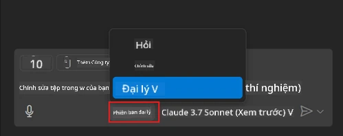
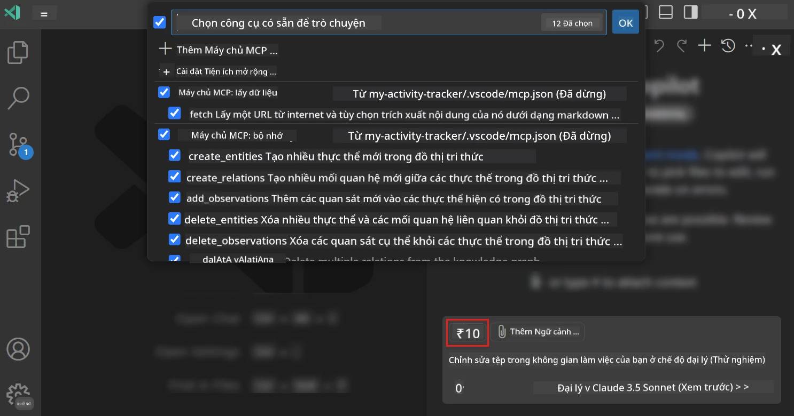
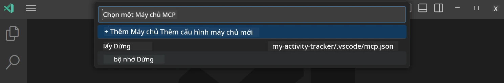
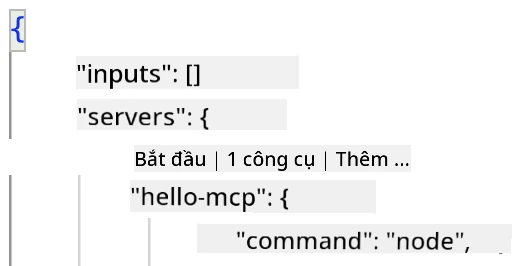
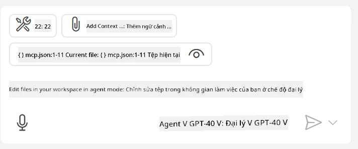
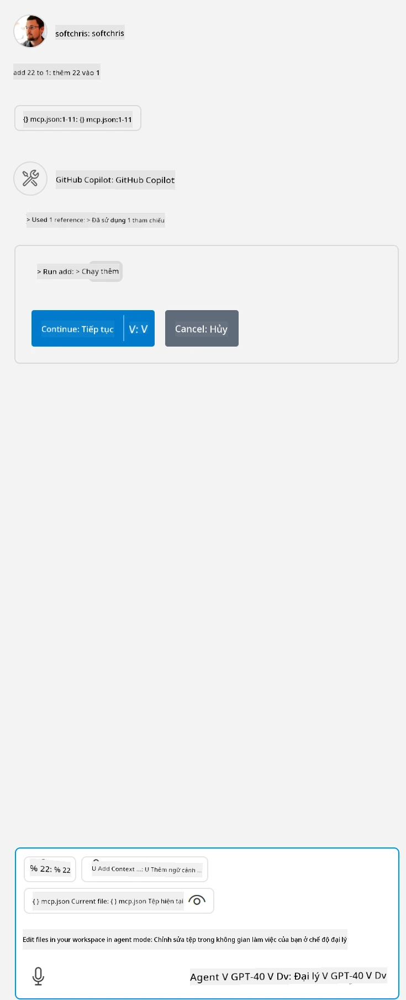

# Sử dụng một server từ chế độ GitHub Copilot Agent

Visual Studio Code và GitHub Copilot có thể hoạt động như một client và sử dụng một MCP Server. Bạn có thể hỏi tại sao chúng ta muốn làm điều đó? Thật ra, điều này có nghĩa là bất kỳ tính năng nào mà MCP Server có bây giờ đều có thể được sử dụng ngay trong IDE của bạn. Hãy tưởng tượng bạn thêm ví dụ như server MCP của GitHub, điều này sẽ cho phép điều khiển GitHub qua các prompt, thay vì phải gõ các lệnh cụ thể trong terminal. Hoặc bạn có thể tưởng tượng bất kỳ điều gì nói chung có thể cải thiện trải nghiệm phát triển của bạn, tất cả được điều khiển bằng ngôn ngữ tự nhiên. Bây giờ bạn bắt đầu thấy lợi ích rồi đúng không?

## Tổng quan

Bài học này hướng dẫn cách sử dụng Visual Studio Code và chế độ Agent của GitHub Copilot như một client cho MCP Server của bạn.

## Mục tiêu học tập

Sau bài học này, bạn sẽ có thể:

- Sử dụng MCP Server qua Visual Studio Code.
- Thực thi các khả năng như công cụ qua GitHub Copilot.
- Cấu hình Visual Studio Code để tìm và quản lý MCP Server của bạn.

## Cách sử dụng

Bạn có thể điều khiển MCP server của mình bằng hai cách khác nhau:

- Giao diện người dùng, bạn sẽ thấy cách thực hiện ở phần sau trong chương này.
- Terminal, có thể điều khiển từ terminal sử dụng `code` thực thi:

  Để thêm một MCP server vào hồ sơ người dùng, sử dụng tùy chọn dòng lệnh --add-mcp, và cung cấp cấu hình server dưới dạng JSON {\"name\":\"server-name\",\"command\":...}.

  ```
  code --add-mcp "{\"name\":\"my-server\",\"command\": \"uvx\",\"args\": [\"mcp-server-fetch\"]}"
  ```

### Ảnh chụp màn hình





Hãy nói thêm về việc sử dụng giao diện hình ảnh trong các phần tiếp theo.

## Cách tiếp cận

Đây là cách chúng ta cần tiếp cận ở mức độ cao:

- Cấu hình một file để tìm MCP Server của chúng ta.
- Khởi động/Kết nối với server đó để lấy danh sách các khả năng của nó.
- Sử dụng các khả năng đó qua giao diện GitHub Copilot Chat.

Tuyệt vời, bây giờ chúng ta đã hiểu quy trình, hãy thử sử dụng MCP Server qua Visual Studio Code qua một bài tập.

## Bài tập: Sử dụng một server

Trong bài tập này, chúng ta sẽ cấu hình Visual Studio Code để tìm MCP server của bạn để nó có thể được sử dụng từ giao diện GitHub Copilot Chat.

### -0- Bước chuẩn bị, bật tìm kiếm MCP Server

Bạn có thể cần bật tính năng tìm kiếm MCP Servers.

1. Truy cập `File -> Preferences -> Settings` trong Visual Studio Code.

1. Tìm kiếm "MCP" và bật `chat.mcp.discovery.enabled` trong file settings.json.

### -1- Tạo file cấu hình

Bắt đầu tạo một file cấu hình trong thư mục gốc dự án của bạn, bạn cần một file tên là MCP.json và đặt nó trong thư mục .vscode. Nó sẽ trông như sau:

```text
.vscode
|-- mcp.json
```

Tiếp theo, hãy xem cách thêm một mục server.

### -2- Cấu hình một server

Thêm nội dung sau vào *mcp.json*:

```json
{
    "inputs": [],
    "servers": {
       "hello-mcp": {
           "command": "node",
           "args": [
               "build/index.js"
           ]
       }
    }
}
```

Đây là một ví dụ đơn giản ở trên về cách khởi động một server viết bằng Node.js, với các runtime khác hãy chỉ định đúng lệnh để khởi động server bằng cách dùng `command` và `args`.

### -3- Khởi động server

Bây giờ bạn đã thêm một mục, hãy khởi động server:

1. Tìm mục của bạn trong *mcp.json* và chắc chắn bạn thấy biểu tượng "play":

    

1. Bấm vào biểu tượng "play", bạn sẽ thấy số lượng công cụ có thể dùng trong GitHub Copilot Chat tăng lên. Nếu bạn bấm vào biểu tượng công cụ đó, bạn sẽ thấy danh sách các công cụ được đăng ký. Bạn có thể chọn hoặc bỏ chọn từng công cụ tùy thuộc bạn muốn GitHub Copilot dùng chúng làm ngữ cảnh hay không:

  

1. Để chạy một công cụ, nhập lệnh mà bạn biết sẽ khớp với mô tả của một công cụ trong danh sách, ví dụ như câu lệnh "add 22 to 1":

  

  Bạn sẽ thấy kết quả trả về là 23.

## Bài tập giao

Hãy thử thêm một mục server vào file *mcp.json* và đảm bảo bạn có thể khởi động/dừng server. Đảm bảo bạn cũng có thể giao tiếp với các công cụ trên server thông qua giao diện GitHub Copilot Chat.

## Giải pháp

[Giải pháp](./solution/README.md)

## Những điểm chính cần ghi nhớ

Những điểm rút ra từ chương này như sau:

- Visual Studio Code là một client tuyệt vời cho phép bạn sử dụng nhiều MCP Servers và công cụ của chúng.
- Giao diện GitHub Copilot Chat là cách bạn tương tác với các server.
- Bạn có thể yêu cầu người dùng nhập dữ liệu như khóa API, có thể truyền cho MCP Server khi cấu hình mục server trong file *mcp.json*.

## Ví dụ mẫu

- [Máy tính Java](../samples/java/calculator/README.md)
- [Máy tính .NET](../../../../03-GettingStarted/samples/csharp)
- [Máy tính JavaScript](../samples/javascript/README.md)
- [Máy tính TypeScript](../samples/typescript/README.md)
- [Máy tính Python](../../../../03-GettingStarted/samples/python)

## Tài nguyên bổ sung

- [Tài liệu Visual Studio](https://code.visualstudio.com/docs/copilot/chat/mcp-servers)

## Tiếp theo là gì

- Tiếp theo: [Tạo một server stdio](../05-stdio-server/README.md)

---

<!-- CO-OP TRANSLATOR DISCLAIMER START -->
**Tuyên bố miễn trừ trách nhiệm**:
Tài liệu này đã được dịch bằng dịch vụ dịch thuật AI [Co-op Translator](https://github.com/Azure/co-op-translator). Mặc dù chúng tôi cố gắng đảm bảo độ chính xác, xin lưu ý rằng bản dịch tự động có thể chứa lỗi hoặc sai sót. Tài liệu gốc bằng ngôn ngữ gốc nên được coi là nguồn tin chính thức. Đối với thông tin quan trọng, nên sử dụng dịch vụ dịch thuật chuyên nghiệp bởi con người. Chúng tôi không chịu trách nhiệm về bất kỳ hiểu lầm hoặc giải thích sai nào phát sinh từ việc sử dụng bản dịch này.
<!-- CO-OP TRANSLATOR DISCLAIMER END -->