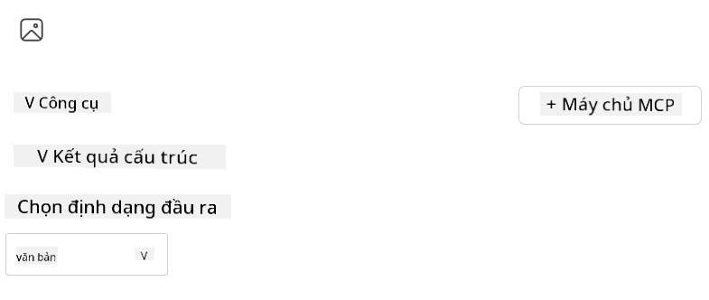
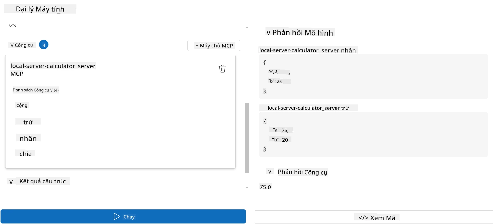

# Sử dụng một máy chủ với Microsoft Foundry Toolkit cho Visual Studio Code

Khi bạn xây dựng một tác nhân AI, không chỉ là tạo ra các phản hồi thông minh; mà còn là cho phép tác nhân của bạn có khả năng thực hiện hành động. Đó là nơi Giao thức Ngữ cảnh Mô hình (MCP) xuất hiện. MCP giúp các tác nhân dễ dàng truy cập các công cụ và dịch vụ bên ngoài theo một cách nhất quán. Hãy tưởng tượng nó như là cắm tác nhân của bạn vào một hộp công cụ mà nó có thể *thực sự* sử dụng.

Giả sử bạn kết nối một tác nhân với máy chủ MCP máy tính của bạn. Đột nhiên, tác nhân của bạn có thể thực hiện các phép toán chỉ bằng cách nhận một lời nhắc như "47 nhân với 89 bằng bao nhiêu?" — không cần phải mã hóa logic cứng nhắc hoặc xây dựng API tùy chỉnh.

## Tổng quan

Bài học này bao gồm cách kết nối một máy chủ MCP máy tính với một tác nhân bằng
[Microsoft Foundry Toolkit cho Visual Studio Code](https://aka.ms/AIToolkit),
cho phép tác nhân của bạn thực hiện các phép toán qua ngôn ngữ tự nhiên.

Microsoft Foundry Toolkit đơn giản hóa việc phát triển và kiểm thử các ứng dụng AI tạo sinh
với các mô hình được lưu trữ cục bộ hoặc trên đám mây.

*Lưu ý*: Bộ công cụ hiện hỗ trợ các mẫu MCP bằng Python và TypeScript.

## Mục tiêu học tập

Đến cuối bài học này, bạn sẽ có thể:

- Tiêu thụ một máy chủ MCP với Microsoft Foundry Toolkit.
- Cấu hình một cấu hình tác nhân để cho phép nó phát hiện và sử dụng các công cụ do máy chủ MCP cung cấp.
- Sử dụng các công cụ MCP qua ngôn ngữ tự nhiên.

## Phương pháp tiếp cận

Đây là cách chúng ta cần tiếp cận ở cấp độ cao:

- Tạo một tác nhân và định nghĩa lời nhắc hệ thống của nó.
- Tạo một máy chủ MCP với các công cụ máy tính.
- Kết nối Trình tạo tác nhân với máy chủ MCP.
- Kiểm thử việc gọi công cụ của tác nhân qua ngôn ngữ tự nhiên.

Tuyệt vời, bây giờ chúng ta đã hiểu quy trình, hãy cấu hình một tác nhân AI để khai thác các công cụ bên ngoài thông qua MCP, nâng cao khả năng của nó!

## Yêu cầu trước

- [Visual Studio Code](https://code.visualstudio.com/)
- [Microsoft Foundry Toolkit cho Visual Studio Code](https://aka.ms/AIToolkit)

## Bài tập: Sử dụng một máy chủ

> [!WARNING]
> Lưu ý cho người dùng macOS. Chúng tôi hiện đang điều tra một sự cố ảnh hưởng đến việc cài đặt phụ thuộc trên macOS. Do đó, người dùng macOS hiện không thể hoàn thành bài hướng dẫn này. Chúng tôi sẽ cập nhật hướng dẫn ngay khi có bản sửa. Cảm ơn bạn đã kiên nhẫn và thông cảm!

Trong bài tập này, bạn sẽ xây dựng, chạy và nâng cao một tác nhân AI với các công cụ từ
một máy chủ MCP bên trong Visual Studio Code bằng Microsoft Foundry Toolkit.

### -0- Bước chuẩn bị, thêm một triển khai Microsoft Foundry GPT-5.1

Tạo một tài nguyên Microsoft Foundry, triển khai **GPT-5.1**, và thêm triển khai này
vào **My Models**. Xem lại
[lịch trình nghỉ hưu mô hình](https://learn.microsoft.com/azure/foundry/openai/concepts/model-retirement-schedule)
khi lựa chọn một triển khai.

1. Mở **Microsoft Foundry Toolkit** từ **Thanh hoạt động (Activity Bar)**.
1. Trong phần **Catalog**, chọn **Models** để mở **Model Catalog**. Việc chọn **Models** mở **Model Catalog** trong một tab soạn thảo mới.
1. Kết nối dự án Microsoft Foundry của bạn và chọn triển khai **GPT-5.1** của bạn.
1. Nhấn **+ Add** để thêm triển khai vào danh sách **My Models**.
1. Trên **Thanh hoạt động (Activity Bar)**, xác nhận rằng triển khai xuất hiện trong danh sách.

### -1- Tạo một tác nhân

**Agent (Prompt) Builder** cho phép bạn tạo và tùy chỉnh các tác nhân AI của riêng bạn. Trong phần này, bạn sẽ tạo một tác nhân mới và gán một mô hình để điều khiển cuộc trò chuyện.

1. Mở **Microsoft Foundry Toolkit** từ **Thanh hoạt động (Activity Bar)**.
1. Trong phần **Tools**, chọn **Agent (Prompt) Builder**. Việc chọn **Agent (Prompt) Builder** mở tab soạn thảo **Agent (Prompt) Builder** mới.
1. Nhấp nút **+ New Agent**. Tiện ích mở rộng sẽ khởi chạy một trình hướng dẫn thiết lập qua **Command Palette**.
1. Nhập tên **Calculator Agent** và nhấn **Enter**.
1. Trong **Agent (Prompt) Builder**, chọn triển khai **GPT-5.1** Foundry của bạn.

### -2- Tạo lời nhắc hệ thống cho tác nhân

Với tác nhân đã được tạo dựng, đã đến lúc xác định cá tính và mục đích của nó. Trong phần này, bạn sẽ sử dụng tính năng **Generate system prompt** để mô tả hành vi dự kiến của tác nhân — trong trường hợp này, là tác nhân máy tính — và để mô hình tự viết lời nhắc hệ thống cho bạn.

1. Trong phần **Prompts**, nhấp nút **Generate system prompt**. Nút này mở trình tạo lời nhắc sử dụng AI để tạo lời nhắc hệ thống cho tác nhân.
1. Trong cửa sổ **Generate a prompt**, nhập nội dung sau: `You are a helpful and efficient math assistant. When given a problem involving basic arithmetic, you respond with the correct result.`
1. Nhấn nút **Generate**. Một thông báo sẽ xuất hiện ở góc phải dưới xác nhận rằng lời nhắc hệ thống đang được tạo. Khi tạo hoàn tất, lời nhắc sẽ xuất hiện trong trường **System prompt** của **Agent (Prompt) Builder**.
1. Xem lại **System prompt** và chỉnh sửa nếu cần thiết.

### -3- Tạo một máy chủ MCP

Bây giờ bạn đã định nghĩa được lời nhắc hệ thống cho tác nhân — hướng dẫn hành vi và phản hồi của nó — đã đến lúc trang bị cho tác nhân các khả năng thiết thực. Trong phần này, bạn sẽ tạo một máy chủ MCP máy tính với các công cụ thực hiện các phép cộng, trừ, nhân, và chia. Máy chủ này sẽ cho phép tác nhân của bạn thực hiện các phép toán thời gian thực khi phản hồi các lời nhắc bằng ngôn ngữ tự nhiên.



Microsoft Foundry Toolkit bao gồm các mẫu để tạo máy chủ MCP. Chúng ta sẽ
sử dụng mẫu Python cho máy chủ MCP máy tính.

*Lưu ý*: Bộ công cụ hiện hỗ trợ các mẫu MCP bằng Python và TypeScript.

1. Trong phần **Tools** của **Agent (Prompt) Builder**, nhấp nút **+ MCP Server**. Tiện ích mở rộng sẽ khởi chạy một trình hướng dẫn qua **Command Palette**.
1. Chọn **+ Add Server**.
1. Chọn **Create a New MCP Server**.
1. Chọn **python-weather** làm mẫu.
1. Chọn **Default folder** để lưu mẫu máy chủ MCP.
1. Nhập tên sau cho máy chủ: **Calculator**
1. Một cửa sổ Visual Studio Code mới sẽ mở. Chọn **Yes, I trust the authors**.
1. Sử dụng terminal (**Terminal** > **New Terminal**), tạo một môi trường ảo: `python -m venv .venv`
1. Sử dụng terminal, kích hoạt môi trường ảo:
    1. Windows - `.venv\Scripts\activate`
    1. macOS/Linux - `source .venv/bin/activate`
1. Sử dụng terminal, cài đặt các phụ thuộc: `pip install -e .[dev]`
1. Trong chế độ xem **Explorer** trên **Thanh hoạt động**, mở rộng thư mục **src** và chọn **server.py** để mở file trong trình soạn thảo.
1. Thay thế mã trong file **server.py** với nội dung sau và lưu lại:

    ```python
    """
    Sample MCP Calculator Server implementation in Python.

    
    This module demonstrates how to create a simple MCP server with calculator tools
    that can perform basic arithmetic operations (add, subtract, multiply, divide).
    """
    
    from mcp.server.fastmcp import FastMCP
    
    server = FastMCP("calculator")
    
    @server.tool()
    def add(a: float, b: float) -> float:
        """Add two numbers together and return the result."""
        return a + b
    
    @server.tool()
    def subtract(a: float, b: float) -> float:
        """Subtract b from a and return the result."""
        return a - b
    
    @server.tool()
    def multiply(a: float, b: float) -> float:
        """Multiply two numbers together and return the result."""
        return a * b
    
    @server.tool()
    def divide(a: float, b: float) -> float:
        """
        Divide a by b and return the result.
        
        Raises:
            ValueError: If b is zero
        """
        if b == 0:
            raise ValueError("Cannot divide by zero")
        return a / b
    ```

### -4- Chạy tác nhân với máy chủ MCP máy tính

Bây giờ tác nhân của bạn đã có công cụ, đã đến lúc sử dụng chúng! Trong phần này, bạn sẽ gửi các lời nhắc đến tác nhân để kiểm thử và xác nhận xem tác nhân có sử dụng công cụ phù hợp từ máy chủ MCP máy tính hay không.



Bạn sẽ chạy máy chủ MCP máy tính trên máy phát triển cục bộ của bạn qua **Agent Builder** như là khách MCP.

1. Nhấn `F5` để bắt đầu gỡ lỗi máy chủ MCP. **Agent (Prompt) Builder** sẽ mở trong một tab soạn thảo mới. Trạng thái của máy chủ hiển thị trên terminal.
1. Trong trường **User prompt** của **Agent (Prompt) Builder**, nhập lời nhắc sau: `I bought 3 items priced at $25 each, and then used a $20 discount. How much did I pay?`
1. Nhấn nút **Run** để tạo phản hồi của tác nhân.
1. Xem xét đầu ra của tác nhân. Mô hình nên kết luận rằng bạn đã trả **$55**.
1. Đây là phân tích những gì nên xảy ra:
    - Tác nhân chọn công cụ **multiply** và **subtract** để hỗ trợ tính toán.
    - Các giá trị `a` và `b` tương ứng được gán cho công cụ **multiply**.
    - Các giá trị `a` và `b` tương ứng được gán cho công cụ **subtract**.
    - Phản hồi từ mỗi công cụ được cung cấp trong phần **Tool Response** tương ứng.
    - Đầu ra cuối cùng từ mô hình được cung cấp trong phần **Model Response** cuối cùng.
1. Gửi các lời nhắc bổ sung để kiểm thử thêm cho tác nhân. Bạn có thể sửa lời nhắc hiện có trong trường **User prompt** bằng cách nhấp vào trường và thay thế lời nhắc hiện tại.
1. Khi bạn hoàn thành việc kiểm thử tác nhân, bạn có thể dừng máy chủ qua **terminal** bằng cách nhập **CTRL/CMD+C** để thoát.

## Bài tập

Hãy thêm một công cụ bổ sung vào file **server.py** của bạn (ví dụ: trả về căn bậc hai của một số). Gửi thêm các lời nhắc yêu cầu tác nhân sử dụng công cụ mới của bạn (hoặc các công cụ hiện có). Hãy chắc chắn khởi động lại máy chủ để load các công cụ mới thêm vào.

## Giải pháp

[Giải pháp](./solution/README.md)

## Những điểm chính

Những điểm rút ra từ chương này bao gồm:

- Microsoft Foundry Toolkit có thể tiêu thụ các máy chủ MCP và các công cụ của chúng.
- Bạn có thể thêm công cụ mới vào máy chủ MCP, mở rộng khả năng của tác nhân để đáp ứng các yêu cầu phát triển.
- Microsoft Foundry Toolkit bao gồm các mẫu máy chủ MCP để tạo công cụ tùy chỉnh.

## Tài nguyên bổ sung

- [Tài liệu Microsoft Foundry Toolkit](https://aka.ms/AIToolkit/doc)

## Tiếp theo
- Tiếp theo: [Kiểm thử & Gỡ lỗi](../08-testing/README.md)

---

<!-- CO-OP TRANSLATOR DISCLAIMER START -->
**Tuyên bố miễn trừ trách nhiệm**:
Tài liệu này đã được dịch bằng dịch vụ dịch thuật AI [Co-op Translator](https://github.com/Azure/co-op-translator). Mặc dù chúng tôi cố gắng đảm bảo độ chính xác, xin lưu ý rằng bản dịch tự động có thể chứa lỗi hoặc sai sót. Tài liệu gốc bằng ngôn ngữ gốc nên được coi là nguồn tin chính thức. Đối với thông tin quan trọng, nên sử dụng dịch vụ dịch thuật chuyên nghiệp bởi con người. Chúng tôi không chịu trách nhiệm về bất kỳ hiểu lầm hoặc giải thích sai nào phát sinh từ việc sử dụng bản dịch này.
<!-- CO-OP TRANSLATOR DISCLAIMER END -->