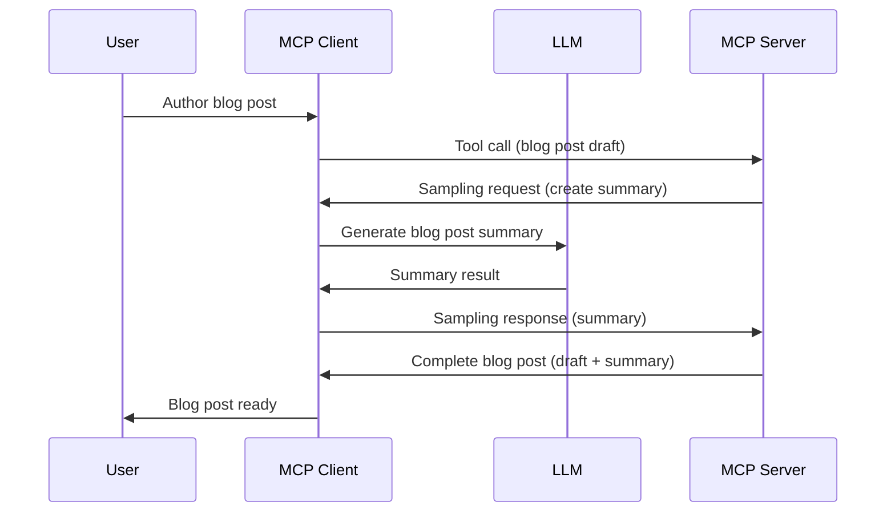

> [!WARNING]
> Việc lấy mẫu đã bị loại bỏ trong MCP `2026-07-28`. Bài học này được giữ lại cho
> các triển khai kế thừa. Các máy chủ mới nên tích hợp trực tiếp với API nhà cung cấp LLM.


> Sampling vẫn còn trong đặc tả `2026-07-28` để tương thích và
> đủ điều kiện để loại bỏ trong bản sửa đổi đầu tiên phát hành vào hoặc sau ngày 28 tháng 7,
> 2027. Các ví dụ trong bài học này có thể sử dụng các API SDK triển khai `2025-11-25`.
> Xem [Có gì thay đổi trong MCP: Đặc tả 2026-07-28](../../01-CoreConcepts/mcp-2026-07-28.md).

Trong các triển khai cũ, Sampling cho phép máy chủ MCP yêu cầu sự trợ giúp từ một LLM
được quản lý bởi khách hàng. Đối với các triển khai mới, thay vào đó hãy gọi trực tiếp nhà cung cấp LLM đã chọn.


Hãy cùng khám phá một số trường hợp sử dụng và cách xây dựng giải pháp liên quan đến sampling.

## Tổng quan

Trong bài học này, chúng ta tập trung giải thích khi nào và ở đâu nên sử dụng Sampling và cách cấu hình nó.

## Mục tiêu học tập

Trong chương này, chúng ta sẽ:

- Giải thích Sampling là gì và khi nào nên sử dụng nó.
- Trình bày cách cấu hình Sampling trong MCP.
- Cung cấp các ví dụ về Sampling trong thực tế.

## Sampling là gì và tại sao sử dụng nó?

Sampling là một tính năng nâng cao hoạt động theo cách sau:



### Yêu cầu sampling

Được rồi, bây giờ chúng ta có cái nhìn tổng quan về một tình huống đáng tin cậy, hãy nói về yêu cầu sampling mà máy chủ gửi lại cho khách hàng. Đây là những gì yêu cầu đó có thể trông như dưới định dạng JSON-RPC:

```json
{
  "jsonrpc": "2.0",
  "id": 1,
  "method": "sampling/createMessage",
  "params": {
    "messages": [
      {
        "role": "user",
        "content": {
          "type": "text",
          "text": "Create a blog post summary of the following blog post: <BLOG POST>"
        }
      }
    ],
    "modelPreferences": {
      "hints": [
        {
          "name": "gpt-5.1"
        }
      ],
      "intelligencePriority": 0.8,
      "speedPriority": 0.5
    },
    "systemPrompt": "You are a helpful assistant.",
    "maxTokens": 100
  }
}
```

Có một vài điểm đáng lưu ý ở đây:

- Prompt, trong content -> text, là prompt của chúng ta, một hướng dẫn cho LLM tóm tắt nội dung bài blog.

- **modelPreferences**. Phần này chỉ đơn thuần là ưu tiên, đề xuất cấu hình nào nên dùng với LLM. Người dùng có thể chọn theo các đề xuất này hoặc thay đổi. Trong trường hợp này có đề xuất về model sử dụng và ưu tiên tốc độ hoặc trí thông minh.
- **systemPrompt**, đây là prompt hệ thống bình thường của bạn cung cấp cho LLM cá tính và chỉ dẫn.
- **maxTokens**, đây là thuộc tính khác dùng để nói số lượng token được đề xuất dùng cho nhiệm vụ này.

### Phản hồi sampling

Phản hồi này là kết quả mà MCP Client gửi lại tới MCP Server, kết quả của việc client gọi LLM, chờ phản hồi rồi tạo tin nhắn này. Dưới đây là cách nó có thể trông như thế dưới dạng JSON-RPC:

```json
{
  "jsonrpc": "2.0",
  "id": 1,
  "result": {
    "role": "assistant",
    "content": {
      "type": "text",
      "text": "Here's your abstract <ABSTRACT>"
    },
    "model": "gpt-5.1",
    "stopReason": "endTurn"
  }
}
```

Phản hồi là một bản tóm tắt của bài blog như yêu cầu. Client
đã chọn triển khai `gpt-5.1` đang hoạt động theo ưu tiên model của server;
ưu tiên model là các đề xuất, vì vậy client có thể chọn triển khai khác đang hoạt động khi cần.


Được rồi, giờ chúng ta đã hiểu luồng chính, và tác vụ hữu ích để sử dụng nó là "tạo bài blog + tóm tắt", hãy xem chúng ta cần làm gì để cho nó hoạt động.

### Các loại tin nhắn

Tin nhắn Sampling không chỉ giới hạn ở văn bản mà bạn cũng có thể gửi hình ảnh và âm thanh. Dưới đây là cách JSON-RPC trông khác nhau:

**Văn bản**

```json
{
  "type": "text",
  "text": "The message content"
}
```

**Nội dung hình ảnh**

```json
{
  "type": "image",
  "data": "base64-encoded-image-data",
  "mimeType": "image/jpeg"
}
```

**Nội dung âm thanh**

```json
{
  "type": "audio",
  "data": "base64-encoded-audio-data",
  "mimeType": "audio/wav"
}
```

> GHI CHÚ: Để biết trạng thái hiện tại và hướng dẫn chuyển đổi, xem
> [tài liệu Sampling đã bị bỏ](https://modelcontextprotocol.io/specification/2026-07-28/client/sampling).

## Cách Cấu Hình Sampling trong Client

> Lưu ý: nếu bạn chỉ xây dựng server, bạn không cần làm nhiều ở đây.

Trong client, bạn cần chỉ định tính năng sau như sau:

```json
{
  "capabilities": {
    "sampling": {}
  }
}
```

Điều này sẽ được xử lý khi client bạn chọn khởi tạo với server.

## Ví dụ về Sampling trong Thực Tiễn - Tạo Bài Viết Blog

Hãy cùng lập trình một server sampling, chúng ta sẽ cần làm các bước sau:

1. Tạo một công cụ trên Server.
1. Công cụ này sẽ tạo một yêu cầu sampling
1. Công cụ phải chờ phản hồi yêu cầu sampling từ client.
1. Sau đó công cụ sẽ trả về kết quả.

Hãy xem mã nguồn từng bước:

### -1- Tạo công cụ

**python**

```python
@mcp.tool()
async def create_blog(title: str, content: str, ctx: Context[ServerSession, None]) -> str:
    """Create a blog post and generate a summary"""

```

### -2- Tạo yêu cầu sampling

Mở rộng công cụ của bạn với đoạn mã sau:

**python**

```python
post = BlogPost(
        id=len(posts) + 1,
        title=title,
        content=content,
        abstract=""
    )

prompt = f"Create an abstract of the following blog post: title: {title} and draft: {content} "

result = await ctx.session.create_message(
        messages=[
            SamplingMessage(
                role="user",
                content=TextContent(type="text", text=prompt),
            )
        ],
        max_tokens=100,
)

```

### -3- Chờ phản hồi và trả phản hồi

**python**

```python
post.abstract = result.content.text

posts.append(post)

# return the complete product
return json.dumps({
    "id": post.title,
    "abstract": post.abstract
})
```

### -4- Mã nguồn hoàn chỉnh

**python**

```python
from starlette.applications import Starlette
from starlette.routing import Mount, Host

from mcp.server.fastmcp import Context, FastMCP

from mcp.server.session import ServerSession
from mcp.types import SamplingMessage, TextContent

import json


from uuid import uuid4
from typing import List
from pydantic import BaseModel


mcp = FastMCP("Blog post generator")

# app = FastAPI()

posts = []

class BlogPost(BaseModel):
    id: int
    title: str
    content: str
    abstract: str

posts: List[BlogPost] = []

@mcp.tool()
async def create_blog(title: str, content: str, ctx: Context[ServerSession, None]) -> str:
    """Create a blog post and generate a summary"""

    post = BlogPost(
        id=len(posts) + 1,
        title=title,
        content=content,
        abstract=""
    )

    prompt = f"Create an abstract of the following blog post: title: {title} and draft: {content} "

    result = await ctx.session.create_message(
        messages=[
            SamplingMessage(
                role="user",
                content=TextContent(type="text", text=prompt),
            )
        ],
        max_tokens=100,
    )

    post.abstract = result.content.text

    posts.append(post)

    # return the complete blog post
    return json.dumps({
        "id": post.title,
        "abstract": post.abstract
    })

if __name__ == "__main__":
    print("Starting server...")
    # mcp.run()
    mcp.run(transport="streamable-http")

# run app with: python server.py
```

### -5- Thử nghiệm trên Visual Studio Code

Để thử nghiệm trên Visual Studio Code, làm theo các bước:

1. Khởi động server trong terminal
1. Thêm nó vào *mcp.json* (và đảm bảo server đã khởi động) ví dụ như sau:

   ```json
   "servers": {
      "blog-server": {
        "type": "http",
        "url": "http://localhost:8000/mcp"
      }
   }
   ```

1. Gõ một prompt:

   ```text
   create a blog post named "Where Python comes from", the content is "Python is actually named after Monty Python Flying Circus"
   ```

1. Cho phép quá trình sampling diễn ra. Lần đầu thử nghiệm, bạn sẽ thấy một hộp thoại bổ sung cần chấp nhận, sau đó sẽ là hộp thoại hỏi bạn có muốn chạy công cụ hay không

1. Kiểm tra kết quả. Bạn sẽ thấy kết quả được hiển thị đẹp trong GitHub Copilot Chat và cũng có thể xem phản hồi JSON thô.

**Thưởng**. Công cụ Visual Studio Code hỗ trợ sampling rất tốt. Bạn có thể cấu hình truy cập Sampling cho server đã cài đặt bằng cách truy cập như sau:

1. Điều hướng đến phần extension.
1. Chọn biểu tượng bánh răng cho server bạn đã cài trong phần "MCP SERVERS - INSTALLED".
1 Chọn "Cấu hình quyền truy cập Model", ở đây bạn có thể chọn các Model mà GitHub Copilot được phép sử dụng khi thực hiện sampling. Bạn cũng có thể xem tất cả các yêu cầu sampling diễn ra gần đây bằng cách chọn "Hiển thị yêu cầu Sampling".

## Bài Tập

Trong bài tập này, bạn sẽ xây dựng một Sampling hơi khác, cụ thể là một tích hợp sampling hỗ trợ tạo mô tả sản phẩm. Đây là kịch bản của bạn:

**Kịch bản**: Nhân viên văn phòng hậu cần của một sàn thương mại điện tử cần trợ giúp, vì mất quá nhiều thời gian để tạo mô tả sản phẩm. Vì vậy, bạn cần xây dựng giải pháp gọi công cụ "create_product" với các đối số "title" và "keywords" và nó sẽ tạo ra sản phẩm hoàn chỉnh bao gồm trường "description" được điền bởi LLM của client.

MẸO: sử dụng những gì bạn đã học trước đó để xây dựng server này và công cụ của nó sử dụng yêu cầu sampling.

## Giải Pháp

[Giải pháp](./solution/README.md)

## Những Điểm Chính

Sampling là một tính năng mạnh mẽ cho phép server phân công nhiệm vụ cho client khi cần sự trợ giúp của LLM.

## Tiếp Theo

- [Chương 4 - Triển khai thực tế](../../04-PracticalImplementation/README.md)

---

<!-- CO-OP TRANSLATOR DISCLAIMER START -->
**Tuyên bố miễn trừ trách nhiệm**:
Tài liệu này đã được dịch bằng dịch vụ dịch thuật AI [Co-op Translator](https://github.com/Azure/co-op-translator). Mặc dù chúng tôi cố gắng đảm bảo độ chính xác, xin lưu ý rằng bản dịch tự động có thể chứa lỗi hoặc sai sót. Tài liệu gốc bằng ngôn ngữ gốc nên được coi là nguồn tin chính thức. Đối với thông tin quan trọng, nên sử dụng dịch vụ dịch thuật chuyên nghiệp bởi con người. Chúng tôi không chịu trách nhiệm về bất kỳ hiểu lầm hoặc giải thích sai nào phát sinh từ việc sử dụng bản dịch này.
<!-- CO-OP TRANSLATOR DISCLAIMER END -->