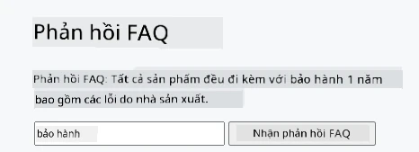
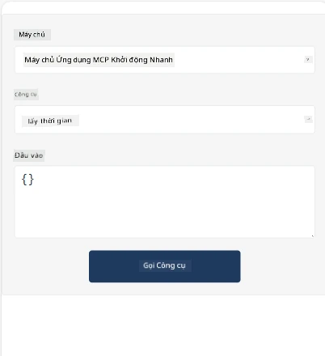
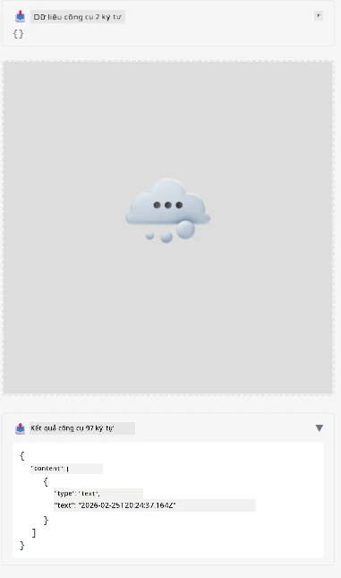

Dưới đây là một ví dụ minh họa MCP App

## Cài đặt

1. Điều hướng đến thư mục *mcp-app*
1. Chạy `npm install`, lệnh này sẽ cài đặt các phụ thuộc frontend và backend

Kiểm tra việc biên dịch backend bằng cách chạy:

```sh
npx tsc --noEmit
```

Sẽ không có đầu ra nếu mọi thứ ổn.

## Chạy backend

> Điều này sẽ phức tạp hơn một chút nếu bạn dùng máy Windows vì giải pháp MCP Apps sử dụng thư viện `concurrently` để chạy mà bạn cần tìm phương án thay thế. Dòng gây sự cố trong *package.json* của MCP App như sau:

```json
"start": "concurrently \"cross-env NODE_ENV=development INPUT=mcp-app.html vite build --watch\" \"tsx watch main.ts\""
```

Ứng dụng này có hai phần, một phần backend và một phần host.

Khởi động backend bằng cách gọi:

```sh
npm start
```

Lệnh này sẽ khởi chạy backend trên `http://localhost:3001/mcp`.

> Lưu ý, nếu bạn đang trong Codespace, bạn có thể cần đặt cổng thành public. Kiểm tra bạn có thể truy cập endpoint qua https://<name của Codespace>.app.github.dev/mcp

## Lựa chọn -1 Kiểm tra ứng dụng trong Visual Studio Code

Để kiểm tra giải pháp trong Visual Studio Code, làm như sau:

- Thêm một mục server vào `mcp.json` như sau:

    ```json
    {
        "servers": {
            "my-mcp-server-7178eca7": {
                "url": "http://localhost:3001/mcp",
                "type": "http"
            }
        },
        "inputs": []
    }
    ```

1. Nhấn nút "start" trong *mcp.json*
1. Đảm bảo cửa sổ chat mở và nhập `get-faq`, bạn sẽ thấy kết quả như sau:

    

## Lựa chọn -2- Kiểm tra ứng dụng với một host

Repo <https://github.com/modelcontextprotocol/ext-apps> chứa nhiều host khác nhau mà bạn có thể sử dụng để kiểm tra các ứng dụng MVP của mình.

Chúng tôi sẽ trình bày hai lựa chọn khác nhau ở đây:

### Máy tính cục bộ

- Điều hướng đến *ext-apps* sau khi bạn đã clone repo.

- Cài đặt các phụ thuộc

   ```sh
   npm install
   ```

- Trong một cửa sổ terminal mới, điều hướng đến *ext-apps/examples/basic-host*

    > Nếu bạn dùng Codespace, bạn cần điều hướng đến serve.ts dòng 27 và thay thế http://localhost:3001/mcp bằng URL Codespace của backend của bạn, ví dụ như https://psychic-xylophone-657rpjgvxpc5g64-3001.app.github.dev/mcp

- Chạy host:

    ```sh
    npm start
    ```

    Lệnh này sẽ kết nối host với backend và bạn sẽ thấy ứng dụng chạy như sau:

    

### Codespace

Cần một chút công sức thêm để thiết lập môi trường Codespace hoạt động. Để sử dụng host thông qua Codespace:

- Xem thư mục *ext-apps* và điều hướng đến *examples/basic-host*.
- Chạy `npm install` để cài đặt các phụ thuộc
- Chạy `npm start` để khởi động host.

## Kiểm tra ứng dụng

Thử ứng dụng theo cách sau:

- Chọn nút "Call Tool" và bạn sẽ thấy kết quả như sau:

    

Tuyệt vời, tất cả đều hoạt động.

---

<!-- CO-OP TRANSLATOR DISCLAIMER START -->
**Tuyên bố miễn trừ trách nhiệm**:
Tài liệu này đã được dịch bằng dịch vụ dịch thuật AI [Co-op Translator](https://github.com/Azure/co-op-translator). Mặc dù chúng tôi cố gắng đảm bảo độ chính xác, xin lưu ý rằng bản dịch tự động có thể chứa lỗi hoặc sai sót. Tài liệu gốc bằng ngôn ngữ gốc nên được coi là nguồn tin chính thức. Đối với thông tin quan trọng, nên sử dụng dịch vụ dịch thuật chuyên nghiệp bởi con người. Chúng tôi không chịu trách nhiệm về bất kỳ hiểu lầm hoặc giải thích sai nào phát sinh từ việc sử dụng bản dịch này.
<!-- CO-OP TRANSLATOR DISCLAIMER END -->