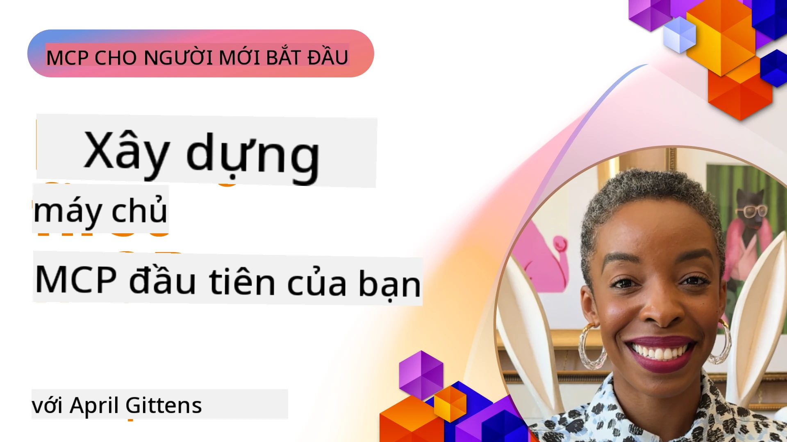

## Bắt đầu  

_(Nhấp vào hình ảnh bên trên để xem video của bài học này)_

Phần này bao gồm một số bài học:

- **1 Máy chủ đầu tiên của bạn**, trong bài học đầu tiên này, bạn sẽ học cách tạo máy chủ đầu tiên của mình và kiểm tra nó với công cụ inspector, một cách hữu ích để kiểm thử và gỡ lỗi máy chủ của bạn, [đến bài học](01-first-server/README.md)

- **2 Client**, trong bài học này, bạn sẽ học cách viết một client có thể kết nối tới máy chủ của bạn, [đến bài học](02-client/README.md)

- **3 Client với LLM**, một cách viết client tốt hơn là thêm LLM để "đàm phán" với máy chủ của bạn về những gì cần làm, [đến bài học](03-llm-client/README.md)

- **4 Sử dụng chế độ GitHub Copilot Agent cho máy chủ trong Visual Studio Code**. Ở đây, chúng ta xem xét việc chạy Máy chủ MCP của mình từ bên trong Visual Studio Code, [đến bài học](04-vscode/README.md)

- **5 Máy chủ giao tiếp stdio** stdio transport là chuẩn được đề xuất cho giao tiếp máy chủ MCP cục bộ với client, cung cấp giao tiếp an toàn dựa trên subprocess với cách ly tiến trình tích hợp sẵn [đến bài học](05-stdio-server/README.md)

- **6 HTTP Streaming với MCP (Streamable HTTP)**. Tìm hiểu về chuẩn giao thức truyền tải từ xa
	trong [Đặc tả MCP 2026-07-28](https://modelcontextprotocol.io/specification/2026-07-28/basic/transports/streamable-http),
	cùng với bản cũ dựa trên phiên được giữ lại trong bài học.
	[đến bài học](06-http-streaming/README.md)

- **7 Sử dụng Bộ công cụ Microsoft Foundry cho Visual Studio Code** để tiêu thụ và kiểm tra các client và server MCP của bạn [trong bài học này](07-aitk/README.md)

- **8 Kiểm thử**. Ở đây chúng ta sẽ tập trung đặc biệt vào cách kiểm thử máy chủ và client ở nhiều cách khác nhau, [đến bài học](08-testing/README.md)

- **9 Triển khai**. Chương này xem xét các cách khác nhau để triển khai các giải pháp MCP của bạn, [đến bài học](09-deployment/README.md)

- **10 Sử dụng máy chủ nâng cao**. Chương này đề cập tới việc sử dụng máy chủ nâng cao, [đến bài học](./10-advanced/README.md)

- **11 Xác thực**. Chương này trình bày cách thêm xác thực đơn giản, từ Basic Auth đến việc sử dụng JWT và RBAC. Bạn được khuyến khích bắt đầu ở đây rồi xem phần Chủ đề nâng cao trong Chương 5 và thực hiện bảo mật thêm theo khuyến nghị trong Chương 2, [đến bài học](./11-simple-auth/README.md)

- **12 MCP Hosts**. Cấu hình và sử dụng các client MCP phổ biến bao gồm Claude Desktop, Cursor, Cline và Windsurf. Tìm hiểu các loại giao thức và cách xử lý sự cố, [đến bài học](./12-mcp-hosts/README.md)

- **13 MCP Inspector**. Gỡ lỗi và kiểm thử các máy chủ MCP của bạn một cách tương tác bằng công cụ MCP Inspector. Tìm hiểu cách xử lý sự cố công cụ, tài nguyên và tin nhắn giao thức, [đến bài học](./13-mcp-inspector/README.md)

- **14 Lấy mẫu**. Tìm hiểu phần tử Lấy mẫu cũ cho `2025-11-25` và
	cách chuyển đổi sang thiết kế mới tích hợp trực tiếp nhà cung cấp LLM. Lấy mẫu
	bị ngừng sử dụng trong MCP `2026-07-28`. [đến bài học](./14-sampling/README.md)

- **15 Ứng dụng MCP**. Xây dựng các Máy chủ MCP còn trả lời với hướng dẫn UI, [đến bài học](./15-mcp-apps/README.md)

Giao thức Model Context Protocol (MCP) là một giao thức mở chuẩn hóa cách các ứng dụng cung cấp ngữ cảnh cho LLM. Hãy nghĩ MCP như một cổng USB-C cho các ứng dụng AI - nó cung cấp một cách chuẩn để kết nối các mô hình AI với các nguồn dữ liệu và công cụ khác nhau.

## Mục tiêu học tập

Đến cuối bài học này, bạn sẽ có thể:

- Thiết lập môi trường phát triển cho MCP trong C#, Java, Python, TypeScript và JavaScript
- Xây dựng và triển khai các máy chủ MCP cơ bản với các tính năng tùy chỉnh (nguồn tài nguyên, lời nhắc và công cụ)
- Tạo ứng dụng host kết nối tới máy chủ MCP
- Kiểm thử và gỡ lỗi các triển khai MCP
- Hiểu các thách thức thường gặp khi thiết lập và cách giải quyết
- Kết nối các triển khai MCP của bạn tới các dịch vụ LLM phổ biến

## Thiết lập môi trường MCP của bạn

Trước khi bắt đầu làm việc với MCP, quan trọng là chuẩn bị môi trường phát triển và hiểu quy trình làm việc cơ bản. Phần này sẽ hướng dẫn bạn qua các bước thiết lập ban đầu để đảm bảo khởi đầu suôn sẻ với MCP.

### Điều kiện tiên quyết

Trước khi bắt đầu phát triển MCP, hãy đảm bảo bạn có:

- **Môi trường phát triển**: cho ngôn ngữ bạn chọn (C#, Java, Python, TypeScript hoặc JavaScript)
- **IDE/Trình soạn thảo**: Visual Studio, Visual Studio Code, IntelliJ, Eclipse, PyCharm hoặc bất kỳ trình soạn thảo mã hiện đại nào
- **Trình quản lý gói**: NuGet, Maven/Gradle, pip hoặc npm/yarn
- **Khóa API**: cho bất kỳ dịch vụ AI nào bạn định sử dụng trong ứng dụng host của mình

### SDK chính thức

Trong các chương sắp tới bạn sẽ thấy các giải pháp được xây dựng bằng Python, TypeScript,
Java và .NET. Dưới đây là các SDK chính thức.

Hỗ trợ SDK cho MCP `2026-07-28` được triển khai độc lập theo từng ngôn ngữ.
Trước khi chạy ví dụ, kiểm tra phiên bản gói và ghi chú phát hành SDK
về các phiên bản sửa đổi giao thức được hỗ trợ. Xem danh sách SDK chính thức tại
[danh sách SDK chính thức](https://modelcontextprotocol.io/docs/sdk):
- [SDK C#](https://github.com/modelcontextprotocol/csharp-sdk) - Duy trì phối hợp cùng Microsoft
- [SDK Java](https://github.com/modelcontextprotocol/java-sdk) - Duy trì phối hợp cùng Spring AI
- [SDK TypeScript](https://github.com/modelcontextprotocol/typescript-sdk) - Triển khai chính thức TypeScript
- [SDK Python](https://github.com/modelcontextprotocol/python-sdk) - Triển khai chính thức Python (FastMCP)
- [SDK Kotlin](https://github.com/modelcontextprotocol/kotlin-sdk) - Triển khai chính thức Kotlin
- [SDK Swift](https://github.com/modelcontextprotocol/swift-sdk) - Duy trì phối hợp cùng Loopwork AI
- [SDK Rust](https://github.com/modelcontextprotocol/rust-sdk) - Triển khai chính thức Rust
- [SDK Go](https://github.com/modelcontextprotocol/go-sdk) - Triển khai chính thức Go

## Những điểm chính cần nhớ

- Việc thiết lập môi trường phát triển MCP rất đơn giản với các SDK chuyên biệt theo ngôn ngữ
- Xây dựng máy chủ MCP liên quan đến việc tạo và đăng ký các công cụ với các sơ đồ rõ ràng
- Client MCP kết nối với các máy chủ và mô hình để tận dụng các khả năng mở rộng
- Kiểm thử và gỡ lỗi là cần thiết để có các triển khai MCP tin cậy
- Các lựa chọn triển khai từ phát triển cục bộ đến giải pháp đám mây

## Thực hành

Chúng tôi có một bộ mẫu bổ sung cho các bài tập bạn sẽ thấy trong tất cả các chương của phần này. Ngoài ra mỗi chương cũng có các bài tập và nhiệm vụ riêng

- [Máy tính Java](./samples/java/calculator/README.md)
- [Máy tính .NET](../../../03-GettingStarted/samples/csharp)
- [Máy tính JavaScript](./samples/javascript/README.md)
- [Máy tính TypeScript](./samples/typescript/README.md)
- [Máy tính Python](../../../03-GettingStarted/samples/python)

## Tài nguyên bổ sung

- [Xây dựng Agents sử dụng Model Context Protocol trên Azure](https://learn.microsoft.com/azure/developer/ai/intro-agents-mcp)
- [MCP từ xa với Azure Container Apps (Node.js/TypeScript/JavaScript)](https://learn.microsoft.com/samples/azure-samples/mcp-container-ts/mcp-container-ts/)
- [Agent MCP OpenAI .NET](https://learn.microsoft.com/samples/azure-samples/openai-mcp-agent-dotnet/openai-mcp-agent-dotnet/)

## Tiếp theo là gì

Bắt đầu với bài học đầu tiên: [Tạo Máy chủ MCP đầu tiên của bạn](01-first-server/README.md)

Sau khi hoàn thành module này, tiếp tục với: [Module 4: Triển khai Thực tế](../04-PracticalImplementation/README.md)

---

<!-- CO-OP TRANSLATOR DISCLAIMER START -->
**Tuyên bố miễn trừ trách nhiệm**:
Tài liệu này đã được dịch bằng dịch vụ dịch thuật AI [Co-op Translator](https://github.com/Azure/co-op-translator). Mặc dù chúng tôi cố gắng đảm bảo độ chính xác, xin lưu ý rằng bản dịch tự động có thể chứa lỗi hoặc sai sót. Tài liệu gốc bằng ngôn ngữ gốc nên được coi là nguồn tin chính thức. Đối với thông tin quan trọng, nên sử dụng dịch vụ dịch thuật chuyên nghiệp bởi con người. Chúng tôi không chịu trách nhiệm về bất kỳ hiểu lầm hoặc giải thích sai nào phát sinh từ việc sử dụng bản dịch này.
<!-- CO-OP TRANSLATOR DISCLAIMER END -->