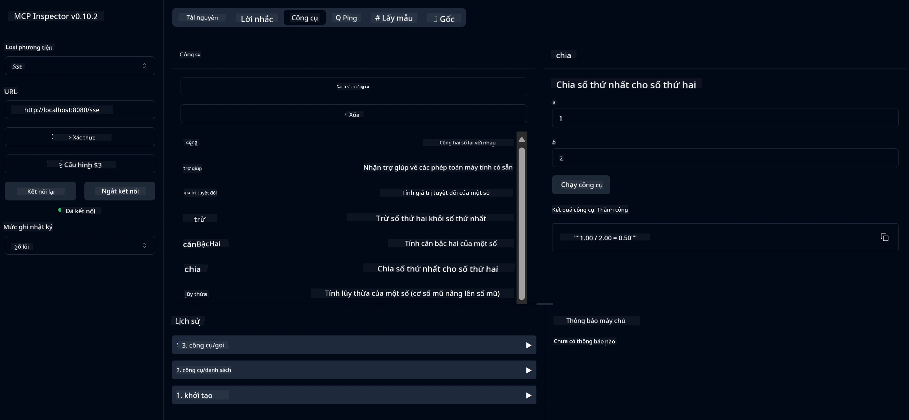

# Dịch vụ Máy tính Cơ bản MCP

> [!NOTE]
> Mẫu này sử dụng giao thức HTTP+SSE cũ và nhắm đến một SDK tương thích
> với MCP `2025-11-25`. Các máy chủ từ xa mới nên sử dụng `2026-07-28` Streamable
> HTTP.

Dịch vụ này cung cấp các phép toán máy tính cơ bản thông qua Giao thức Ngữ cảnh Mô hình (MCP) sử dụng Spring Boot với giao thức WebFlux. Nó được thiết kế như một ví dụ đơn giản dành cho người mới bắt đầu học về các triển khai MCP.

Để biết thêm thông tin, xem tài liệu tham khảo [MCP Server Boot Starter](https://docs.spring.io/spring-ai/reference/api/mcp/mcp-server-boot-starter-docs.html).

## Tổng quan

Dịch vụ trình bày:
- Hỗ trợ SSE (Server-Sent Events)
- Đăng ký công cụ tự động sử dụng chú thích `@Tool` của Spring AI
- Các chức năng máy tính cơ bản:
  - Cộng, trừ, nhân, chia
  - Tính lũy thừa và căn bậc hai
  - Tính dư (modulus) và trị tuyệt đối
  - Chức năng trợ giúp mô tả các phép tính

## Tính năng

Dịch vụ máy tính này cung cấp các khả năng sau:

1. **Các phép toán số học cơ bản**:
   - Cộng hai số
   - Trừ một số từ số khác
   - Nhân hai số
   - Chia một số cho số khác (kiểm tra không chia cho 0)

2. **Các phép toán nâng cao**:
   - Tính lũy thừa (nâng cơ số lên số mũ)
   - Tính căn bậc hai (kiểm tra số âm)
   - Tính phần dư (modulus)
   - Tính trị tuyệt đối

3. **Hệ thống trợ giúp**:
   - Chức năng trợ giúp tích hợp giải thích tất cả các phép toán có sẵn

## Sử dụng Dịch vụ

Dịch vụ cung cấp các điểm cuối API sau thông qua giao thức MCP:

- `add(a, b)`: Cộng hai số
- `subtract(a, b)`: Trừ số thứ hai từ số đầu tiên
- `multiply(a, b)`: Nhân hai số
- `divide(a, b)`: Chia số đầu tiên cho số thứ hai (với kiểm tra số 0)
- `power(base, exponent)`: Tính lũy thừa của một số
- `squareRoot(number)`: Tính căn bậc hai (với kiểm tra số âm)
- `modulus(a, b)`: Tính phần dư khi chia
- `absolute(number)`: Tính trị tuyệt đối
- `help()`: Lấy thông tin về các phép toán có sẵn

## Khách hàng kiểm tra

Một khách hàng kiểm tra đơn giản được bao gồm trong gói `com.microsoft.mcp.sample.client`. Lớp `SampleCalculatorClient` minh họa các phép toán có sẵn của dịch vụ máy tính.

## Sử dụng Khách hàng LangChain4j

Dự án bao gồm một ví dụ khách hàng LangChain4j trong
`com.microsoft.mcp.sample.client.LangChain4jClient` minh họa cách
tích hợp dịch vụ máy tính với mô hình Microsoft Foundry.

### Yêu cầu trước

1. Tạo một tài nguyên Microsoft Foundry và triển khai mô hình hoạt động như
   `gpt-5.1`.
2. Đặt điểm cuối mô hình, khóa API và tên triển khai:

   ```bash
   export AZURE_OPENAI_ENDPOINT="https://<resource-name>.openai.azure.com"
   export AZURE_OPENAI_API_KEY="<api-key>"
   export AZURE_OPENAI_DEPLOYMENT="gpt-5.1"
   ```

3. Kiểm tra
   [lịch nghỉ hưu mô hình Microsoft Foundry](https://learn.microsoft.com/azure/foundry/openai/concepts/model-retirement-schedule)
   trước khi chọn triển khai.
4. Đảm bảo máy chủ máy tính đang chạy trên `localhost:8080`.

### Chạy Khách hàng LangChain4j

Ví dụ này minh họa:
- Kết nối với máy chủ MCP máy tính qua giao thức SSE
- Sử dụng LangChain4j để tạo bot trò chuyện tận dụng các phép tính của máy tính
- Tích hợp với mô hình Microsoft Foundry đã triển khai

Khách hàng gửi các truy vấn mẫu sau để minh họa chức năng:
1. Tính tổng hai số
2. Tìm căn bậc hai của một số
3. Lấy thông tin trợ giúp về các phép toán máy tính có sẵn

Chạy ví dụ và kiểm tra đầu ra trên console để xem cách mô hình AI sử dụng công cụ máy tính để trả lời truy vấn.

### Cấu hình Mô hình Microsoft Foundry

Khách hàng LangChain4j sử dụng điểm cuối tương thích Azure OpenAI v1 được Microsoft Foundry
cung cấp:

```java
String endpoint = System.getenv("AZURE_OPENAI_ENDPOINT");
ChatLanguageModel model = OpenAiOfficialChatModel.builder()
   .baseUrl(endpoint.replaceAll("/+$", "") + "/openai/v1/")
   .apiKey(System.getenv("AZURE_OPENAI_API_KEY"))
   .isAzure(true)
   .modelName(System.getenv().getOrDefault("AZURE_OPENAI_DEPLOYMENT", "gpt-5.1"))
    .timeout(Duration.ofSeconds(60))
    .build();
```

`AZURE_OPENAI_DEPLOYMENT` phải khớp với tên được gán khi mô hình
được triển khai, có thể khác với tên mô hình gốc.

## Các phụ thuộc

Dự án yêu cầu các phụ thuộc chính sau:

```xml
<!-- For MCP Server -->
<dependency>
    <groupId>org.springframework.ai</groupId>
    <artifactId>spring-ai-starter-mcp-server-webflux</artifactId>
</dependency>

<!-- For LangChain4j integration -->
<dependency>
    <groupId>dev.langchain4j</groupId>
    <artifactId>langchain4j-mcp</artifactId>
    <version>${langchain4j.version}</version>
</dependency>

<!-- For Microsoft Foundry's OpenAI-compatible endpoint -->
<dependency>
    <groupId>dev.langchain4j</groupId>
   <artifactId>langchain4j-open-ai-official</artifactId>
    <version>${langchain4j.version}</version>
</dependency>
```

## Xây dựng Dự án

Xây dựng dự án sử dụng Maven:
```bash
./mvnw clean install -DskipTests
```

## Chạy Máy chủ

### Sử dụng Java

```bash
java -jar target/calculator-server-0.0.1-SNAPSHOT.jar
```

### Sử dụng MCP Inspector

MCP Inspector là công cụ hữu ích để tương tác với dịch vụ MCP. Để sử dụng với dịch vụ máy tính này:

1. **Cài đặt và chạy MCP Inspector** trong cửa sổ terminal mới:
   ```bash
   npx @modelcontextprotocol/inspector
   ```

2. **Truy cập giao diện web** bằng cách nhấp vào URL hiển thị bởi ứng dụng (thường là http://localhost:6274)

3. **Cấu hình kết nối**:
   - Đặt loại giao thức là "SSE"
   - Đặt URL đến điểm cuối SSE của máy chủ đang chạy: `http://localhost:8080/sse`
   - Nhấn "Connect"

4. **Sử dụng công cụ**:
   - Nhấn "List Tools" để xem các phép tính máy tính có sẵn
   - Chọn một công cụ và nhấn "Run Tool" để thực hiện phép toán



### Sử dụng Docker

Dự án bao gồm một Dockerfile cho việc triển khai container:

1. **Xây dựng ảnh Docker**:
   ```bash
   docker build -t calculator-mcp-service .
   ```

2. **Chạy container Docker**:
   ```bash
   docker run -p 8080:8080 calculator-mcp-service
   ```

Điều này sẽ:
- Xây dựng ảnh Docker đa giai đoạn với Maven 3.9.9 và Eclipse Temurin 24 JDK
- Tạo ảnh container tối ưu
- Mở cổng dịch vụ trên 8080
- Khởi chạy dịch vụ MCP máy tính bên trong container

Bạn có thể truy cập dịch vụ tại `http://localhost:8080` khi container đang chạy.

## Khắc phục sự cố

### Các sự cố kết nối mô hình phổ biến

1. **Lỗi xác thực**: Xác nhận `AZURE_OPENAI_API_KEY` thuộc về
   tài nguyên được xác định bởi `AZURE_OPENAI_ENDPOINT`.
2. **Không tìm thấy triển khai**: Xác nhận `AZURE_OPENAI_DEPLOYMENT` khớp chính xác
   tên triển khai trong Microsoft Foundry.
3. **Giới hạn tốc độ**: Xem xét hạn mức triển khai và thử lại sau khoảng thời gian
   được dịch vụ trả về.

Để được trợ giúp thêm, xem
[tài liệu LangChain4j](https://github.com/langchain4j/langchain4j) và
[tài liệu Microsoft Foundry](https://learn.microsoft.com/azure/ai-foundry/).

---

<!-- CO-OP TRANSLATOR DISCLAIMER START -->
**Tuyên bố miễn trừ trách nhiệm**:
Tài liệu này đã được dịch bằng dịch vụ dịch thuật AI [Co-op Translator](https://github.com/Azure/co-op-translator). Mặc dù chúng tôi cố gắng đảm bảo độ chính xác, xin lưu ý rằng bản dịch tự động có thể chứa lỗi hoặc sai sót. Tài liệu gốc bằng ngôn ngữ gốc nên được coi là nguồn tin chính thức. Đối với thông tin quan trọng, nên sử dụng dịch vụ dịch thuật chuyên nghiệp bởi con người. Chúng tôi không chịu trách nhiệm về bất kỳ hiểu lầm hoặc giải thích sai nào phát sinh từ việc sử dụng bản dịch này.
<!-- CO-OP TRANSLATOR DISCLAIMER END -->