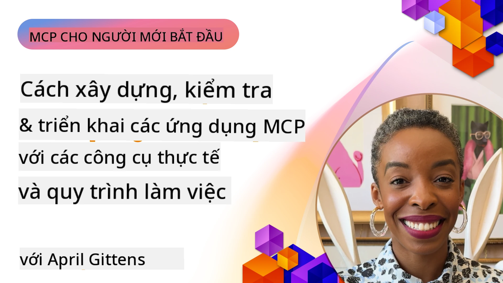
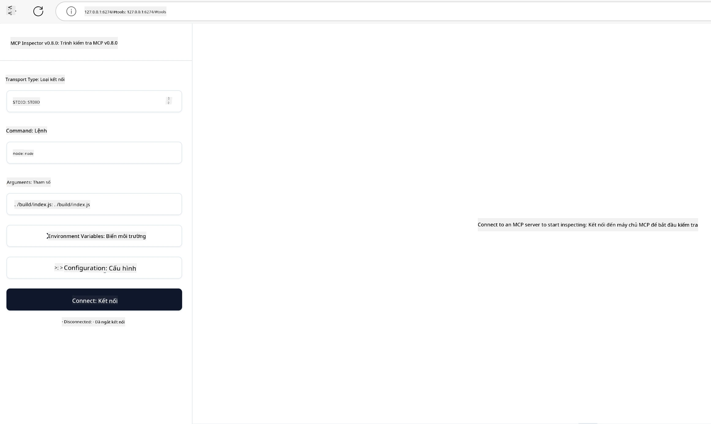

# Triển Khai Thực Tiễn

[](https://youtu.be/vCN9-mKBDfQ)

_(Nhấp vào hình ảnh phía trên để xem video bài học này)_

Triển khai thực tiễn là nơi sức mạnh của Giao Thức Ngữ Cảnh Mô Hình (MCP) trở nên hữu hình. Mặc dù việc hiểu lý thuyết và kiến trúc đằng sau MCP là quan trọng, giá trị thực sự xuất hiện khi bạn áp dụng các khái niệm này để xây dựng, kiểm tra và triển khai các giải pháp giải quyết vấn đề thực tế. Chương này cầu nối khoảng cách giữa kiến thức khái niệm và phát triển thực hành, hướng dẫn bạn qua quá trình đưa các ứng dụng dựa trên MCP vào cuộc sống.

Dù bạn đang phát triển trợ lý thông minh, tích hợp AI vào quy trình công việc kinh doanh, hay xây dựng công cụ tùy chỉnh để xử lý dữ liệu, MCP cung cấp một nền tảng linh hoạt. Thiết kế không phụ thuộc ngôn ngữ và SDK chính thức cho các ngôn ngữ lập trình phổ biến giúp MCP tiếp cận được nhiều nhà phát triển. Bằng cách tận dụng các SDK này, bạn có thể nhanh chóng tạo mẫu, lặp lại và mở rộng giải pháp của mình trên các nền tảng và môi trường khác nhau.

Trong các phần sau, bạn sẽ tìm thấy các ví dụ thực tế, mã mẫu, và chiến lược triển khai thể hiện cách thực hiện MCP trong C#, Java với Spring, TypeScript, JavaScript và Python. Bạn cũng sẽ học cách gỡ lỗi và kiểm tra máy chủ MCP, quản lý API, và triển khai giải pháp lên đám mây bằng Azure. Những tài nguyên thực hành này được thiết kế để tăng tốc quá trình học tập và giúp bạn tự tin xây dựng ứng dụng MCP vững chắc, sẵn sàng cho môi trường sản xuất.

## Tổng Quan

Bài học này tập trung vào các khía cạnh thực tiễn của việc triển khai MCP trên nhiều ngôn ngữ lập trình. Chúng ta sẽ khám phá cách sử dụng các SDK MCP trong C#, Java với Spring, TypeScript, JavaScript và Python để xây dựng ứng dụng vững chắc, gỡ lỗi và kiểm tra máy chủ MCP, và tạo các tài nguyên, lời nhắc và công cụ có thể tái sử dụng.

## Mục Tiêu Học Tập

Khi kết thúc bài học này, bạn sẽ có thể:

- Triển khai giải pháp MCP sử dụng SDK chính thức trong nhiều ngôn ngữ lập trình
- Gỡ lỗi và kiểm tra máy chủ MCP một cách có hệ thống
- Tạo và sử dụng các tính năng của máy chủ (Tài nguyên, Lời nhắc, và Công cụ)
- Thiết kế quy trình công việc MCP hiệu quả cho các tác vụ phức tạp
- Tối ưu hóa triển khai MCP về hiệu suất và độ tin cậy

## Tài Nguyên SDK Chính Thức

Giao Thức Ngữ Cảnh Mô Hình cung cấp các SDK chính thức cho nhiều ngôn ngữ. Hỗ trợ SDK cho MCP `2026-07-28` được phát hành độc lập, vì vậy hãy kiểm tra ghi chú phát hành của từng SDK và phiên bản gói ví dụ trước khi giả định tương thích giao thức. Xem danh sách [SDK chính thức](https://modelcontextprotocol.io/docs/sdk):


- [C# SDK](https://github.com/modelcontextprotocol/csharp-sdk)
- [Java với Spring SDK](https://github.com/modelcontextprotocol/java-sdk) **Lưu ý:** yêu cầu phụ thuộc vào [Project Reactor](https://projectreactor.io). (Xem [vấn đề thảo luận 246](https://github.com/orgs/modelcontextprotocol/discussions/246).)
- [TypeScript SDK](https://github.com/modelcontextprotocol/typescript-sdk)
- [Python SDK](https://github.com/modelcontextprotocol/python-sdk)
- [Kotlin SDK](https://github.com/modelcontextprotocol/kotlin-sdk)
- [Go SDK](https://github.com/modelcontextprotocol/go-sdk)

## Làm việc với MCP SDKs

Phần này cung cấp các ví dụ thực tiễn về việc triển khai MCP trong nhiều ngôn ngữ lập trình khác nhau. Bạn có thể tìm thấy mã mẫu trong thư mục `samples` được tổ chức theo ngôn ngữ.

### Mẫu có sẵn

Kho lưu trữ bao gồm [các triển khai mẫu](../../../04-PracticalImplementation/samples) trong các ngôn ngữ sau:

- [C#](./samples/csharp/README.md)
- [Java với Spring](./samples/java/containerapp/README.md)
- [TypeScript](./samples/typescript/README.md)
- [JavaScript](./samples/javascript/README.md)
- [Python](./samples/python/README.md)

Mỗi ví dụ minh họa các khái niệm chính của MCP và các mẫu triển khai cho ngôn ngữ và hệ sinh thái cụ thể đó.

### Hướng dẫn thực tiễn

Các hướng dẫn bổ sung cho việc triển khai MCP thực tiễn:

- [Phân trang và Bộ kết quả lớn](./pagination/README.md) - Xử lý phân trang dựa trên con trỏ cho công cụ, tài nguyên và bộ dữ liệu lớn

## Tính năng máy chủ cốt lõi

Máy chủ MCP có thể triển khai bất kỳ kết hợp nào của các tính năng này:

### Tài nguyên

Tài nguyên cung cấp ngữ cảnh và dữ liệu cho người dùng hoặc mô hình AI sử dụng:

- Kho lưu trữ tài liệu
- Cơ sở tri thức
- Nguồn dữ liệu có cấu trúc
- Hệ thống tập tin

### Lời nhắc

Lời nhắc là các tin nhắn mẫu và luồng công việc dành cho người dùng:

- Mẫu hội thoại định sẵn
- Mẫu tương tác hướng dẫn
- Cấu trúc đối thoại chuyên biệt

### Công cụ

Công cụ là các hàm cho mô hình AI thực thi:

- Tiện ích xử lý dữ liệu
- Tích hợp API bên ngoài
- Khả năng tính toán
- Chức năng tìm kiếm

## Triển khai mẫu: Triển khai C#

Kho chứa SDK C# chính thức chứa nhiều ví dụ triển khai minh họa các khía cạnh khác nhau của MCP:

- **Khách hàng MCP cơ bản**: Ví dụ đơn giản cho thấy cách tạo một khách hàng MCP và gọi các công cụ
- **Máy chủ MCP cơ bản**: Triển khai máy chủ tối thiểu với đăng ký công cụ cơ bản
- **Máy chủ MCP nâng cao**: Máy chủ đầy đủ tính năng với đăng ký công cụ, xác thực và xử lý lỗi
- **Tích hợp ASP.NET**: Ví dụ minh họa tích hợp với ASP.NET Core
- **Mẫu triển khai công cụ**: Nhiều mẫu khác nhau để triển khai công cụ với các mức độ phức tạp khác nhau

SDK C# MCP đang ở giai đoạn xem trước và API có thể thay đổi. Chúng tôi sẽ liên tục cập nhật blog này khi SDK phát triển.

### Các tính năng chính

- [C# MCP Nuget ModelContextProtocol](https://www.nuget.org/packages/ModelContextProtocol)
- Xây dựng [Máy chủ MCP đầu tiên](https://devblogs.microsoft.com/dotnet/build-a-model-context-protocol-mcp-server-in-csharp/).

Để xem các ví dụ triển khai C# hoàn chỉnh, hãy truy cập [kho chứa mẫu SDK C# chính thức](https://github.com/modelcontextprotocol/csharp-sdk)

## Triển khai mẫu: Triển khai Java với Spring

SDK Java với Spring cung cấp các tùy chọn triển khai MCP mạnh mẽ với các tính năng cấp doanh nghiệp.

### Các tính năng chính

- Tích hợp Spring Framework
- An toàn kiểu dữ liệu mạnh mẽ
- Hỗ trợ lập trình phản ứng
- Xử lý lỗi toàn diện

Để xem ví dụ triển khai Java với Spring đầy đủ, hãy xem [ví dụ Java với Spring](samples/java/containerapp/README.md) trong thư mục mẫu.

## Triển khai mẫu: Triển khai JavaScript

SDK JavaScript cung cấp cách tiếp cận nhẹ và linh hoạt để triển khai MCP.

### Các tính năng chính

- Hỗ trợ Node.js và trình duyệt
- API dựa trên Promise
- Tích hợp dễ dàng với Express và các framework khác
- Hỗ trợ WebSocket cho streaming

Để xem ví dụ triển khai JavaScript đầy đủ, hãy xem [ví dụ JavaScript](samples/javascript/README.md) trong thư mục mẫu.

## Triển khai mẫu: Triển khai Python

SDK Python cung cấp cách tiếp cận Pythonic cho triển khai MCP với tích hợp tuyệt vời các framework ML.

### Các tính năng chính

- Hỗ trợ async/await với asyncio
- Tích hợp FastAPI``
- Đăng ký công cụ đơn giản
- Tích hợp nguyên bản với các thư viện ML phổ biến

Để xem ví dụ triển khai Python đầy đủ, hãy xem [ví dụ Python](samples/python/README.md) trong thư mục mẫu.

## Quản lý API

Azure API Management là một giải pháp tuyệt vời để chúng ta có thể bảo mật các MCP Server. Ý tưởng là đặt một phiên bản Azure API Management trước MCP Server của bạn và để nó xử lý các tính năng bạn có thể muốn như:

- giới hạn tốc độ
- quản lý token
- giám sát
- cân bằng tải
- bảo mật

### Ví dụ Azure

Đây là một ví dụ Azure làm chính xác điều đó, tức là [tạo một MCP Server và bảo mật nó với Azure API Management](https://github.com/Azure-Samples/remote-mcp-apim-functions-python).

Xem cách luồng ủy quyền xảy ra trong hình dưới đây:


Trong hình trên, những điều sau diễn ra:

- Xác thực/Ủy quyền diễn ra bằng Microsoft Entra.
- Azure API Management đóng vai trò như một cổng và sử dụng các chính sách để điều hướng và quản lý lưu lượng.
- Azure Monitor ghi lại tất cả các yêu cầu để phân tích thêm.

#### Luồng ủy quyền

Hãy xem xét luồng ủy quyền chi tiết hơn:


#### Đặc tả ủy quyền MCP

Tìm hiểu thêm về
[Đặc tả Ủy quyền MCP](https://modelcontextprotocol.io/specification/2026-07-28/basic/authorization/).

## Triển khai Remote MCP Server đến Azure

Hãy xem liệu chúng ta có thể triển khai ví dụ đã đề cập trước đó không:

1. Sao chép repo

    ```bash
    git clone https://github.com/Azure-Samples/remote-mcp-apim-functions-python.git
    cd remote-mcp-apim-functions-python
    ```

1. Đăng ký nhà cung cấp tài nguyên `Microsoft.App`.

   - Nếu bạn sử dụng Azure CLI, chạy `az provider register --namespace Microsoft.App --wait`.
   - Nếu bạn sử dụng Azure PowerShell, chạy `Register-AzResourceProvider -ProviderNamespace Microsoft.App`. Sau đó chạy `(Get-AzResourceProvider -ProviderNamespace Microsoft.App).RegistrationState` sau một thời gian để kiểm tra xem đăng ký đã hoàn tất chưa.

1. Chạy lệnh [azd](https://aka.ms/azd) này để cung cấp dịch vụ quản lý api, ứng dụng function (với mã) và tất cả các tài nguyên Azure cần thiết khác

    ```shell
    azd up
    ```

    Lệnh này sẽ triển khai tất cả các tài nguyên đám mây trên Azure

### Kiểm tra server của bạn với MCP Inspector

1. Trong một **cửa sổ terminal mới**, cài đặt và chạy MCP Inspector

    ```shell
    npx @modelcontextprotocol/inspector
    ```

    Bạn sẽ thấy một giao diện tương tự như:

    

1. CTRL click để tải ứng dụng web MCP Inspector từ URL hiện ra bởi ứng dụng (ví dụ [http://127.0.0.1:6274/#resources](http://127.0.0.1:6274/#resources))
1. Đặt loại transport thành `SSE`
1. Đặt URL đến điểm cuối API Management SSE đang chạy của bạn được hiển thị sau `azd up` và **Kết nối**:

    ```shell
    https://<apim-servicename-from-azd-output>.azure-api.net/mcp/sse
    ```

1. **Liệt kê Công cụ**. Nhấp vào công cụ và **Chạy Công cụ**.  

Nếu tất cả các bước đã thực hiện thành công, bạn bây giờ sẽ kết nối được tới MCP server và có thể gọi một công cụ.

## MCP servers cho Azure

[Remote-mcp-functions](https://github.com/Azure-Samples/remote-mcp-functions-dotnet): Bộ kho lưu trữ này là mẫu khởi đầu nhanh cho việc xây dựng và triển khai các máy chủ MCP tùy chỉnh từ xa sử dụng Azure Functions với Python, C# .NET hoặc Node/TypeScript.

Các Ví dụ cung cấp giải pháp hoàn chỉnh cho phép các nhà phát triển:

- Xây dựng và chạy cục bộ: Phát triển và gỡ lỗi MCP server trên máy cục bộ
- Triển khai lên Azure: Dễ dàng triển khai lên đám mây với lệnh azd up đơn giản
- Kết nối từ client: Kết nối tới MCP server từ nhiều client khác nhau bao gồm chế độ Copilot agent của VS Code và công cụ MCP Inspector

### Các tính năng chính

- Bảo mật theo thiết kế: MCP server được bảo mật bằng khóa và HTTPS
- Các tùy chọn xác thực: Hỗ trợ OAuth dùng xác thực tích hợp và/hoặc API Management
- Cách ly mạng: Cho phép cách ly mạng sử dụng Azure Virtual Networks (VNET)
- Kiến trúc Serverless: Tận dụng Azure Functions cho thực thi mở rộng dựa trên sự kiện
- Phát triển cục bộ: Hỗ trợ đầy đủ phát triển và gỡ lỗi cục bộ
- Triển khai đơn giản: Quy trình triển khai tinh gọn đến Azure

Kho lưu trữ bao gồm tất cả các file cấu hình cần thiết, mã nguồn và định nghĩa hạ tầng để nhanh chóng bắt đầu với triển khai MCP server sẵn sàng cho sản xuất.

- [Azure Remote MCP Functions Python](https://github.com/Azure-Samples/remote-mcp-functions-python) - Ví dụ triển khai MCP sử dụng Azure Functions với Python

- [Azure Remote MCP Functions .NET](https://github.com/Azure-Samples/remote-mcp-functions-dotnet) - Ví dụ triển khai MCP sử dụng Azure Functions với C# .NET

- [Azure Remote MCP Functions Node/Typescript](https://github.com/Azure-Samples/remote-mcp-functions-typescript) - Ví dụ triển khai MCP sử dụng Azure Functions với Node/TypeScript.

## Những điểm chính cần ghi nhớ

- MCP SDK cung cấp công cụ đặc thù theo ngôn ngữ để triển khai các giải pháp MCP mạnh mẽ
- Quá trình gỡ lỗi và kiểm thử là rất quan trọng cho các ứng dụng MCP đáng tin cậy
- Mẫu prompt tái sử dụng giúp tương tác AI nhất quán
- Luồng công việc được thiết kế tốt có thể phối hợp các tác vụ phức tạp sử dụng nhiều công cụ
- Triển khai giải pháp MCP cần cân nhắc về bảo mật, hiệu năng và xử lý lỗi

## Bài tập

Thiết kế một luồng công việc MCP thực tiễn giải quyết một vấn đề thực tế trong lĩnh vực của bạn:

1. Xác định 3-4 công cụ sẽ hữu ích cho việc giải quyết vấn đề này
2. Tạo sơ đồ luồng công việc thể hiện cách các công cụ này tương tác
3. Triển khai phiên bản cơ bản của một trong các công cụ sử dụng ngôn ngữ bạn ưa thích
4. Tạo mẫu prompt để giúp mô hình sử dụng công cụ của bạn hiệu quả

## Tài nguyên bổ sung

---

## Tiếp theo là gì

Tiếp theo: [Chủ đề nâng cao](../05-AdvancedTopics/README.md)

---

<!-- CO-OP TRANSLATOR DISCLAIMER START -->
**Tuyên bố miễn trừ trách nhiệm**:
Tài liệu này đã được dịch bằng dịch vụ dịch thuật AI [Co-op Translator](https://github.com/Azure/co-op-translator). Mặc dù chúng tôi cố gắng đảm bảo độ chính xác, xin lưu ý rằng bản dịch tự động có thể chứa lỗi hoặc sai sót. Tài liệu gốc bằng ngôn ngữ gốc nên được coi là nguồn tin chính thức. Đối với thông tin quan trọng, nên sử dụng dịch vụ dịch thuật chuyên nghiệp bởi con người. Chúng tôi không chịu trách nhiệm về bất kỳ hiểu lầm hoặc giải thích sai nào phát sinh từ việc sử dụng bản dịch này.
<!-- CO-OP TRANSLATOR DISCLAIMER END -->