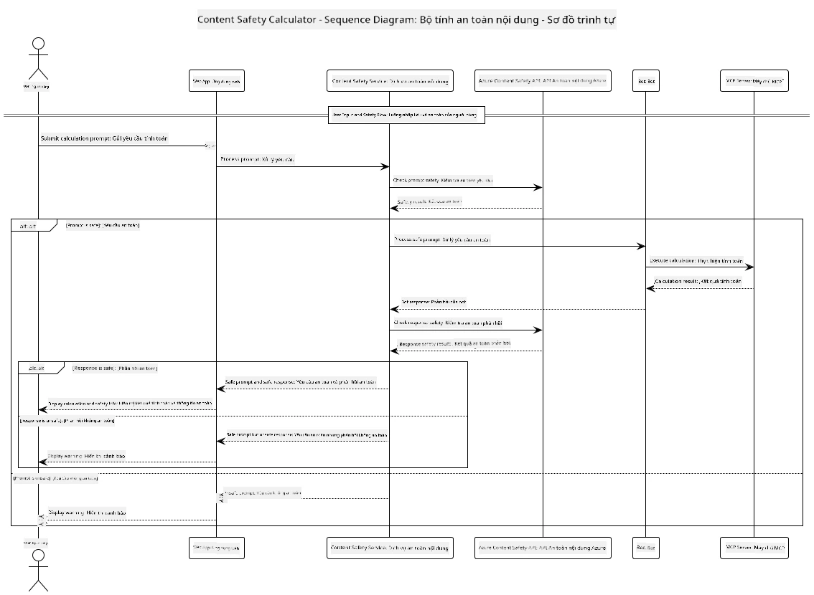

## Kiến trúc Hệ thống

Dự án này trình bày một ứng dụng web sử dụng kiểm tra an toàn nội dung trước khi chuyển các lời nhắc người dùng tới dịch vụ máy tính qua Giao thức Ngữ cảnh Mô hình (MCP).



### Cách Hoạt động

1. **Nhập Liệu Người dùng**: Người dùng nhập lời nhắc tính toán trong giao diện web
2. **Kiểm tra An toàn Nội dung (Đầu vào)**: Lời nhắc được phân tích bởi Azure Content Safety API
3. **Quyết định An toàn (Đầu vào)**:
   - Nếu nội dung an toàn (mức độ nghiêm trọng < 2 ở tất cả các danh mục), nó sẽ được gửi tới máy tính
   - Nếu nội dung bị đánh dấu là có khả năng gây hại, quá trình dừng lại và trả về cảnh báo
4. **Tích hợp Máy tính**: Nội dung an toàn được xử lý bởi LangChain4j, giao tiếp với máy chủ máy tính MCP
5. **Kiểm tra An toàn Nội dung (Đầu ra)**: Phản hồi của bot được phân tích bởi Azure Content Safety API
6. **Quyết định An toàn (Đầu ra)**:
   - Nếu phản hồi của bot an toàn, nó được hiển thị cho người dùng
   - Nếu phản hồi của bot bị đánh dấu là có khả năng gây hại, nó được thay thế bằng cảnh báo
7. **Phản hồi**: Kết quả (nếu an toàn) được hiển thị cho người dùng cùng với cả hai phân tích an toàn

## Sử dụng Giao thức Ngữ cảnh Mô hình (MCP) với Dịch vụ Máy tính

Dự án này trình bày cách sử dụng Giao thức Ngữ cảnh Mô hình (MCP) để gọi dịch vụ máy tính MCP từ LangChain4j. Triển khai sử dụng một máy chủ MCP cục bộ chạy trên cổng 8080 để cung cấp các phép toán máy tính.

### Thiết lập Dịch vụ Azure Content Safety

Trước khi sử dụng các tính năng an toàn nội dung, bạn cần tạo một tài nguyên dịch vụ Azure Content Safety:

1. Đăng nhập vào [Azure Portal](https://portal.azure.com)
2. Nhấn "Create a resource" và tìm kiếm "Content Safety"
3. Chọn "Content Safety" và nhấn "Create"
4. Nhập tên duy nhất cho tài nguyên của bạn
5. Chọn đăng ký và nhóm tài nguyên của bạn (hoặc tạo mới)
6. Chọn khu vực được hỗ trợ (xem [Region availability](https://azure.microsoft.com/en-us/global-infrastructure/services/?products=cognitive-services) để biết chi tiết)
7. Chọn một cấp giá phù hợp
8. Nhấn "Create" để triển khai tài nguyên
9. Khi triển khai hoàn tất, nhấn "Go to resource"
10. Ở bảng bên trái, dưới "Resource Management", chọn "Keys and Endpoint"
11. Sao chép một trong các khóa và URL endpoint để sử dụng ở bước tiếp theo

### Cấu hình Biến Môi trường

Đặt endpoint mô hình Microsoft Foundry, khóa API và tên triển khai:
```sh
export AZURE_OPENAI_ENDPOINT="https://<resource-name>.openai.azure.com"
export AZURE_OPENAI_API_KEY="<api-key>"
export AZURE_OPENAI_DEPLOYMENT="gpt-5.1"
```

Đối với các tính năng an toàn nội dung, cấu hình:
```sh
export CONTENT_SAFETY_ENDPOINT=<your_content_safety_endpoint>
export CONTENT_SAFETY_KEY=<your_content_safety_key>
```

Các biến môi trường này được ứng dụng sử dụng để xác thực với dịch vụ Azure Content Safety. Nếu các biến này không được thiết lập, ứng dụng sẽ dùng giá trị giả để minh họa, nhưng các tính năng an toàn nội dung sẽ không hoạt động đúng.

### Khởi động Máy chủ MCP Máy tính

Trước khi chạy client, bạn cần khởi động máy chủ MCP máy tính ở chế độ SSE trên localhost:8080.

## Mô tả Dự án

Dự án này trình bày tích hợp Giao thức Ngữ cảnh Mô hình (MCP) với LangChain4j để gọi các dịch vụ máy tính. Các tính năng chính bao gồm:

- Sử dụng MCP để kết nối với dịch vụ máy tính cho các phép toán cơ bản
- Kiểm tra an toàn nội dung hai lớp trên lời nhắc người dùng và phản hồi bot
- Tích hợp với mô hình Microsoft Foundry triển khai qua LangChain4j
- Sử dụng Server-Sent Events (SSE) cho truyền tải MCP

## Tích hợp An toàn Nội dung

Dự án bao gồm các tính năng an toàn nội dung toàn diện để đảm bảo cả đầu vào người dùng và phản hồi hệ thống đều không chứa nội dung gây hại:

1. **Kiểm tra Đầu vào**: Tất cả lời nhắc người dùng được phân tích các loại nội dung gây hại như lời nói thù địch, bạo lực, tự làm hại, và nội dung tình dục trước khi xử lý.

2. **Kiểm tra Đầu ra**: Ngay cả khi dùng các mô hình có thể chưa kiểm duyệt, hệ thống cũng kiểm tra tất cả phản hồi được tạo qua bộ lọc an toàn nội dung trước khi hiển thị cho người dùng.

Phương pháp hai lớp này đảm bảo hệ thống luôn an toàn bất kể mô hình AI nào được sử dụng, bảo vệ người dùng khỏi cả đầu vào độc hại và các đầu ra tiềm ẩn vấn đề do AI tạo ra.

## Client Web

Ứng dụng bao gồm giao diện web thân thiện cho phép người dùng tương tác với hệ thống Content Safety Calculator:

### Tính năng Giao diện Web

- Biểu mẫu đơn giản, trực quan để nhập lời nhắc tính toán
- Xác thực an toàn nội dung hai lớp (đầu vào và đầu ra)
- Phản hồi thời gian thực về mức độ an toàn của lời nhắc và phản hồi
- Chỉ báo an toàn có mã màu giúp dễ hiểu
- Thiết kế sạch sẽ, đáp ứng, hoạt động trên nhiều thiết bị
- Ví dụ các lời nhắc an toàn để hướng dẫn người dùng

### Sử dụng Client Web

1. Khởi động ứng dụng:
   ```sh
   mvn spring-boot:run
   ```

2. Mở trình duyệt và điều hướng tới `http://localhost:8087`

3. Nhập lời nhắc tính toán vào ô văn bản có sẵn (ví dụ: "Tính tổng của 24.5 và 17.3")

4. Nhấn "Submit" để xử lý yêu cầu

5. Xem kết quả, bao gồm:
   - Phân tích an toàn nội dung của lời nhắc
   - Kết quả tính toán (nếu lời nhắc an toàn)
   - Phân tích an toàn nội dung của phản hồi của bot
   - Bất kỳ cảnh báo an toàn nào nếu đầu vào hoặc đầu ra bị đánh dấu

Client web tự động xử lý cả hai quy trình xác minh an toàn nội dung, đảm bảo tất cả tương tác đều an toàn và phù hợp bất kể mô hình AI nào đang được sử dụng.

---

<!-- CO-OP TRANSLATOR DISCLAIMER START -->
**Tuyên bố miễn trừ trách nhiệm**:
Tài liệu này đã được dịch bằng dịch vụ dịch thuật AI [Co-op Translator](https://github.com/Azure/co-op-translator). Mặc dù chúng tôi cố gắng đảm bảo độ chính xác, xin lưu ý rằng bản dịch tự động có thể chứa lỗi hoặc sai sót. Tài liệu gốc bằng ngôn ngữ gốc nên được coi là nguồn tin chính thức. Đối với thông tin quan trọng, nên sử dụng dịch vụ dịch thuật chuyên nghiệp bởi con người. Chúng tôi không chịu trách nhiệm về bất kỳ hiểu lầm hoặc giải thích sai nào phát sinh từ việc sử dụng bản dịch này.
<!-- CO-OP TRANSLATOR DISCLAIMER END -->