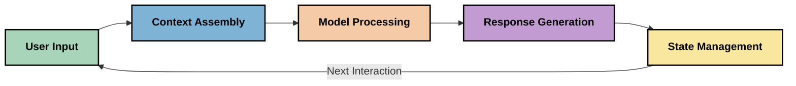
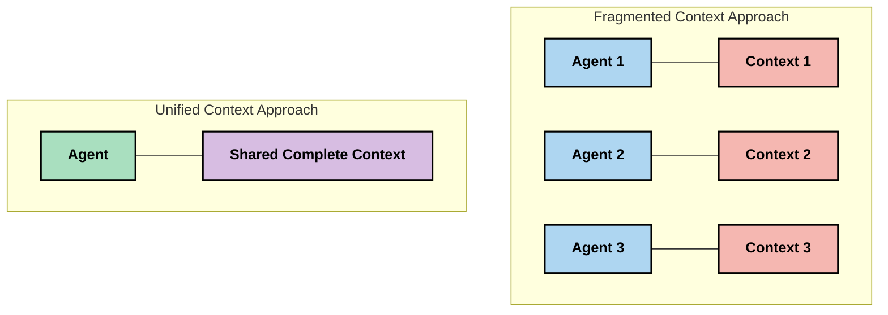
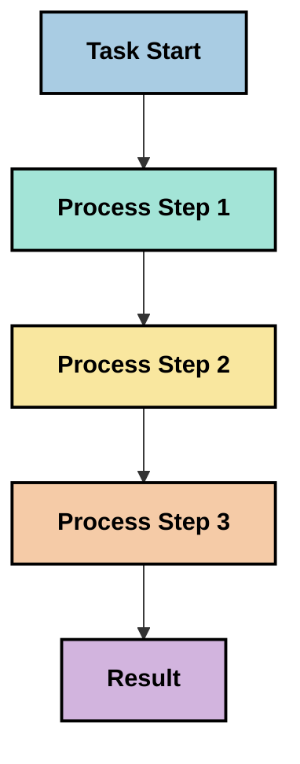
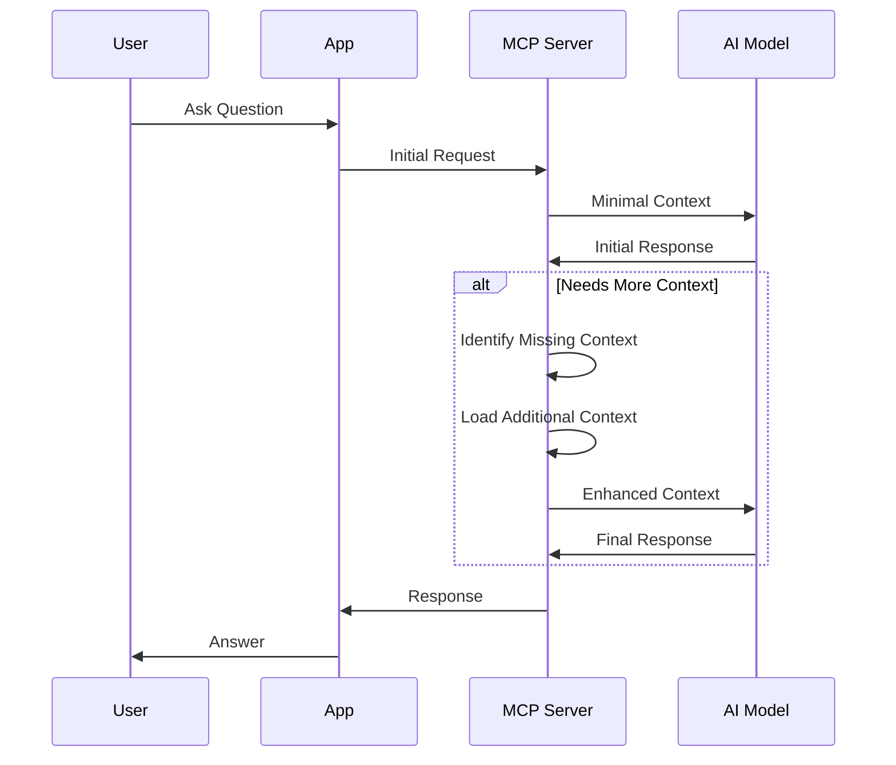
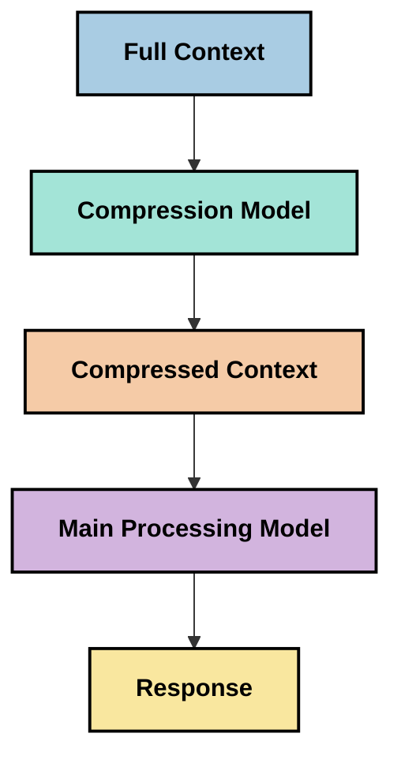
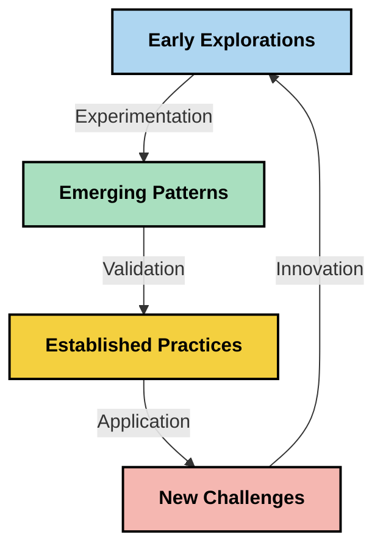

# Kỹ thuật ngữ cảnh: Một Khái niệm Mới nổi trong Hệ sinh thái MCP

## Tổng quan

Kỹ thuật ngữ cảnh là một khái niệm mới nổi trong lĩnh vực AI, khám phá cách thông tin được cấu trúc, truyền đạt và duy trì trong suốt các tương tác giữa khách hàng và dịch vụ AI. Khi hệ sinh thái Model Context Protocol (MCP) phát triển, việc hiểu cách quản lý ngữ cảnh hiệu quả trở nên ngày càng quan trọng. Mô-đun này giới thiệu khái niệm kỹ thuật ngữ cảnh và khám phá các ứng dụng tiềm năng của nó trong các triển khai MCP.

## Mục tiêu học tập

Đến cuối mô-đun này, bạn sẽ có thể:

- Hiểu khái niệm mới nổi về kỹ thuật ngữ cảnh và vai trò tiềm năng của nó trong các ứng dụng MCP
- Xác định các thách thức chính trong quản lý ngữ cảnh mà thiết kế giao thức MCP giải quyết
- Khám phá các kỹ thuật cải thiện hiệu suất mô hình thông qua xử lý ngữ cảnh tốt hơn
- Xem xét các phương pháp đo lường và đánh giá hiệu quả ngữ cảnh
- Áp dụng các khái niệm mới nổi này để cải thiện trải nghiệm AI thông qua khung MCP

## Giới thiệu về Kỹ thuật ngữ cảnh

Kỹ thuật ngữ cảnh là một khái niệm mới nổi tập trung vào thiết kế và quản lý có chủ đích luồng thông tin giữa người dùng, ứng dụng và các mô hình AI. Khác với các lĩnh vực đã được thiết lập như kỹ thuật prompt, kỹ thuật ngữ cảnh vẫn đang được các nhà thực hành định nghĩa khi họ nỗ lực giải quyết những thách thức đặc thù trong việc cung cấp cho các mô hình AI thông tin đúng lúc, đúng chỗ.

Khi các mô hình ngôn ngữ lớn (LLMs) phát triển, tầm quan trọng của ngữ cảnh trở nên ngày càng rõ ràng. Chất lượng, tính liên quan và cấu trúc của ngữ cảnh chúng ta cung cấp ảnh hưởng trực tiếp đến kết quả của mô hình. Kỹ thuật ngữ cảnh khám phá mối quan hệ này và tìm cách phát triển các nguyên tắc quản lý ngữ cảnh hiệu quả.

> "Vào năm 2025, các mô hình ngoài kia rất thông minh. Nhưng ngay cả con người thông minh nhất cũng không thể làm việc hiệu quả mà không có ngữ cảnh về những gì họ được yêu cầu làm... 'Kỹ thuật ngữ cảnh' là cấp độ tiếp theo của kỹ thuật prompt. Nó là việc thực hiện điều này một cách tự động trong một hệ thống động." — Walden Yan, Cognition AI

Kỹ thuật ngữ cảnh có thể bao gồm:

1. **Lựa chọn ngữ cảnh**: Xác định thông tin nào liên quan cho một nhiệm vụ cụ thể
2. **Cấu trúc ngữ cảnh**: Tổ chức thông tin nhằm tối đa hóa sự hiểu biết của mô hình
3. **Truyền đạt ngữ cảnh**: Tối ưu hóa cách thức và thời điểm thông tin được gửi đến các mô hình
4. **Duy trì ngữ cảnh**: Quản lý trạng thái và sự tiến hóa của ngữ cảnh theo thời gian
5. **Đánh giá ngữ cảnh**: Đo lường và cải thiện hiệu quả của ngữ cảnh

Những lĩnh vực tập trung này đặc biệt liên quan đến hệ sinh thái MCP, vốn cung cấp một phương thức tiêu chuẩn để các ứng dụng truyền ngữ cảnh đến LLM.


## Góc nhìn về Hành trình Ngữ cảnh

Một cách để hình dung kỹ thuật ngữ cảnh là theo dõi hành trình thông tin đi qua một hệ thống MCP:



### Các giai đoạn chính trong Hành trình Ngữ cảnh:

1. **Dữ liệu đầu vào của người dùng**: Thông tin thô từ người dùng (văn bản, hình ảnh, tài liệu)
2. **Tập hợp ngữ cảnh**: Kết hợp đầu vào của người dùng với ngữ cảnh hệ thống, lịch sử hội thoại và các thông tin truy xuất khác
3. **Xử lý mô hình**: Mô hình AI xử lý ngữ cảnh đã được tập hợp
4. **Tạo phản hồi**: Mô hình tạo đầu ra dựa trên ngữ cảnh được cung cấp
5. **Quản lý trạng thái**: Hệ thống cập nhật trạng thái nội bộ dựa trên tương tác

Góc nhìn này làm nổi bật tính động của ngữ cảnh trong các hệ thống AI và đặt ra các câu hỏi quan trọng về cách quản lý thông tin tốt nhất ở mỗi giai đoạn.

## Các nguyên tắc mới nổi trong Kỹ thuật ngữ cảnh

Khi lĩnh vực kỹ thuật ngữ cảnh hình thành, một số nguyên tắc đầu tiên đang xuất hiện từ các nhà thực hành. Những nguyên tắc này có thể giúp định hướng các lựa chọn triển khai MCP:

### Nguyên tắc 1: Chia sẻ ngữ cảnh một cách đầy đủ

Ngữ cảnh nên được chia sẻ đầy đủ giữa tất cả các thành phần của một hệ thống thay vì phân mảnh qua nhiều tác tử hoặc quy trình. Khi ngữ cảnh bị phân tán, các quyết định được đưa ra ở một phần của hệ thống có thể mâu thuẫn với các quyết định ở phần khác.



Trong các ứng dụng MCP, điều này gợi ý thiết kế các hệ thống nơi ngữ cảnh chảy mượt mà qua toàn bộ chuỗi thay vì bị ngăn cách từng phần.

### Nguyên tắc 2: Nhận biết rằng hành động chứa quyết định ngầm định

Mỗi hành động mà mô hình thực hiện đều mang theo những quyết định ngầm về cách diễn giải ngữ cảnh. Khi nhiều thành phần hành động trên các ngữ cảnh khác nhau, các quyết định ngầm này có thể xung đột, dẫn đến kết quả không nhất quán.

Nguyên tắc này có hàm ý quan trọng đối với các ứng dụng MCP:
- Ưu tiên xử lý tuần tự các tác vụ phức tạp hơn là thực thi song song với ngữ cảnh phân mảnh
- Đảm bảo tất cả các điểm quyết định đều có truy cập cùng một thông tin ngữ cảnh
- Thiết kế hệ thống sao cho các bước sau có thể xem toàn bộ ngữ cảnh của các quyết định trước đó

### Nguyên tắc 3: Cân bằng độ sâu ngữ cảnh với các giới hạn cửa sổ

Khi các cuộc hội thoại và quy trình kéo dài, cửa sổ ngữ cảnh cuối cùng sẽ bị tràn. Kỹ thuật ngữ cảnh hiệu quả khám phá các cách tiếp cận để quản lý sự mâu thuẫn giữa ngữ cảnh toàn diện và các giới hạn kỹ thuật.

Các phương pháp tiềm năng đang được tìm hiểu gồm:
- Nén ngữ cảnh giữ lại thông tin quan trọng đồng thời giảm việc sử dụng token
- Tải ngữ cảnh theo tiến trình dựa trên mức độ liên quan với nhu cầu hiện tại
- Tóm tắt các tương tác trước đây trong khi giữ lại các quyết định và sự kiện chính

## Thách thức về ngữ cảnh và Thiết kế Giao thức MCP

Model Context Protocol (MCP) được thiết kế với nhận thức về các thách thức đặc thù trong quản lý ngữ cảnh. Hiểu những thách thức này giúp giải thích các khía cạnh chính của thiết kế giao thức MCP:


### Thách thức 1: Giới hạn cửa sổ ngữ cảnh
Hầu hết các mô hình AI có kích thước cửa sổ ngữ cảnh cố định, giới hạn lượng thông tin chúng có thể xử lý cùng một lúc.

**Phản hồi Thiết kế MCP:** 
- Giao thức hỗ trợ ngữ cảnh cấu trúc dựa trên tài nguyên có thể được tham chiếu hiệu quả
- Tài nguyên có thể được phân trang và tải theo tiến trình

### Thách thức 2: Xác định mức độ liên quan
Xác định thông tin nào là quan trọng nhất để đưa vào ngữ cảnh là điều khó khăn.

**Phản hồi Thiết kế MCP:**
- Công cụ linh hoạt cho phép truy xuất thông tin một cách động tùy theo nhu cầu
- Các prompt cấu trúc giúp tổ chức ngữ cảnh nhất quán

### Thách thức 3: Duy trì ngữ cảnh
Quản lý trạng thái qua các tương tác đòi hỏi theo dõi ngữ cảnh một cách cẩn thận.

**Phản hồi Thiết kế MCP:**
- Quản lý phiên chuẩn hóa
- Mẫu tương tác được định nghĩa rõ ràng cho sự tiến hóa ngữ cảnh

### Thách thức 4: Ngữ cảnh đa phương tiện
Các loại dữ liệu khác nhau (văn bản, hình ảnh, dữ liệu cấu trúc) đòi hỏi cách xử lý khác nhau.

**Phản hồi Thiết kế MCP:**
- Thiết kế giao thức phù hợp với nhiều loại nội dung
- Đại diện chuẩn hóa cho thông tin đa phương tiện

### Thách thức 5: An toàn và Bảo mật
Ngữ cảnh thường chứa thông tin nhạy cảm cần được bảo vệ.

**Phản hồi Thiết kế MCP:**
- Ranh giới rõ ràng giữa trách nhiệm của khách hàng và máy chủ
- Tùy chọn xử lý cục bộ để giảm thiểu việc phơi bày dữ liệu

Việc hiểu các thách thức này và cách MCP giải quyết chúng cung cấp nền tảng để khám phá các kỹ thuật kỹ thuật ngữ cảnh nâng cao hơn.

## Các phương pháp mới nổi trong kỹ thuật ngữ cảnh

Khi lĩnh vực kỹ thuật ngữ cảnh phát triển, một số phương pháp hứa hẹn đang xuất hiện. Đây là tư duy hiện tại hơn là thực hành đã được thiết lập, và có thể thay đổi khi chúng ta có nhiều kinh nghiệm hơn với các triển khai MCP.

### 1. Xử lý tuần tự đơn luồng

Khác với kiến trúc đa tác tử phân phối ngữ cảnh, một số nhà thực hành nhận thấy rằng xử lý tuần tự đơn luồng tạo ra kết quả nhất quán hơn. Điều này phù hợp với nguyên tắc duy trì ngữ cảnh thống nhất.



Mặc dù cách tiếp cận này có vẻ kém hiệu quả hơn xử lý đồng thời, nhưng nó thường tạo ra kết quả mạch lạc và đáng tin cậy hơn vì mỗi bước dựa trên sự hiểu biết đầy đủ các quyết định trước đó.

### 2. Phân mảnh và ưu tiên ngữ cảnh

Chia ngữ cảnh lớn thành các phần quản lý được và ưu tiên những phần quan trọng nhất.

```python
# Conceptual Example: Context Chunking and Prioritization
def process_with_chunked_context(documents, query):
    # 1. Break documents into smaller chunks
    chunks = chunk_documents(documents)
    
    # 2. Calculate relevance scores for each chunk
    scored_chunks = [(chunk, calculate_relevance(chunk, query)) for chunk in chunks]
    
    # 3. Sort chunks by relevance score
    sorted_chunks = sorted(scored_chunks, key=lambda x: x[1], reverse=True)
    
    # 4. Use the most relevant chunks as context
    context = create_context_from_chunks([chunk for chunk, score in sorted_chunks[:5]])
    
    # 5. Process with the prioritized context
    return generate_response(context, query)
```

Khái niệm trên minh họa cách chúng ta có thể chia các tài liệu lớn thành các phần dễ quản lý và chỉ chọn những phần liên quan nhất cho ngữ cảnh. Cách tiếp cận này giúp làm việc trong giới hạn cửa sổ ngữ cảnh trong khi vẫn tận dụng được các cơ sở tri thức lớn.

### 3. Tải ngữ cảnh theo tiến trình

Tải ngữ cảnh dần dần theo nhu cầu thay vì tải toàn bộ cùng một lúc.



Tải ngữ cảnh tiến trình bắt đầu với ngữ cảnh tối thiểu và mở rộng chỉ khi cần thiết. Điều này có thể giảm đáng kể việc sử dụng token cho các truy vấn đơn giản trong khi vẫn giữ khả năng xử lý các câu hỏi phức tạp.

### 4. Nén và tóm tắt ngữ cảnh

Giảm kích thước ngữ cảnh trong khi giữ lại thông tin cần thiết.



Nén ngữ cảnh tập trung vào:
- Loại bỏ thông tin trùng lặp
- Tóm tắt nội dung dài dòng
- Trích xuất các sự kiện và chi tiết chính
- Bảo toàn các yếu tố ngữ cảnh quan trọng
- Tối ưu hóa cho hiệu quả sử dụng token

Cách tiếp cận này đặc biệt có giá trị trong việc duy trì các cuộc hội thoại dài trong cửa sổ ngữ cảnh hoặc xử lý các tài liệu lớn một cách hiệu quả. Một số nhà thực hành sử dụng các mô hình chuyên biệt để nén và tóm tắt lịch sử hội thoại.


## Các cân nhắc thăm dò kỹ thuật ngữ cảnh

Khi chúng ta khám phá lĩnh vực kỹ thuật ngữ cảnh mới nổi, có một số cân nhắc đáng lưu ý khi làm việc với các triển khai MCP. Đây không phải là các thực hành tốt nhất có tính bắt buộc mà là các lĩnh vực khám phá có thể đem lại cải tiến cho trường hợp sử dụng cụ thể của bạn.

### Xem xét mục tiêu ngữ cảnh của bạn

Trước khi triển khai các giải pháp quản lý ngữ cảnh phức tạp, hãy xác định rõ ràng những gì bạn muốn đạt được:
- Mô hình cần thông tin cụ thể nào để thành công?
- Thông tin nào là thiết yếu, thông tin nào là bổ sung?
- Ràng buộc về hiệu suất của bạn là gì (độ trễ, giới hạn token, chi phí)?

### Khám phá các phương pháp ngữ cảnh theo lớp

Một số nhà thực hành thành công với ngữ cảnh được bố trí theo các lớp khái niệm:
- **Lớp cốt lõi**: Thông tin thiết yếu mà mô hình luôn cần
- **Lớp tình huống**: Ngữ cảnh cụ thể cho tương tác hiện tại
- **Lớp hỗ trợ**: Thông tin bổ sung có thể hữu ích
- **Lớp dự phòng**: Thông tin chỉ truy cập khi cần thiết

### Nghiên cứu các chiến lược truy xuất

Hiệu quả của ngữ cảnh của bạn thường phụ thuộc vào cách bạn truy xuất thông tin:
- Tìm kiếm ngữ nghĩa và embedding để tìm thông tin có ý nghĩa liên quan
- Tìm kiếm dựa trên từ khóa cho các chi tiết thực tế cụ thể
- Phương pháp kết hợp đa dạng với nhiều phương pháp truy xuất
- Lọc metadata để thu hẹp phạm vi theo danh mục, ngày tháng hoặc nguồn

### Thử nghiệm với tính mạch lạc của ngữ cảnh

Cấu trúc và dòng chảy của ngữ cảnh có thể ảnh hưởng đến việc mô hình hiểu:
- Gom nhóm các thông tin liên quan với nhau
- Sử dụng định dạng và tổ chức nhất quán
- Duy trì thứ tự logic hoặc theo trình tự thời gian khi thích hợp
- Tránh thông tin mâu thuẫn

### Cân nhắc các đánh đổi trong kiến trúc đa tác tử

Mặc dù kiến trúc đa tác tử phổ biến trong nhiều khung AI, chúng đi kèm với những thách thức lớn trong quản lý ngữ cảnh:
- Phân mảnh ngữ cảnh có thể dẫn đến quyết định không đồng nhất giữa các tác tử
- Xử lý song song có thể gây ra tranh chấp khó giải quyết
- Chi phí giao tiếp giữa các tác tử có thể bù đắp lợi ích hiệu suất
- Quản lý trạng thái phức tạp để duy trì tính mạch lạc

Trong nhiều trường hợp, cách tiếp cận đơn tác tử với quản lý ngữ cảnh toàn diện có thể tạo ra kết quả đáng tin cậy hơn so với nhiều tác tử chuyên biệt với ngữ cảnh phân mảnh.

### Phát triển phương pháp đánh giá

Để cải thiện kỹ thuật ngữ cảnh theo thời gian, hãy cân nhắc cách bạn sẽ đo lường thành công:
- Thử nghiệm A/B các cấu trúc ngữ cảnh khác nhau
- Theo dõi việc sử dụng token và thời gian phản hồi
- Giám sát sự hài lòng của người dùng và tỷ lệ hoàn thành nhiệm vụ
- Phân tích khi nào và tại sao các chiến lược ngữ cảnh thất bại

Những cân nhắc này là các lĩnh vực khám phá tích cực trong không gian kỹ thuật ngữ cảnh. Khi lĩnh vực trưởng thành, các mẫu và thực hành rõ ràng hơn nhiều khả năng sẽ xuất hiện.

## Đo lường hiệu quả ngữ cảnh: Một khung phát triển

Khi kỹ thuật ngữ cảnh được định hình như một khái niệm, các nhà thực hành bắt đầu khám phá cách chúng ta có thể đo lường hiệu quả của nó. Hiện chưa có khung làm việc chính thức, nhưng nhiều chỉ số đang được xem xét có thể giúp định hướng công việc tương lai.

### Các chiều đo tiềm năng


#### 1. Cân nhắc hiệu quả đầu vào

- **Tỷ lệ Ngữ cảnh đến Phản hồi**: Cần bao nhiêu ngữ cảnh so với kích thước phản hồi?
- **Sử dụng Token**: Bao nhiêu phần trăm token ngữ cảnh được cho là ảnh hưởng tới phản hồi?
- **Giảm ngữ cảnh**: Chúng ta có thể nén thông tin thô hiệu quả đến mức nào?

#### 2. Cân nhắc hiệu suất

- **Tác động độ trễ**: Quản lý ngữ cảnh ảnh hưởng thế nào đến thời gian phản hồi?
- **Tối ưu token**: Chúng ta có tối ưu hóa việc sử dụng token hiệu quả không?
- **Độ chính xác truy xuất**: Thông tin truy xuất có liên quan đến đâu?
- **Sử dụng tài nguyên**: Yêu cầu tài nguyên tính toán ra sao?

#### 3. Cân nhắc chất lượng

- **Tính liên quan của phản hồi**: Phản hồi có trả lời đúng câu hỏi không?
- **Độ chính xác thực tế**: Quản lý ngữ cảnh có cải thiện độ chính xác của thông tin không?
- **Tính nhất quán**: Phản hồi có nhất quán với các truy vấn tương tự không?
- **Tỷ lệ ảo giác**: Ngữ cảnh tốt có giảm các ảo giác của mô hình không?

#### 4. Cân nhắc trải nghiệm người dùng

- **Tỷ lệ hỏi lại**: Người dùng cần làm rõ bao nhiêu lần?
- **Hoàn thành nhiệm vụ**: Người dùng có thực hiện xong mục tiêu không?
- **Chỉ số hài lòng**: Người dùng đánh giá trải nghiệm ra sao?

### Các phương pháp thăm dò để đo lường

Khi thử nghiệm kỹ thuật ngữ cảnh trong các triển khai MCP, hãy cân nhắc các phương pháp thăm dò sau:

1. **So sánh cơ bản**: Thiết lập tiêu chuẩn cơ bản với các cách tiếp cận ngữ cảnh đơn giản trước khi thử nghiệm các phương pháp phức tạp hơn

2. **Thay đổi tăng dần**: Thay đổi từng khía cạnh quản lý ngữ cảnh một để tách biệt tác động của nó

3. **Đánh giá tập trung vào người dùng**: Kết hợp số liệu định lượng với phản hồi định tính của người dùng

4. **Phân tích thất bại**: Nghiên cứu các trường hợp chiến lược ngữ cảnh thất bại để hiểu những cải tiến tiềm năng

5. **Đánh giá đa chiều**: Cân nhắc những đánh đổi giữa hiệu quả, chất lượng và trải nghiệm người dùng

Cách tiếp cận thử nghiệm đa khía cạnh này phù hợp với tính chất mới nổi của kỹ thuật ngữ cảnh.

## Những suy nghĩ kết luận

Kỹ thuật ngữ cảnh là một lĩnh vực khám phá mới nổi có thể trở thành trung tâm cho các ứng dụng MCP hiệu quả. Bằng cách suy nghĩ thấu đáo về cách thông tin chảy qua hệ thống của bạn, bạn có thể tạo ra trải nghiệm AI hiệu quả hơn, chính xác hơn và hữu ích hơn đối với người dùng.

Các kỹ thuật và phương pháp được trình bày trong mô-đun này đại diện cho tư duy ban đầu trong lĩnh vực này, chưa phải là các thực hành đã được thiết lập. Kỹ thuật ngữ cảnh có thể phát triển thành một lĩnh vực chuyên định rõ ràng hơn khi khả năng AI tiến bộ và sự hiểu biết của chúng ta sâu sắc hơn. Hiện tại, thử nghiệm kết hợp với đo lường cẩn thận có vẻ là phương pháp hiệu quả nhất.

## Các hướng phát triển tương lai tiềm năng

Lĩnh vực kỹ thuật ngữ cảnh vẫn còn sơ khai, nhưng một số hướng phát triển đầy hứa hẹn đang nổi lên:

- Các nguyên tắc kỹ thuật ngữ cảnh có thể ảnh hưởng đáng kể đến hiệu suất mô hình, hiệu quả, trải nghiệm người dùng và độ tin cậy
- Các cách tiếp cận đơn luồng với quản lý ngữ cảnh toàn diện có thể vượt trội kiến trúc đa tác tử trong nhiều trường hợp
- Các mô hình nén ngữ cảnh chuyên biệt có thể trở thành thành phần tiêu chuẩn trong các pipeline AI
- Sự mâu thuẫn giữa độ đầy đủ ngữ cảnh và giới hạn token sẽ thúc đẩy đổi mới trong xử lý ngữ cảnh
- Khi các mô hình ngày càng có khả năng giao tiếp hiệu quả giống con người, cộng tác đa tác tử thực sự có thể khả thi hơn
- Các triển khai MCP có thể phát triển để chuẩn hóa các mẫu quản lý ngữ cảnh xuất phát từ các thử nghiệm hiện nay



## Tài nguyên

### Tài nguyên MCP chính thức
- [Trang web Model Context Protocol](https://modelcontextprotocol.io/)
- [Thông số kỹ thuật Model Context Protocol](https://github.com/modelcontextprotocol/modelcontextprotocol)
- [Tài liệu MCP](https://modelcontextprotocol.io/docs)
- [Bộ SDK MCP C#](https://github.com/modelcontextprotocol/csharp-sdk)
- [Bộ SDK MCP Python](https://github.com/modelcontextprotocol/python-sdk)
- [Bộ SDK MCP TypeScript](https://github.com/modelcontextprotocol/typescript-sdk)
- [MCP Inspector](https://github.com/modelcontextprotocol/inspector) - Công cụ kiểm thử trực quan cho các máy chủ MCP

### Bài viết Kỹ thuật Ngữ cảnh
- [Đừng xây dựng đa đại lý: Nguyên tắc của Kỹ thuật Ngữ cảnh](https://cognition.ai/blog/dont-build-multi-agents) - Những hiểu biết của Walden Yan về nguyên tắc kỹ thuật ngữ cảnh
- [Hướng dẫn thực tiễn xây dựng đại lý](https://cdn.openai.com/business-guides-and-resources/a-practical-guide-to-building-agents.pdf) - Hướng dẫn của OpenAI về thiết kế đại lý hiệu quả
- [Xây dựng đại lý hiệu quả](https://www.anthropic.com/engineering/building-effective-agents) - Phương pháp của Anthropic trong phát triển đại lý

### Nghiên cứu liên quan
- [Tăng cường truy xuất năng động cho Mô hình Ngôn ngữ Lớn](https://arxiv.org/abs/2310.01487) - Nghiên cứu về phương pháp truy xuất năng động
- [Lạc trong phần giữa: Cách các mô hình ngôn ngữ sử dụng ngữ cảnh dài](https://arxiv.org/abs/2307.03172) - Nghiên cứu quan trọng về các mẫu xử lý ngữ cảnh
- [Tạo hình ảnh theo văn bản phân cấp với CLIP Latents](https://arxiv.org/abs/2204.06125) - Bài báo DALL-E 2 với những hiểu biết về cấu trúc ngữ cảnh
- [Khám phá vai trò của ngữ cảnh trong kiến trúc Mô hình Ngôn ngữ Lớn](https://aclanthology.org/2023.findings-emnlp.124/) - Nghiên cứu gần đây về xử lý ngữ cảnh
- [Hợp tác đa đại lý: Tổng quan](https://arxiv.org/abs/2304.03442) - Nghiên cứu về hệ thống đa đại lý và những thách thức của chúng

### Tài nguyên bổ sung
- [Kỹ thuật tối ưu hóa cửa sổ ngữ cảnh](https://learn.microsoft.com/en-us/azure/ai-services/openai/concepts/context-window)
- [Kỹ thuật nâng cao RAG](https://www.microsoft.com/en-us/research/blog/retrieval-augmented-generation-rag-and-frontier-models/)
- [Tài liệu Semantic Kernel](https://github.com/microsoft/semantic-kernel)
- [Microsoft Foundry Toolkit cho Visual Studio Code](https://github.com/microsoft/vscode-ai-toolkit)

## Tiếp theo là gì

- [5.15 MCP Custom Transport](../mcp-transport/README.md)

---

<!-- CO-OP TRANSLATOR DISCLAIMER START -->
**Tuyên bố miễn trừ trách nhiệm**:
Tài liệu này đã được dịch bằng dịch vụ dịch thuật AI [Co-op Translator](https://github.com/Azure/co-op-translator). Mặc dù chúng tôi cố gắng đảm bảo độ chính xác, xin lưu ý rằng bản dịch tự động có thể chứa lỗi hoặc sai sót. Tài liệu gốc bằng ngôn ngữ gốc nên được coi là nguồn tin chính thức. Đối với thông tin quan trọng, nên sử dụng dịch vụ dịch thuật chuyên nghiệp bởi con người. Chúng tôi không chịu trách nhiệm về bất kỳ hiểu lầm hoặc giải thích sai nào phát sinh từ việc sử dụng bản dịch này.
<!-- CO-OP TRANSLATOR DISCLAIMER END -->